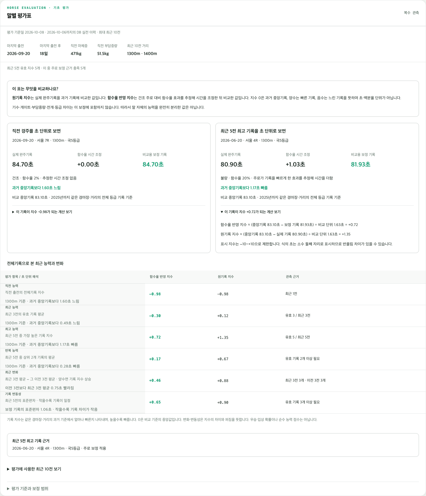
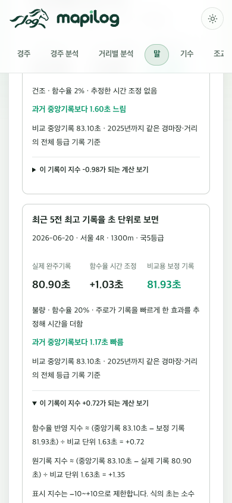

# 말별 기초 평가표 웹 연결 v1

서울·부산 말 상세페이지 `/horses/{KRA 마번}`에 말별 평가표를 추가했다.
기존 DB 이력을 조회해 계산하며, 평가값을 DB에 저장하거나 운영 예측 모델을 변경하지 않는다.
제주마에는 더러브렛 지수를 표시하지 않는다.

## 표시 항목

| 항목 | 정의 |
|---|---|
| 직전 능력 | 직전 실제 출전의 전체기록 지수 |
| 최근 능력 | 최근 3전의 유효 지수 평균 |
| 최고 능력 | 최근 5전의 최고 지수 및 해당 경주 링크 |
| 반복 능력 | 최근 5전 중 상위 2개 유효 지수 평균; 2개 이상 필요 |
| 최근 변화 | 최근 3전 평균 − 그 이전 3전 평균; 각 구간 유효 2개 이상 필요 |
| 기록 변동성 | 최근 5전 유효 지수의 표본 표준편차; 3개 이상 필요 |

원기록 지수와 함수율 반영 지수를 함께 표시한다. 마지막 출전일, 경과일, 직전 마체중·부담중량,
최근 출전 거리, 유효 관측수와 보정 근거 충족수를 함께 제공한다. 최근 10전 상세에는
원기록, 보정 시간, 두 지수, 보정 상태를 표시한다. 자료 부족은 `—`이며 낮은 능력이 아니다.

### 숫자의 의미를 드러내는 표시 보완

직전·최근 최고 경주에 `실제 기록 → 함수율 시간 조정 → 비교용 기록`을 표시하고,
과거 중앙기록과 몇 초 차이인지 설명한다. 해당 기록의 두 지수 계산식도 펼쳐 볼 수 있다.
최근 평균·변화·변동성은 경마장·거리·기준연도와 비교 기준이 같을 때만 초 단위 해석을 붙인다.
조건이 섞이면 출전별 시간차를 확인하도록 표시한다. 지수 제한(−10~10)에 걸린 경우도
실제 시간차를 계산하며, 제한된 지수에 단순히 비교 단위를 곱하지 않는다.

미리보기 예: 비케이비바체 2026-06-20 서울 1300m, 함수율 20%:
실제 80.90초 + 추정 보정 1.03초 = 비교용 81.93초.
과거 중앙기록 83.10초보다 약 1.17초 빠르며 원기록 지수 +1.35, 함수율 반영 지수 +0.72다.
기존의 최근 평균 지수 −0.30은 이 동일 조건 예에서 중앙기록보다 평균 약 0.49초 느리다는 뜻이다.
이 비교 중앙값은 전체 등급 기록으로 산출했다. 현재 편성이나 같은 등급 안의 순위는 아니다.

## 시간·보정 계약

- 평가 기준일은 서울 기준 오늘이며 이력 상한은 기준일 − 2일이다. 마지막 실제 출전일을 별도로 표시한다.
- 완료된 실제 출전 최대 10건을 최신순으로 읽는다. 취소·제외·예정 출전은 제외하고,
  주행중지·실격은 결측 관측으로 출전 순서에 남긴다. 숫자 코드와 과거 수입 자료의 명시적 중지·실격 문구를 함께 확인한다.
- 최근 3전·5전은 실제 출전 위치를 유지한다. 무효 기록을 건너뛰어 오래된 유효 기록으로 채우지 않는다.
- 2017년 이후 정상 완주, 거리/시간 10~20m/s의 전체기록을 사용한다.
- 각 기록 연도 이전의 경마장·거리별 중앙값/MAD 기준을 사용한다.
  지수는 `(과거 중앙값 − 기록시간) / max(0.5, 1.4826 × MAD)`이며 −10~10으로 제한한다.
- 기존 함수율 구간별 전체기록 보정만 적용한다. 근거가 없으면 시간은 원기록을 유지한다.
  원기록·보정 기록의 과거 비교 기준이 별도이므로 시간 보정이 없어도 지수가 달라질 수 있다.
- 기수·게이트·부담중량 효과, 전개·구간기록은 이번 기초 지수에 적용하지 않는다.
  체중·부담중량은 관측 정보다. 지수는 확률, 공식 레이팅, 순수 능력 추정값이 아니다.
- 현재 패키지에 동결한 연도별 기준은 2026년까지다. 이후 연도 기준을 임의로 재사용하지 않으며,
  비교 기준이 없는 기록은 지수를 비운다. 기준 갱신 시 재수출·검증이 필요하다.

## 구현과 재현

- `src/horse_racing/web/horse_evaluation.py`: DB 읽기 및 순수 Python 계산. 말별 기존 인덱스로 조회하며 결과는 10건으로 제한한다.
- `src/horse_racing/web/templates/_horse_evaluation.html`: 자동 이스케이프를 사용하는 평가표 및 펼침 이력.
- `src/horse_racing/web/static/css/horse-evaluation.css`: 모바일 표 스크롤 및 다크 모드.
- `src/horse_racing/web/data/horse_evaluation_v1.json`: 29,298바이트 동결 기준표와 출처 SHA-256.
- `scripts/export_horse_evaluation_references.py`: 연구 기준 CSV·Parquet에서 작은 기준표를 수출한다.
  함수율 보정값이 연도·경마장·거리·구간 안에서 일정하고 학습 종료 연도가 과거인지 검사한다.

웹 실행에는 연구 스크립트, pandas, DuckDB, LightGBM 또는 대형 연구 파일이 필요하지 않다.
새 DB 테이블·마이그레이션은 없다. 기준표는 애플리케이션 패키지 내부 고정 경로로만 읽는다.

```sh
.venv/bin/python scripts/export_horse_evaluation_references.py
.venv/bin/pytest -q tests/test_horse_evaluation.py tests/test_dashboard.py tests/test_last_race_rating.py tests/test_race_analysis.py
```

## 검증과 화면

- 관련 테스트 최종 실행: **104 passed**. 결측 출전 위치, T−2 상한, 신마, 중지·취소 구분,
  함수율 경계, 보정 지원·미지원, 제주 제외, HTML 이스케이프 및 기존 페이지 회귀 포함.
- 연구 평가표 216두·이력 1,388건과 웹 계산 6,756개 값 대조: 최대 절대 차이
  `6.661338147750939e-16`.
- PC 1440px, 좁은 창 390px, 다크 모드 확인. 최근 이력 10행 펼치기, 페이지 오류 없음,
  모바일 문서 전체 가로 넘침 없음. 표 내부는 가로 스크롤한다.
- 의미 표시 보완 후 관련 테스트 **17 passed**. 보정 부호, 원기록 유지, 시간차,
  조건 혼합 시 초 단위 집계 방지, 지수 제한 시 실제 시간차 보존, 기존 말 상세페이지 포함.
  PC·모바일에서 위 예시 80.90 / +1.03 / 81.93 / 83.10 / 1.17초 표시 및 계산식 펼치기를 확인했다.
- 미리보기는 비케이비바체의 **2026-09-20까지** 동결 자료로 만든 별도 임시 SQLite DB다.
  최신 운영 DB 화면으로 해석하지 않는다. 실제 사이트 배포는 수행하지 않았다.




