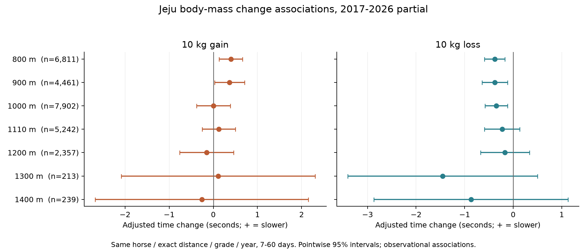

# 제주 마체중 증감과 말별 및 거리별 적정 체중 연구

**마체중과 기록의 연관성은 관찰되지만, 모든 말에 적용할 적정 체중이나 암수·거리별 고정 최적 kg은 확인하지 못했다.** 전체 출전 비교에서는 같은 말의 체중이 높은 때 기록이 느린 연관성이 있었고, 가까운 두 출전을 비교하면 800~1000m의 체중 감소가 빠른 기록과 연관됐다. 최근 기간·안정 조건에서는 불확실성이 커졌다. 체중 감소를 권장하거나 체중만으로 기록을 확정 보정하는 결과가 아니다.

2017-01-01~2026-09-19, 정상 완전순위 5,206경주·52,155출전·2,813두다. 2026년은 부분연도이며 7~13두 편성이다. 현재 거리 800·900·1000·1110·1200·1300·1400·1610m를 모두 확인하고 400m는 제외했다. 기존 과거 자료의 후향 개발 분석이며 독립 미래 검증이 아니다.

## 체중 증감과 기록 변화

동일 말·정확 거리·원문 등급·연도, 7~60일 간격의 27,230쌍에서 실제 측정 체중 차이를 계산했다. 증가는 양의 gain, 감소는 양의 loss로 따로 모형화했다. 부담중량 및 증감, 이전 체중, 이전 기록·착순·이력, 간격, 경주 당시 나이, 함수율 구간, 월의 연속 계절 주기, 게이트 등을 고려했다. 여기서 연속은 연구 조건을 만족한 동일 거리 출전 사이이며 모든 경력의 바로 다음 출전을 뜻하지 않는다.

아래 단위는 **10kg 변화와 연관된 시간 차이, 초**다. 양수는 느림, 음수는 빠름이다. 두 열 모두 체중 변동이 0인 경우와 비교한 회귀 기울기이며 실제 모든 10kg 사례를 단순 평균한 값은 아니다. 괄호는 점별 95% 구간이다.

| 거리 | 출전 쌍 | 10kg 증가 | 10kg 감소 |
|---|---|---|---|
| 800m | 6,811 | +0.396 (+0.131~+0.661) | −0.381 (−0.591~−0.170) |
| 900m | 4,461 | +0.369 (+0.031~+0.707) | −0.377 (−0.641~−0.113) |
| 1000m | 7,902 | +0.005 (−0.378~+0.388) | −0.348 (−0.581~−0.115) |
| 1110m | 5,242 | +0.126 (−0.250~+0.502) | −0.228 (−0.591~+0.136) |
| 1200m | 2,357 | −0.153 (−0.763~+0.457) | −0.169 (−0.672~+0.334) |
| 1300m | 213 | +0.113 (−2.084~+2.310) | −1.452 (−3.405~+0.501) |
| 1400m | 239 | −0.260 (−2.676~+2.155) | −0.869 (−2.867~+1.129) |

800m 증가는 +0.396초, 감소는 −0.381초였고, 900m 감소 −0.377초, 1000m 감소 −0.348초에서 거리·두 시간 목표에 대한 BH 근거가 남았다. 900m 증가의 점별 구간은 양수지만 BH q=0.114로 충족하지 않았다. 1110m 이상은 두 방향 모두 불확실했다. 1610m는 5쌍·9경주뿐이어서 효과를 추정하지 않았다.

2024~2025년과 2026년 부분기간의 증가·감소 기울기는 어느 지원 거리에서도 BH를 충족하지 못했다. 예를 들어 1000m 감소는 2024~2025년 −0.184초(−0.670~+0.301), 2026년 −0.433초(−0.976~+0.110)다. 같은 달·같은 함수율 구간·부담중량 변화 1kg 이내로 제한한 1000m 558쌍, 1110m 308쌍도 불확실했다. 직전 성적 통제를 빼면 감소 효과가 더 크게 나와 회귀 평균과 상태 변화의 영향을 보여준다. [기간·민감도 전체 표](effects.csv)를 따른다.

별도의 전체 출전 경주·말 고정효과 모형에서 280→290kg와 연관된 시간은 1000m +0.259초(95% +0.191~+0.326), 1110m +0.260초(+0.184~+0.335)였다. 이는 동일 말의 체중 수준 차이에 대한 후향 비교이며, 위 가까운 두 출전의 증감 효과와 추정 대상이 다르다. 체중 증가가 모두 지방 증가이거나 감소가 모두 건강한 감량이라는 근거는 없다.

## 말마다 적정 체중이 있는가

다른 말끼리 큰 말과 작은 말을 비교하지 않고, 말·경주 효과와 부담중량·과거 성적·나이 등을 고려한 뒤 체중 곡선을 확인했다. 거리별 절대 kg 곡선은 어느 거리에서도 신뢰할 수 있는 내부 최저점을 확인하지 못했다. 곡선의 최저점을 무리하게 계산하면 표본이 드문 영역이나 비현실적 체중으로 외삽되는 경우가 있어 최적 kg으로 공개하지 않는다.

각 말의 전체 기간 중앙 체중에서 얼마나 벗어났는지를 사용한 민감도에서는 800~1200m에 U자형 곡률 신호가 있었다. 수학적 최저점 후보는 중앙 체중보다 약 6~10kg 낮은 쪽이었다. 그러나 구간이 넓고 대부분 표본의 주요 범위 하단에 걸려 **중앙 체중−10kg을 적정 체중으로 채택할 근거는 부족하다.** 중앙값도 미래를 포함한 전체 기간의 후향 기준이므로 사전 입력으로 쓸 수 없다.

| 거리 | 전체 기간 중앙 체중 대비 최저점 후보 | 모수 정규근사 95% 구간 | 곡률 BH q |
|---|---|---|---|
| 800m | -10.0kg | -19.8~-5.6kg | 0.00001 |
| 900m | -8.5kg | -20.5~-4.6kg | 0.00147 |
| 1000m | -9.3kg | -16.7~-5.7kg | 0.00001 |
| 1110m | -10.2kg | -18.4~-6.4kg | 0.00001 |
| 1200m | -6.4kg | -15.8~-2.3kg | 0.00088 |

위 구간은 양의 곡률을 가진 모수 추출에 조건부로 계산했다. 곡률이 음수인 경우까지 안정적인 최저점이 존재한다는 의미가 아니며, [곡선 전체 표](body_curves.csv)의 양의 곡률 추출 비율과 실제 체중 지원 범위를 함께 확인한다. 전체 및 민감도 모두 사전 고정한 최저점 지원 조건을 충족한 거리는 0개였다.

말별로는 2017~2023년 동일 거리 30회 이상·서로 다른 체중 8개 이상·체중 폭 20kg 이상인 51개 말×거리 조합을 선별했다. 각 기간에 따로 추정한 체중 제외 전역 모형의 잔차에 개별 곡선을 적합했다. 다중 비교와 내부 최저점·양쪽 표본을 확인하니 과거 후보 2건이 남았다.

| 현재 프로필명과 공식 ID | 거리 | 과거 출전 | 관측 체중 kg | 과거 최저점 후보 kg | 2024~2026 해당 거리 지원 |
|---|---|---|---|---|---|
| 백록장원 (3012533) | 1200m | 40 | 283~312 | 290.3 | 2회: 반복 확인 불가 |
| 한라영산 (3014987) | 1200m | 31 | 280~326 | 307.0 | 0회: 반복 확인 불가 |

이는 확정 적정 체중이 아니라 후향 탐색 후보다. 두 후보의 이후 출전은 각각 2회·0회로 반복 확인 기준 15회에 부족했다. 전체 51개 중 이후에도 최소 반복 비교 조건을 만족한 조합은 2개지만 이들은 과거 후보가 아니었다. 따라서 ‘후보가 이후에 실패했다’고 말할 수 없고 **이후 확인이 가능한 적정 체중을 확보하지 못했다**고 해석한다. 개인별 HC1 구간은 전역 잔차 추정의 불확실성을 전부 전파하지 않은 탐색용이며, 생존·은퇴 선택과 적은 반복 수를 고려해야 한다. 새 개체별 최적값은 채택하지 않았다.

## 암수와 거세마 비교

경주 당시 성별을 사용하고 거세마를 수말에 합치지 않았다. 암·수/거 이력 충돌 말은 이번 분석 모집단에 0두였고, 두 출전의 성별이 바뀐 4쌍은 성별 기울기 비교에서 제외했다. 최신 프로필 성별을 과거에 소급하지 않았다.

아래는 **평균 체중 kg / 출전 수**이며 적정 체중이 아니다.

| 거리 | 암말 | 수말 | 거세마 |
|---|---|---|---|
| 800m | 273.9 / 5,556 | 270.6 / 2,532 | 276.6 / 4,341 |
| 900m | 274.5 / 3,708 | 271.3 / 1,553 | 276.0 / 3,622 |
| 1000m | 276.2 / 4,480 | 271.9 / 2,605 | 280.2 / 7,372 |
| 1110m | 279.1 / 2,146 | 277.0 / 1,993 | 284.3 / 5,860 |
| 1200m | 282.0 / 583 | 282.7 / 1,209 | 288.9 / 3,062 |
| 1300m | 281.6 / 53 | 277.7 / 139 | 288.2 / 414 |
| 1400m | 292.3 / 59 | 288.0 / 164 | 296.1 / 620 |
| 1610m | 271.0 / 1 | 289.5 / 11 | 299.6 / 72 |

같은 공동 모형에서 암말−수말의 증감 반응을 직접 비교했다. 800m 암말의 10kg 증가 기울기 +0.549초는 개별 성별의 BH 근거가 남았지만, 수말 대비 차이 +0.381초(95% −0.250~+1.012)는 불확실했다. 한 성별에서만 유의하다는 이유로 성별 차이가 유의하다고 해석하지 않는다.

| 거리 | 비교 변화 | 암말−수말 시간 반응 차이 초 | 95% 구간 | BH q |
|---|---|---|---|---|
| 800m | 10kg 증가 | +0.381 | −0.250~+1.012 | 0.393 |
| 800m | 10kg 감소 | +0.385 | −0.126~+0.896 | 0.697 |
| 900m | 10kg 증가 | −0.709 | −1.652~+0.235 | 0.372 |
| 900m | 10kg 감소 | +0.233 | −0.409~+0.876 | 0.963 |
| 1000m | 10kg 증가 | +0.150 | −0.671~+0.970 | 0.870 |
| 1000m | 10kg 감소 | +0.015 | −0.604~+0.634 | 0.963 |
| 1110m | 10kg 증가 | −0.881 | −2.030~+0.269 | 0.372 |
| 1110m | 10kg 감소 | −0.164 | −1.463~+1.135 | 0.963 |
| 1200m | 10kg 증가 | −0.161 | −2.092~+1.770 | 0.870 |
| 1200m | 10kg 감소 | +0.052 | −1.489~+1.592 | 0.963 |

800~1200m에서 암말−수말 체중 곡선의 공동 차이도 BH q가 모두 0.958 수준으로 불확실했다. **암말의 체중 변화에 더 큰 고정 감점을 주거나 암수별 최적 kg을 정할 근거는 확보하지 못했다.** 이는 성별 반응이 같다는 동등성 증명이 아니다. 1300·1400m 암말은 각각 53·59출전이라 성별 공동 효과를 추정하지 않았고, 1610m 암말은 1출전이다.

## 거리별 적정 체중과 적용

긴 거리 출전마의 평균 체중은 상대적으로 높았다. 그러나 다른 말·나이·등급·경력의 거리 선택이 섞이므로 ‘긴 거리에는 무거울수록 좋다’고 해석할 수 없다. 같은 말과 경주 조건을 고려한 곡선, 최근 기간, 개별 말 반복 확인을 종합하면 **800~1610m에서 확정된 공통 적정 체중은 없다.** 1300·1400m는 소표본, 1610m는 효과 추정 불가로 제한한다.

현재 기록 보정에는 ‘증가 10kg당 몇 초’, ‘평균 체중−10kg’, ‘거리별 최적 kg’을 고정 적용하지 않는다. 사용자에게 실제 체중·측정 시점·최근 증감·해당 말의 과거 관측 범위와 표본 수를 보여줄 수 있다. 향후 입력 후보는 T−2까지 관측한 최근 체중 중앙값 대비 편차와 증감률이며, 전체 기간 중앙값이나 당일 사후 체중을 사전 입력에 넣지 않는다. 예측 개선은 이번 관찰 연구로 검증하지 않았다.

## 원천과 검증

마체중 괄호의 증감은 직전 동일 거리 증감으로 쓰지 않았다. DB의 보유 경주 결과 연대기와 비교 가능한 45,029행 중 44,460행(98.7%)이 일치했고, 569행은 이전 관측의 누락·심사 등 다른 사건 가능성 때문에 오류로 확정하지 않았다. 괄호 증감 수치 미제공 5,118행도 체중 자체가 결측인 것은 아니다. 원시 값과 실제 두 출전의 측정 체중을 구분한 [감사](reported_change_chronology_audit.csv)를 보존했다.

177개 결과 모형과 원천 ID·해시를 보존했다. 경주·말 고정효과의 공동 방정식과 투영 결과 최대 차이는 2.98×10⁻⁸ 이하였다. 1000·1110m의 출전 및 증감 계수·날짜/말 공분산을 별도 NumPy로 재검산하고 BH·체중 단위·최저점 산술·T−2 이력을 확인했다. 날짜+말 공분산을 합산한 보수적 구간이지만 쌍의 앞 출전일만 공유하는 서로 다른 말의 상관은 완전히 반영하지 못한다. 정규근사 최저점 구간은 점별 탐색 값이다.

현재 경주 체중은 사후 설명 측정이며 T−2 가용성을 가정하지 않았다. 사건 나이는 성장·노화 통제에 사용한 경주 원문 나이이고 2026년 고정 프로필 나이가 아니다. 성장·영양·질병·훈련·출전 선택·시변 능력·측정 오차의 잔여 교란이 남는다. 순수 생리적 최적 체중과 인과효과는 확인할 수 없다.

[계획](PLAN.json), [분석 코드](analyze.py), [별도 검산과 발행 코드](verify_publish.py), [전체 효과](effects.csv), [곡선](body_curves.csv), [성별 직접 비교](sex_differences.csv), [말별 전체 결과](individual_curve_results.csv), [말별 기간 비교](individual_period_comparison.csv), [출전 지원](model_support.csv), [원천 해시](source_manifest.json), [원천 감사](input_audit.json), [검증](verification.json), [별도 계산 검증](calculation_verification.json)을 연결한다. 최초 v1은 NumPy의 제거된 row_stack 별칭 때문에 최종 효과표 작성 전에 중단됐고, v2는 동일한 vstack 치환만 적용했다. [재실행 이력](RETRY_PROVENANCE.json)을 보존했다. 기존 연구·DB·운영 모델을 변경하지 않았다.
