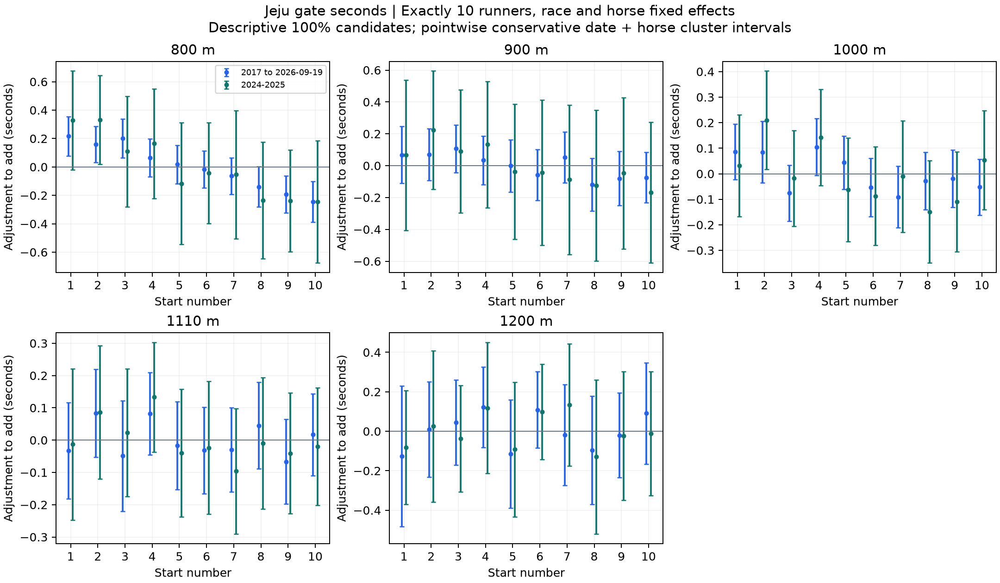

# 제주 거리별 게이트 기록 보정 후보

2017년부터2026년9월19일까지의10두 경주에서 게이트별 완주시간 차이를 추정했다. **가장 근거가 나은 것은800m의 내측과 외측 차이다.** 내측1~3번은 평균 게이트보다 약0.19초 빠르고 외측8~10번은 약0.19초 느린 방향이었으며2024~2025년에도 유지됐다.900m는 더 약한 내측 우세가 관찰됐지만 최근 구간과 다중비교에서 불확실했고,1000·1110·1200m는 일정한 고정 보정 형태를 확인하지 못했다.

번호별100% 추정표와 불확실성을 보존했으나 **확정 적용률이나 번호별 자동 보정은 채택하지 않았다.** 연구용으로 구체적인 시험표를 만든다면800m의1~3번+0.10초·4~7번0초·8~10번−0.10초가 전체기간 그룹 추정 효과의 절반을 반영하는 예시다.50%가 최적이라는 뜻이 아니며,이 제안과 사전에 고정한 번호별 후보 판정은 구분한다.800m2026년10두 표본은3경주뿐이어서 최신 부분연도만으로 재확인할 수 없다.

기록을 평균 게이트 조건으로 환산하는 연구다. Top3 차이를 초로 변환하지 않았고,미래 경주 기록을 사전 예측하는 실험도 아니다. 함수율의 확정 보정률을 가정하지 않고 같은 경주 효과로 공통 환경을 흡수했다. DB·운영 모델·기존 연구는 변경하지 않았다.

## 자료와 기준 조건

원천은 보존된 품질 뷰 추출 자료의 정상·완전순위·양수 전체시간이다. 현재 대상800·900·1000·1110·1200·1300·1400·1610m에서 정확히10두이며 번호1~10이 모두 있는 경주39,300출전·3,930경주를 사용했다.400m는 현재 대상에서 제외했다. 이 중1610m2경주는 효과 추정 지원을 충족하지 않아 값은 미추정으로 남겼다.2017년 전 기록은 동일 거리 과거 이력의 워밍업에만 남을 수 있다.

거리마다 같은 경주와 같은 말의 고정효과를 동시에 분리했다. 경주 전체에 공통인 함수율·월·등급·당일 속도는 경주 효과에 포함된다. 같은 말의 고정 능력 차이와 T−2 이전의 정확 거리 최근5회 기록,관측 출전횟수·휴식간격·부담중량·사건 원문 나이 관련 값·성별 등을 고려했다. 현재2026년 고정 프로필 나이를 과거 나이로 사용하지 않았다. 미관측 컨디션·기수·전개·말별 비선형 성장까지 제거한 결과는 아니다.

번호1~10의 시간 효과 평균을 거리별0으로 두었다. 보정초는 그 효과의 반대 부호다. **빠른 번호는 원기록에 더하고 느린 번호는 뺀다.** 함수율·월처럼 경주 전체에 같은 수를 더하는 보정과 달리 게이트 환산은 같은 경주 안 말 사이의 기록 차이도 바꿀 수 있다. 실제 주행 경로·외측 추가 미터를 측정한 값이 아니다. 출발번호와 물리 게이트의 정확한 대응은 독립 확인하지 않았다.

## 내측과 외측의 시간 차이

내측1~3번−외측8~10번의 조정된 완주시간 차이다. 음수는 내측이 빠르다는 뜻이며 아래 값을 원기록에 그대로 더하는 것은 아니다. 구간은 날짜·말 군집의 보수적 합산 공분산을 사용한 점별95% 구간이다.

| 거리 | 전체10두 경주 | 전체 내측−외측 | 95% 구간 | 2024~2025년 차이 | 판단 |
|---|---:|---:|---:|---:|---|
| 800m | 1,057 | −0.385초 | −0.500~−0.270 | −0.496초 | 반복된 내측 우세 |
| 900m | 690 | −0.173초 | −0.313~−0.033 | −0.240초 | 최근 구간이0 포함 |
| 1000m | 1,067 | −0.065초 | −0.168~+0.038 | −0.143초 | 불확실 |
| 1110m | 700 | −0.002초 | −0.128~+0.124 | −0.056초 | 불확실 |
| 1200m | 304 | +0.016초 | −0.213~+0.244 | −0.023초 | 불확실 |
| 1300m | 47 | −0.426초 | −1.052~+0.199 | −0.489초 | 제한표본 |
| 1400m | 63 | −0.323초 | −0.842~+0.196 | −0.529초 | 제한표본 |
| 1610m | 2 | 미추정 | — | 미추정 | 표본 부족 |

전체7거리×3내외측 대비의21검정에서800m 내측−외측은BH q<0.001,2024~2025년q=0.0354였다.900m 전체 점별 구간은0을 제외하지만q=0.0834이며2024~2025년 구간은−0.598~+0.118초로0을 포함한다. 점별 구간과 다중비교 판정을 구분한다. 최근2024~2026년800m는−0.500초(−0.804~−0.197,q=0.0306)이지만2026년3경주만 더한 중복 기간이므로 별도의 독립 재현으로 세지 않는다.

## 번호별 원기록에 더할 추정초

아래는 전체기간 모형의 **100% 설명용 후보**다. 확정 적용표나 권장 적용률이 아니며 소수 둘째자리로 반올림했다.0.00도 효과가 없다는 확정이 아니다. 표 안의 유불리를 착순·확률·수익률로 바꾸지 않는다.

| 번호 | 800m | 900m | 1000m | 1110m | 1200m |
|---|---:|---:|---:|---:|---:|
| 1 | +0.22 | +0.07 | +0.09 | −0.03 | −0.13 |
| 2 | +0.16 | +0.07 | +0.09 | +0.08 | +0.01 |
| 3 | +0.20 | +0.11 | −0.08 | −0.05 | +0.04 |
| 4 | +0.07 | +0.03 | +0.11 | +0.08 | +0.12 |
| 5 | +0.02 | 0.00 | +0.04 | −0.02 | −0.11 |
| 6 | −0.02 | −0.06 | −0.05 | −0.03 | +0.11 |
| 7 | −0.06 | +0.05 | −0.09 | −0.03 | −0.02 |
| 8 | −0.14 | −0.12 | −0.03 | +0.05 | −0.10 |
| 9 | −0.19 | −0.08 | −0.02 | −0.07 | −0.02 |
| 10 | −0.25 | −0.07 | −0.05 | +0.02 | +0.09 |

단위는 초다.1300·1400m의 번호별 추정은 제한표본 상태로 [전체 표](number_seconds.csv)에 보존했으며 표시용 확정표로 제안하지 않는다.1610m는 미추정이다. 모든 거리의 번호별 후보·구간·보류 사유는 [후보 상태표](candidate_status.csv)에 있다.

800m1번의100% 조정 후보는+0.217초,점별 구간+0.079~+0.356초이고10번은−0.245초,−0.389~−0.102초다. 하지만 전체70번호 검정을 함께 보면q는1번0.0718·10번0.0590으로0.05를 넘는다. 최근 번호별 구간도 넓고,사전에 정한 전체·확인 기간 지원·양쪽q·모든 민감도 방향 기준을 통과한 번호 셀은0개였다. **800m 내외측 그룹 차이의 근거와 모든 번호의 고정 초가 확정됐다는 주장은 다르다.**

## 800m 그룹 단위의 시험용 제안

800m의 전체기간 그룹 추정은 다음과 같다. 그룹은 기존 연구와 동일하게1~3·4~7·8~10으로 고정했다. 반올림 전 효과는 전체10번호 평균0이며 각 그룹을3·4·3 비중으로 합해도0이다.

| 출발번호 | 전체100% 조정 후보 | 점별95% 구간 | 2024~2025년100% 후보 | 50% 반영 시험 예시 |
|---|---:|---:|---:|---:|
| 1~3번 | +0.192초 | +0.125~+0.259 | +0.256초 | **+0.10초** |
| 4~7번 | +0.0005초 | −0.053~+0.054 | −0.012초 | **0.00초** |
| 8~10번 | −0.193초 | −0.262~−0.124 | −0.240초 | **−0.10초** |

같은 경주만 통제하는 보조모형과 과거 기록 변수를 제외한 같은 경주·말 모형에서도800m 그룹 방향이 유지됐다. 따라서 번호별 세밀한0.01초 표보다 그룹 단위 소액 시험을 먼저 살펴볼 근거가 더 낫다. 절반 적용은 설명용 수축 정책의 예시이며 데이터가 선택한 최적 적용률은 아니다. 이 표를 운영에 반영하지 않았다. 예를 들어800m10두 경주에서1번의65.00초라는 가상 기록은 이 시험표에서65.10초,10번의65.00초는64.90초가 된다. 실제 말의 가상 재경주 기록을 보장하는 예가 아니다.

## 다른 기간에서 게이트 편차가 줄었는가

2017~2023년 번호별 계수를 고정하고2024~2025년에서 별도로 추정한 게이트 효과에0·25·50·75·100%를 적용해 남는 효과의RMS를 비교했다. 숫자가 작을수록 번호별 체계적 편차가 작은 방향이다. 기준 조건의 실제 정답 기록 오차나 미래 완주시간 예측 오차는 아니다. 확인 계수의 공분산에서2000회 정규 근사 추출해 구간을 구했으며 과거 계수의 추정 불확실성·선택 불확실성은 포함하지 않았다.

| 거리 | 무보정 번호 편차 RMS | 과거 번호 효과50% 적용 | 100% 적용 |
|---|---:|---:|---:|
| 800m | 0.212초 | 0.150초 | 0.109초 |
| 900m | 0.117초 | 0.096초 | 0.089초 |
| 1000m | 0.107초 | 0.101초 | 0.110초 |
| 1110m | 0.063초 | 0.060초 | 0.071초 |
| 1200m | 0.087초 | 0.109초 | 0.179초 |

800m의50% 적용 변화는−0.061초,조건부95% 구간−0.065~−0.007초였다.25%와75%도 유리한 구간이었으나100%는−0.121~+0.011초로0을 포함했다. 그 밖의 거리50% 비교는 모두0을 포함했다. 여러 비율을 확인했으므로 이 결과만으로50%를 최적이라고 선택하지 않는다.1300m는2023년까지 표본이 없고1400m는26경주라 과거 계수를 고정한 확인을 수행하지 못했다.2026년은 별도 [전체 확인 표](frozen_rate_checks.csv)에 남겼고800m는 미추정이다.

주 결과를 본 후,같은 과거 번호 효과를 기존3그룹 평균으로 압축해도 편차가 줄어드는지 **추가 탐색**했다. 확인 목표는10번호 편차를 그대로 유지해 그룹 안의 편차를 숨기지 않았다.800m50% 그룹 보정에서RMS는0.212→0.149초,변화 구간−0.063~−0.012초였다.900·1000·1110·1200m는 이 비교에서도0을 포함했다. [추가 탐색 계획](GROUP_DIAGNOSTIC.json)에 시점을 명시했고 [모든 비율·거리 결과](exploratory_group_rate_checks.csv)를 보존했다. 독립 확증이나 기존 번호별 채택 기준 완화로 쓰지 않는다. 고정 과거 검증은 반올림 전 과거 그룹 계수이며 최신 전체기간의반올림 시험표 자체를 직접 검증한 것은 아니다.

## 판단 범위와 한계

현재 권고는800m의 그룹 단위 보정 후보를 우선 검토하고900m 이상은 고정 적용을 보류하는 것이다.800m의+0.10·0·−0.10초는 시험 제안이며 자동 채택된 수치가 아니다.1번+0.217초나10번−0.245초를 정답처럼 적용하지 않는다.9두나11두 등 다른 편성에는 이 표를 옮기지 않는다.

모든 표본은 후향 자료다. 같은 말의 고정효과는 전체기간의 고정 능력을 흡수하지만 지속적인 성장·쇠퇴와 기수·전개·게이트 배정 과정의 미관측 요인을 완전히 없애지 못한다. 말의 과거 기록 자체에 이전 게이트의 영향이 섞일 수 있어 과거 기록 제외 민감도를 함께 확인했다. 실제 경로가 측정되지 않아 출발번호 효과를 코너 외측의 물리적 거리 손실로 단정할 수 없다.

날짜와 말의 군집 공분산을 합산하고 중복되는 교차항을 차감하지 않은 보수적 구간이다. 이전 연구의 날짜 단독 구간과 같지 않다. 고정효과 연결 성분의 자유도를 반영했다. 구간은 점별이며번호 전체70개와내외측 대조21개는 별도BH 가족으로 관리했다.0을 포함하거나q 기준을 넘는 것은 효과가 없다는 증명이 아니다. 최근 기간은 전체기간에 포함되므로 독립 증거로 더하지 않는다. 등급·시대에 따라 효과가 달라질 가능성과2026년800m의 지원 부족이 남는다.

## 재현과 보관

- [사전 계획](PLAN.json),[계산 코드](analyze.py),[원천 해시](source_manifest.json),[출전별 연결](source_lineage.csv),[연도별 지원](annual_support.csv)
- [번호별 전체 수치와 구간](number_seconds.csv),[내외측 수치](lateral_seconds.csv),[기간별 지원과 미추정](support.csv),[보류 사유](candidate_status.csv)
- [고정 과거 계수의 비율 진단](frozen_rate_checks.csv),[설명용 절반 그룹 표](illustrative_half_group_table.csv),[추가 그룹 계산](group_diagnostic.py)
- [모형·공분산](models.json),[원천과 투영 검증](verification.json),[별도 연립식·군집 공분산 재검산](calculation_verification.json),[재검산 코드](verify_plot.py)
- [이전 Top3와 시간 연관 연구](../20261008_gate_2017_2026_v1/report.html)

58개 모형과번호·그룹 대비를 보존했다.14개 전체·확인 주 모형을 고정효과까지 포함한 별도 희소 연립식으로 다시 풀어 대조했고 공분산·BH·조정 부호·평균0·원천 연결·129,833개의 사용 이력 끝점을 확인했다. 원천·DB 해시는 유지됐다. 이전 연구 파일은 덮어쓰지 않았다.
