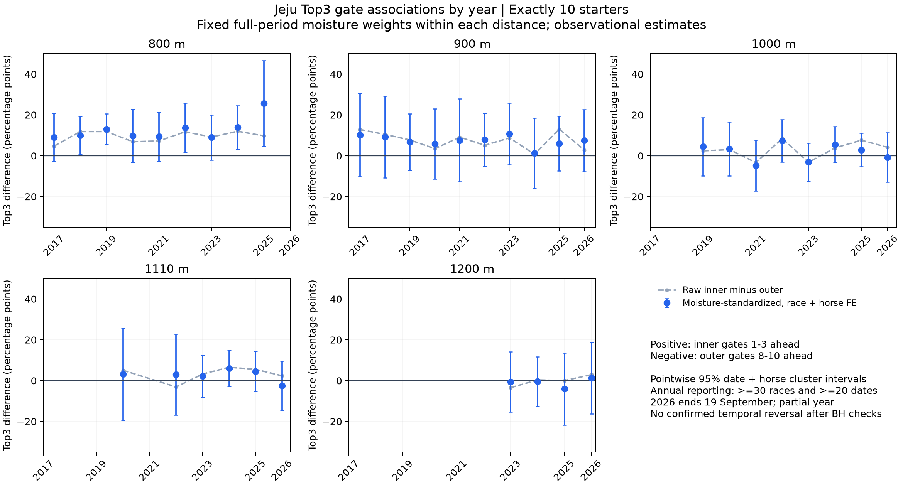

# 제주 출발번호별 입상률과 함수율을 고려한 시기별 내외측 차이

2017년부터 2026년 9월 19일까지 정상 완전순위·정확히 10두·출발번호 1~10인 3,930경주, 39,300출전을 비교했다. **800m와 900m는 전체기간에 내측 1~3번의 Top3 입상 이점이 관찰됐다. 일부 연도와 함수율에서는 외측 8~10번의 비율이 높았지만, 조정·불확실성·다중비교 기준을 함께 충족한 시기별 우세 반전은 확인하지 못했다.** 모든 시기에 내측이 유리하다는 뜻은 아니다.

시간 차이가 전혀 관측되지 않았다는 결론도 아니다. [별도 시간 연구](../20261008_gate_record_seconds_v1/README.md)에서 800m 내측−외측은 전체 −0.385초, 2024~2025년 −0.496초였다. 다른 거리의 초 단위 고정 환산 근거는 불확실했다. 입상률 차이를 초 단위 보정치로 바꾸지 않는다.

## 출발번호별 실제 Top3 입상률

Top3는 최종 1~3착이다. 아래 값은 **조정 전 실제 입상 횟수 ÷ 출전 횟수**다. 10두 편성만 비교하므로 거리마다 각 번호의 출전수는 경주수와 같다. 800m 1,057회, 900m 690회, 1000m 1,067회, 1110m 700회, 1200m 304회다. 10개 번호의 평균은 각 거리에서 정확히 30%다.

| 출발번호 | 800m | 900m | 1000m | 1110m | 1200m |
|---|---|---|---|---|---|
| 1 | 34.63% | 35.94% | 32.24% | 33.00% | 32.24% |
| 2 | 35.10% | 31.01% | 34.40% | 34.71% | 33.22% |
| 3 | 35.10% | 34.64% | 30.37% | 30.57% | 29.28% |
| 4 | 31.22% | 30.43% | 32.61% | 30.86% | 32.57% |
| 5 | 31.22% | 29.71% | 29.52% | 29.29% | 26.64% |
| 6 | 27.91% | 29.42% | 26.80% | 30.00% | 25.33% |
| 7 | 28.95% | 29.71% | 27.55% | 28.86% | 29.61% |
| 8 | 25.54% | 27.10% | 29.62% | 28.29% | 26.97% |
| 9 | 24.50% | 24.06% | 28.96% | 26.86% | 30.59% |
| 10 | 25.83% | 27.97% | 27.93% | 27.57% | 33.55% |

1300m는 번호당 47회, 1400m는 63회, 1610m는 2회뿐이다. 특히 1610m의 0%·50%는 두 경주의 관측값이며 게이트 성능을 판단할 근거로 사용하지 않는다.

| 출발번호 | 1300m | 1400m | 1610m |
|---|---|---|---|
| 1 | 38.30% | 39.68% | 0.00% |
| 2 | 29.79% | 36.51% | 0.00% |
| 3 | 36.17% | 42.86% | 0.00% |
| 4 | 38.30% | 31.75% | 50.00% |
| 5 | 21.28% | 20.63% | 50.00% |
| 6 | 31.91% | 20.63% | 50.00% |
| 7 | 29.79% | 33.33% | 50.00% |
| 8 | 29.79% | 28.57% | 50.00% |
| 9 | 27.66% | 20.63% | 50.00% |
| 10 | 17.02% | 25.40% | 0.00% |

정확한 분자·분모와 서술용 Wilson 구간은 [번호별 전체 원시 집계](raw_gate.csv)에 있다. 이 구간은 반복말·같은 날의 상관을 반영한 회귀 구간과 다르다. [연도별 번호](raw_year_gate.csv), [함수율별 번호](raw_band_gate.csv), [연도와 함수율별 번호](raw_year_band_gate.csv)도 보존했다.

## 내측과 외측의 전체기간 비교

원시 비율은 관측값이고, 조정 차이는 같은 말·같은 경주 효과와 과거 동일거리 이력·부담중량·사건 당시 나이·성별·출전 경험·간격을 고려한 추정치다. 각 거리 전체기간의 함수율 구성을 모든 연도에 동일하게 적용했다. 양수는 내측 입상률이 높다는 뜻이며 단위는 %p다.

| 거리 | 경주 | 원시 내측 | 원시 외측 | 원시 차이 %p | 조정 차이 %p | 점별 95% 구간 | BH q |
|---|---|---|---|---|---|---|---|
| 800m | 1057 | 34.94% | 25.29% | +9.65 | +11.46 | +7.91~+15.01 | 0.0000 |
| 900m | 690 | 33.86% | 26.38% | +7.49 | +7.39 | +2.42~+12.37 | 0.0128 |
| 1000m | 1067 | 32.33% | 28.83% | +3.50 | +2.21 | −1.50~+5.91 | 0.3636 |
| 1110m | 700 | 32.76% | 27.57% | +5.19 | +4.04 | −0.42~+8.51 | 0.1764 |
| 1200m | 304 | 31.58% | 30.37% | +1.21 | +0.53 | −6.41~+7.46 | 0.8812 |
| 1300m | 47 | 34.75% | 24.82% | +9.93 | +6.05 | −13.04~+25.13 | 0.6146 |
| 1400m | 63 | 39.68% | 24.87% | +14.81 | +10.14 | −7.68~+27.95 | 0.3636 |
| 1610m | 2 | 0.00% | 33.33% | −33.33 | 미추정 | — | — |

800·900m의 전체기간 내측 우세는 경주 효과만 사용하는 분석과 과거 기록 변수를 제외한 분석에서도 방향이 유지됐다. 1000·1110m는 양수 추정이지만 이번 보수적 구간은 0을 포함했다. 1300·1400m는 제한표본, 1610m는 미추정이다. [모든 조정 결과와 민감도](adjusted_contrasts.csv)를 함께 확인한다.

이전 Top3 보고서는 경주 효과·개별 번호 모형과 날짜 군집 구간을 사용했다. 이번에는 말 고정효과를 추가하고 내측·중간·외측 그룹 및 연도·함수율 상호작용을 적합했으며 날짜와 말의 군집 공분산을 더했다. 따라서 이전 효과와 수치·구간이 달라질 수 있다. 이전 원본은 보존하고 최신 판단에서 불확실성을 확대했다.

## 외측의 실제 입상률이 높았던 연도

800·900m는 보유 모든 연도에서 원시 내측 입상률이 외측보다 높았고, 보고 가능한 연도별 조정 추정도 모두 양수였다. 800m의 2026년은 3경주뿐이라 연도별 조정 결과를 제시하지 않았다. 900m는 2024년 원시 차이가 +0.69%p로 작았고 2025년 +13.06%p, 2026년 부분기간 +2.85%p였다. 이 연간 변동을 입증된 효과 변화로 단정하지 않는다.

30경주 이상인 연도 중 외측 원시 입상률이 높았던 구간은 아래 네 개다.

| 거리 | 연도 | 경주 | 내측 | 외측 | 원시 차이 %p | 함수율 조정 차이 %p | 점별 95% 구간 |
|---|---|---|---|---|---|---|---|
| 1000m | 2021 | 90 | 30.37% | 33.70% | −3.33 | −4.79 | −17.19~+7.60 |
| 1000m | 2023 | 187 | 28.16% | 31.37% | −3.21 | −3.16 | −12.58~+6.25 |
| 1110m | 2022 | 43 | 27.91% | 31.01% | −3.10 | +3.00 | −16.77~+22.78 |
| 1200m | 2023 | 77 | 29.87% | 33.33% | −3.46 | −0.57 | −15.29~+14.14 |

모두 조정 구간이 0을 포함한다. 1110m 2022년은 원시 비율에서 외측이 앞섰지만 조정값은 내측 방향으로 바뀌었다. 반대로 1000m·1110m의 2026년 부분기간은 원시 비율이 내측 방향인데 조정 추정은 각각 −0.77·−2.56%p다. 두 구간 모두 0을 포함하므로 어느 쪽 우세도 확정하지 않는다.

연도별 내외측 대비 37개에 BH를 적용했다. 개별 연도의 내측 우세로 q<0.05인 것은 800m 2019년 한 구간이었다. **외측 우세로 q<0.05인 연도는 없었고, 양쪽 연도의 반대 방향 우세·연도 간 변화·민감도 방향 일치를 함께 요구한 반전도 0개였다.** 전체기간의 800·900m 내측 연관성이 모든 연도에서 각각 유의하다는 뜻은 아니다. [연도 쌍 전체 변화](year_pair_changes.csv)와 [반전 판정](reversal_checks.csv)을 보존했다.

회색은 실제 내측−외측 비율, 파란색은 함수율 표준화 및 경주·말 효과 조정값과 점별 95% 구간이다. [그림 PDF](annual_inner_outer.pdf)를 제공한다.

## 함수율에 따른 차이

아래는 각 함수율 구간을 거리별 전체기간의 같은 연도 구성으로 표준화한 내측−외측 차이다. 단위는 %p, 대괄호는 점별 95% 구간이다. 함수율 자체가 입상률을 높이는 효과가 아니라 **해당 함수율에서 내외측 차이가 얼마였는지**를 비교한다.

| 함수율 | 800m | 900m | 1000m | 1110m | 1200m |
|---|---|---|---|---|---|
| 건조 1~5% | +12.68 [+5.19~+20.16] | +5.96 [−2.81~+14.73] | +2.75 [−3.22~+8.72] | +5.61 [−1.86~+13.08] | +7.27 [−3.86~+18.41] |
| 양호 6~9% | +13.15 [+6.49~+19.80] | +5.90 [−5.01~+16.80] | +2.42 [−5.36~+10.20] | +3.80 [−6.02~+13.63] | −3.07 [−18.63~+12.50] |
| 다습 10~14% | +9.76 [+2.53~+17.00] | +10.75 [+0.17~+21.33] | +3.87 [−4.20~+11.94] | +8.43 [−1.37~+18.22] | +9.20 [−5.09~+23.49] |
| 포화 15~19% | +4.84 [−7.02~+16.70] | +5.46 [−14.09~+25.02] | +4.65 [−6.32~+15.62] | −0.05 [−13.28~+13.17] | −9.68 [−32.54~+13.18] |
| 불량 20% 이상 | +13.70 [+1.04~+26.36] | +12.46 [−5.96~+30.88] | −8.19 [−21.71~+5.33] | −6.83 [−22.30~+8.65] | 표본 부족 |

800m는 모든 함수율에서 내측 방향 추정이었다. 다만 함수율별 24개 대비에 BH를 적용하면 건조와 양호 두 구간에서 내측 우세 근거가 남고, 다른 구간의 크기는 불확실하다. 900m 역시 모든 함수율에서 내측 방향이지만 각각의 구간을 확정하지 못했다.

함수율 20% 이상에서 1000m는 −8.19%p(−21.71~+5.33), 1110m는 −6.83%p(−22.30~+8.65)로 외측 방향 추정이었다. 두 구간 모두 0을 포함한다. ‘비가 오거나 함수율이 높으면 외측이 유리해진다’는 규칙으로 채택할 근거는 부족하다. 실제 비율에서도 800m 2020년 다습 36경주는 외측이 0.93%p 높았지만, 이 한 구간을 우세 반전으로 해석하지 않는다.

연도와 함수율의 가산 상호작용 가정을 점검하려고 미리 고정한 2017~2020·2021~2023·2024~2026 부분기간 각각에서 함수율별 회귀를 별도로 적합했다. 46개 지원 구간 모두 BH 기준을 통과하지 못했다. 이 세부 분석은 같은 말이 해당 구간에서 여러 게이트에 출전한 정보가 적어 일부 구간의 추정과 구간이 매우 불안정했다. 선형확률모형의 구간은 ±100%p를 넘을 수 있으며 이런 값을 개별 말의 확률로 사용하지 않는다. 세부 셀의 불확실성 때문에 국소적인 반전을 배제할 수도 없다.

## 기간 및 함수율 조정의 범위

연도별 단순 분할만으로는 젖은 주로 경주 비중의 변화와 게이트 효과 변화를 구별하기 어렵다. 거리마다 경주·말 고정효과 선형확률모형에 내측·외측 지시변수, 연도×내외측, 함수율 구간×내외측을 함께 넣었다. 같은 경주의 함수율 주효과는 경주 고정효과에 흡수되지만, 함수율에 따라 내외측 차이가 바뀌는 항은 직접 추정했다. 중간 4~7번을 기준으로 사용했다.

모든 연도의 내외측 차이에 동일한 전체기간 함수율 비중을 적용해 구성 차이를 통제했다. 이는 연도별 변화와 함수율별 변화를 더하는 구조이며, 모든 연도×함수율 조합을 완전히 독립적으로 추정한 모형은 아니다. 관측되지 않은 조합도 이 가정으로 환산한다. 예컨대 800m 2018년에는 건조 표본이 없고 표준화 비중 27.8%, 900m 2018년에는 건조 표본이 없고 34.5%다. 이 연도 추정은 해당 부분의 외삽에 의존한다. [연도별 실제 함수율 지원](annual_moisture_support.csv)과 [고정 표준화 가중치](standardization_weights.csv)를 확인한다.

최소 30경주·20일 이상인 구간만 조정 결과를 공개했다. 100경주·40일 미만은 제한표본으로 표시한다. 전체 회귀에는 소표본 연도도 포함하되 해당 연도 추정치는 공개하지 않는다. 1300·1400m는 보고 가능한 연도가 하나도 없고 1610m는 전체도 미추정이다. 1300m 분석 표본은 2024년부터, 1400m는 2020년부터, 1610m는 2025년부터다. 2017년 시작이라고 이 거리들의 2017년 표본이 존재하는 것은 아니다.

기존 quality 추출을 재사용했으며 2026년은 9월 19일까지다. 400m는 2025·2026년 보유 시행 기록이 없어 과거 워밍업으로 남겼다. 같은 공식 말 ID·정확 거리의 T−2 이전 이력만 통제변수에 사용했고 제외 말은 재편입하지 않았다. 실제 경주 당시 원문 나이를 사용했으며 현재 2026년 고정 나이를 과거 나이로 설명하지 않는다.

날짜 군집 공분산과 말 군집 공분산을 교차항 차감 없이 더해 보수적으로 계산하고, 흡수한 고정효과의 잔여 자유도와 작은 군집 수의 t 임계값을 사용했다. 통제변수만 ridge 1로 수축하고 게이트·상호작용은 수축하지 않았다. BH는 전체기간·연도·함수율·시대와 함수율·연도 쌍 변화의 각 검정군에서 모든 지원 거리에 적용했다. 95% 구간은 동시 구간이 아닌 점별 구간이다.

## 연도별 전체 조정표

마지막 열은 해당 연도에 실제 관측되지 않은 함수율에 배정된 표준화 비중이다. 0%여도 각 세부 셀의 표본이 충분하다는 뜻은 아니다.

| 거리 | 연도 | 경주 | 원시 차이 %p | 조정 차이 %p | 점별 95% 구간 | BH q | 미관측 함수율 비중 |
|---|---|---|---|---|---|---|---|
| 800m | 2017 | 134 | +4.73 | +8.99 | −2.76~+20.74 | 0.5561 | 0.0% |
| 800m | 2018 | 158 | +11.81 | +9.97 | +0.79~+19.14 | 0.2461 | 27.8% |
| 800m | 2019 | 209 | +11.80 | +13.04 | +5.61~+20.48 | 0.0227 | 0.0% |
| 800m | 2020 | 102 | +6.86 | +9.83 | −3.20~+22.86 | 0.5561 | 0.0% |
| 800m | 2021 | 106 | +7.23 | +9.34 | −2.60~+21.29 | 0.5561 | 0.0% |
| 800m | 2022 | 88 | +11.74 | +13.72 | +1.67~+25.78 | 0.2383 | 0.0% |
| 800m | 2023 | 113 | +9.14 | +8.93 | −2.11~+19.97 | 0.5561 | 0.0% |
| 800m | 2024 | 103 | +11.97 | +13.86 | +3.24~+24.47 | 0.1960 | 0.0% |
| 800m | 2025 | 41 | +9.76 | +25.58 | +4.61~+46.55 | 0.2085 | 0.0% |
| 900m | 2017 | 52 | +12.82 | +10.22 | −10.17~+30.61 | 0.6973 | 9.3% |
| 900m | 2018 | 48 | +10.42 | +9.19 | −10.89~+29.27 | 0.6973 | 34.5% |
| 900m | 2019 | 82 | +7.72 | +6.72 | −7.14~+20.59 | 0.6973 | 0.0% |
| 900m | 2020 | 58 | +3.45 | +5.77 | −11.43~+22.97 | 0.7551 | 0.0% |
| 900m | 2021 | 44 | +9.09 | +7.54 | −12.75~+27.83 | 0.7551 | 0.0% |
| 900m | 2022 | 91 | +5.13 | +7.85 | −5.09~+20.79 | 0.6177 | 0.0% |
| 900m | 2023 | 88 | +8.71 | +10.68 | −4.39~+25.74 | 0.5561 | 0.0% |
| 900m | 2024 | 48 | +0.69 | +1.26 | −15.90~+18.41 | 0.9507 | 0.0% |
| 900m | 2025 | 97 | +13.06 | +6.05 | −7.39~+19.49 | 0.6973 | 0.0% |
| 900m | 2026 | 82 | +2.85 | +7.42 | −7.75~+22.59 | 0.6973 | 0.0% |
| 1000m | 2019 | 84 | +2.38 | +4.45 | −9.79~+18.69 | 0.7682 | 0.0% |
| 1000m | 2020 | 78 | +2.99 | +3.32 | −9.94~+16.57 | 0.8426 | 0.0% |
| 1000m | 2021 | 90 | −3.33 | −4.79 | −17.19~+7.60 | 0.7551 | 0.0% |
| 1000m | 2022 | 131 | +8.40 | +7.32 | −3.13~+17.76 | 0.5561 | 0.0% |
| 1000m | 2023 | 187 | −3.21 | −3.16 | −12.58~+6.25 | 0.7551 | 0.0% |
| 1000m | 2024 | 166 | +3.82 | +5.48 | −3.30~+14.27 | 0.6177 | 0.0% |
| 1000m | 2025 | 184 | +7.61 | +2.83 | −5.39~+11.04 | 0.7551 | 0.0% |
| 1000m | 2026 | 114 | +4.09 | −0.77 | −12.92~+11.37 | 0.9507 | 0.0% |
| 1110m | 2020 | 33 | +5.05 | +3.14 | −19.46~+25.73 | 0.9079 | 0.0% |
| 1110m | 2022 | 43 | −3.10 | +3.00 | −16.77~+22.78 | 0.9079 | 0.0% |
| 1110m | 2023 | 124 | +3.23 | +2.14 | −8.17~+12.46 | 0.8426 | 0.0% |
| 1110m | 2024 | 168 | +6.55 | +6.03 | −2.80~+14.86 | 0.5561 | 0.0% |
| 1110m | 2025 | 157 | +5.52 | +4.56 | −5.26~+14.39 | 0.6973 | 0.0% |
| 1110m | 2026 | 99 | +2.36 | −2.56 | −14.66~+9.55 | 0.8426 | 0.0% |
| 1200m | 2023 | 77 | −3.46 | −0.57 | −15.29~+14.14 | 0.9507 | 0.0% |
| 1200m | 2024 | 96 | +0.35 | −0.38 | −12.49~+11.73 | 0.9507 | 0.0% |
| 1200m | 2025 | 47 | +0.00 | −4.06 | −21.73~+13.61 | 0.8426 | 0.0% |
| 1200m | 2026 | 57 | +2.92 | +1.26 | −16.30~+18.82 | 0.9507 | 0.0% |

## 시대와 함수율별 세부 확인

최소 지원을 충족한 별도 회귀만 표시한다. 모두 탐색적 세부 연관성이며 새 독립 검증으로 세지 않는다.

| 거리 | 시대와 함수율 | 경주 | 일 | 조정 차이 %p | 점별 95% 구간 | BH q |
|---|---|---|---|---|---|---|
| 800m | 2017_2020:건조 | 116 | 47 | +9.87 | −5.80~+25.53 | 0.9808 |
| 800m | 2017_2020:다습 | 161 | 83 | +9.76 | −2.83~+22.34 | 0.9808 |
| 800m | 2017_2020:불량 | 39 | 24 | +35.72 | −101.70~+173.13 | 0.9808 |
| 800m | 2017_2020:양호 | 251 | 143 | +13.39 | +4.25~+22.53 | 0.2020 |
| 800m | 2017_2020:포화 | 36 | 22 | −25.53 | −160.38~+109.31 | 0.9808 |
| 800m | 2021_2023:건조 | 123 | 88 | +14.82 | −0.81~+30.44 | 0.9808 |
| 800m | 2021_2023:다습 | 39 | 27 | −7.99 | −126.45~+110.46 | 0.9808 |
| 800m | 2021_2023:양호 | 62 | 40 | −5.38 | −43.74~+32.97 | 0.9808 |
| 800m | 2021_2023:포화 | 57 | 33 | +9.89 | −43.39~+63.18 | 0.9808 |
| 800m | 2024_2026partial:건조 | 55 | 42 | +17.10 | −25.56~+59.75 | 0.9808 |
| 800m | 2024_2026partial:다습 | 40 | 31 | +25.32 | −29.31~+79.95 | 0.9808 |
| 900m | 2017_2020:건조 | 38 | 30 | +14.66 | −23.87~+53.19 | 0.9808 |
| 900m | 2017_2020:다습 | 72 | 52 | +15.58 | −7.46~+38.61 | 0.9808 |
| 900m | 2017_2020:양호 | 106 | 82 | +10.03 | −7.51~+27.58 | 0.9808 |
| 900m | 2021_2023:건조 | 98 | 67 | −1.69 | −19.36~+15.97 | 0.9808 |
| 900m | 2021_2023:다습 | 33 | 24 | +3.40 | −61.41~+68.21 | 0.9808 |
| 900m | 2021_2023:양호 | 44 | 34 | −2.76 | −58.31~+52.79 | 0.9808 |
| 900m | 2024_2026partial:건조 | 102 | 76 | +11.73 | −8.76~+32.23 | 0.9808 |
| 900m | 2024_2026partial:다습 | 44 | 35 | −17.34 | −83.68~+49.00 | 0.9808 |
| 900m | 2024_2026partial:양호 | 40 | 33 | −1.39 | −118.57~+115.78 | 0.9808 |
| 1000m | 2017_2020:건조 | 48 | 32 | −0.90 | −28.49~+26.69 | 0.9808 |
| 1000m | 2017_2020:다습 | 59 | 35 | +0.50 | −28.49~+29.49 | 0.9808 |
| 1000m | 2017_2020:양호 | 62 | 42 | +7.14 | −17.37~+31.66 | 0.9808 |
| 1000m | 2021_2023:건조 | 180 | 100 | +2.69 | −8.58~+13.96 | 0.9808 |
| 1000m | 2021_2023:다습 | 50 | 32 | −7.30 | −49.81~+35.20 | 0.9808 |
| 1000m | 2021_2023:불량 | 41 | 20 | −4.64 | −71.18~+61.91 | 0.9808 |
| 1000m | 2021_2023:양호 | 85 | 47 | −3.53 | −24.03~+16.97 | 0.9808 |
| 1000m | 2021_2023:포화 | 52 | 29 | +9.19 | −45.93~+64.32 | 0.9808 |
| 1000m | 2024_2026partial:건조 | 206 | 110 | +3.92 | −6.76~+14.59 | 0.9808 |
| 1000m | 2024_2026partial:다습 | 99 | 59 | −2.83 | −21.01~+15.35 | 0.9808 |
| 1000m | 2024_2026partial:불량 | 31 | 20 | +17.90 | −76.88~+112.69 | 0.9808 |
| 1000m | 2024_2026partial:양호 | 84 | 51 | −2.78 | −26.93~+21.38 | 0.9808 |
| 1000m | 2024_2026partial:포화 | 44 | 29 | −8.76 | −65.50~+47.98 | 0.9808 |
| 1110m | 2017_2020:다습 | 35 | 27 | +11.88 | −18.28~+42.03 | 0.9808 |
| 1110m | 2017_2020:양호 | 34 | 31 | +0.93 | −32.72~+34.57 | 0.9808 |
| 1110m | 2021_2023:건조 | 79 | 61 | −3.86 | −24.14~+16.43 | 0.9808 |
| 1110m | 2021_2023:양호 | 43 | 33 | +12.19 | −25.72~+50.10 | 0.9808 |
| 1110m | 2024_2026partial:건조 | 174 | 105 | +6.49 | −4.43~+17.40 | 0.9808 |
| 1110m | 2024_2026partial:다습 | 99 | 58 | +6.35 | −12.18~+24.87 | 0.9808 |
| 1110m | 2024_2026partial:불량 | 37 | 22 | −7.06 | −62.10~+47.99 | 0.9808 |
| 1110m | 2024_2026partial:양호 | 68 | 41 | +1.33 | −23.36~+26.03 | 0.9808 |
| 1110m | 2024_2026partial:포화 | 46 | 26 | −6.21 | −54.21~+41.78 | 0.9808 |
| 1200m | 2021_2023:건조 | 34 | 31 | +17.58 | −15.51~+50.67 | 0.9808 |
| 1200m | 2024_2026partial:건조 | 80 | 71 | +2.97 | −13.78~+19.71 | 0.9808 |
| 1200m | 2024_2026partial:다습 | 47 | 44 | +8.43 | −20.46~+37.33 | 0.9808 |
| 1200m | 2024_2026partial:양호 | 37 | 32 | +0.65 | −35.83~+37.14 | 0.9808 |

## 저장과 검증

[분석 계획](PLAN.json)을 새 효과 추정 전에 고정했다. [실행 코드](analyze.py), [별도 재검산 코드](verify_plot.py), [입력 해시](source_manifest.json), [출전별 원천 연결](source_lineage.csv), [지원 및 보류](support.csv), [계수와 공분산](models.json), [검증](verification.json), [분자·분모·구간·군집 계산 재검산](calculation_verification.json)을 보존했다. 원천 집계 8종과 67모형의 대비·구간을 재검산하고, 7거리의 주 모형 군집 공분산을 별도 NumPy 누적으로 확인했다. 전체 희소 고정효과 연립식과 투영식의 계수 최대 차이는 9.36×10⁻¹¹이었다.

같은 말의 다른 게이트 출전도 무작위 실험은 아니며 시간에 따라 변하는 능력·기수·전개 등 잔여 교란이 남는다. 출발번호와 입상의 관찰 연관성이고 실제 주행 내외측 위치의 인과효과를 확정하지 않는다. 기존 자료를 반복 사용한 후향 연구다. 순위 연구에서 시간 환산률을 선택하지 않았고 DB·운영 모델도 변경하지 않았다. 결과는 [주제별 결론](../conclusions/01_GATE_LATERAL.md)에 연결했다.
