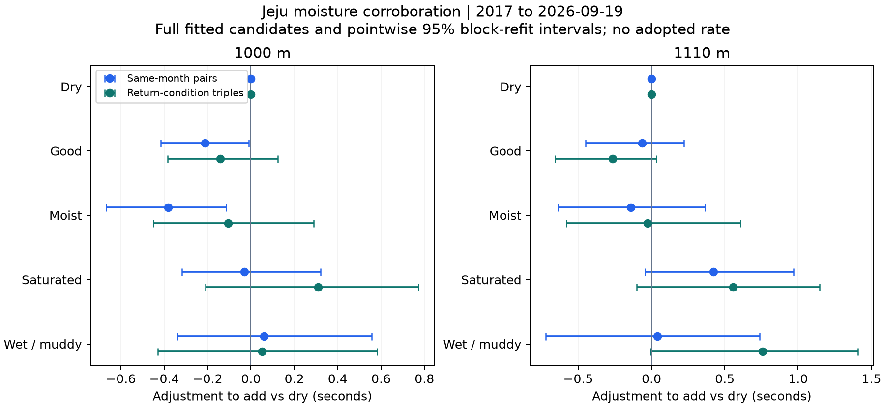

# 제주 함수율 보정의 단기 출전과 조건 복귀 검증

2017~2026년9월19일의1000m·1110m 기록에서 같은 말의 가까운 출전과 조건이 돌아오는3회 출전을 비교했다. **함수율 보정의 고정 수치를 확정할 만큼 일관된 근거는 확보하지 못했다.** 1110m 포화 주로가 빠른 방향은 여러 비교에서 나타났지만 추정 폭과 기간별 변동이 컸다.1000m 포화에 일률적으로+0.30초를 더하는 앞선 후보는 같은 달·단기 비교에서 재현되지 않았다.

이번에는 미래 기록을 맞히는 성능보다 조건이 바뀔 때 생기는 체계적 기록 편차를 중심으로 확인했다. 관측 연구이며 진짜 건조 조건의 반사실 기록을 확인한 것은 아니다. 연구 후보를 유지하고 확정 적용률이나 운영 모델은 변경하지 않았다. 월 효과는 분리 검증을 위해 먼저 함수율을 좁혀 확인했으며, 새 월별 보정표를 채택한 연구가 아니다.

## 비교 대상과 방법

원천은 앞선 연구의 품질 뷰에서 보존한 정상·완전순위 추출 자료다. 공식 말ID와 정확 거리를 연결했고 출전두수는 제한하지 않았다. 보존된 정상 출전의 인접 기록을 사용하므로 중간에 제외된 실제 출전이 있을 수 있다. 비교한 기록은 모두 같은 연도 안에 있다.

| 비교 | 1000m | 1110m |
|---|---:|---:|
| 같은 달·7~30일 내 함수율이 달라진2회 출전 | 1,892쌍·810두 | 1,327쌍·540두 |
| 같은 달·함수율도 같은 비교 대조군 | 885쌍 | 489쌍 |
| A→B→A로 조건이 돌아온3회 출전 | 588건 | 420건 |
| A→A→A로 조건이 유지된3회 대조군 | 448건 | 244건 |
| 3회가 모두 같은 달인 조건 복귀 표본 | 33건 | 8건 |

2회 비교에서는 이후−이전 기록을 사용한다.3회 비교는 앞뒤 함수율 구간이 같고 각 간격7~30일, 전체60일 이내인 경우다. 중간 기록에서 앞뒤 기록을 날짜 간격에 맞춰 보간한 기준을 뺀다. 예를 들어 중간 출전이 두 바깥 출전의 정확한 중간 날짜라면 앞뒤 기록의 평균을 기준으로 삼는다. 말의 능력과 계절 효과가 시간에 따라 선형으로 변하는 부분은 상쇄하지만 갑작스러운 컨디션 변화와 곡선 형태의 변화는 남는다.

함수율 구간의 기록 차이와 부담중량·관측 출전횟수·출전두수·경주번호·등급·성별 변화, 출전간격과 달 지시값을 함께 추정했다. 기수·바람·전개·건강을 모두 통제한 결과가 아니다. 각 경주의 가중치 합을 같게 하고, 극단 기록을 삭제하지 않는 고정 Huber 손실과ridge 벌점을 사용했다.2회와3회 표본은 겹치므로 독립된 두 실험으로 합산하지 않는다.

전체기간 설명용 추정과2017~2023년 추정,2024~2025년 확인,2026년 부분연도를 구분했다. 기간 평가에는 모든 출전이 해당 기간 안에 있는 쌍·세 쌍만 사용했다. 이미 다른 연구에 쓴 기간을 다시 활용하므로 새로운 미래 자료의 독립 검증은 아니다. [사전 계획](PLAN.json)에 대상·모형·비율·민감도를 고정했다.

## 포화 주로의 건조 대비 조정초

아래는 원기록에 **더할** 전체기간 추정 조정초다. 양수는 포화에서 빠르게 나온 기록을 건조 기준으로 늘리는 방향이다. 효과를100% 반영한 설명용 후보이며 고정 채택값이 아니다. 괄호는84일 블록200회 전체 재추정의 근사 점별95% 구간이다. 여러 조건의 동시 검정 보정은 하지 않았다.

| 거리 | 앞선 함수율과 월 공동 모형 | 같은 달·단기2회 비교 | 조건 복귀3회 비교 |
|---|---:|---:|---:|
| 1000m | +0.30초 | **−0.03초** (−0.32~+0.32) | **+0.31초** (−0.21~+0.77) |
| 1110m | +0.28초 | **+0.42초** (−0.04~+0.97) | **+0.56초** (−0.10~+1.15) |

1000m는 비교 설계에 따라 중심값이 달라졌다.1110m는 포화가 빠른 방향은 반복됐지만 두 설계 모두 블록 구간이0을 포함했다. 등급이 같고 부담중량 차이가1kg 이내인 조건으로 더 좁히면1110m3회 비교의 포화 조정은−0.15초로 방향이 바뀌었다. 같은 달2회 비교는 같은 제한에서+0.23초,간격21일 제한에서는+0.43초였다. 따라서1110m에도+0.5초를 확정 적용하기 어렵다.

| 함수율 | 1000m2회 조정 | 1000m3회 조정 | 1110m2회 조정 | 1110m3회 조정 |
|---|---:|---:|---:|---:|
| 건조1~5% | 기준0.00 | 기준0.00 | 기준0.00 | 기준0.00 |
| 양호6~9% | −0.21 | −0.14 | −0.06 | −0.26 |
| 다습10~14% | −0.38 | −0.10 | −0.14 | −0.03 |
| 포화15~19% | −0.03 | +0.31 | +0.42 | +0.56 |
| 불량20% 이상 | +0.06 | +0.05 | +0.04 | +0.76 |

표 전체는100% 후보이며 초 단위다. 건조0은 기준 정의이고 양호·다습이 느린 중심값으로 나온 것을 인과관계로 해석하지 않는다.1000m2회 비교의 일부 구간이0을 제외하더라도3회와 최근 기간에서 일관되게 재현된 고정 보정표는 아니다. 불량은 일반 제곱손실로 바꾼2회 비교에서 두 거리 모두 방향이 바뀐다. 전체 구간은 [효과 표](effects.csv),모든 민감도는 [민감도 표](sensitivities.csv)에 보존했다.

## 건조와 포화를 직접 오간 표본

총 표본이 수천 쌍이어도 특정 조건을 직접 오간 표본은 훨씬 적다. 함수율 계수는 모든 구간의 전환을 함께 사용하므로 다른 구간을 거친 간접 비교 정보도 들어 있다.

| 거리와 비교 | 건조→포화 | 포화→건조 |
|---|---:|---:|
| 1000m2회 | 89쌍·28경주 | 129쌍·51경주 |
| 1110m2회 | 50쌍·17경주 | 70쌍·28경주 |
| 1000m3회 | 건조→포화→건조54건·31경주 | 포화→건조→포화7건·6경주 |
| 1110m3회 | 건조→포화→건조36건·22경주 | 포화→건조→포화9건·7경주 |

경주 수는2회 비교의 이후 경주,3회 비교의 중간 경주다. 같은 경주·말이 반복될 수 있다. 특히2024~2025년 건조→포화→건조는1000m6건·5경주,1110m9건·5경주이고 반대 조건 복귀도 각각2건뿐이다. 최근3회 검증의 매우 넓은 구간은 이 지원 부족과 관련된다.

공변량 영향을 조정한 직접 전환 평균을 같은 ‘포화−건조’ 방향으로 맞추면1000m2회는 건조→포화−0.13초,포화→건조+0.34초로 방향이 서로 다르다.1110m는 각각−1.16초,−0.57초로 모두 빠른 방향이지만 크기가 다르다. 이 값은 방향별 관측 평균이며 위 공동 회귀계수와 동일한 통계량이 아니다.3회 반대 방향은6~7경주뿐이므로 대칭 효과를 확정하기 어렵다. [양방향 전체 결과](direction_estimates.csv)를 함께 확인한다.

## 이후 기간에서 조건 편차가 줄었는가

2017~2023년 같은 달2회 비교로 추정한 함수율 계수를 고정하고0·25·50·100%를2024~2025년과2026년에 적용했다.3회 비교에도 같은2회 추정 계수를 적용해 한 보정표가 다른 비교 설계에서 작동하는지 확인했다. 각 비율의 공변량 모형은 과거 자료로만 다시 적합했다. 확인 기간을 보고 비율을 선택하지 않았다. [고정 계수](frozen_before_confirmation.json)는 이 확인 계산 전에 저장했으며,별도의 기간별 설명용 추정도 수행한 후향 연구다.

주요 진단은 함수율 전환 그룹별 잔여 평균 기록 차이의 퍼짐이다. 같은 전환의 경주별 잔차 평균을 계산하고10경주 이상인 전환 그룹을 대상으로 가중 중심 RMS를 구했다. **작을수록 조건별 남은 편차가 작다.** 실제 반사실 오차가 아니며 표본 잡음과 미관측 편성 차이도 포함한다. 경주와 전환의 조합을 단위로 하므로 전환이 여러 개인 한 경주가 여러 셀에 나타날 수 있다.

| 2024~2025년 조건 편차 RMS | 0% | 25% | 50% | 100% |
|---|---:|---:|---:|---:|
| 1000m2회 | 0.529 | 0.512 | 0.503 | 0.513 |
| 1110m2회 | 0.392 | 0.427 | 0.467 | 0.557 |
| 1000m3회 | 0.123 | 0.126 | 0.153 | 0.242 |
| 1110m3회 | 0.178 | 0.176 | 0.174 | 0.171 |

단위는 초다.1000m2회에서는 약간 줄지만3회에서는 늘고,1110m는2회에서 늘고3회에서 조금 줄었다. 거리와 설계를 모두 만족하는 일관된 비율은 없었다.100% 적용의 편차 변화 근사95% 구간은1000m2회−0.152~+0.161초,1110m2회+0.037~+0.227초,1000m3회−0.157~+0.231초,1110m3회−0.034~+0.032초다. 여러 후보 중 한 구간을 골라 일반적 결론으로 사용하지 않는다.

보조 MAE도 확인했다.0%에서100% 적용으로1000m2회1.361→1.369초,1110m2회1.670→1.705초,1000m3회1.049→1.070초,1110m3회1.474→1.513초로 중심값이 커졌고 모든 변화 구간은0을 포함했다. 이 MAE는 기록 차이·중간 기록 편차를 설명하는 오차다. 실제 건조 환산 기록의 정답 오차나 사전 미래 기록 예측 오차로 표현하지 않는다.

2026년은2회에서도 평가 가능한 전환 그룹이1000m3개·1110m2개뿐이며3회는 각각1개로 조건 간 퍼짐을 비교할 수 없다. 해당3회 RMS는 결측으로 유지했다.2026년 작은 표본의 유리한 결과로 비율을 다시 선택하지 않았다. [전체 기간별 지표](held_checks.csv),[고정 예측값 조건부 구간](held_metric_intervals.csv)에 모두 남겼다.

## 계절 변화와 표본 한계

3회가 모두 같은 달에 있는 조건 복귀는1000m33건,1110m8건뿐이다. 같은 조건 대조군까지 포함해도43건과11건으로 작다.1000m의 같은 달 민감도 결과는 계산해 남겼지만 다수 공변량 대비 표본이 부족해 고정 보정의 근거로 쓰지 않는다.1110m는30건 미만 사전 기준에 따라 해당 민감도 모형을 추정하지 않았다.

앞선 월 곡선을 진단용으로 적용하면3회 보간 뒤 남는 월 곡률의 절댓값 중앙은1000m0.015초·1110m0.014초,95백분위는0.037초·0.054초였다. 완만한 계절 흐름의 영향은 작아지는 설계지만 이 곡선 자체가 추정 모형이다. 실제 계절·주로·컨디션의 비선형 변화를 작다고 입증한 것은 아니다. 이 진단은 새 월 효과 추정이나 독립 검증으로 세지 않는다.

시간 블록과 말 단위 재표집 구간을 모두 보존했다. 블록은 이후 또는 중간 날짜 기준이며,앞뒤 출전이 블록 경계를 넘거나 동일 말의 쌍·세 쌍이 겹치는 의존성은 남는다. 재표집 구간은 모형·짝 구성·비율을 고정한 조건부 근사값이며 모형 선택 불확실성을 포함하지 않는다. 확인 지표의 구간은 고정된 예측을1000회 블록 재표집한 것이고 계수를 다시 추정한 구간은 별도다. 확인 기간은2회10개 블록,3회9개 블록으로 충분히 많지 않다.

앞뒤 조건이 같다는 것은 함수율 **구간**이 같다는 뜻으로 정확한 함수율 수치까지 같은 것은 아니다. 같은 구간 대조군에 함수율 조정이0인 것은 이 구간 모형의 정의이며 실제 환경 영향이 없다는 증거가 아니다. 등급·중량 제한3회 비교는 세 출전의 등급이 같고 중간 부담중량과 날짜 보간한 바깥 부담중량의 차이가1kg 이내인 조건이다.

## 현재 판단과 다음 근거

함수율의 기록 영향이 없다는 결론은 아니다. **앞선 전체기간 후보를 확정 보정치로 승격할 추가 근거는 이번에도 부족하며,1000m 포화 후보의 확신은 더 낮춰야 한다.** 1110m 포화의 빠른 방향은 연구 가설로 유지하되 추정 크기·기간·등급과 중량 제한에 민감한 상태다. 불량의 일괄 보정과 제주 전체 거리로의 확대도 보류한다.

사용자 표시에서는 원기록을 기본으로 두고 앞선 환산값은 연구용 후보라는 상태를 명확히 해야 한다.80.00초가 확정80.69초로 바뀐다고 설명하지 않는다. 다음 근거는 많은 말 수만 늘리기보다 최근 기간의 양방향 건조↔포화 경주와 조건 복귀 경주를 충분히 확보하고,등급·중량이 안정된 비교에서 재현되는지 확인하는 것이다. 월은 말의 장기 능력 변화·연도별 주로 차이를 분리하는 별도 검증이 필요하다.

## 재현과 보관

- [분석 코드](analyze.py),[사전 계획](PLAN.json),[원천 해시](source_manifest.json),[출전별 원천 연결](endpoint_lineage.csv)
- [연도별 표본](annual_support.csv),[전환별 지원](transition_support.csv),[건조와 포화 직접 지원](dry_saturated_direct_support.csv)
- [전체 효과와 구간](effects.csv),[모든 재표집 계수](bootstrap_draws.json),[기간별 모형](models.json),[민감도](sensitivities.csv)
- [고정 확인 예측](held_predictions.csv),[전환별 잔여 편차](held_transition_means.csv),[월 곡률 진단](month_curvature_diagnostic.json)
- [원천과 수렴 확인](verification.json),[별도 수식과 범용 최적화 재검산](calculation_verification.json),[재검산 코드](verify_summarize.py)
- [앞선 함수율과 월 공동 연구](../20261008_record_normalization_pairs_v3/README.md)

원천과DB의SHA를 시작·종료와 별도 재검산에서 확인했다. 모든 모형과 재표집이 수렴했고 범용SciPy 최적화와 예측값을 대조했다. 초기 구현은 그룹 이동 시 그룹 키가 제외되는 문제로 효과 추정 전에 종료되어 앞선 폴더에 보존했다. 이 버전은 공식 출전ID 조회로 말과 거리 연결을 재검증한 구현 보수이며 결과에 맞춘 대상 변경이 아니다.
