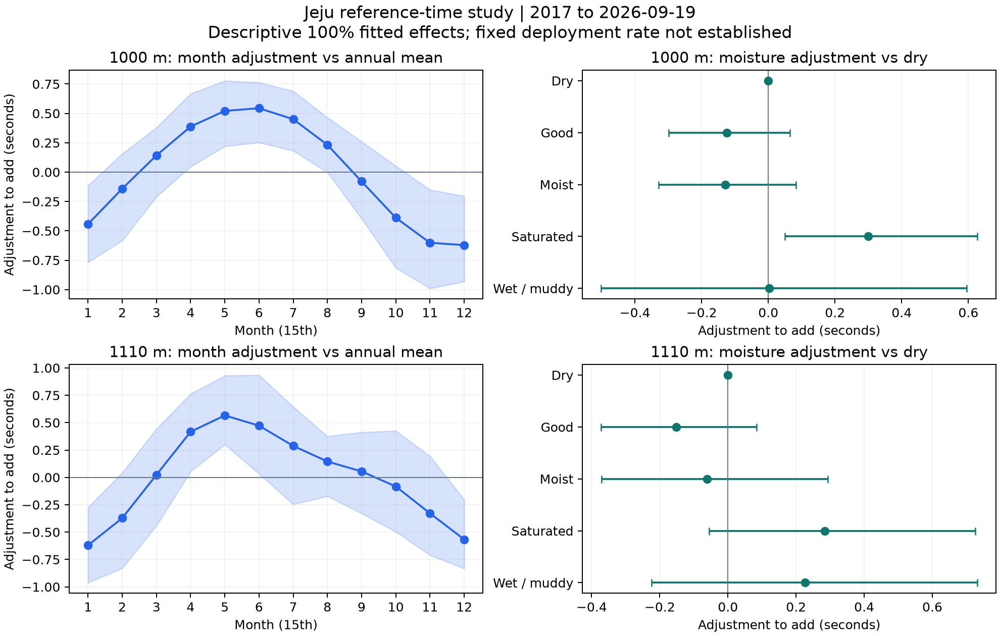

# 제주 함수율과 월의 기록 환산 연구

2017년부터 2026년 9월 19일까지의 1000m·1110m 기록을 같은 말의 전후 출전으로 비교했다. **겨울에는 느리고 봄부터 초여름에는 빠른 월별 흐름, 포화 주로에서는 건조보다 빠른 방향이 관찰됐다.** 그러나 과거로 계수를 추정해 이후 기간에 적용했을 때 비교 오차의 개선은 작고 불확실했다. 함수율25%+월25% 또는50%+50%를 확정 적용률로 채택할 근거는 확보하지 못했다.

이 결과는 Top3 예측 성능으로 판단하지 않았다. 원기록을 기준 조건으로 환산해 보여주는 목적의 시간 비교 연구다. 사용자에게 제공할 수 있는 것은 **연구용 환산 추정치와 그 불확실성**이며, 실제로 다른 조건에서 뛰었을 때의 정답 기록은 아니다. DB·운영 모델·예측 등록부는 변경하지 않았다.

## 대상과 비교 방법

기존 품질 검증 뷰에서 보존한 원천 추출 자료 중 정상·완전순위 경주를 사용했다. 출전두수는 제한하지 않았다. 같은 공식 말 ID와 정확히 같은 거리에서 보존된 출전의 인접 쌍을 만들되, 같은 연도이며 출전 간격7~90일인 경우로 제한했다. 정상 기준에서 빠진 출전이 중간에 있을 수 있어 전체 생애의 연속 출전을 뜻하지 않는다.

| 거리 | 전후 출전 비교 쌍 | 2026년 비교 쌍 | 추정 기간 |
|---|---:|---:|---|
| 1000m | 9,447 | 794 | 2017~2026-09-19 |
| 1110m | 6,415 | 719 | 2017~2026-09-19 |
| 합계 | 15,862 | 1,513 | 2026년은 부분연도 |

반응값은 `이후 기록−이전 기록`이다. 말의 고정 능력 차이를 줄이고 함수율 구간 차이와 연중 월 효과를 동시에 추정했다. 부담중량·출전간격·관측 출전횟수·경주등급·출전두수·경주번호·성별·경주 당시 나이 관련 차이를 함께 포함했다. 말의 성장·컨디션 변화와 기수·전개·바람 등 미관측 요인까지 제거한 것은 아니다. 실제 나이는 같은 연도 내에서 거의 변하지 않아 성장 효과를 충분히 식별하지 못한다.

월 효과는 실제 날짜를 쓰는 연중 주기의 사인·코사인 두 쌍으로 부드럽게 추정했다. 아래 월별 표는 매월15일의 값이다. **같은 거리·건조 함수율1~5%·연중 평균 월 효과0**을 환산 기준으로 삼았다. 건조의0은 기준 정의다. 함수율과 월의 상호작용은 추정하지 않았다.

Huber 손실과 ridge 벌점으로 극단 기록의 영향은 줄이되 기록을 임의 삭제하지 않았다. 학습 자료로만 표준화하며 이후 경주별로 가중치 합을 같게 했다. 전체기간 계수는 최신 설명용 추정치이고, 기간별 평가는 매년 직전 연도까지의 자료로만 추정했다.

## 사용자 기록에 더할 후보 조정초

아래는 **전체기간에서 추정한 효과를100% 적용하는 설명용 후보**다. 채택된 고정 보정표가 아니다. 양수는 원기록에 더하고 음수는 뺀다. 범위는12주 단위 블록100회 전체 재추정의 근사 점별95% 구간이다. 여러 조건을 동시에 검정하는 보정은 하지 않았다.

| 함수율 조건 | 1000m 조정초 | 근사95% 구간 | 1110m 조정초 | 근사95% 구간 |
|---|---:|---:|---:|---:|
| 건조 1~5% | 0.00 | 기준 | 0.00 | 기준 |
| 양호 6~9% | −0.13 | −0.30~+0.07 | −0.15 | −0.37~+0.08 |
| 다습 10~14% | −0.13 | −0.33~+0.08 | −0.06 | −0.37~+0.29 |
| 포화 15~19% | +0.30 | +0.05~+0.63 | +0.28 | −0.06~+0.73 |
| 불량 20% 이상 | +0.00 | −0.50~+0.60 | +0.23 | −0.22~+0.73 |

함수율이 높아질수록 일정 비율로 빨라진다는 형태는 확인되지 않았다. 불량은 특히 불안정하다. 일반 제곱손실로 바꾸면 불량의 조정초가1000m−0.20초,1110m−0.03초로 방향이 바뀐다. 말 단위로 묶은 재표집은 시간 블록보다 좁은 구간을 내므로 시간에 따른 변동을 생략하면 확신을 과장할 수 있다. 구간 끝값은 반올림했다.

| 월 | 1000m 조정초 | 1110m 조정초 |
|---|---:|---:|
| 1월 | −0.44 | −0.62 |
| 2월 | −0.14 | −0.37 |
| 3월 | +0.14 | +0.02 |
| 4월 | +0.39 | +0.42 |
| 5월 | +0.52 | +0.57 |
| 6월 | +0.54 | +0.47 |
| 7월 | +0.45 | +0.29 |
| 8월 | +0.23 | +0.15 |
| 9월 | −0.08 | +0.05 |
| 10월 | −0.39 | −0.08 |
| 11월 | −0.60 | −0.33 |
| 12월 | −0.62 | −0.57 |

월별 값에는 계절의 순수한 인과효과 외에 통제하지 못한 편성·환경·말 상태의 계절 변화가 남을 수 있다. 1000m의1월 조정 구간은−0.77~−0.11초,5월은+0.22~+0.78초,12월은−0.93~−0.20초다. 1110m는 각각−0.96~−0.27초,+0.30~+0.93초,−0.83~−0.20초다. 전체 월별 구간은 [계수 표](latest_coefficients.csv)에 있다.

## 환산 표시 예시

원기록80.00초를 가정한1000m·4월15일·포화 조건의 설명용 예시다. 실제 특정 말의 기록이 아니며 최신 전체기간 모델100% 적용 예다.

`80.00초 + 함수율0.30초 + 월0.39초 = 연구용 환산80.69초`

합산 조정의 근사95% 구간은+0.29~+1.01초이므로 환산 추정 구간은80.29~81.01초다. 함수율과 월의 **공동 재추정**으로 구간을 계산했다. 각각의 구간 끝을 더하지 않았다. 이 범위는 계수 추정의 불확실성이고 해당 말의 가상 재경주 기록 예측 구간이 아니다.1110m·4월15일·포화의90.00초는90.70초, 계수 불확실성을 반영한 범위는90.21~91.19초다.

사용자 표에는 원기록, 실제 조건, 기준 조건, 각 조정초, 환산 추정치, 불확실성, 자료 기간과 버전을 함께 표시한다. 조건은 같아도 말마다 별도의 임의 비율을 적용하지 않으므로 같은 경주 내 기록 차이는 그대로 유지된다. [120개 월과 함수율 조합](latest_joint_reference.csv)의 `supported`는 사전 **주변 표본 기준** 충족 여부다. 개별 함수율×월 조합의 충분한 관측을 뜻하지 않으며 [실제 조합 표본](joint_cell_support.csv)을 별도로 확인해야 한다. 희소 조합은 가법 모형의 외삽 성격이 강하다.

## 이후 기간의 비교 검증

2022~2023년 자료에서 함수율·월 각각0·25·50·75·100%의25개 조합을 비교했다. 최저 오차와1표준오차 이내 후보 중 보정이 작은 것을 고른 뒤, 무보정 대비 개선 구간이0을 넘으면 미채택하는 규칙을 계산 전에 고정했다.1000m는 월25% 후보가 평균0.0031초 개선됐지만 구간은−0.0079~+0.0015초,1110m는 월50% 후보가0.0099초 개선됐지만−0.0239~+0.0045초였다. 두 거리 모두 비영 적용률의 선택 기준을 통과하지 못했다.

2024~2025년 확인 비교에는 사전에 정한25%+25%,50%+50%,100%+100%도 진단용으로 남겼다. 아래 오차는 말의 전후 기록 차이를 조건·공변량 변화로 설명할 때의 경주 균등 평균절대오차(MAE)다. **기준 조건에서 실제로 뛰었을 기록의 오차가 아니다.**

| 거리와 기간 | 무보정 MAE | 25%씩 MAE | 50%씩 MAE | 100%씩 MAE |
|---|---:|---:|---:|---:|
| 1000m 2024~2025 | 1.4336 | 1.4308 | 1.4303 | 1.4364 |
| 1110m 2024~2025 | 1.6631 | 1.6583 | 1.6560 | 1.6604 |
| 1000m 2026 부분연도 | 1.1946 | 1.1846 | 1.1780 | 1.1799 |
| 1110m 2026 부분연도 | 1.4758 | 1.4760 | 1.4791 | 1.4961 |

2024~2025년25%씩 적용한 MAE 변화 구간은1000m−0.0100~+0.0062초,1110m−0.0117~+0.0011초로 모두0을 포함했다.50%씩도 각각−0.0174~+0.0139초,−0.0206~+0.0043초였다.2026년1000m의 개선 방향만 보고 비율을 다시 고르지 않았다.1110m에서는 반대로 오차가 커졌고,2026년은 단4개12주 블록뿐이다.2024~2025년은 거리별10개 블록이다.

선택 규칙에 따른 결과는 양쪽 모두0%로 돌아가는 보수적 기준 유지다. 이는 **환경 효과가 없거나0%가 참된 최적 환산률이라는 뜻이 아니다.** 관측된 효과와 시간 비교의 개선을 별도로 평가한 결과다. 앞서 제안한25%+25% 역시 검증된 최적값이 아니었다. 출전간격45·60일,2019년 이후 학습,일반 제곱손실의 민감도 비교는 고정 선택률0%를 대상으로 하므로 후보 보정의 강건성을 입증하는 자료로 쓰지 않는다.

## 한계와 후속 판단

반사실 정답이 없어 시간 비교 지표는 대리 근거다. 한 말의 능력도90일 안에 변하고, 시간 블록을 넘는 쌍과 동일 말의 반복 출전은 의존성을 남긴다. 같은 연도 제한으로 연말과 다음 연초를 잇는 쌍은 없고 연중 곡선의 매끄러움을 가정한다. 원천을 이미 여러 연구에서 확인했으므로2024~2026년 비교는 후향 평가이며 새 미래 자료의 독립 검증이 아니다.

계수 구간은 모형·표본 구성·비율을 고정한 조건부 근사 구간이다.100회 재추정은 정밀한 꼬리 확률을 보장하지 않으며 모형 선택 불확실성은 포함하지 않았다. 전체 효과를100% 반영한 표와 최종 선택률0%를 혼용하면 안 된다. 현재 권고는 원기록을 유지하면서 별도 연구용 환산 추정치와 범위를 제시하는 단계다. 확정 보정표를 정하려면 월 효과·연도별 주로 변화와 말의 변화가 얼마나 분리되는지 추가 검증이 필요하다. 이번 결과를800·900·1200·1300·1400·1610m로 자동 확장하지 않는다.

## 재현과 보관

- [사전 계획과 수치 계산 보수 이력](PLAN.json), [계산 코드](analyze.py), [수치 재검산 코드](verify_and_plot.py)
- [원천 해시](source_manifest.json), [출전 쌍별 원천 연결](pair_source_lineage.csv), [연도별 표본](annual_support.csv)
- [확인 전에 고정한 선택](selection_locked_before_confirmation.json), [최종 판단](decision.json), [기간별 전체 비교](confirmation_comparisons.csv)
- [최신 계수](latest_coefficients.csv), [공동 환산 후보](latest_joint_reference.csv), [실제 원기록 표시 예](real_record_examples.csv)
- [원천과 계산 검증](verification.json), [별도 수식과 범용 최적화 재검산](independent_calculation_verification.json)

앞선 두 계산 버전은 수렴 진단용으로 보존했다. 최종 버전은 같은 고정 Huber 손실을 감쇠 Newton 방식으로 풀어 모든 기간 모델과200회씩의 거리별 재표집이 수렴했다. 범용 SciPy 최적화로 다시 푼 예측값과도 대조했다. 버전 수는 독립 연구 횟수가 아니다. 원천·DB 해시가 유지됐음을 확인했고 다른 연구 폴더는 변경하지 않았다.
