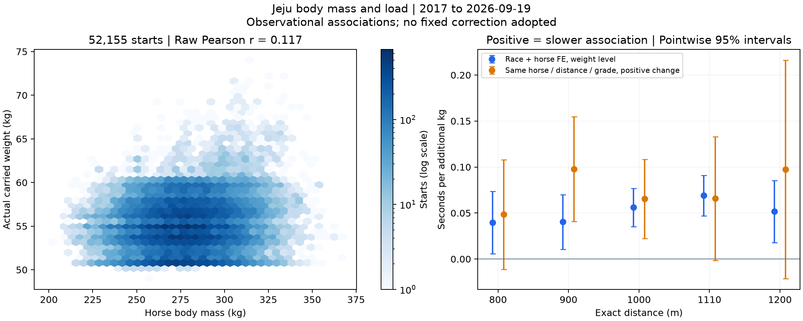

# 제주 마체중과 부담중량 및 증량에 따른 속도 변화

2017년부터 2026년 9월 19일까지 정상 완전순위인 5,206경주·52,155출전·2,813두를 분석했다. **마체중과 부담중량의 원시 상관은 약하다. 같은 말의 부담중량이 커질 때 완주시간이 소폭 늘어나는 연관성은 관찰됐지만, 직전 대비 증량의 일정한 초 단위 효과는 최근 기간과 설계에 따라 불확실해 고정 보정률을 채택하지 않았다.**

이전 환경·게이트 연구의 해석은 [능력 평가와 환경 조건 해석 보존](../20261008_weight_speed_v1/CONTEXT_SNAPSHOT.md)에 저장했다. 말의 반복 수행과 최근 상태를 평가 중심에 두되, 함수율·월·게이트 영향을 없다고 처리하지 않는다. 이번 연구는 Top3 선택이 아닌 완주시간과 평균속도의 관찰 연구다.

## 마체중과 부담중량의 상관관계

전체 Pearson 상관은 **r=0.117**, 말 단위 재표집 95% 구간은0.091~0.143이었다. Spearman은0.092다. 같은 말 안에서 평균을 뺀 상관은−0.010, 경주와 말의 공통 효과를 모두 분리한 잔여 상관은−0.030이었다. 다른 말끼리 큰 말이 조금 더 무거운 부담중량을 지는 경향은 있으나, 같은 말의 마체중 증가와 부담중량 증가는 거의 함께 움직이지 않았다. 이것은 중량 배정 규칙이나 원인의 검증이 아니다.

| 거리 | 출전 | 원시 Pearson r | 말 재표집 95% 구간 | 같은 말 안 r | 경주·말 분리 잔여 r |
|---|---|---|---|---|---|
| 전체 | 52155 | 0.117 | 0.091~0.143 | -0.010 | -0.030 |
| 800m | 12429 | 0.119 | 0.079~0.157 | -0.041 | -0.024 |
| 900m | 8883 | 0.138 | 0.101~0.178 | -0.049 | -0.068 |
| 1000m | 14457 | 0.089 | 0.056~0.118 | -0.036 | -0.051 |
| 1110m | 9999 | 0.105 | 0.065~0.147 | -0.026 | -0.038 |
| 1200m | 4854 | 0.170 | 0.097~0.242 | 0.001 | -0.012 |
| 1300m | 606 | 0.193 | 0.085~0.289 | -0.007 | 0.082 |
| 1400m | 843 | 0.152 | 0.044~0.265 | -0.015 | -0.005 |
| 1610m | 84 | 0.364 | 0.164~0.567 | -0.145 | 0.099 |

1610m는84출전이지만9경주뿐이라 일반화하지 않는다. 전체 평균 마체중은278.23kg, 부담중량은55.07kg이며 출전별 부담중량÷마체중의 평균은19.90%다. 평균 중량끼리 나눈 값과 출전별 비율의 평균은 다르다. [상관 전체 표](body_burden_correlations.csv)를 보존했다.

1000m·1110m의 체중 구간별 관측 부담 비율은 다음과 같다. 경계는 결과에 따른 최적화가 아닌 서술용 구간이다.

| 거리 | 마체중 구간 kg | 출전 | 평균 마체중 kg | 평균 부담 kg | 평균 부담 비율 |
|---|---|---|---|---|---|
| 1000m | under250 | 1191 | 241.1 | 54.91 | 22.80% |
| 1000m | 250to279 | 6821 | 266.9 | 54.91 | 20.60% |
| 1000m | 280to309 | 5511 | 291.4 | 55.22 | 18.96% |
| 1000m | 310plus | 934 | 319.0 | 55.83 | 17.51% |
| 1110m | under250 | 507 | 240.8 | 54.59 | 22.69% |
| 1110m | 250to279 | 4142 | 267.3 | 54.89 | 20.55% |
| 1110m | 280to309 | 4488 | 292.2 | 55.10 | 18.87% |
| 1110m | 310plus | 862 | 320.4 | 56.00 | 17.49% |

작은 말은 산술적으로 같은 부담중량의 체중 대비 비율이 높다. 그러나 부담중량×마체중 상호작용은 어느 거리에서도 BH 기준을 통과하지 못했다. ‘작은 말은1kg 증가에 몇 배 더 손해’ 또는 최적 마체중·부담 비율은 확정하지 않았다. 이 구간 평균은 체중 변화의 속도 효과가 아니다.

## 같은 말과 경주를 고려한 부담중량과 기록의 관계

거리별로 경주와 말 고정효과를 동시에 분리했다. 최근 동일거리 기록, 마지막 동일거리 착순 비율, 경력·간격·사건 당시 나이·마체중과 그 제곱·성별·출발번호를 고려했다. 아래는 **부담중량1kg 증가당 조건부 연관성**이다. 같은 경주 공통 함수율·월·등급·평균 페이스 수준은 경주 효과에 흡수된다. 완주시간의 양수는 느려진 방향이며 속도는 거리÷완주시간인 평균속도다.

| 거리 | 출전 | 시간 차이 초/kg | 점별 95% 구간 | 평균속도 변화 %/kg | 속도 95% 구간 | 시간 BH q |
|---|---|---|---|---|---|---|
| 800m | 12429 | +0.039 | +0.006~+0.073 | −0.058% | −0.106~−0.010% | 0.0315 |
| 900m | 8883 | +0.040 | +0.011~+0.070 | −0.052% | −0.090~−0.015% | 0.0134 |
| 1000m | 14457 | +0.056 | +0.035~+0.077 | −0.066% | −0.089~−0.043% | <0.0001 |
| 1110m | 9999 | +0.069 | +0.047~+0.091 | −0.072% | −0.095~−0.049% | <0.0001 |
| 1200m | 4854 | +0.052 | +0.018~+0.085 | −0.051% | −0.083~−0.018% | 0.0065 |
| 1300m | 606 | +0.030 | −0.100~+0.160 | −0.027% | −0.145~+0.090% | 0.6477 |
| 1400m | 843 | +0.038 | −0.058~+0.134 | −0.030% | −0.109~+0.048% | 0.5190 |

800~1200m의 전체기간 시간·속도 결과는 다중비교 후에도 느려지는 연관성이 남았다.1000m는+0.056초/kg,1110m는+0.069초/kg이며 평균속도는 각각약−0.066%·−0.072%/kg다.1300·1400m는 시간 구간이0을 포함하고1610m는 표본 부족으로 회귀 미추정이다.이번 분석은10두에 제한하지 않아 게이트 연구의47·63·2경주 대신1300·1400·1610m가63·88·9경주다.게이트 연구의 적용 범위 자체를 변경한 것이 아니다.

마체중을 일정하게 두는 선형 모형에서1000m+3kg의 설명값은약+0.17초다. 이는 평균 연관성을3배한 값이며, 해당 말의 다음 경주가 실제로0.17초 느려진다는 예측이나 채택된 기록 환산값이 아니다. 중량 배정은 무작위가 아니며 변하는 능력·기수·전개 등 잔여 교란이 남는다.

말 효과를 빼고 경주 효과만 사용하면800~1200m의 부담중량 계수는 오히려 빠른 방향으로 바뀌었다. 능력이 좋은 말의 중량 배정과 말 자체 능력이 섞이는 문제를 보여준다. 말 효과를 포함한 모형의 양수 계수도 순수 물리효과의 인과 인증은 아니다. [전체 계수와 민감도](effects.csv)를 확인한다.

파란색은 경주·말 고정효과의 중량 수준 비교, 주황색은 다음 절의 같은 말 연속 출전에서 양의 중량 변화에 대한 기울기다. 두 설계의 비교 대상은 완전히 같지 않다. [그림 PDF](body_load_speed.pdf)를 제공한다.

## 같은 말이 같은 거리와 등급에 연속 출전했을 때

같은 공식 말 ID·정확 거리·원문 등급·연도를 유지하고7~60일 간격으로 이어지는 적격 정상 출전27,230쌍을 비교했다. 사이에 부적격 경주나 다른 거리 출전이 있을 수 있으므로 경력 전체에서 바로 직전 출전이라고 설명하지 않는다. 양의 부담 증감과 음의 부담 증감을 별도 기울기로 적합했다. 마체중 변화·이전 부담중량·간격·이전 상대 기록과 착순·함수율·연중 시점·출발번호·두수 변화 등을 고려했다.

아래는 부담중량이 증가하는 쪽의1kg당 시간 차이다.

| 거리 | 출전 쌍 | 증량 시간 차이 초/kg | 점별 95% 구간 | BH q |
|---|---|---|---|---|
| 800m | 6811 | +0.048 | −0.011~+0.108 | 0.1545 |
| 900m | 4461 | +0.098 | +0.041~+0.155 | 0.0055 |
| 1000m | 7902 | +0.065 | +0.022~+0.108 | 0.0101 |
| 1110m | 5242 | +0.066 | −0.001~+0.133 | 0.1289 |
| 1200m | 2357 | +0.097 | −0.021~+0.216 | 0.1545 |
| 1300m | 213 | −0.109 | −0.610~+0.392 | 0.7484 |
| 1400m | 239 | +0.044 | −0.229~+0.317 | 0.7484 |

전체기간900·1000m는 증량과 느려진 시간의 연관성이 다중비교 후에도 남았다.1110m는+0.066초/kg이지만 시간 구간이0을 약간 포함했다.같은 주로상태·같은 달·마체중 변화5kg 이내로 제한하거나 같은 기수로 제한하면 표본이 줄고 모든 거리의 시간 대비가 BH 기준을 통과하지 못했다.이는 효과가 없다는 증명이 아니다.

전체 연속 출전의 조정 전 상관은 다음과 같다.증감량과 시간 변화의 양수는 증량할수록 느려진 방향,증감량과 속도 변화의 음수는 증량할수록 속도가 낮아진 방향이다.

| 거리 | 출전 쌍 | 중량 증감과 시간 변화 r | 중량 증감과 속도 변화 r |
|---|---|---|---|
| 800m | 6811 | 0.116 | -0.120 |
| 900m | 4461 | 0.218 | -0.222 |
| 1000m | 7902 | 0.210 | -0.215 |
| 1110m | 5242 | 0.193 | -0.198 |
| 1200m | 2357 | 0.141 | -0.149 |
| 1300m | 213 | 0.071 | -0.073 |
| 1400m | 239 | 0.210 | -0.213 |
| 1610m | 5 | 0.671 | -0.671 |

1000m의 원시 상관은 시간과+0.210,속도와−0.215였으나,증량한 출전만 보면+0.147·−0.151로 약했다.관측 자체로 직접적인 감속 원인을 확정하지 않는다.[원시 쌍 상관 전체](raw_pair_correlations.csv)에 증가 출전만의 결과도 보존했다.

## 원시 시간 차이를 중량 효과로 읽으면 안 되는 이유

1000m에서 부담 증감 폭으로 나눈 단순 집계는 다음과 같다.마지막 열의 직전 착순 비율은0이1착,1이최하위이므로 작을수록 직전 성적이 좋다.

| 부담 증감군 | 출전 쌍 | 평균 증감 | 평균 원기록 변화 | 직전 착순 비율 |
|---|---|---|---|---|
| −1kg 초과~+1kg 미만 | 4079 | -0.05kg | -0.101초 | 0.588 |
| +1kg 이상~+3kg 미만 | 1705 | +1.58kg | +0.401초 | 0.319 |
| +3kg 이상~+5kg 미만 | 656 | +3.54kg | +0.764초 | 0.207 |
| +5kg 이상 | 215 | +6.27kg | +0.832초 | 0.246 |

증량군은 직전 성적이 훨씬 좋다.직전의 좋은 성적에서 다음 경주에 평균 쪽으로 돌아오는 현상과 경주 조건 변화가 증량의 영향에 섞인다.1000m에서 직전 성적 통제를 빼면 양의 변화 계수는+0.204초/kg,넣으면+0.065초/kg였다.1110m는+0.240에서+0.066초/kg로 줄었다.통제 방식도 정답은 아니므로 두 결과와 한계를 함께 보존했다.원시0.4~0.8초 차이를 전부 증량 탓으로 환산하지 않는다.

## 최근 기간에서 재현되는가

기간 표기는 confirmation=2024~2025년,2026partial=2026년1월부터9월19일까지다. 같은 과거 자료를 다시 나눈 후향 비교이며 신규 독립 검증이나 과거 계수를 고정한 미래 예측 평가가 아니다.

| 설계 | 기간 | 거리 | 출전 또는 쌍 | 시간 차이 초/kg | 점별 95% 구간 | BH q |
|---|---|---|---|---|---|---|
| 同馬·同경주 효과 | confirmation | 800m | 1484 | +0.140 | −0.067~+0.347 | 0.2147 |
| 同馬·同경주 효과 | confirmation | 900m | 1526 | +0.035 | −0.071~+0.142 | 0.5101 |
| 同馬·同경주 효과 | confirmation | 1000m | 3641 | +0.068 | +0.026~+0.111 | 0.0063 |
| 同馬·同경주 효과 | confirmation | 1110m | 3517 | +0.088 | +0.043~+0.134 | 0.0012 |
| 同馬·同경주 효과 | confirmation | 1200m | 1758 | +0.079 | +0.013~+0.145 | 0.0468 |
| 同馬·同경주 효과 | confirmation | 1300m | 414 | +0.112 | −0.022~+0.246 | 0.1378 |
| 同馬·同경주 효과 | confirmation | 1400m | 369 | +0.162 | +0.003~+0.321 | 0.0801 |
| 同馬·同경주 효과 | 2026partial | 900m | 938 | +0.136 | −0.054~+0.326 | 0.1563 |
| 同馬·同경주 효과 | 2026partial | 1000m | 1372 | +0.088 | −0.001~+0.176 | 0.0700 |
| 同馬·同경주 효과 | 2026partial | 1110m | 1208 | +0.148 | +0.062~+0.233 | 0.0040 |
| 同馬·同경주 효과 | 2026partial | 1200m | 754 | +0.126 | +0.027~+0.225 | 0.0277 |
| 연속 출전 증량 | confirmation | 800m | 649 | +0.112 | −0.171~+0.394 | 0.8717 |
| 연속 출전 증량 | confirmation | 900m | 652 | −0.089 | −0.300~+0.121 | 0.8717 |
| 연속 출전 증량 | confirmation | 1000m | 2133 | −0.001 | −0.105~+0.103 | 0.9849 |
| 연속 출전 증량 | confirmation | 1110m | 2098 | +0.052 | −0.080~+0.185 | 0.8717 |
| 연속 출전 증량 | confirmation | 1200m | 1040 | +0.026 | −0.197~+0.250 | 0.9803 |
| 연속 출전 증량 | confirmation | 1300m | 170 | +0.113 | −0.441~+0.666 | 0.9803 |
| 연속 출전 증량 | 2026partial | 900m | 395 | +0.332 | −0.011~+0.675 | 0.2299 |
| 연속 출전 증량 | 2026partial | 1000m | 652 | +0.053 | −0.072~+0.179 | 0.5315 |
| 연속 출전 증량 | 2026partial | 1110m | 612 | +0.134 | −0.056~+0.325 | 0.3274 |
| 연속 출전 증량 | 2026partial | 1200m | 358 | +0.052 | −0.142~+0.246 | 0.5923 |

경주·말 효과를 분리한 수준 비교에서는2024~2025년1000·1110·1200m가 느려지는 방향으로 재현됐고,2026년 부분기간은1110·1200m가 BH 기준을 충족했다.1000m2026년 시간 구간은0을 조금 포함했다.그러나 **연속 출전의 양의 증량 기울기는2024~2025년과2026년 모두 어느 거리에서도 BH 기준을 통과하지 못했다.** 최근 고정1kg 보정치를 확정하기에 설계와 기간의 일치가 부족하다.

## 연구 범위와 방법

현재 시행 기록이 있는8개 거리를 대상으로2017년 이후 정상 완전순위 경주를 사용했고,400m와2017년 이전은 현재 대상 효과 추정에서 제외했다.7~13두 편성을 포함하며 말 ID 제외 정책을 지켰다.보유 상한은2026-09-19,2026년은 부분연도다.마체중 원문은200~367kg,부담중량은49~74kg로 모두 양수이며 임의의 값으로 교정하지 않았다.1kg 기울기는 전 범위의 선형 근사다.

기존 quality 뷰에서 보존한 추출의 시간·착순·조건을 그대로 사용하고,공식 출전 API ID로 읽기 전용DB의 마체중 원문·기수를1:1 연결했다.부담중량은quality 추출과 전수 일치했고,고정 무작위 표본과 극단값260출전은 원본API의wgHr·wgBudam에 직접 대조했다.마체중 괄호 안 원문은 보존하지만 동일거리 이전 체중 차이로 가정하지 않았다.쌍의 체중 변화는 두 출전의 실제 체중으로 계산했다.

현재 경주의 마체중과 실제 부담중량은 사후 설명 자료다.당일 마체중이T−2에 알려졌다고 간주하거나 기존 모델의 과거 체중 변수를 바꾸지 않는다.능력 통제 이력은 공식 말 ID·정확 거리의T−2 이전 출전만 사용했고 사건 당시 원문 나이를 사용했다.현재2026년 고정 나이를 과거 나이로 쓰지 않았다.

주 모형의 경주·말 고정효과는 희소 연립식으로 분리하고 표적 중량·마체중 계수에는 수축을 주지 않았다.통제변수만 표준화해ridge1을 적용했다.연속 출전은 이전 성적 등을 포함한 차분 회귀다.날짜 군집과 말 군집 공분산을 교차항 차감 없이 더하고 잔여 자유도 및 작은 군집 수의t 임계값을 사용했다.연속 출전의 날짜 군집은 뒤 출전일 기준이라 서로 다른 말이 앞 출전일만 공유할 때의 상관은 완전히 반영하지 못한다.중첩 쌍과 동일말 반복은 말 군집에 포함되지만 이 날짜 한계는 남는다.

BH는 설계·기간·민감도·노출별로 지원 거리와 두 시간 목표 전체에 적용했다.점별95%구간은 동시 신뢰구간이 아니다.속도 변화는100×log(시간)의 계수b를100×(exp(−b/100)−1)로 바꿨으며 순수 순간속도나 단순 회귀평균 실제 속도 차이로 설명하지 않는다.

주 모형은30경주·20일·30두 이상,연속 출전은100쌍·30일·30두 이상과 잔여 자유도20 초과만 추정했다.미지원 구간은0으로 채우지 않았다.[지원과 보류](support.csv),[연도별 출전](annual_support.csv),[연도별 쌍](pair_support.csv)을 보존했다.

## 전체기간 민감도 표

row=경주·말 수준 모형,pair=연속 출전 변화 모형이다.race_only=말 효과 제외,no_history=이전 수행 통제 제외,exact_ten=정확10두,interaction=중량×마체중,no_previous_performance=직전 수행 통제 제외,stable_conditions=같은 함수율 구간·달·마체중 변화5kg 이내,same_jockey=같은 기수다.burden_body는 마체중10kg 증가당 초/kg 기울기의 변화다.

| 설계 | 거리 | 민감도 | 노출 | 기울기 | 점별 95% 구간 | BH q |
|---|---|---|---|---|---|---|
| row | 800m | primary | burden | +0.039 | +0.006~+0.073 | 0.0315 |
| row | 800m | race_only | burden | −0.024 | −0.048~−0.001 | 0.0720 |
| row | 800m | no_history | burden | +0.055 | +0.022~+0.087 | 0.0019 |
| row | 800m | exact_ten | burden | +0.062 | +0.022~+0.102 | 0.0056 |
| row | 800m | interaction | burden | +0.038 | +0.004~+0.072 | 0.0384 |
| row | 800m | interaction | burden_body | −0.004 | −0.016~+0.009 | 0.5951 |
| row | 900m | primary | burden | +0.040 | +0.011~+0.070 | 0.0134 |
| row | 900m | race_only | burden | −0.033 | −0.052~−0.013 | 0.0046 |
| row | 900m | no_history | burden | +0.060 | +0.031~+0.089 | 0.0001 |
| row | 900m | exact_ten | burden | +0.044 | +0.005~+0.084 | 0.0400 |
| row | 900m | interaction | burden | +0.040 | +0.010~+0.069 | 0.0150 |
| row | 900m | interaction | burden_body | −0.008 | −0.019~+0.003 | 0.5386 |
| row | 1000m | primary | burden | +0.056 | +0.035~+0.077 | <0.0001 |
| row | 1000m | race_only | burden | −0.028 | −0.041~−0.014 | 0.0006 |
| row | 1000m | no_history | burden | +0.055 | +0.036~+0.073 | <0.0001 |
| row | 1000m | exact_ten | burden | +0.056 | +0.031~+0.081 | 0.0001 |
| row | 1000m | interaction | burden | +0.056 | +0.036~+0.077 | <0.0001 |
| row | 1000m | interaction | burden_body | −0.002 | −0.009~+0.005 | 0.5951 |
| row | 1110m | primary | burden | +0.069 | +0.047~+0.091 | <0.0001 |
| row | 1110m | race_only | burden | −0.017 | −0.033~−0.002 | 0.0593 |
| row | 1110m | no_history | burden | +0.062 | +0.040~+0.084 | <0.0001 |
| row | 1110m | exact_ten | burden | +0.055 | +0.028~+0.082 | 0.0003 |
| row | 1110m | interaction | burden | +0.072 | +0.049~+0.094 | <0.0001 |
| row | 1110m | interaction | burden_body | −0.004 | −0.012~+0.004 | 0.5386 |
| row | 1200m | primary | burden | +0.052 | +0.018~+0.085 | 0.0065 |
| row | 1200m | race_only | burden | −0.011 | −0.036~+0.013 | 0.4301 |
| row | 1200m | no_history | burden | +0.047 | +0.015~+0.080 | 0.0065 |
| row | 1200m | exact_ten | burden | +0.060 | +0.013~+0.108 | 0.0215 |
| row | 1200m | interaction | burden | +0.058 | +0.023~+0.093 | 0.0032 |
| row | 1200m | interaction | burden_body | −0.005 | −0.016~+0.006 | 0.5386 |
| row | 1300m | primary | burden | +0.030 | −0.100~+0.160 | 0.6477 |
| row | 1300m | race_only | burden | −0.016 | −0.073~+0.040 | 0.5717 |
| row | 1300m | no_history | burden | +0.047 | −0.071~+0.164 | 0.4311 |
| row | 1300m | exact_ten | burden | +0.013 | −0.148~+0.174 | 0.8700 |
| row | 1300m | interaction | burden | +0.010 | −0.128~+0.148 | 0.8929 |
| row | 1300m | interaction | burden_body | +0.019 | −0.024~+0.062 | 0.5386 |
| row | 1400m | primary | burden | +0.038 | −0.058~+0.134 | 0.5190 |
| row | 1400m | race_only | burden | −0.033 | −0.092~+0.026 | 0.3659 |
| row | 1400m | no_history | burden | +0.059 | −0.034~+0.153 | 0.2541 |
| row | 1400m | exact_ten | burden | +0.066 | −0.060~+0.192 | 0.3571 |
| row | 1400m | interaction | burden | +0.087 | −0.024~+0.198 | 0.1506 |
| row | 1400m | interaction | burden_body | −0.025 | −0.054~+0.004 | 0.5386 |
| pair | 800m | primary | increase_kg | +0.048 | −0.011~+0.108 | 0.1545 |
| pair | 800m | no_previous_performance | increase_kg | +0.177 | +0.117~+0.237 | <0.0001 |
| pair | 800m | stable_conditions | increase_kg | +0.071 | −0.100~+0.242 | 0.4450 |
| pair | 800m | same_jockey | increase_kg | +0.022 | −0.072~+0.116 | 0.7664 |
| pair | 900m | primary | increase_kg | +0.098 | +0.041~+0.155 | 0.0055 |
| pair | 900m | no_previous_performance | increase_kg | +0.173 | +0.120~+0.226 | <0.0001 |
| pair | 900m | stable_conditions | increase_kg | +0.064 | −0.081~+0.209 | 0.4450 |
| pair | 900m | same_jockey | increase_kg | +0.075 | −0.005~+0.155 | 0.2043 |
| pair | 1000m | primary | increase_kg | +0.065 | +0.022~+0.108 | 0.0101 |
| pair | 1000m | no_previous_performance | increase_kg | +0.204 | +0.165~+0.244 | <0.0001 |
| pair | 1000m | stable_conditions | increase_kg | +0.132 | +0.019~+0.246 | 0.1135 |
| pair | 1000m | same_jockey | increase_kg | +0.060 | +0.001~+0.118 | 0.2043 |
| pair | 1110m | primary | increase_kg | +0.066 | −0.001~+0.133 | 0.1289 |
| pair | 1110m | no_previous_performance | increase_kg | +0.240 | +0.179~+0.301 | <0.0001 |
| pair | 1110m | stable_conditions | increase_kg | +0.155 | −0.140~+0.449 | 0.4450 |
| pair | 1110m | same_jockey | increase_kg | +0.066 | −0.024~+0.155 | 0.2609 |
| pair | 1200m | primary | increase_kg | +0.097 | −0.021~+0.216 | 0.1545 |
| pair | 1200m | no_previous_performance | increase_kg | +0.215 | +0.103~+0.327 | 0.0003 |
| pair | 1200m | stable_conditions | increase_kg | −0.242 | −0.853~+0.369 | 0.4450 |
| pair | 1200m | same_jockey | increase_kg | +0.126 | −0.019~+0.270 | 0.2043 |
| pair | 1300m | primary | increase_kg | −0.109 | −0.610~+0.392 | 0.7484 |
| pair | 1300m | no_previous_performance | increase_kg | +0.169 | −0.242~+0.581 | 0.4302 |
| pair | 1300m | same_jockey | increase_kg | +0.129 | −0.510~+0.769 | 0.7664 |
| pair | 1400m | primary | increase_kg | +0.044 | −0.229~+0.317 | 0.7484 |
| pair | 1400m | no_previous_performance | increase_kg | +0.106 | −0.161~+0.374 | 0.4302 |
| pair | 1400m | same_jockey | increase_kg | +0.049 | −0.278~+0.375 | 0.7664 |

## 저장과 검증

[계획](PLAN.json),[실행 코드](analyze.py),[재검산 코드](verify_plot.py),[입력 해시](source_manifest.json),[입력 감사](input_audit.json),[출전 연결](source_lineage.csv),[두 출전 연결](pair_lineage.csv),[모형 계수와 공분산](models.json),[분석 검증](verification.json),[계산 재검산](calculation_verification.json)을 보존했다.176개 결과 모형의 대비·구간·속도 환산·BH를 확인하고14개 주 모형의 계수와 군집 점수를 별도 NumPy 계산으로 확인했다.고정효과의 전체 희소 연립식과 투영식 계수 차이는최대2.16×10⁻⁸이었다.

첫v1은API ID가 인덱스와 열에 동시에 있어1:1 연결 단계에서 중단됐으며 효과 추정은0회였다.[실행 중단 기록](../20261008_weight_speed_v1/IMPLEMENTATION_FAILURE.json)을 보존하고 인덱스 처리만 수정한v2에서 같은 사전 계획을 실행했다.앞선 환경 해석의 보존본은v1에 그대로 남겼다.

**연구 결과는 작은 감속 연관성의 근거이며 고정1kg당 환산표의 채택은 아니다.** 신규 미래 검증·물리적 인과 실험·입상 확률 개선을 수행하지 않았다.DB·공통 운영 앱·모델 등록부를 변경하지 않았다.결론은[마체중과 부담중량 주제 문서](../conclusions/04_WEIGHT_SPEED.md)에 연결했다.
