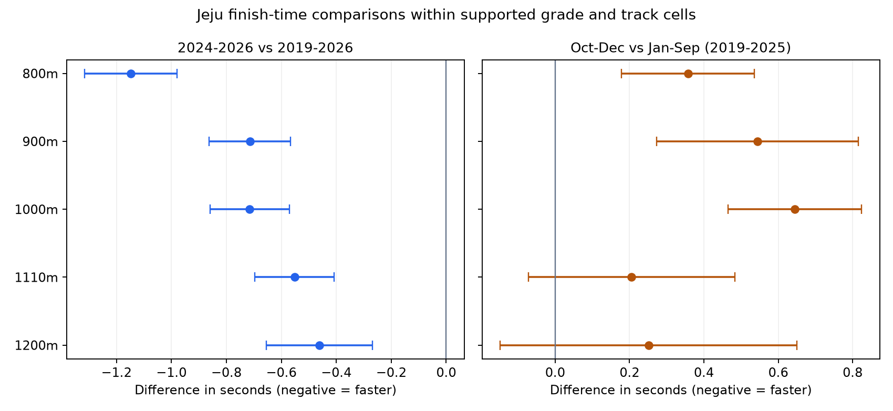

# 제주 최근 3년 기록과 10월 이후 평균의 비교

2026년10월9일. **최근3년은 보유 장기 평균보다 빠르지만, 과거10~12월 평균이 일관되게 낮은 것은 아니다.** 공통 등급·주로 조건을 맞춘800~1200m에서는10~12월이 오히려 느린 방향이었다.1110·1200m는 점별95%구간이0을 포함하고 연도별 예외도 있다.

최근3년은2024~2026년 보유분이며 완전한3개 연도가 아니다. 원천 상한은2026-09-19여서2026년10월 이후 실제 기록은 없다. 이번 결과로2026년10~12월 평균을 관측했다고 설명하거나 미래 평균을 확정하지 않는다.

## 비교 방법과 범위

이전 연구의 정정·보류·제외 정책을 반영한 출전 스냅샷에서2019년 이후46,381출전·4,677경주를 사용했다. 원천 ID와 해시를 연결했으며 외부 수집과DB 변경은 없다. 시간은 전체·S1F·1C·2C·3C·4C·G3F·G1F를 따로 집계했다. 코너의 누적시간과 종반 구간시간을 합산하지 않는다.

정확 거리 안에서 원문 등급과 주로상태가 같은 조건을 비교했다. 각 비교의 양쪽 모두30출전·5경주·5경주일 이상인 조건만 남기고, 양쪽 출전수를 합한 고정 비중으로 평균을 다시 계산했다. 계절 합산에는 연도도 같은 조건으로 묶어 연도 구성 차이를 줄였다. 이 지원 정책은 평균 비교를 위한 분석자 선택이며 앞선 이상치 경계의100출전 기준과 목적이 다르다.

아래 음수는 오른쪽 기간이 빠름, 양수는 느림이다. 장기 표본 안에 최근 표본이 포함되므로 두 집단을 독립으로 처리하지 않고 날짜별 영향값을 합쳐 중복 공분산을 반영했다.95%구간은 경주일 군집 t 근사이며 여러 비교에 대한 동시 신뢰구간은 아니다. 말 능력·부담중량·편성 등의 차이를 완전히 통제한 계절 인과효과가 아니다.

## 최근 3년과 장기의 차이

| 거리 m | 최근3년−장기 초 | 달력·월 구성 맞춘 차이 초 | 10~12월−1~9월 초 |
| --- | --- | --- | --- |
| 800 | -1.15 | -0.98 | +0.36 |
| 900 | -0.71 | -0.51 | +0.54 |
| 1000 | -0.71 | -0.39 | +0.64 |
| 1110 | -0.55 | -0.20 | +0.21 |
| 1200 | -0.46 | -0.14 | +0.25 |

첫 열은 실제 보유 기간끼리 등급·주로 비중을 맞춘 차이다. 둘째 열은 모든 연도를1월1일~9월19일로 제한하고 월별 구성까지 같은 비중으로 맞춘 추가 점검이다. 이때에도800·900·1000·1110m는 빠른 방향이 남았고1200m는−0.14초,95%−0.31~+0.03초로 불확실했다. 두 열은 공통 지원 조건의 집합이 달라 감소분 전체를 순수한 계절 효과라고 해석하지 않는다.

실제 보유 기간 비교의 표본과 구간은 다음과 같다.

| 거리 m | 장기 출전 | 최근 출전 | 공통 조건 | 최근−장기 초 | 95% 하한 | 95% 상한 |
| --- | --- | --- | --- | --- | --- | --- |
| 800 | 8492 | 1748 | 5 | -1.15 | -1.32 | -0.98 |
| 900 | 6593 | 2670 | 10 | -0.71 | -0.86 | -0.57 |
| 1000 | 12150 | 5274 | 11 | -0.71 | -0.86 | -0.57 |
| 1110 | 8435 | 5032 | 14 | -0.55 | -0.70 | -0.41 |
| 1200 | 3969 | 2545 | 12 | -0.46 | -0.66 | -0.27 |

1300m는 장기와최근의 보유 출전이 동일해 차이0이다. 과거 대비 변화가 없다는 증거가 아니다.1400m는+0.04초,95%−0.48~+0.57초로 불확실하고1610m는 공통 지원이 없다. 이 범위에800~1200m의 결과를 확대하지 않는다.

앞서 예로 든1000m·제5등급·건조의 단순 평균은장기86.63초,최근3년86.05초,2026년84.60초다. 거리 전체 표는 여러 공통 등급·주로를 같은 비중으로 합친 것이므로 이 단일 조건 예시와 수치가 다르다.

## 과거 10월부터 12월까지의 평균

2019~2025년의 같은 연도·등급·주로 조건에서10~12월을1~9월과 비교했다.2026년은 이 비교에서 제외했다.

| 거리 m | 1~9월 출전 | 10~12월 출전 | 공통 연도 조건 | Q4−1~9월 초 | 95% 하한 | 95% 상한 |
| --- | --- | --- | --- | --- | --- | --- |
| 800 | 3627 | 1656 | 13 | +0.36 | 0.18 | 0.54 |
| 900 | 1404 | 482 | 6 | +0.54 | 0.27 | 0.82 |
| 1000 | 4138 | 1680 | 17 | +0.64 | 0.47 | 0.82 |
| 1110 | 2391 | 1099 | 14 | +0.21 | -0.07 | 0.48 |
| 1200 | 570 | 323 | 6 | +0.25 | -0.15 | 0.65 |

800·1000m는 공통 지원이 있는 모든 연도에서10~12월 평균이 더 느린 방향이었다.900m는2024년,1110m는2025년,1200m는2024년에 반대 방향이 있었지만 각각의 구간은0을 포함한다. 모든 연도·모든 거리에 적용할 고정 계절 차이는 확정하지 않았다.

1000m의 연도별 비교는 다음과 같다.2020년의 빈 값은 지원 부족이며 효과0이 아니다.

| 연도 | 1~9월 출전 | 10~12월 출전 | Q4−1~9월 초 | 95% 하한 | 95% 상한 |
| --- | --- | --- | --- | --- | --- |
| 2019 | 508 | 247 | +0.36 | -0.14 | 0.87 |
| 2020 | — | — | — | — | — |
| 2021 | 417 | 219 | +1.96 | 1.28 | 2.64 |
| 2022 | 770 | 321 | +0.55 | 0.17 | 0.93 |
| 2023 | 510 | 257 | +1.15 | 0.65 | 1.65 |
| 2024 | 836 | 327 | +0.44 | -0.00 | 0.87 |
| 2025 | 1097 | 309 | +0.17 | -0.19 | 0.52 |

10월만 따로 본 추가 점검에서도800m는1~9월보다+0.74초,1000m는+1.32초의 느린 방향이었다. 다만 각각3개 연도·등급·주로 공통 조건뿐이라 거리 전체의 일반적10월 효과로 채택하지 않는다.7~9월과 비교하면1000m의10월 차이는+0.85초,1110m는−0.03초로 불확실했다. 이 비교 역시 공통 조건이 다르므로10월이 반드시 일정한 만큼 느리다는 뜻은 아니다.

## 2026년의 빠른 기록과 구간별 차이

과거도1월1일~9월19일로 잘라 비교하면2026년은1000m−2.47초,1110m−2.84초의 빠른 방향이다. 월 구성까지 맞춘 더 제한된 공통 조건에서도1000m−2.27초(과거944·2026년343출전),1110m−3.38초(과거625·2026년298출전)가 남았다.2026년의 빠른 기록을 단지10~12월 미포함으로 설명하기는 어렵다. 이 수치는 선택된 공통 지원 범위의 관찰 차이로, 원인이나 향후 유지 여부는 미확정이다.

1000m의 구간별 비교는 다음과 같다. 최근3년은 초반S1F보다G3F·G1F의 빠른 방향이 컸고, 과거10~12월은 종반도 느린 방향이었다.

| 시간 필드 | 최근3년−장기 초 | 10~12월−1~9월 초 |
| --- | --- | --- |
| finish_time_seconds | -0.71 | +0.64 |
| s1f_time_seconds | -0.02 | +0.07 |
| c3_time_seconds | -0.08 | +0.18 |
| c4_time_seconds | -0.21 | +0.32 |
| g3f_time_seconds | -0.63 | +0.47 |
| g1f_time_seconds | -0.31 | +0.21 |

초반·코너·종반의 표본이 일부 다르고 시간이 겹치므로 차이를 합산하지 않는다. 추가적인 느린 꼬리 삭제는 하지 않았으며, 이전에 보류한 불확실한 계측 지점은 그대로 유지했다.

## 참고표에 적용할 판단

현재 말 기록을 판단할 때 장기 평균 하나보다 최근 기간과 같은 달의 지원을 함께 확인하는 편이 맞다.2026년 현재 평균의 빠른 방향과 과거 늦가을·겨울의 느린 방향을 별도로 유지해야 한다. 과거10~12월 비교를 근거로2026년10월 이후에도 평균이 낮아질 것이라고 예측하지 않는다. 이전 함수율·월 환산 연구의 확정 적용률 미채택 상태도 바꾸지 않았다.

전체 월·연도·조건·구간 평균은[월별 표](run02/year_month_cells.csv),[기간별 표](run02/period_cells.csv),[계절별 표](run02/season_cells.csv)에 있다. [비중을 맞춘 전체 비교](run02/standardized_comparisons.csv),[달력 범위 추가 비교](run02/calendar_sensitivity.csv),[조건별 계산 근거](run02/common_cell_contributions.csv),[원천 연결](run02/source_manifest.json),[검증](run02/verification.json)을 보존했다.

재현 코드는[주 계산](analyze.py),[달력 추가 점검](calendar_sensitivity.py),[검증과 보고서](report_and_verify.py)다. 기존 출력이 있으면 덮어쓰지 않고 멈춘다. 초기에 열 이름을 잘못 참조해 첫 비교 직전에 멈춘 이력과 원집계는 보존했고 최종 결과는run02에 있다. 이미 여러 연구에서 사용한 보유 자료의 후향 기술통계이며 새로운 독립 미래 검증은 아니다.
