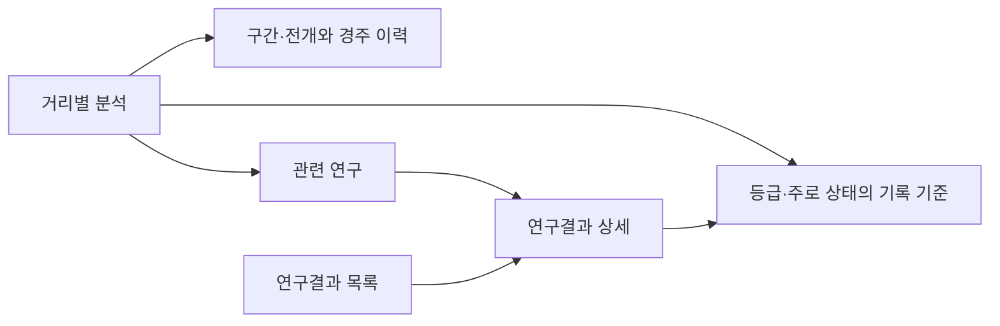

# 마필로그 거리별 분석 개편과 연구결과 메뉴 검토

2026-10-04. 실제 [서울1200m 거리별 분석](https://mapilog.xyz/racecourses/seoul/distances?distance=1200)과 로컬 웹 코드를 확인했다. **현재 경주 이력 화면에 연구 기준표와 근거 문서를 연결하는 방식으로 확장할 수 있다. 거리별 분석은 숫자를 찾는 화면으로, 연구결과는 그 숫자의 의미와 근거를 읽는 독립 메뉴로 제안한다.** 이번 작업은 확인과 구성안이며 웹 코드를 수정하거나 공개 게시·배포하지 않았다.

사용자의 ‘앞으로도 연구로 알게 된 내용을 지속 정리’ 지시는 [지속 정리·게시 정책](../RESEARCH_PUBLICATION_POLICY.md)에 보존했다. 기존 [결론 모음](../conclusions/README.md)과 각 연구 원본을 근거 저장소로 유지한다.

## 현재 확인한 화면

- 지역 선택:서울·제주·부경. 하위 메뉴:거리별 분석·지도 보기.
- 필터:연도·등급·거리. 현재 함수율 상태 필터는 없다.
- 요약:완료 경주·출전/유효 기록 건수·평균 완주시간·최단 완주시간.
- 본문:날짜별 경주 목록,거리·등급·출전두수·기록 보유·우승 기록·주로상태와 페이지 이동.
- 연구 기준표·시간 분위수·구간 평가·연구결과 메뉴는 이 화면에 없다. 웹 라우트에도 독립 연구결과 페이지를 찾지 못했다.

확인 당시 서울1200m·2026년·전체 등급은197경주·2,137출전·2,078유효 기록,평균1:15.9·최단1:10.7,기간2026-01-03~2026-10-04였다. 실시간 운영 집계값이며 고정 연구 기준으로 쓰지 않는다. 연구 참조분포는2024~2026-09-20 서울7,897행·743경주로 기간·모집단·품질 기준이 다르다. 화면 건수와 연구 건수가 같아야 한다는 조건을 두지 않는다.

## 개편할 거리별 분석

기존 지역 선택과 주소를 유지하고, 지역·거리를 선택한 뒤 **기록 기준 / 구간·전개 / 경주 이력 / 관련 연구**를 볼 수 있는 구성을 제안한다. 지도 보기도 기존처럼 연결한다. 탭 이름과 최종 배치는 아직 구현하지 않은 제안이다.

| 위치 | 제안 내용 | 현재 사용할 근거 |
|---|---|---|
| 기록 기준 | 등급·함수율 상태 선택,전체시간 평균·중앙값·빠른20%/느린20% 경계,시간 꼬리 평균 | 서울·부산1200m 기준 연구 |
| 구간·전개 | 출발200m·중간 두 구간·마지막200m,서울4C 이후와G1F 전후 기록·순위 | 1200m 구간 연구와 서울4C 연구 |
| 구간 상대속도 | 구간속도÷자기 전체 평균속도×100,마무리 비율과 기준 전개 대비 편차 | [추가 범위와 방법](../20261004_relative_speed_scope/README.md);실제 분포·par는 후속 검증 |
| 기록 비교 | 한 기록 입력 시 같은 등급/전체 등급 수준 설명,기준 기간·상태 표시 | 기존 전체·구간 기록 점수 도구;4C 자체 점수 UI는 후속 구현 |
| 경주 이력 | 현재 연도·등급·거리 필터 및 페이지 목록 유지 | 현재 운영DB 조회 |
| 관련 연구 | 선택한 지역·거리에 맞는 결론 요약과 자세히 보기 | 연구결과 메뉴의 개별 문서 |

기준표는 평균·중앙·경계의 의미를 설명하고 ‘빠른20% 경계 이하’처럼 방향을 명시한다. 시간 상위20% 집단과 실제 착순상위3두의 구간 평균은 다른 표로 보여준다. 구간 평균은 합산할 수 있지만 구간별 분위수는 합산하지 않는다.

상단에 ‘서울1200m·국5·건조·연구 기준v1·자료2026-09-20까지’처럼 선택 조건을 표시한다. 경주 이력에서2026년을 선택해도 기준표가 그해 표로 자동 변경됐다고 오인하게 만들지 않는다. 해당 조건의 관측/추정·소표본 표시와 경주·날짜 수를 제공한다.

첫 지원 범위는 서울·부산1200m로 제안한다. 제주·영천 또는 미연구 거리에는1200m 기준을 복사하지 않고 연구 미정리 상태와 기존 이력을 보여준다. 제주 데이터와 연구 대상 더러브렛을 섞지 않는다. 서울 막판400m는 미관측이며 부산400m와 같은 항목으로 채우지 않는다.

## 독립 연구결과 메뉴

주요 메뉴에 ‘연구결과’를 추가하고 목록과 상세 문서를 둔다. 제안 주소는`/research`와`/research/{slug}`다. 이 주소는 현재 구현되지 않았다. 거리 페이지의 관련 연구 링크와 상호 연결한다. 모바일에서도 접근 가능하게 한다.

목록은 지역·거리·주제·최근 개정일로 찾을 수 있게 하고, 문서에는 결론 한두 문장·표/그림·기록 해석·실제 사례·자료 기간과 표본·검증·한계·상태·관련 거리표를 남긴다. 공개 글은 연구자가 사용한 폴더명·모델 변수 목록을 중심으로 쓰지 않고 이용자의 질문에 답한다. 상세 방법과 공식 출처는 근거 영역에서 연결한다. 문서 상태는 ‘연구용 기준’, ‘연구 후보’, ‘연구 기준 채택’, ‘운영 반영’을 구분한다.

## 첫 게시 후보와 출처

| 게시 주제 | 원 연구/결론 | 공개 설명의 중심 |
|---|---|---|
| 서울·부산1200m 기록은 어느 정도가 빠른가 | [1200m 기준](../20261004_1200_benchmarks/README.md) / [결론08](../conclusions/08_DISTANCE_RECORD_BENCHMARKS.md) | 등급·주로상태별 평균/분포와 단일 기록의 수준 |
| 서울4C 이후 마무리와 추입은 어떻게 읽나 | [4C 연구](../20261004_seoul4c_finish/README.md) / [결론09](../conclusions/09_SEOUL4C_FINISH.md) | 전체−4C,두 부분,순위 변화,선두 시간차 회복 |
| 함수율에 따라 전체 기록을 어떻게 비교하나 | [결론01](../conclusions/01_TRACK_MOISTURE.md) | 서울80%·부산90% 연구 기준과 양호/건조 차이,운영 반영 상태 |
| 빠른 마지막 구간을 전개와 함께 보는 이유 | [결론06](../conclusions/06_SECTIONAL_PACE_MOISTURE.md) / [결론07](../conclusions/07_GRADE1200_SECTIONS.md) | 초중반 여유와 막판 기록,거리·등급 차이 |
| 게이트와 달리는 위치의 유불리 | [결론03](../conclusions/03_GATE_POSITION.md) / [결론04](../conclusions/04_JOINT_CORRECTION.md) | 출발 게이트와 내중외 경로·앞뒤 순위의 차이,2두와 공동 보정 후보 |
| 주행심사 기록은 실전과 어떻게 다른가 | [결론05](../conclusions/05_TRIAL_TIME_BASELINES.md) | 심사1000m의 공식 합격 규정과 관측 분포,실전1200m와 구분 |

마지막600m와4C 이후는 상관0.990으로 겹치는 마무리 정보다. 기록 점수를 독립 능력처럼 더하지 않는다는 설명을 두 화면에 일관되게 넣는다. 서울4C의530m 공식 설명을 유지하되 시간으로부터 실제 가속도·외측 손실·미계측400m를 생성하지 않는다. 연구의 포화·불량 효과를 웹의 운영 보정값으로 자동 적용하지 않는다.

## 구현에 연결할 코드와 데이터

2026-10-04 사용자 추가 합의에 따라 구간 상대속도와 기준 전개 비교를 개편 범위에 포함했다. 연구결과에는 Timeform의 계산·해석과 Frontiers의 정보 누수·시간순 검증 역할을 구분해 설명한다. 현재 시간 기준표를 상대속도par로 부르지 않고 실제 개별 비율 분포와 기준은 별도로 연구한다. 값의 단위는 상대속도%,기준 대비 차이는%p다. 원래 기록 수준과 순위·시간차 회복을 함께 보여준다.

- 라우트: `src/horse_racing/web/app.py`의`/racecourses/{course}/distances`. 지역 검증·등급 허용 목록과 연도·거리·페이지 범위 검증이 있다.
- 이력 집계: `src/horse_racing/web/distance_page.py`. SQLAlchemy로 완료 경주·정상 기록을 집계한다. 연구 전용 모집단 선정과는 다르다.
- 화면: `templates/distance_page.html`,주요 메뉴:`templates/base.html`. 모바일 접근은 별도 모바일 기본 틀과 레이아웃 전환도 확인해야 한다.
- 기존 회귀 검사: `tests/test_distance_page.py`. 제주 필터와 서울 지역 분리를 검증하지만 서울 경주 링크의 지역 문구까지 검증하지 않는다.
- 연구 표:`20261004_1200_benchmarks/outputs/estimated_benchmarks.csv`의650행,`20261004_seoul4c_finish/outputs/estimated_benchmarks.csv`의150행. 원시값과 상태 정렬값의 의미를 보존해 웹 전용 작은JSON으로 내보내는 방식을 제안한다.
- 웹 표시용 지역·등급은 원 연구의`서울/부산`·`국5/1/혼4`와 현재 화면의`seoul/busan`·`국5등급/1등급/혼4등급` 사이 명시적 대응이 필요하다. 비슷한 문자열을 임의로 추측해 연결하지 않는다.
- 게시문 목록·slug·지역·거리·주제·상태·연구 종료일·개정일·근거 문서·표 버전을 묶은 명시적 목록을 관리한다. 런타임에서 전체 연구 폴더를 훑거나 사용자 입력을 파일 경로로 열지 않는다. 승인된 문서와 표만 렌더링한다.
- 기준표와 게시 콘텐츠를 배포 자산으로 제공하면 원 연구DuckDB·원API·전체Parquet를 웹 요청마다 조회하거나 서버에 복제할 필요가 없다. 출처·해시와 검증 결과는 내부 기록으로 유지한다. 원 마필·경주 데이터 수정이 필요한 구조는 아니다.
- 실제 구현 시 캐시·사이트맵·canonical·조회 범위·문서의 안전한HTML 렌더링·모바일 메뉴를 함께 맞춘다. 현재 루트와 검색 필터를 사용하는 경주 이력 동작을 유지한다.

## 개편 때 함께 고칠 관찰 사항

1. **서울 경주 링크에‘제주 ○경주’가 표시됨.** 실제 서울 화면과 템플릿의 고정 문자열 모두 확인했다. 지역별`data.course_name`을 쓰는 변경과 서울·부경 표시 검증이 필요하다.
2. 연도 선택에서2026년이 두 번 표시됨. 템플릿은 선택 연도를 문자열로 바꾸지만 로더의연도 목록은 정수여서 존재 검사가 어긋나는 구조다. 선택값·목록의 타입을 통일해야 한다.
3. 주요 메뉴‘거리별 분석’은 제주로 고정 연결된다. 서울·부산 연구가 중심인 초기 개편은 지역별 진입 화면 또는 현재 지역을 유지하는 연결을 제안한다. 제주 지원 제거를 의미하지 않는다.
4. 현 화면에는 주로상태 기준 선택이나 연구 기간 설명이 없다. 과거 이력 평균을 함수율 정렬 기준으로 오인하지 않도록 기준표와 이력의 설명을 구분한다.

## 다음 구현의 완료 조건

서울·부산1200m의 기준표와 서울4C 연구를 첫 사례로 연결하고,연구결과 목록/상세 메뉴를 실제 표시한다. 원 표의 수치·단위·등급·상태·구간·표본·미관측 표시를 대조한다. 모바일과 데스크톱·빈 조건·미연구 지역/거리·등급 대응·지역 문구·검색 검증을 확인한다. 공개 URL에서 최종 화면이 보이는 것까지 확인해야 게시 완료로 기록한다. 연구 기준 문서의 상태와 운영 모델 상태도 별도로 유지한다.

구간 상대속도의 거리·누적시간 차·전체시간 입력과%,%p 표시를 검증한다. 기준 전개 추정이 끝나기 전에는 실제par 편차를 표시하지 않는다. 실제 구간거리·기준기간·주로 보정의 정의를 맞추고 계산 예시와 최종 연구 기준을 구분한다.

이번에는 실제 공개 화면과 로컬 소스를 읽고 구성안 및 지속 정리 원칙을 기록했다. 구현·게시 완료 조건은 아직 수행하지 않았다. 새 관찰 기록과 근거 파일 해시는 [점검 기록](outputs/review_evidence.json), 문서 링크·근거 해시 확인은 [문서 검증](outputs/verification.json), 이번 작업의 크기는 [용량 명세](outputs/artifact_inventory.json)에 보존한다.

## 구간 상대속도 후속 결과 추가

[1200m 상대속도·par 후보](../20261004_relative_speed_par_v1/README.md)와 [게시 요약](../20261004_relative_speed_par_v1/PUBLICATION.md),[기준JSON](../20261004_relative_speed_par_v1/outputs/web_relative_speed_par.json)을 게시 준비 자료로 추가했다. 지역 공통 수준·분포를 먼저 보여주고 등급/함수율 소표본 완화 후보를 상세로 연결한다. 서울4C 명목거리 표식, 최적 효율 미확정, 추가 예측 가치 미확정을 유지한다. 실제 화면 구현·배포는 아직 수행하지 않았다.

## 총중량 대비 부담중량 연구 추가

2026-10-05 [1200m 중량 비율 연구](../20261005_relative_load1200/README.md)·[게시용 요약](../20261005_relative_load1200/PUBLICATION.md)·[작은 요약JSON](../20261005_relative_load1200/outputs/web_relative_load_summary.json)을 연구결과 게시 준비 자료로 추가했다. 비율을 시간 보정으로 표시하지 않고 마체중 공개시각 미검증·후향 조건부·작은 효과를 함께 표시한다. 운영 모델·웹 화면·배포는 변경하지 않았다.

## 1300m 기록 기준 추가

2026-10-05 [1300m 기준 연구](../20261005_1300_benchmarks/README.md)·[게시용 요약](../20261005_1300_benchmarks/PUBLICATION.md)·[기준JSON](../20261005_1300_benchmarks/outputs/web_benchmarks1300.json)을거리별 분석과연구결과의 게시 준비 자료에추가했다.4등급40조합260구간행과미지원60조합, 상태별/등급별 표본, 부산 국4의한 경주 잠정치와서울 마지막400m부재를보존해야 한다. 실제 웹 구현·배포는변경하지 않았다.

## 1400m 기록 기준 추가

2026-10-05 [1400m 연구](../20261005_1400_benchmarks/README.md)·[게시 요약](../20261005_1400_benchmarks/PUBLICATION.md)·[기준JSON](../20261005_1400_benchmarks/outputs/web_benchmarks1400.json)을거리별 분석과연구결과의 게시 준비 자료에 추가했다.100조합650구간행, 최근 미관측14조합·소표본69조합과OPEN/상위등급 참조날짜, 서울 직접400m부재를 표시해야 한다. 웹구현·배포는변경하지 않았다.

## 1600m 기록 기준 추가

2026-10-06 [1600m 연구](../20261006_1600_benchmarks/README.md)·[게시 요약](../20261006_1600_benchmarks/PUBLICATION.md)·[기준JSON](../20261006_1600_benchmarks/outputs/web_benchmarks1600.json)을 거리별 분석과 연구결과의 게시 준비 자료에 추가했다.85조합560구간행과 서울15조합 참조 부재, 서울 추정의 잠정 상태와 관측 평균을 함께 표시해야 한다. 서울 국OPEN2일·부산1등급3일의 극소표본, 서울 국OPEN 신뢰구간 부재, 마지막400m의 지역별 가용성도 보존한다. 실제 웹 구현·배포는 변경하지 않았다.

## 서울1700m와 서울·부산1800m 기록 기준 추가

2026-10-06 [통합 연구](../20261006_1700_1800_benchmarks/README.md), [1700m 게시 요약](../20261006_1700_1800_benchmarks/1700/PUBLICATION.md)·[기준JSON](../20261006_1700_1800_benchmarks/1700/outputs/web_benchmarks1700.json), [1800m 게시 요약](../20261006_1700_1800_benchmarks/1800/PUBLICATION.md)·[기준JSON](../20261006_1700_1800_benchmarks/1800/outputs/web_benchmarks1800.json)을 게시 준비 자료로 추가했다.115조합735행과 미지원35조합을 구분한다.1700 국OPEN3일 참조·미관측 복원 개선 미확인,1800 서울 국5의 과거 참조 부재31행, 지역별 마지막400m 가용성·중복 구간을 함께 표시해야 한다. 실제 웹 구현·배포나 운영 모델은 변경하지 않았다.

## 남은5거리 게시 준비 자료 추가

2026-10-06 [통합 연구](../20261006_remaining_distance_benchmarks/README.md)의1000·1900·2000·2200·2300m 게시요약과 거리별 web_benchmarks JSON을 추가했다.76조합489행과324미지원 조합을 구분한다.1000m는 실전으로 주행심사와 분리하고1900 부산은 최근기준 없음,1900 서울/2200 부산은 한두 경주,2300 서울은6일의 잠정치로 표시해야 한다.2200 포화·2300 불량은 시간 null이며 한 날짜의 신뢰구간 부재도 보존한다.1000/2000 평균 오차 소폭 감소를 우승 예측 개선으로 표현하지 않으며 숨긴 조합 복원의 개선도 확인되지 않았다. 실제 웹 구현·배포·운영 적용은 변경하지 않았다.

## 동일 함수율의 계절별 경향 추가

2026-10-07 [계절 연구](../20261007_seasonal_same_moisture/README.md)·[게시 요약](../20261007_seasonal_same_moisture/PUBLICATION.md)·[게시JSON](../20261007_seasonal_same_moisture/outputs/web_seasonal_same_moisture.json)을 연결했다. 계절 차이는 동일 연도·등급·함수율 숫자를 통제한 경주평균 차이다. 표본 조건과 재표집 지원을 구분하고, 식별 부재는0으로 채우지 않으며95% 구간은 점별 구간이다. 기존 기준에 계절 보정을 자동 가산하거나 우승 예측 개선으로 표현하지 않는다. 실제 웹 구현·배포·운영 적용은 변경하지 않았다.

## 동일 함수율의 월별 특성 추가

2026-10-07 [월별 연구](../20261007_monthly_same_moisture/README.md) · [게시 요약](../20261007_monthly_same_moisture/PUBLICATION.md) · [게시JSON](../20261007_monthly_same_moisture/outputs/web_monthly_same_moisture.json)을 추가했다. 월별 관측지원·재표집 지원·식별 부재를 구분하고, 월간 구간은 같은 회차의 차이를 사용한다. 계절과 월의 효과를 중복 가산하지 않으며 단일 최상월이나 확정 보정으로 표시하지 않는다. 실제 사이트 구현·배포는 변경하지 않았다.

## 시대별 기록 변화 연구 추가

2026-10-07 [기록 변화 연구](../20261007_era_record_trends/README.md) · [게시 요약](../20261007_era_record_trends/PUBLICATION.md) · [게시JSON](../20261007_era_record_trends/outputs/web_era_record_trends.json)을 연결했다.2026년 부분연도를 고려한 공통월 비교이며,원시와 공통층 모집단·초와상대속도%p·기간별 민감도·표본지원·점별95%구간을 구분한다. 관찰된 변화는 매년 일정한 초 보정·2024년 인과적 전환점·전 경주 능력 변화로 표현하지 않는다. 실제 사이트 구현·배포는 변경하지 않았다.

## 연령 곡선과 출전 중단 연구 추가

2026-10-07 [원 연구](../20261007_age_curve_exit/README.md) · [게시 요약](../20261007_age_curve_exit/PUBLICATION.md) · [게시JSON](../20261007_age_curve_exit/outputs/web_age_curve_exit.json)을 연결했다. 집단 곡선·같은 말 변화·출전 중단을 구분하고,무출전을 퇴사로 표시하지 않는다. 현재 기록과 다음 기록의 비교이며 생물학적 고정 정점·일률 감점·운영 예측으로 표현하지 않는다. 사이트 구현·배포는 변경하지 않았다.
