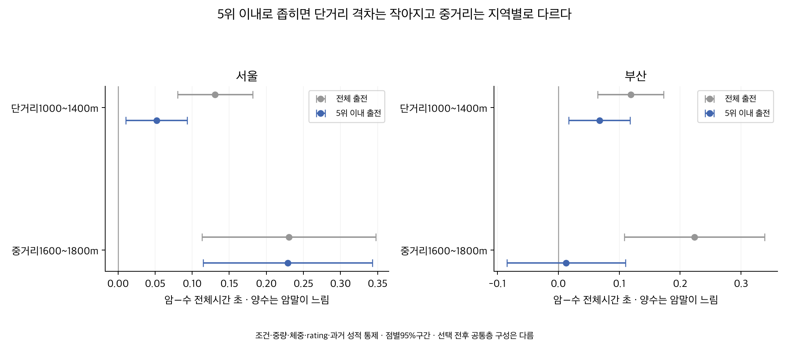
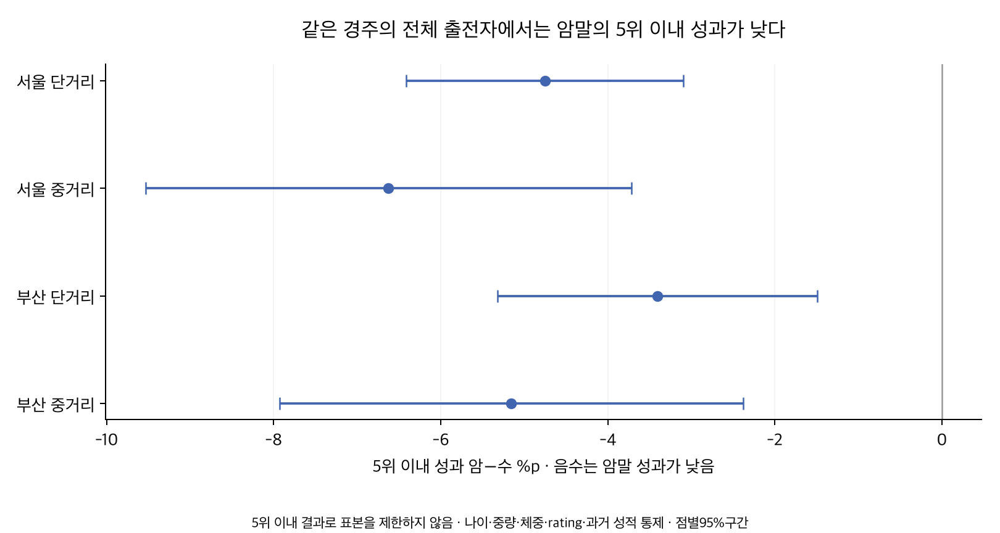

# 5위 이내 암말 수말 거세마의 기록과 성과

2026-10-07. **5위 이내 출전만 비교하면 단거리 암−수 전체시간 차이는 작아지지만 암말 우세로 바뀌지는 않는다. 중거리는 서울에서 수말 우세가 남고, 부산에서는 명확한 차이가 사라진다.** 그러나 같은 경주의 전체 출전자에서5위 이내에 드는 성과는 암말이 수말보다 낮았다. 이미 상위권에 든 집단의 기록과 상위권에 진입하는 성과는 다른 질문이다.

## 상위권의 정의와 자료

사용자의5위 이내는 각 경주 최종 착순1~5위의 출전 기록으로 정의했다. 고등급·평생 우수마·사전 예측 상위5두를 뜻하지 않는다. [성별 원 연구](../20261007_sex_ability_gap/README.md)의151,074행·13,928경주·12,435두 중69,639행이 해당한다. 원 모집단에서 경주당5개보다1개 적은 것은 부산2025-11-23 제3경주3위 수말이 기존 구간 품질/부모 거리 선택에서 빠진 출전이며 복구하거나0으로 채우지 않았다. 원 출전자 전원이 유지된 경주는 모두5개씩 존재함을 검증했다.

서울2018-01-06~2026-09-20·부산2018-01-05~2026-09-18, 출전 당시 암·수·거 분류다. 거리별 종료일은 다르고2026년은 부분 연도다. 정상 완주·구간 품질 선택을 계승했다. 거세마는 수컷의 거세 상태를 포함한다. 제주·영천·주행심사·주로빠르기는 제외했다.

연구용 단거리는1000~1400m, 중거리는1600~1800m다.1900m 이상은 원 연구의 암말 희소성 때문에 새 일반 우열을 추정하지 않는다.6두 경주의5위와12두 경주의5위는 같은 상위비율이 아니다. 같은 경주 비교와10두 이상 경주 민감도를 함께 제시한다.

## 체중 차이는 유지된다

| 지역 | 분류 | 전체 출전 수 | 5위 이내 출전 수 | 전체 마체중 평균 kg | 5위 이내 평균 kg | 5위 이내 중앙값 kg | 말별 동일 가중 kg |
|---|---|---:|---:|---:|---:|---:|---:|
| 서울 | 암 | 35,111 | 15,076 | 465.42 | 466.98 | 467 | 466.52 |
| 서울 | 수 | 33,027 | 16,563 | 486.99 | 487.33 | 487 | 487.39 |
| 서울 | 거 | 20,105 | 9,266 | 480.70 | 481.12 | 481 | 480.64 |
| 부산 | 암 | 24,955 | 10,536 | 467.86 | 469.16 | 469 | 468.37 |
| 부산 | 수 | 21,881 | 11,012 | 489.01 | 490.14 | 490 | 490.49 |
| 부산 | 거 | 15,995 | 7,186 | 482.54 | 483.15 | 482 | 483.74 |

상위5위 출전에서도 암말은 수말보다 서울20.35kg·부산20.98kg, 거세마보다 서울14.14kg·부산13.99kg 가볍다. 기존 전체 출전의 약21kg/15kg 차이와 방향이 같다. 평균이 조금 바뀌어도 체중 자체가 경기력 차이의 원인이라는 뜻은 아니다. 마체중·부담중량의 평균/중앙값/P20/P80과 말별 동일 가중값은 [관측표](outputs/descriptives.csv), 조건을 맞춘 차이는 [대비표](outputs/contrasts.csv)에 보존한다.

## 전체 출전과 5위 이내 기록

정확 거리·연도·월·나이·등급·함수율 숫자가 같은 층에서 비교하고, 부담중량·마체중·rating의 제곱항 및 과거 기록/성과·출전수·공백을 더했다. 거리묶음별 공변량 기울기를 따로 추정한다. **시간 암−수 양수는 암말이 느린 방향**이고 괄호는 마필/날짜 군집을 반영한 점별95%구간이다.

| 지역 | 거리 묶음 | 전체 출전 암−수 초 | 5위 이내 암−수 초 |
|---|---|---:|---:|
| 서울 | 1000~1400m | +0.131 [+0.080, +0.181] | +0.052 [+0.011, +0.093] |
| 서울 | 1600~1800m | +0.231 [+0.113, +0.348] | +0.229 [+0.115, +0.343] |
| 부산 | 1000~1400m | +0.119 [+0.064, +0.173] | +0.068 [+0.017, +0.118] |
| 부산 | 1600~1800m | +0.224 [+0.109, +0.339] | +0.013 [-0.084, +0.110] |

단거리 격차의 점추정은 서울 약0.13→0.05초, 부산 약0.12→0.07초로 작아졌다. 서울 중거리는 약0.23초로 유지되고 부산 중거리는 약0.01초로0을 포함한다. 이는 서로 다른 선택 표본의 조건부 추정치 비교이며 격차 감소의 통계적 유의성이나 상위권만의 인과효과를 검정한 결과가 아니다.



5위 이내 표본의 전체·1000m당 시간·초반200m·마지막200m 및 중거리−단거리 직접 대비는 다음과 같다.

| 지역 | 지표 | 단거리 암−수 | 중거리 암−수 | 중거리−단거리 직접 대비 |
|---|---|---:|---:|---:|
| 부산 | 전체 초 | +0.068 [+0.017, +0.118] | +0.013 [-0.084, +0.110] | -0.055 [-0.164, +0.054] |
| 부산 | 1000m당 초 | +0.054 [+0.013, +0.094] | +0.009 [-0.050, +0.068] | -0.045 [-0.116, +0.026] |
| 부산 | 출발200m 초 | -0.056 [-0.079, -0.033] | -0.019 [-0.062, +0.024] | +0.037 [-0.011, +0.086] |
| 부산 | 마지막200m 초 | +0.090 [+0.057, +0.122] | +0.025 [-0.039, +0.089] | -0.064 [-0.137, +0.008] |
| 서울 | 전체 초 | +0.052 [+0.011, +0.093] | +0.229 [+0.115, +0.343] | +0.177 [+0.054, +0.300] |
| 서울 | 1000m당 초 | +0.042 [+0.008, +0.075] | +0.133 [+0.067, +0.200] | +0.091 [+0.016, +0.167] |
| 서울 | 출발200m 초 | -0.044 [-0.065, -0.024] | -0.020 [-0.083, +0.044] | +0.025 [-0.041, +0.091] |
| 서울 | 마지막200m 초 | +0.048 [+0.020, +0.077] | +0.154 [+0.093, +0.216] | +0.106 [+0.037, +0.175] |

암말은 상위5위 단거리에서도 초반200m가 서울 약0.044초·부산0.056초 빠르지만, 막판200m는0.048초·0.090초 느리다. 초반 속도만으로 단거리 경주 전체 우세를 주장하지 않는다. 서울에서는 중거리−단거리 전체 차이+0.177초와1000m당 차이+0.091초의 점별 구간이0을 포함하지 않는다. 부산에서는 두 직접 대비 모두 불확실하다. 최근/10두 이상으로 좁히면 서울의 거리 증가 대비도 불확실해진다.

## 같은 경주에서 5위 안에 드는 성과

이 비교는5위 이내로 표본을 제한하지 않는다. 원래 출전자 전원이 남은 정상 혼합 경주 중 암·수가 실제 동반 출전한 전체 출전자에서5위 이내 지시자를 비교했다. 같은 경주 효과와 나이·중량·체중·rating·과거 성적 등을 맞춘 선형 확률 차이이며 음수는 암말 성과가 낮은 방향이다. 우승·3위 이내도 함께 보존한다.

| 지역 | 지표 | 단거리 암−수 | 중거리 암−수 | 중거리−단거리 직접 대비 |
|---|---|---:|---:|---:|
| 부산 | 5위 이내 %p | -3.40 [-5.32, -1.49] | -5.15 [-7.93, -2.38] | -1.75 [-5.04, +1.54] |
| 부산 | 3위 이내 %p | -2.29 [-3.84, -0.75] | -3.81 [-6.14, -1.47] | -1.52 [-4.34, +1.31] |
| 부산 | 우승 %p | -0.70 [-1.73, +0.33] | -1.42 [-3.03, +0.20] | -0.71 [-2.59, +1.17] |
| 서울 | 5위 이내 %p | -4.75 [-6.41, -3.09] | -6.63 [-9.53, -3.72] | -1.87 [-5.17, +1.43] |
| 서울 | 3위 이내 %p | -3.02 [-4.44, -1.60] | -6.13 [-8.54, -3.73] | -3.11 [-5.82, -0.40] |
| 서울 | 우승 %p | -1.19 [-2.07, -0.31] | -3.32 [-4.87, -1.78] | -2.13 [-3.88, -0.39] |

5위 이내 암−수 차이는 서울 단거리−4.75%p·중거리−6.63%p, 부산 단거리−3.40%p·중거리−5.15%p다. 네 점별95%구간 모두0보다 낮다. 그러나 중거리−단거리 성과 차이의 구간은 양 지역 모두0을 포함한다.5위 이내에 든 말끼리 기록이 비슷하다는 결과와 이 진입 성과는 모순되지 않는다. 개별 말의 우승확률 예측값이나 생물학적 인과효과로 사용하지 않는다.



## 선택과 공통조건을 바꾼 점검

상위5위 양쪽 분류가 존재하는 정확 공통층으로 전체 출전도 제한하면 다음과 같다. 서울 중거리 전체 표본 암−수는+0.093초, 부산−0.070초로 원래 전체 표본과 달라진다. 상위5위 선택에 따라 어느 조건이 비교에 남는지도 변하기 때문이다. 이 점검에서도5위 이내와 전체의 층 내 구성·가중치·이력 분포는 완전히 같지 않다.

| 지역 | 지표 | 단거리 암−수 | 중거리 암−수 | 중거리−단거리 직접 대비 |
|---|---|---:|---:|---:|
| 부산 | 전체 초 | +0.098 [+0.037, +0.160] | -0.070 [-0.229, +0.089] | -0.168 [-0.339, +0.002] |
| 서울 | 전체 초 | +0.097 [+0.040, +0.154] | +0.093 [-0.058, +0.245] | -0.004 [-0.166, +0.157] |

다른 경주의 편성 차이를 더 줄여 같은 경주에서5위 이내에 든 암·수끼리 비교하면 서울 단거리+0.021초[−0.013,+0.055]·중거리+0.143초[+0.076,+0.210], 부산 단거리+0.060초[+0.018,+0.103]·중거리+0.065초[−0.004,+0.135]다. 이 비교도 이미 선택된 상위권끼리의 연관이다. 서울 단거리의 작은 격차는 이 방식에서 확실하지 않다.

| 지역 | 지표 | 단거리 암−수 | 중거리 암−수 | 중거리−단거리 직접 대비 |
|---|---|---:|---:|---:|
| 부산 | 전체 초 | +0.060 [+0.018, +0.103] | +0.065 [-0.004, +0.135] | +0.005 [-0.077, +0.087] |
| 서울 | 전체 초 | +0.021 [-0.013, +0.055] | +0.143 [+0.076, +0.210] | +0.121 [+0.046, +0.197] |

| 지역 | 분석 | 입력 쌍 행 | 공통 행 | 단거리 암/수 | 중거리 암/수 | 제외율 |
|---|---|---:|---:|---:|---:|---:|
| 부산 | time/top5 | 21,223 | 10,638 | 4480/4271 | 866/1021 | 49.9% |
| 서울 | time/top5 | 30,977 | 16,213 | 7308/6852 | 939/1114 | 47.7% |
| 부산 | time/all_in_top5_common_cells | 20,068 | 20,068 | 9288/7640 | 1447/1693 | 0.0% |
| 서울 | time/all_in_top5_common_cells | 30,804 | 30,804 | 15047/12521 | 1503/1733 | 0.0% |
| 부산 | race_outcome/all | 39,703 | 37,643 | 14036/13809 | 4043/5755 | 5.2% |
| 서울 | race_outcome/all | 56,661 | 53,493 | 20319/22100 | 4334/6740 | 5.6% |
| 부산 | race_selected_time/top5 | 18,336 | 13,954 | 4984/5462 | 1504/2004 | 23.9% |
| 서울 | race_selected_time/top5 | 26,402 | 19,778 | 7477/8447 | 1642/2212 | 25.1% |

입력 쌍 행수는 각 분석의 사전 선택까지 적용한 수다. 서로 다른 범위의 제외율을 전체151,074행 대비 비율로 혼동하지 않는다. 단거리/중거리 양쪽 분류100행·30두·20날짜·20공통층 및 대비 식별을 지원 요건으로 썼다. 전체 결과1704행은 이 묶음 기준을 통과했지만, 이는 개별 희소 장거리까지 지원한다는 뜻이 아니다.

## 최근 기간과 10두 이상 경주

2024~2025 완결연도만 보면 서울5위 이내 중거리 암−수+0.237초는 느린 방향이 남지만, 양 지역 단거리와 부산 중거리는 구간이0을 포함한다. 서울 거리 증가 직접 대비도0을 포함한다. 부산 최근 중거리−단거리 대비는 반대 방향의 점별 구간으로 나와, 일관된 거리 법칙을 확정하지 않는다. 같은 자료의 재분석이며 미래 검증이 아니다.

| 지역 | 지표 | 단거리 암−수 | 중거리 암−수 | 중거리−단거리 직접 대비 |
|---|---|---:|---:|---:|
| 부산 | 전체 초 | +0.099 [-0.042, +0.241] | -0.151 [-0.369, +0.067] | -0.250 [-0.497, -0.004] |
| 서울 | 전체 초 | +0.040 [-0.057, +0.136] | +0.237 [+0.027, +0.447] | +0.197 [-0.033, +0.428] |

| 지역 | 지표 | 단거리 암−수 | 중거리 암−수 | 중거리−단거리 직접 대비 |
|---|---|---:|---:|---:|
| 부산 | 5위 이내 %p | -2.00 [-6.77, +2.77] | -6.24 [-11.46, -1.02] | -4.24 [-11.06, +2.58] |
| 서울 | 5위 이내 %p | -5.40 [-8.97, -1.83] | -8.18 [-14.13, -2.23] | -2.78 [-9.53, +3.97] |

10두 이상 경주만 보면 서울5위 이내 중거리+0.148초의 느린 방향이 남고 부산 중거리는 약0이다. 서울 단거리+0.055초·부산+0.035초로 부산 단거리 구간은0을 포함한다. 같은 경주의5위 이내 진입 성과는 네 지역/거리 묶음 모두 암말이 낮은 방향이다.

| 지역 | 지표 | 단거리 암−수 | 중거리 암−수 | 중거리−단거리 직접 대비 |
|---|---|---:|---:|---:|
| 부산 | 전체 초 | +0.035 [-0.022, +0.092] | +0.000 [-0.109, +0.110] | -0.035 [-0.156, +0.086] |
| 서울 | 전체 초 | +0.055 [+0.008, +0.101] | +0.148 [+0.036, +0.260] | +0.093 [-0.032, +0.218] |

| 지역 | 지표 | 단거리 암−수 | 중거리 암−수 | 중거리−단거리 직접 대비 |
|---|---|---:|---:|---:|
| 부산 | 5위 이내 %p | -3.57 [-5.61, -1.54] | -6.33 [-9.31, -3.34] | -2.75 [-6.30, +0.80] |
| 서울 | 5위 이내 %p | -5.02 [-6.78, -3.26] | -6.88 [-9.95, -3.81] | -1.86 [-5.37, +1.66] |

거세마−수말의 상위5위 전체시간은 서울 단거리−0.052초[−0.086,−0.018]·중거리−0.030초[−0.087,+0.028], 부산 단거리−0.017초[−0.064,+0.029]·중거리−0.009초[−0.075,+0.058]다. 일관된 성별 순위나 거세의 인과효과로 해석하지 않는다. 모든 세 쌍·등급만 통제한 단계·원시 체중·원시 같은 경주 성과는 전체 결과에 있다.

## 검증과 해석 범위

입력5개 해시·행/경주 고유성·출전 당시 분류·착순/우승/3위 이내 지시자·경주별5위 이내 수·구간 합을 확인했다. DuckDB 집계로 선택수·체중 평균·말별 평균을 대조했다. 이전 보고서의432개 추정치를 정확히 재현했다. 별도QR 회귀와 pandas 군집 합으로 주 모형252행의 계수·표준오차를 대조했고4개 명시적 희소 고정효과 적합을 확인했다. 총1073수치 검사가 통과했다.

반복 출전과 같은 날짜 의존성은 마필/날짜 이원 군집과 각 단독 군집 중 최대 분산, 고정효과 자유도와t 보정으로 반영했다. 이는 다수 비교의 점별95%구간이며 동시 보장이 아니다. 공변량 결측은 행렬 안에서 중앙값+결측 지시자만 쓰고 원천 null은 유지한다. 말 고정효과로 성별을 식별하거나 기존 성별 보정 잔차를 재사용하지 않았다.

5위 이내는 결과로 집단을 고른 것이어서 부진한 출전이 제거되고 통과한 말의 구성도 달라진다. 이를 영구적인 상위마 분류·사전 예측 능력·전체 집단의 동등함으로 바꾸어 해석할 수 없다. 정상 완주 모집단의 선택 편향은 [원 연구의 넓은 출전자 민감도](../20261007_sex_ability_gap/README.md)를 계승하지만 이번 상위5위 재분석은 그 넓은 모집단까지 새로 확장하지 않았다. 성별 보정·운영 반영·체중 인과 설명·웹사이트 배포는 채택하지 않았다.

## 산출물과 재현

[계획](PLAN.md) · [출처/방법](SOURCES.md) · [전체1704대비](ALL_RESULTS.md) · [관측표](outputs/descriptives.csv) · [선택표](outputs/selection_ledger.csv) · [대비 CSV](outputs/contrasts.csv) · [검증](outputs/verification.json) · [독립 계산표](outputs/independent_model_checks.csv) · [게시 요약](PUBLICATION.md) · [게시 데이터](outputs/publication_summary.json) · [파일별 용량](outputs/artifact_inventory.json).

프로젝트 루트에서 다음을 순서대로 실행한다. 기존 연구는 재실행하지 않는다.

```sh
PYTHONDONTWRITEBYTECODE=1 OPENBLAS_NUM_THREADS=1 .venv/bin/python thoroughbred/research/20261007_sex_top5_followup/analyze.py
PYTHONDONTWRITEBYTECODE=1 OPENBLAS_NUM_THREADS=1 .venv/bin/python thoroughbred/research/20261007_sex_top5_followup/verify.py
MPLCONFIGDIR=/private/tmp/sex_top5_plot PYTHONDONTWRITEBYTECODE=1 .venv/bin/python thoroughbred/research/20261007_sex_top5_followup/render.py
```
