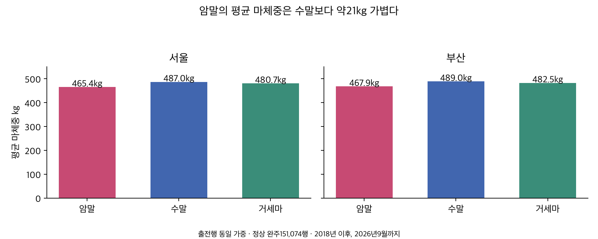
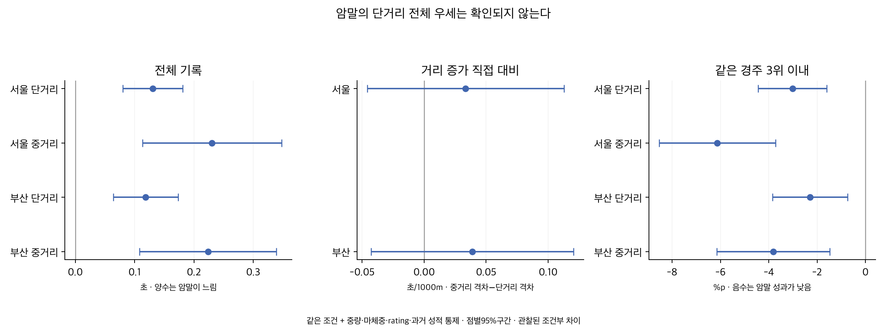

# 암말 수말 거세마의 체중과 거리별 경기력

2026-10-07. **암말은 평균적으로 수말보다 약21kg, 거세마보다 약15kg 가볍다. 그러나 단거리 경주 전체에서 암말이 더 잘 뛴다는 주장은 이번 자료에서 확인되지 않았다.** 출발200m는 암말이 조금 빠르지만, 전체시간과 같은 경주 입상 성과는 다른 결과를 보인다. 중거리에서 암말의 열세가 더 커지는지는 지표·지역에 따라 불확실하다.

## 자료와 비교 범위

[기존 성별 연구](../20261007_sex_ability_gap/README.md)의 검증된 서울·부산 실전151,074출전·13,928경주·12,435두를 읽기 전용으로 재사용했다. 2018년 이후 자료이며 종료일은 서울2026-09-20·부산2026-09-18, 거리별 종료일은 다르다. 2026년은 부분 연도다. 출전 당시 암·수·거 분류이며 거세마는 수컷의 거세 상태를 포함한 분류다. 주행심사·제주·영천과 주로빠르기는 사용하지 않았다.

단거리는1000·1200·1300·1400m, 중거리는1600·1700·1800m라는 연구용 묶음이다. 공식 거리 분류를 주장하지 않는다.1900m 이상은 별도이며 아래 결론을 확장하지 않는다. 정상 완주·구간 품질 선택을 계승했고 정상적인 빠르거나 느린 기록을 추가 제거하지 않았다. 이 선택에 따른 한계와 넓은 모집단 민감도는 원 연구에 보존돼 있다.

## 마체중과 부담중량

마체중은 말 몸의 무게이고 부담중량은 경주에서 짊어지는 중량이다. 아래 기본 평균은 출전행 동일 가중이어서 자주 출전한 말의 비중이 크다. 말별 동일 가중은 각 말의 해당 분류·지역 평균을 먼저 만든 뒤 평균했다. 수→거로 바뀐 말은 각 출전 당시 분류에 속할 수 있다.

| 지역 | 분류 | 출전 수 | 마체중 평균 kg | 중앙값 | 가벼운20% 경계 | 무거운20% 경계 | 말별 동일 가중 평균 kg | 부담중량 평균 kg |
|---|---|---:|---:|---:|---:|---:|---:|---:|
| 서울 | 암 | 35,111 | 465.42 | 465 | 444 | 486 | 465.18 | 53.23 |
| 서울 | 수 | 33,027 | 486.99 | 486 | 467 | 508 | 486.88 | 54.54 |
| 서울 | 거 | 20,105 | 480.70 | 480 | 460 | 501 | 481.72 | 54.35 |
| 부산 | 암 | 24,955 | 467.86 | 468 | 446 | 489 | 467.79 | 53.15 |
| 부산 | 수 | 21,881 | 489.01 | 488 | 468 | 510 | 489.65 | 54.46 |
| 부산 | 거 | 15,995 | 482.54 | 481 | 461 | 505 | 483.96 | 54.30 |



다음 괄호는 마필·날짜 의존성을 반영한 점별95%구간이다. 같은 조건은 지역별 정확 거리·연도·월·나이·함수율 숫자·등급이 모두 같은 층 중 양쪽 분류가 관측된 경우다.

| 지역 | 비교 | 원시 마체중 차이 kg | 같은 조건·등급 차이 kg |
|---|---|---:|---:|
| 서울 | 암−수 | -21.57 [-23.05, -20.08] | -18.79 [-20.20, -17.39] |
| 서울 | 거−수 | -6.29 [-8.01, -4.56] | -7.17 [-8.78, -5.56] |
| 서울 | 암−거 | -15.28 [-17.03, -13.52] | -11.91 [-13.57, -10.25] |
| 부산 | 암−수 | -21.15 [-23.00, -19.30] | -18.31 [-20.00, -16.62] |
| 부산 | 거−수 | -6.46 [-8.52, -4.40] | -7.70 [-9.70, -5.70] |
| 부산 | 암−거 | -14.69 [-16.79, -12.58] | -10.49 [-12.37, -8.61] |

말별 동일 가중에서도 암−수 차이는 서울−21.70kg·부산−21.86kg로 남는다. 부담중량은 암말이 수말보다 원시 평균 약1.31~1.32kg 적었다. 이는 관측 평균이며 연도별 공식 감량 규정의 수치로 해석하지 않는다. 가볍다는 사실만으로 더 빠르거나 체중 때문에 기록 차이가 난다고 단정할 수 없다.

## 전체 기록과 초반 및 막판

아래는 정확 거리·연도·월·나이·등급·함수율을 맞추고 부담중량·마체중(제곱항 포함),rating(제곱항 포함)·과거 기록/성과·출전수·공백을 추가 통제한 조건부 차이다. 통제 기울기는 단거리와 중거리에서 각각 추정했다. **암−수의 시간 양수는 암말이 느린 방향**이며 괄호는 점별95%구간이다.

| 지역 | 지표 | 단거리 암−수 | 중거리 암−수 | 중거리−단거리 직접 대비 |
|---|---|---:|---:|---:|
| 부산 | 전체 초 | +0.119 [+0.064, +0.173] | +0.224 [+0.109, +0.339] | +0.105 [-0.023, +0.233] |
| 부산 | 1000m당 초 | +0.092 [+0.049, +0.135] | +0.131 [+0.062, +0.200] | +0.039 [-0.043, +0.120] |
| 부산 | 출발200m 초 | -0.052 [-0.067, -0.037] | -0.031 [-0.059, -0.003] | +0.021 [-0.009, +0.052] |
| 부산 | 마지막200m 초 | +0.111 [+0.081, +0.141] | +0.111 [+0.052, +0.169] | -0.000 [-0.065, +0.064] |
| 서울 | 전체 초 | +0.131 [+0.080, +0.181] | +0.231 [+0.113, +0.348] | +0.100 [-0.028, +0.227] |
| 서울 | 1000m당 초 | +0.099 [+0.058, +0.139] | +0.132 [+0.064, +0.200] | +0.033 [-0.046, +0.113] |
| 서울 | 출발200m 초 | -0.041 [-0.055, -0.026] | +0.001 [-0.035, +0.037] | +0.042 [+0.004, +0.080] |
| 서울 | 마지막200m 초 | +0.097 [+0.070, +0.124] | +0.115 [+0.055, +0.176] | +0.019 [-0.047, +0.085] |

단거리 전체시간의 암말 열세는 서울+0.131초·부산+0.119초다. 출발200m는 각각−0.041초·−0.052초로 암말이 빠르지만, 마지막200m는+0.097초·+0.111초로 느리다. 초반이 빠른 현상을 단거리 경주 전체의 우세로 바꿔 읽을 수 없다. 중거리 전체시간은+0.231초·+0.224초로 점추정상 격차가 더 크지만, 중거리−단거리 직접 대비의95%구간은 양 지역 모두0을 포함한다.

경주가 길면 동일 비율 차이도 초 차이가 커질 수 있어1000m당 관측시간으로 재확인했다. 이 단위는 가상의1000m 경주 환산이나 환경 보정이 아니다. 중거리에서 암말 격차가 늘어나는 정도는 서울+0.034초/1000m·부산+0.039초/1000m이며 양쪽 모두 구간이0을 포함한다. 거리 증가의 일반 법칙으로 확정하기 어렵다.

중량·체중·rating·이력을 넣기 전 같은 조건·등급만 맞춘 결과도 보존한다. 이 단계에서 암말은 단거리/중거리 모두 느린 방향이다. 서울 전체 초의 거리 증가 대비만 양수 구간이나1000m당 대비는0을 포함한다. 전부 통제한 값은 동등한 등급·중량·이력의 말 사이 질문이며 전체 출전 집단의 격차가 없어졌다는 뜻이 아니다.

| 지역 | 지표 | 단거리 암−수 | 중거리 암−수 | 중거리−단거리 직접 대비 |
|---|---|---:|---:|---:|
| 부산 | 전체 초 | +0.259 [+0.206, +0.311] | +0.276 [+0.167, +0.385] | +0.017 [-0.098, +0.132] |
| 부산 | 1000m당 초 | +0.208 [+0.166, +0.251] | +0.164 [+0.098, +0.229] | -0.045 [-0.119, +0.029] |
| 서울 | 전체 초 | +0.194 [+0.148, +0.240] | +0.299 [+0.204, +0.395] | +0.105 [+0.003, +0.207] |
| 서울 | 1000m당 초 | +0.151 [+0.113, +0.189] | +0.173 [+0.118, +0.229] | +0.022 [-0.042, +0.087] |

## 같은 경주의 실제 성과

원래 출전자 구성이 전부 유지된 정상 혼합 경주에서 해당 두 분류가 실제 함께 출전한 경우만 비교했다. 암말 제한 편성과 비표준 원래 편성은 제외했다. 같은 경주 효과에 나이·중량·체중·rating·과거 성적 등을 더한 선형 확률 차이다. 우승/3위 이내는 시간과 별도의 성과이며 **음수는 암말 성과가 낮은 방향**이다. 아래 %p는 우승확률 예측값이 아니다.

| 지역 | 지표 | 단거리 암−수 | 중거리 암−수 | 중거리−단거리 직접 대비 |
|---|---|---:|---:|---:|
| 부산 | 우승 %p | -0.70 [-1.73, +0.33] | -1.42 [-3.03, +0.20] | -0.71 [-2.59, +1.17] |
| 부산 | 3위 이내 %p | -2.29 [-3.84, -0.75] | -3.81 [-6.14, -1.47] | -1.52 [-4.34, +1.31] |
| 서울 | 우승 %p | -1.19 [-2.07, -0.31] | -3.32 [-4.87, -1.78] | -2.13 [-3.88, -0.39] |
| 서울 | 3위 이내 %p | -3.02 [-4.44, -1.60] | -6.13 [-8.54, -3.73] | -3.11 [-5.82, -0.40] |

서울에서는 중거리의3위 이내 성과 격차가 단거리보다−3.11%p 더 낮았고 점별 구간은0을 포함하지 않는다. 부산의−1.52%p 직접 대비는0을 포함한다. 양쪽의 단거리3위 이내 성과는 수말보다 낮은 방향이다. 통제 없는 같은 경주 결과까지 함께 제공한다.

| 지역 | 지표 | 단거리 암−수 | 중거리 암−수 | 중거리−단거리 직접 대비 |
|---|---|---:|---:|---:|
| 부산 | 우승 %p | -4.47 [-5.41, -3.53] | -5.35 [-6.89, -3.81] | -0.88 [-2.57, +0.81] |
| 부산 | 3위 이내 %p | -9.49 [-11.12, -7.86] | -11.36 [-13.87, -8.86] | -1.87 [-4.61, +0.87] |
| 서울 | 우승 %p | -4.65 [-5.43, -3.87] | -6.72 [-8.13, -5.32] | -2.08 [-3.57, -0.58] |
| 서울 | 3위 이내 %p | -8.88 [-10.26, -7.51] | -12.37 [-14.74, -10.00] | -3.49 [-6.03, -0.96] |



## 표본과 최근 기간의 한계

| 지역 | 분석 | 입력 쌍 행수 | 공통 행수 | 단거리 암/수 | 중거리 암/수 | 제외율 |
|---|---|---:|---:|---:|---:|---:|
| 부산 | time_joint | 46,180 | 30,689 | 13127/11200 | 2925/3437 | 33.5% |
| 서울 | time_joint | 66,707 | 45,477 | 20577/18005 | 3153/3742 | 31.8% |
| 부산 | race_joint | 39,703 | 37,643 | 14036/13809 | 4043/5755 | 5.2% |
| 서울 | race_joint | 56,661 | 53,493 | 20319/22100 | 4334/6740 | 5.6% |

기록 분석의 입력 쌍은 해당 지역1000~1800m 암·수 전체이고, 같은 경주 분석 입력 쌍은 먼저 정상 완전 혼합 편성으로 제한한 수다. 제외율은 각각의 입력 대비 공통층/동반 출전 조건에서 빠진 비중이므로 서로 같은 모집단의 제외율이 아니다. 전체 성별 수·거리별 수·쌍별 공통수는 결과 CSV에 있다.

2024~2025 완결연도만 재분석하면 아래와 같다. 방향은 대체로 유지되지만 중거리 전체시간 구간은 양 지역 모두0을 포함하며, 부산 단거리도0을 포함한다. 서울의 중거리−단거리3위 이내 차이도 최근 표본에서는 불확실하다. 이는 같은 자료의 민감도이며 독립 미래 검증이 아니다.

| 지역 | 지표 | 단거리 암−수 | 중거리 암−수 | 중거리−단거리 직접 대비 |
|---|---|---:|---:|---:|
| 부산 | 전체 초 | +0.145 [-0.001, +0.291] | +0.211 [-0.044, +0.466] | +0.066 [-0.223, +0.355] |
| 부산 | 1000m당 초 | +0.109 [-0.004, +0.222] | +0.123 [-0.025, +0.272] | +0.014 [-0.168, +0.197] |
| 서울 | 전체 초 | +0.153 [+0.045, +0.261] | +0.200 [-0.045, +0.446] | +0.048 [-0.223, +0.318] |
| 서울 | 1000m당 초 | +0.115 [+0.030, +0.199] | +0.114 [-0.030, +0.257] | -0.001 [-0.169, +0.167] |

| 지역 | 지표 | 단거리 암−수 | 중거리 암−수 | 중거리−단거리 직접 대비 |
|---|---|---:|---:|---:|
| 부산 | 3위 이내 %p | -0.76 [-4.52, +2.99] | -1.85 [-6.38, +2.69] | -1.08 [-6.93, +4.76] |
| 서울 | 3위 이내 %p | -2.67 [-5.75, +0.41] | -6.43 [-11.29, -1.56] | -3.76 [-9.42, +1.91] |

1900m 이상은 서울 암말203행·수말1,228행·거세마552행, 부산 암말134행·수말522행·거세마309행뿐이다. 여러 정확 거리·연도·월·나이·등급·함수율을 맞추면 암말 공통 비교가 더 희소해진다. 이 자료로 장거리의 보편적 성별 우열을 새로 확정하지 않았다. 특히 부산1900은2020년에 종료하는 오래된 관측이다.

거세마는 수말보다 평균 약6.3~6.5kg 가볍지만 경기력을 체중 순서대로 나열할 수 없다. 전부 통제한 전체시간 거−수는 서울 단거리−0.048초[−0.090,−0.006], 중거리−0.022초[−0.101,+0.057], 부산 단거리−0.012초[−0.067,+0.044], 중거리−0.004초[−0.091,+0.084]다. 거세의 인과효과나 일관된 순위로 해석하지 않는다. 세 쌍의 모든 결과를 공개해 특정 비교만 선택하지 않았다.

## 계산과 검증

공통층 내 회귀와 성별×거리묶음 상호작용의 직접 대비를 썼다. 공변량 결측은 분석행렬 안에서 중앙값과 결측 지시자로 처리하고 원천 null은 유지했다. 말 고정효과나 기존 성별 보정 잔차를 사용하지 않았다. 공통층 내 양쪽 표본수에 따라 가중되는 비교이고 정확 거리들의 동일 가중 평균이 아니다. 각 쌍의 공통 모집단이 다르므로 서로 뺄셈해 다른 쌍을 만들지 않는다.

마필·지역별 날짜의 이원 군집 분산과 각 단독 군집 분산 중 최대를 쓰고 층 자유도·t 보정을 적용했다. 경주는 날짜 군집 안에 들어간다. 각 거리묶음 양쪽100행·30두·20날짜·20층과 대비 식별을 구간 제공 요건으로 삼았다. 다수 비교의 점별 탐색95%구간으로 동시 신뢰구간은 아니다. 자기선택·편성·건강·훈련 등 미관측 요인이 남아 생물학적 인과 결론이나 자동 성별 보정의 근거로 쓰지 않는다.

입력4개 해시·행/경주 고유성·분류·마체중 유효성을 확인했다. DuckDB로 원시·말별 동일 가중 체중을 대조하고, 모든 상호작용 대비/구간 산식을 검사했다. 별도 QR 회귀·pandas 군집 합으로 세 성별 쌍의 주 모형126행을 재계산하고4개 명시적 희소 고정효과 회귀로 주요 계수를 확인했다. 총524수치 검사가 통과했다. 원문 성별·날짜·구간 합의 재검증 기록은 원 연구의 감사 결과를 계승한다.

## 산출물과 재현

[계획](PLAN.md), [출처와 방법](SOURCES.md), [모든816대비](ALL_RESULTS.md), [결과 CSV](outputs/joint_contrasts.csv), [체중·표본표](outputs/weight_and_population_summary.csv), [독립 검증](outputs/verification.json), [독립 계산표](outputs/independent_model_checks.csv), [게시 요약](PUBLICATION.md), [게시 데이터](outputs/publication_summary.json), [용량 명세](outputs/artifact_inventory.json)를 보존한다. 기존 연구·운영 DB·기준표·배포는 변경하지 않았다.

프로젝트 루트에서 순서대로 실행한다. 기존 원 연구는 재실행하지 않는다.

```sh
PYTHONDONTWRITEBYTECODE=1 .venv/bin/python thoroughbred/research/20261007_sex_weight_distance_followup/analyze.py
PYTHONDONTWRITEBYTECODE=1 OPENBLAS_NUM_THREADS=1 .venv/bin/python thoroughbred/research/20261007_sex_weight_distance_followup/verify.py
MPLCONFIGDIR=/private/tmp/sex_weight_plot PYTHONDONTWRITEBYTECODE=1 .venv/bin/python thoroughbred/research/20261007_sex_weight_distance_followup/render.py
```
