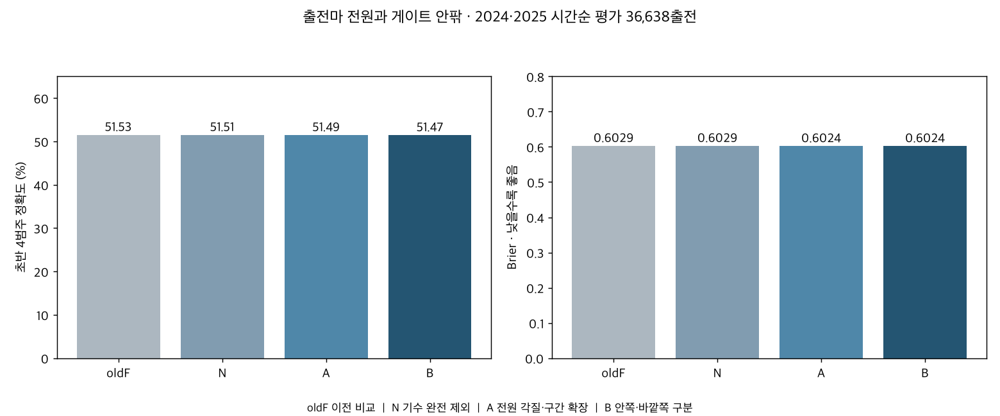
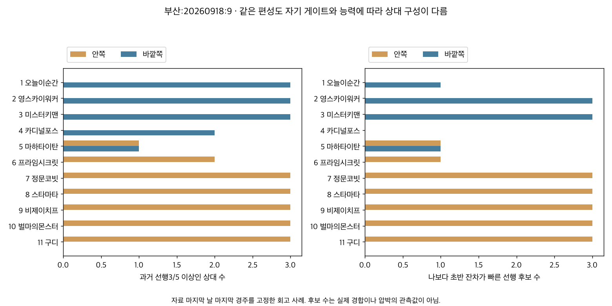

# 출전마 전원과 게이트 안팎을 함께 보는 전개 예측

2026-10-08 · 연구28 후속28D · 서울·부산 · 종료 서울2026-09-20/부산2026-09-18 · 연구 후보.

**전체 상대를 보는 기존 방향을 유지하면서, 전원의 각질·구간 구성과 게이트 안팎을 명시적으로 비교했다.** 기존에는 바깥 상대도 전체 비교에 포함됐지만 방향별로는 안쪽 선행성향 합만 있었다. 이번에는 기수·조교사 성향과 기수 교체 여부를 모두 제외했다.

2024·2025년 같은 36,638출전에서 초반 네 각질 정확도는 기준 N 51.51%, 전원 구성 확장 A 51.49%, 안쪽/바깥쪽 구분 B 51.47%였다. 전원 구성 확장의 Brier A−N은 -0.000502 [-0.000897, -0.000106]로, 확률오차를 아주 작게 줄였다. 안팎 구분의 B−A는 +0.000043 [-0.000229, +0.000315]로, 확률오차의 추가 개선은 불확실했다. 음수는 개선이며 괄호는 말·날짜 군집95% 구간이다. 전체·부분집단의 정확도와 확률오차를 구분한다.

## 무엇을 새로 확인했는가

기존에도 자기 자신을 제외한 전원이 전체 상대 집계에 들어갔다. ‘전체 선행성향 합−안쪽 합=바깥 합’이므로 바깥 선행합 하나는 새 독립 정보가 아니다. 이번 확장의 핵심은 **바깥에 몇 마리가 있고, 어떤 각질 분포이며, 그중 누가 자기보다 초반이 빠른가**를 안쪽과 같은 방식으로 입력한 것이다.

| 범위 | 반영 내용 |
|---|---|
| 각 말 | 최근 실제5/10슬롯의 네 각질 빈도, 원래 위치·성적·구간 이력 |
| 전체 상대 | 네 각질 비율 평균과 지원, 초반200m·마지막600/200m 원초와 잔차, 단독선두율 |
| 안쪽·바깥쪽 각각 | 같은 정보의 평균·지원, 선행/앞선 후보 수, 빠른 상대 수, 빠른 선행후보 수, 빠른 상대의 선행성향 합 |
| 결측 | 신마·기록 부족 상대도 명단 유지, 방향별 인원·유효수/지원비율과 미관측 표시 |

자기 기록을 상대 평균에 포함하지 않는다. 각 말의 어느 쪽에도 상대가 없으면 인원·합은0, 평균·지원비율은 미관측이다. ‘기록이 없어서 빠른 상대를 알 수 없음’과 ‘알려진 빠른 상대가0두’를 구분한다. 게이트 번호 사이의 취소 공백은 유지한다. 번호의 안팎이지 실제 주행 중 레일 위치나 물리적 경로 길이가 아니다.

선행 후보는 최근5슬롯 선행3회 이상, 앞선 후보는 선행+선입3회 이상이다. 빠른 상대는 과거 평균 초반 환경 잔차가 자기보다 큰 말이며 동률을 제외한다. 원초 빠름도 별도로 저장했다. 마지막600m와200m는 겹치므로 독립 능력 점수처럼 더하지 않는다. 후보 수·성향 합은 실제 경합의 공동확률이 아니다.

선행성향 합은 각 상대의 (과거 선행횟수+1)/(유효 각질수+4)를 더한 값이다. 이력 미관측 말의0.25는 사전값이므로 관측 성향으로 오해하지 않는다. 유효수·기록 지원과 함께 읽어야 하며 이번 경주에서 각 말이 선행할 예측확률의 합도 아니다.

## 같은 표본·같은 설정의 시간순 검증

전체159,014출전·14,636경주·12,516두를 상대 명단에 유지했다. 주 성능평가는2024·2025의36,638출전·4,405두·3,465경주다. N은 기존 F에서 기수 교체 표식까지 제거한157개, A는202개, B는297개 입력이다. 기수·조교사 성향과 식별자·교체 여부가 실제 저장 모형에 없는지 확인했다.

| 모형 | 평가 출전 | 정확도 | Brier | 로그손실 |
|---|---|---|---|---|
| 이전 F·교체표식 포함 | 36638 | 0.5153 | 0.6029 | 1.0991 |
| 기수 완전 제외 기준 | 36638 | 0.5151 | 0.6029 | 1.0991 |
| 전원 구성 확장 | 36638 | 0.5149 | 0.6024 | 1.0983 |
| 안쪽·바깥쪽 구분 추가 | 36638 | 0.5147 | 0.6024 | 1.0983 |

| comparison | estimate | lower | upper | bh_q_three |
|---|---|---|---|---|
| B-A | 4.26e-05 | -0.0002 | 0.0003 | 0.8335 |
| A-N | -0.0005 | -0.0009 | -0.0001 | 0.0393 |
| N-oldF | 1.12e-05 | -9.38e-05 | 0.0001 | 0.8335 |

B−A가 주 비교다. A−N은 전원 구성의 명시적 확장이고 N−oldF는 기수 교체 표식 제거다. 세 대비 BH를 표시했다. N과 B의 차이 전체를 바깥 게이트만의 효과로 해석하지 않는다. 기존 유효5전 공통24,613출전에서는 N 52.85%, A 52.97%, B 52.96%였다. 연도별 전체/지원수·정확도·확률오차는 [성능 원표](outputs/early_metrics.csv), [군집구간](outputs/early_comparisons.csv), [지역·거리·등급·게이트 구간](outputs/subgroup_metrics.csv), [교정표](outputs/early_calibration.csv)를 따른다.

모든 학습은 평가연도 이전 자료만 사용했다.2024모형은2023년까지,2025모형은2024년까지다. 학습률0.04·15잎·최소잎150·L2=10·180회·seed42를 고정해 결과를 보고 튜닝하지 않았다. 과거 실제 슬롯·T−2·730일·전년까지의 환경 기준을 재사용했다. 현재 경주의 실제 각질·시간·함수율·체중·rating·배당은 입력하지 않았다. 명단 메타정보의 당시 사전 공개시각은 미감사이므로 회고 시간순 실험이다.

2024·2025년은 이전 연구에서도 사용한 후향 기간이다. 시간순 분리를 지킨 비교이며, 아직 보지 않은 미래 경주에서 독립 검증을 완료한 것은 아니다.

## 평소 선행형에서 안팎 상대를 보면

아래는 과거5슬롯 선행3회 이상, 초반 잔차3전 이상인 말의 관찰표다. 안/중/외 게이트 구간마다 안쪽·바깥쪽의 ‘자기보다 초반이 빠른 선행후보’가 있는지 나눴다. 현재 경주 실제 전개로 후보를 미리 골라내지 않았다.

| gate_band | inner_fast_front | outer_fast_front | n | horses | first_group_rate | inner_speed_coverage | outer_speed_coverage |
|---|---|---|---|---|---|---|---|
| inner | False | False | 877 | 530 | 0.7104 | 0.9795 | 0.9868 |
| inner | False | True | 865 | 584 | 0.4555 | 0.9957 | 0.9934 |
| inner | True | False | 88 | 85 | 0.4773 | 0.9943 | 0.9913 |
| inner | True | True | 202 | 176 | 0.3416 | 1 | 0.9949 |
| middle | False | False | 739 | 467 | 0.6590 | 0.9887 | 0.9896 |
| middle | False | True | 294 | 253 | 0.3980 | 0.9927 | 0.9907 |
| middle | True | False | 321 | 267 | 0.4081 | 0.9921 | 0.9937 |
| middle | True | True | 352 | 290 | 0.3267 | 0.9961 | 0.9941 |
| outer | False | False | 836 | 527 | 0.6005 | 0.9875 | 0.9872 |
| outer | False | True | 85 | 84 | 0.4824 | 0.9831 | 0.9941 |
| outer | True | False | 826 | 573 | 0.3983 | 0.9918 | 0.9897 |
| outer | True | True | 177 | 168 | 0.2881 | 0.9945 | 0.9962 |

거리·말 능력·두수·지원·선행 경쟁이 섞인 기술통계다. 외곽 상대 유무의 인과효과나 강제 선행실패 손실이 아니다. 구간마다 표본 수가 다르고 어떤 조합은 적다. 안팎이 모두 복잡한 편성에서 한쪽만으로 결론을 내리지 않는다.

예를 들어 안쪽 게이트이고 안쪽에 빠른 선행후보가 없는 경우, 바깥에도 없으면 첫 마군 포함률71.0%(877출전), 바깥에 있으면45.5%(865출전)였다. 중간 게이트의 같은 비교는65.9%(739출전) 대39.8%(294출전)였다. 바깥 상대도 살펴야 한다는 관찰 근거지만 자기 능력이 낮을수록 ‘자기보다 빠른 상대’가 늘어나는 구조도 있어 원인 효과로 읽지 않는다.

이 관찰 차이가 새 방향별 입력의 예측 개선을 뜻하지는 않는다. B−A는2024년−0.000161,2025년+0.000244로 방향이 달랐고 두 연도 모두 구간이0을 포함했다. 기존에도 전체 상대 속도와 게이트 정보가 있었으며 바깥 선행합은 계산 가능했다. 이번 결과만으로 방향별 확장 B를 우수 모형으로 채택하거나 외측 압박 가산점을 확정할 근거는 없다.

## 후반 순위 회복·앞선 후퇴

28C와 같은 목표를 유지했다. 회복은 결승 전600m에서 뒤쪽 상대위치0.5 이상인 말이 결승까지0.25 이상 회복, 후퇴는 초반 선행/선입이면서 결승 상대위치가 초반 마군평균보다0.30 이상 뒤인 사건이다. 현재 실제 앞선 여부로 사전 표본을 고르지 않으며 미완주/미관측 목표는0으로 대체하지 않는다. 이 결과는 추입 의도·육체적 붕괴의 정답이 아니다.

| task | model | n | prevalence | brier | auc | low20_rate | high20_rate |
|---|---|---|---|---|---|---|---|
| fade | N | 36609 | 0.1480 | 0.1097 | 0.7669 | 0.0217 | 0.3633 |
| fade | B | 36609 | 0.1480 | 0.1097 | 0.7664 | 0.0220 | 0.3623 |
| recovery | N | 36531 | 0.1994 | 0.1395 | 0.7458 | 0.0401 | 0.4269 |
| recovery | B | 36531 | 0.1994 | 0.1395 | 0.7457 | 0.0408 | 0.4245 |

| task | estimate | lower | upper | bh_q_two |
|---|---|---|---|---|
| fade | 5.05e-05 | -4.78e-05 | 0.0001 | 0.5349 |
| recovery | -4.17e-05 | -0.0002 | 9.05e-05 | 0.5349 |

이 후반 비교는 N과 B의 전체 입력 확장 효과이며 방향 구분만의 독립 효과가 아니다. [원표](outputs/late_metrics.csv) · [교정표](outputs/late_calibration.csv).

## 출전마 전원을 보존한 같은 편성 사례

이전28C와 같은 자료 마지막 날짜 마지막 경주를 고정했다.2026모형은2025년까지 학습했고 사례 결과를 학습하거나 현재 입력에 넣지 않았다. 좋은 결과의 경주를 고른 것이 아니며 당시 실제 사전 발행도 아니다. 두 경주21두, 자기 제외 방향이 있는 상대 200쌍을 모두 저장했다.

| 경주 | 게이트 | 말 | 안쪽 수 | 바깥 수 | 안쪽 선행후보 | 바깥 선행후보 | 안쪽 빠른 선행후보 | 바깥 빠른 선행후보 | 선행확률 | 실제 초반 |
|---|---|---|---|---|---|---|---|---|---|---|
| 부산:20260918:9 | 1 | 오늘이순간 | 0 | 10 | 0 | 3 | 0 | 1 | 0.3355 | 후미 |
| 부산:20260918:9 | 2 | 영스카이워커 | 1 | 9 | 0 | 3 | 0 | 3 | 0.3124 | 후미 |
| 부산:20260918:9 | 3 | 미스터키맨 | 2 | 8 | 0 | 3 | 0 | 3 | 0.1859 | 중단 |
| 부산:20260918:9 | 4 | 카디널포스 | 3 | 7 | 0 | 2 | 0 | 0 | 0.5652 | 선행 |
| 부산:20260918:9 | 5 | 마하타이탄 | 4 | 6 | 1 | 1 | 1 | 1 | 0.5425 | 중단 |
| 부산:20260918:9 | 6 | 프라임시크릿 | 5 | 5 | 2 | 0 | 1 | 0 | 0.6767 | 선행 |
| 부산:20260918:9 | 7 | 정문코빗 | 6 | 4 | 3 | 0 | 3 | 0 | 0.1269 | 후미 |
| 부산:20260918:9 | 8 | 스타마타 | 7 | 3 | 3 | 0 | 3 | 0 | 0.0082 | 선행 |
| 부산:20260918:9 | 9 | 비제이치프 | 8 | 2 | 3 | 0 | 3 | 0 | 0.0133 | 후미 |
| 부산:20260918:9 | 10 | 벌마의몬스터 | 9 | 1 | 3 | 0 | 3 | 0 | 0.0572 | 중단 |
| 부산:20260918:9 | 11 | 구디 | 10 | 0 | 3 | 0 | 3 | 0 | 0.0088 | 후미 |
| 서울:20260920:11 | 1 | 글로벌하트 | 0 | 9 | 0 | 1 | 0 | 1 | 0.3551 | 후미 |
| 서울:20260920:11 | 2 | 드림리메인 | 1 | 8 | 0 | 1 | 0 | 1 | 0.2127 | 선행 |
| 서울:20260920:11 | 3 | 팬텀프린스 | 2 | 7 | 0 | 1 | 0 | 1 | 0.5371 | 중단 |
| 서울:20260920:11 | 4 | 문학루퍼 | 3 | 6 | 0 | 1 | 0 | 1 | 0.0551 | 중단 |
| 서울:20260920:11 | 5 | 마이티세이버 | 4 | 5 | 0 | 1 | 0 | 1 | 0.1656 | 중단 |
| 서울:20260920:11 | 6 | 원평크라운 | 5 | 4 | 0 | 1 | 0 | 1 | 0.0515 | 후미 |
| 서울:20260920:11 | 7 | 무초마초라피도 | 6 | 3 | 0 | 1 | 0 | 1 | 0.2459 | 선입 |
| 서울:20260920:11 | 8 | 이스트라코타 | 7 | 2 | 0 | 1 | 0 | 1 | 0.0327 | 후미 |
| 서울:20260920:11 | 10 | 이끌림 | 8 | 1 | 0 | 0 | 0 | 0 | 0.8094 | 선행 |
| 서울:20260920:11 | 11 | 위너선 | 9 | 0 | 1 | 0 | 1 | 0 | 0.0808 | 중단 |

이 고정 사례에서 가장 높은 선행확률은 이끌림 80.9%였다. 실제 첫 마군 중 가장 낮게 예측한 말은 스타마타 0.8%였다. 위치확률은 고정 작전이 아니며, 낮은 확률 사건도 발생한다. 실제 추진·제어·진로·작전 지시 자료가 없어 이런 차이의 원인을 확정하지 않는다.

[출전마별 전체/안팎 입력과 확률](outputs/example_cards.csv) · [모든 상대 쌍별 각질·기록](outputs/example_rival_pairs.csv). 각 상대의 최근5/10전 네 각질, 초반/막판 시간·잔차, 선행 성향과 게이트 방향을 대조할 수 있다. 모형은 이들을 전체·방향별 요약으로 사용하며, 말별 전체 주행경로의 공동확률이나 모든 게이트 순서 조합을 직접 학습한 결과는 아니다.

## 검증·보존·적용 범위

독립 SQL 자기 제외·전원·안팎 집계 21,466,890개 값, 게이트 대칭 505경주, 현재 결과/기수 변조, 별도 트리 경로와 저장 예측, 확률·군집/BH·교정·상대 전수 검증을 통과했다. 총 검사 25,842,279개, 기존 114파일 보존이다. 입력/결측/게이트 집계를 검증한 것이 모든 미래 경주의 성능 보장은 아니다.

[계산 전 계획](PLAN.md) · [출처](SOURCES.md) · [검증](outputs/verification.json) · [게시요약](PUBLICATION.md) · [게시JSON](PUBLICATION.json) · [중앙28D](../conclusions/28D_BILATERAL_FIELD_PACE.md) · [용량](outputs/SIZE_REPORT.md). 기존 독립 연구 수41·DB·운영 모델·웹 배포는 유지한다. 기수·조교사는 이번 입력에서 제외했지만 과거 말 기록 속 기수 영향을 인과적으로 분리한 것은 아니다. 직접 작전 의도·주행경로·강제 선행실패의 성적 손실·입상확률 개선은 별도 미검증이다.
