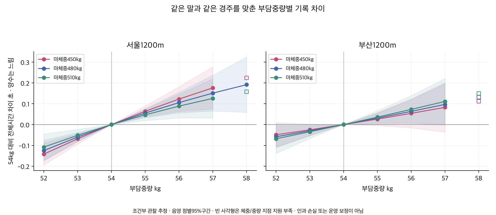
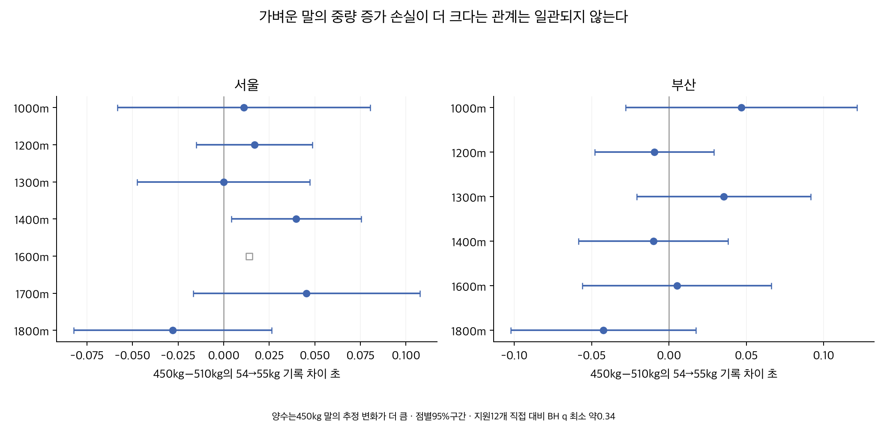

# 마체중별 부담중량 증가와 기록 차이

2026-10-08. **부담중량별 조건부 기록 차이를 추정할 수 있다.1200m에서480kg 말의54→55kg 차이는 서울 약+0.055초·부산+0.031초다. 그러나 가벼운 말이 같은1kg 증가에 더 큰 손실을 본다는 관계는 충분히 확인되지 않았다.** 체중별 격차의 방향이 지역·거리·모형에 따라 바뀌며 인과적 손실이나운영 환산계수로 확정할 수 없다.

## 자료와 질문

[성별 연구의 검증된 모집단](../20261007_sex_ability_gap/README.md)151,074출전·13,928경주·12,435두를 읽기 전용 재사용했다.2018년 이후 서울2026-09-20·부산2026-09-18까지이며 거리별 종료일은 다르다. 출전 당시 체중·부담중량·성별을 쓰고,정상 완주/구간 품질 선택을 계승했다. 제주·영천·주행심사·주로빠르기는 제외했다.

[기존1200m 중량 비율 연구](../20261005_relative_load1200/README.md)는 부담중량 표현에 따른 예측오차 차이를 평가했다. 그 작은 오차 감소는1kg의 기록 손실이 아니었다. 이번 질문은 체중을 고정한 상태에서 부담중량 차이에 동반하는 시간 차이와 그 차이가 체중에 따라 달라지는가다. 물리 실험이나중량을 무작위 배정한 시험이 아니다.

주 분석은 같은 지역·정확 거리별2000행/100날짜 이상인1000~1800m의13개 조합이다. 기타 거리는 [지원표](outputs/distance_eligibility.csv)에 남기고 일반 손실을 추정하지 않았다. 전체 출전에서 먼저 추정하며5위 이내는1200m의 별도 민감도다. 예측 개선·우승확률·새 기록 보정은 평가하지 않았다.

## 같은 말과 같은 경주를 맞춘 1kg 차이

부담중량54kg를 기준으로55kg의 전체시간 차이다. **양수는 느린 방향**이며 괄호는 점별95%구간이다. 같은 말과 같은 경주의 효과에 나이·rating·과거 성과/출전수/공백 등을 더했다. 같은 경주 효과가 거리·날짜·등급·함수율·월 등 해당 경주에 공통인 조건을 흡수한다.

| 지역 | 마체중450kg | 마체중480kg | 마체중510kg |
|---|---:|---:|---:|
| 서울 | +0.064 [+0.037, +0.090] | +0.055 [+0.033, +0.077] | +0.047 [+0.020, +0.074] |
| 부산 | +0.026 [-0.005, +0.057] | +0.031 [+0.007, +0.056] | +0.036 [+0.005, +0.067] |

서울에서는450kg의+0.064초가510kg의+0.047초보다 크지만, 둘의 직접 차이는 +0.017 [-0.015, +0.049]초로0을 포함한다. 부산은450kg+0.026초·510kg+0.036초로 반대 순서이며 직접 차이 -0.009 [-0.048, +0.029]초도0을 포함한다. 따라서 체중이 가벼울수록 손실이 확실히 크다는 공식은 얻지 못했다.450kg 부산의1kg 차이 자체도0을 포함한다.

## 부담중량별 기록 차이

아래는 각각의 체중에서54kg 대비 차이다. 같은 체중의52kg과55kg를 비교할 때54kg 기준 차이끼리 단순히 독립값처럼 표준오차를 합치지 않는다. 결과표는 지정한54kg 대비 공동모형 대비를 제공한다.54kg 행의0은 정의상 기준이며 미관측값을0으로 채운 것이 아니다. 지원 부족은 점추정만 잠정 표시하고95%구간을 비웠다.

| 지역 | 부담중량 | 450kg 말 | 480kg 말 | 510kg 말 |
|---|---:|---:|---:|---:|
| 서울 | 52kg | -0.142 [-0.195, -0.089] | -0.125 [-0.174, -0.076] | -0.108 [-0.171, -0.045] |
| 서울 | 53kg | -0.068 [-0.093, -0.044] | -0.060 [-0.082, -0.038] | -0.052 [-0.080, -0.023] |
| 서울 | 54kg | 0 기준 | 0 기준 | 0 기준 |
| 서울 | 55kg | +0.064 [+0.037, +0.090] | +0.055 [+0.033, +0.077] | +0.047 [+0.020, +0.074] |
| 서울 | 56kg | +0.122 [+0.063, +0.182] | +0.106 [+0.056, +0.155] | +0.089 [+0.031, +0.146] |
| 서울 | 57kg | +0.176 [+0.075, +0.278] | +0.151 [+0.065, +0.237] | +0.126 [+0.032, +0.220] |
| 서울 | 58kg | +0.225 [지원 부족] | +0.192 [+0.058, +0.325] | +0.158 [지원 부족] |
| 부산 | 52kg | -0.049 [-0.108, +0.010] | -0.059 [-0.111, -0.006] | -0.068 [-0.138, +0.002] |
| 부산 | 53kg | -0.025 [-0.053, +0.003] | -0.030 [-0.053, -0.007] | -0.035 [-0.067, -0.002] |
| 부산 | 54kg | 0 기준 | 0 기준 | 0 기준 |
| 부산 | 55kg | +0.026 [-0.005, +0.057] | +0.031 [+0.007, +0.056] | +0.036 [+0.005, +0.067] |
| 부산 | 56kg | +0.054 [-0.016, +0.124] | +0.063 [+0.007, +0.120] | +0.073 [+0.006, +0.139] |
| 부산 | 57kg | +0.083 [-0.037, +0.202] | +0.097 [-0.002, +0.196] | +0.111 [+0.001, +0.221] |
| 부산 | 58kg | +0.113 [지원 부족] | +0.132 [지원 부족] | +0.151 [지원 부족] |



480kg의54→56kg 차이는 서울 약+0.106초·부산+0.063초,54→57kg는+0.151초·+0.097초다.57kg 부산480kg의구간은0을 포함한다. 제곱항을 포함했으므로1kg 추정치에 증가kg을 단순 곱한 표가 아니다.58kg은 대부분 체중/중량 지점의 표본이 부족해 강한 해석을 하지 않는다.

## 거리별로 같은가

| 지역 | 거리 | 480kg 말의54→55kg 초 | 450−510kg의1kg 변화 차이 초 | BH q |
|---|---:|---:|---:|---:|
| 부산 | 1000 | +0.065 [+0.004, +0.126] | +0.047 [-0.028, +0.122] | 0.526 |
| 부산 | 1200 | +0.031 [+0.007, +0.056] | -0.009 [-0.048, +0.029] | 0.905 |
| 부산 | 1300 | +0.043 [+0.000, +0.085] | +0.035 [-0.021, +0.092] | 0.526 |
| 부산 | 1400 | +0.034 [+0.005, +0.063] | -0.010 [-0.058, +0.038] | 0.905 |
| 부산 | 1600 | +0.048 [+0.009, +0.088] | +0.005 [-0.056, +0.066] | 0.949 |
| 부산 | 1800 | +0.060 [+0.022, +0.098] | -0.042 [-0.102, +0.017] | 0.526 |
| 서울 | 1000 | +0.067 [+0.001, +0.132] | +0.011 [-0.058, +0.080] | 0.905 |
| 서울 | 1200 | +0.055 [+0.033, +0.077] | +0.017 [-0.015, +0.049] | 0.533 |
| 서울 | 1300 | +0.057 [+0.021, +0.093] | -0.000 [-0.047, +0.047] | 0.998 |
| 서울 | 1400 | +0.018 [-0.008, +0.044] | +0.040 [+0.004, +0.075] | 0.345 |
| 서울 | 1600 | -0.028 [-0.123, +0.067] | +0.014 [지원 부족] | null |
| 서울 | 1700 | +0.032 [-0.013, +0.077] | +0.045 [-0.017, +0.108] | 0.526 |
| 서울 | 1800 | +0.024 [-0.014, +0.062] | -0.028 [-0.082, +0.026] | 0.533 |



서울1400m의450−510kg 차이는 약+0.040초로 점별 구간이0보다 높다. 그러나 지원된12개 전체시간 체중 대비의다중비교를BH로 조정하면 최소q는 약0.345다. 이 일부 결과를 가벼운 말의 보편적 손실로 일반화하지 않는다. 서울1600m의체중 직접 대비는 지점 지원 부족으로구간을 제공하지 않았다. 다른 지표·중량표 전체의 다중비교 조정까지 완료했다는 뜻은 아니다.

## 모형을 바꾸면 결과가 달라지는가

부담중량 배정이 능력·편성·성별 등과 관련되므로 통제 방법에 따라 추정치가 달라진다. 아래 단계들은 같은 질문의 인과 분해가 아니다. 원시는 중량/체중 제곱항·상호작용만,같은 경주는 성별·나이·rating·이력 통제를 더한 값이다. 같은 말까지 맞춘 주 모형은 반복 출전 일부만 남는다.

원시1200m:

| 지역 | 마체중450kg | 마체중480kg | 마체중510kg |
|---|---:|---:|---:|
| 서울 | +0.050 [+0.011, +0.089] | +0.017 [-0.018, +0.052] | -0.016 [-0.061, +0.028] |
| 부산 | +0.086 [+0.042, +0.129] | +0.052 [+0.016, +0.088] | +0.018 [-0.026, +0.062] |

같은 경주와 이력 통제:

| 지역 | 마체중450kg | 마체중480kg | 마체중510kg |
|---|---:|---:|---:|
| 서울 | -0.011 [-0.036, +0.014] | -0.019 [-0.041, +0.003] | -0.027 [-0.053, -0.001] |
| 부산 | +0.005 [-0.021, +0.030] | -0.008 [-0.029, +0.013] | -0.021 [-0.048, +0.005] |

같은 말/경주에서rating을 제외:

| 지역 | 마체중450kg | 마체중480kg | 마체중510kg |
|---|---:|---:|---:|
| 서울 | +0.052 [+0.029, +0.076] | +0.044 [+0.026, +0.062] | +0.036 [+0.011, +0.060] |
| 부산 | +0.041 [+0.013, +0.069] | +0.045 [+0.025, +0.065] | +0.048 [+0.021, +0.075] |

같은 경주 통제만으로 일부 음의 값이 나오더라도 무거워지면 빨라지는 물리 효과로 해석하지 않는다. 좋은 말의 높은 중량 배정·성장/컨디션·통제 구조 등이 섞인다. 말 효과를 추가해도 중량 배정의 내생성은 남는다. rating 제외 시480kg의54→55kg는 서울 약+0.044초·부산+0.045초로 주 모형과 크기가 바뀐다.

## 최근 기간과 상위5위 민감도

2024~2025 완결연도만 쓰면480kg의1kg 차이는 서울 약+0.045초·부산+0.014초로 두 구간 모두0을 포함한다. 표본 감소와 시간 변화가 함께 있어 최근에도 같은 환산계수를 쓸 근거는 부족하다. 최근1000m는 같은 말/경주 반복 구조를 남긴 뒤 부산59행·서울32행에 불과해 생략했다. 사유와원수는 [모형 생략표](outputs/skipped_models.csv)에 있다.

| 지역 | 마체중450kg | 마체중480kg | 마체중510kg |
|---|---:|---:|---:|
| 서울 | +0.071 [+0.001, +0.142] | +0.045 [-0.011, +0.101] | +0.018 [-0.053, +0.089] |
| 부산 | -0.003 [-0.078, +0.073] | +0.014 [-0.052, +0.080] | +0.031 [-0.050, +0.112] |

5위 이내만 고르면 서울480kg의차이는 약+0.008초로 작아지고0을 포함한다. 이미 잘 뛴 출전만 남긴 결과로 전체 부담중량 손실의 검증이 아니다. 전체 기록과 실제5위 이내 성과는 [직전 연구](../20261007_sex_top5_followup/README.md)에서 구분했다.

| 지역 | 마체중450kg | 마체중480kg | 마체중510kg |
|---|---:|---:|---:|
| 서울 | +0.010 [-0.015, +0.035] | +0.008 [-0.012, +0.028] | +0.006 [-0.017, +0.029] |
| 부산 | +0.034 [+0.002, +0.066] | +0.023 [-0.002, +0.049] | +0.013 [-0.014, +0.040] |

## 표본과 계산

관측 분포 CSV의420~540kg 네 구간은 열람용이다. 모형에는 이 구간 밖의 유효 체중도 포함했고, 체중이나 기록 분위수로 추가 절사하지 않았다.

| 지역 | 기간/표본 | 모형 | 입력 | 분석 | 제외 | 말 | 경주 | 중량 변화 말 |
|---|---|---|---:|---:|---:|---:|---:|---:|
| 부산 | all | raw | 16662 | 16662 | 0 | 4105 | 1510 | 2486 |
| 부산 | all | race_full | 16662 | 16662 | 0 | 4105 | 1510 | 2486 |
| 부산 | all | horse_race_full | 16662 | 15509 | 1153 | 2954 | 1508 | 2485 |
| 부산 | all | horse_race_no_rating | 16662 | 15509 | 1153 | 2954 | 1508 | 2485 |
| 부산 | complete_2024_2025 | horse_race_full | 4110 | 3615 | 495 | 826 | 379 | 652 |
| 부산 | top5_selected | horse_race_full | 7550 | 6394 | 1156 | 1593 | 1483 | 1304 |
| 서울 | all | raw | 24961 | 24961 | 0 | 5878 | 2271 | 3691 |
| 서울 | all | race_full | 24961 | 24961 | 0 | 5878 | 2271 | 3691 |
| 서울 | all | horse_race_full | 24961 | 23524 | 1437 | 4441 | 2269 | 3691 |
| 서울 | all | horse_race_no_rating | 24961 | 23524 | 1437 | 4441 | 2269 | 3691 |
| 서울 | complete_2024_2025 | horse_race_full | 5993 | 5348 | 645 | 1270 | 562 | 1013 |
| 서울 | top5_selected | horse_race_full | 11355 | 9848 | 1507 | 2446 | 2241 | 2010 |

같은 말/경주 모형은 재귀적으로1행뿐인 말이나경주를 제거한다. 주1200m는 서울24,961→23,524행·부산16,662→15,509행이다. 제외는 기록의 좋고 나쁨을 기준으로 한 절사가 아니며,반복 비교 가능 집단으로 질문이 좁아진다. 각 거리의입력/분석/제외·연결요소·중량 변화 말수·수렴오차는 [진단표](outputs/model_diagnostics.csv)에 있다.

모형은 W=부담중량−54, B=(마체중−480)/50에 대해 W,W²,B,B²,W×B를 포함한다.1kg 차이는 W=0→1의대비이며450−510kg 체중 차이는공동계수의직접 대비다. 지역·거리별로 따로 적합한다. 모형 형태 밖의 비선형 관계나개별 말의 최적체중을 식별하지 않는다. 시간은초이며초반/마지막200m도모든 대비에 함께 보존했다. 겹치는600m를 합산하거나서울 미계측400m를 생성하지 않았다.

경주 및 말 효과는 번갈아 잔차화해 흡수했다. 이분 그래프 연결요소를 구해고정효과rank=말수+경주수−연결요소로 자유도를 계산했다. 동일 말에서 변하지 않는 성별의효과를 식별했다고 주장하지 않는다. 잔차행렬의SVD 기준을 적합·식별·자유도에 일관되게 적용해수치오차로 흡수된 변수를 자유도로 다시 세지 않았다. 원천 결측은 유지하고통제행렬 안에서만 중앙값과결측 지시자를 썼다.

불확실성은마필/지역별 날짜의이원 군집과각 단독 군집 중 최대 분산,고정효과 자유도와t(min군집−1) 보정이다. 각 체중지점±15kg·중량지점±0.5kg에100행·30두·20날짜가 있어야 구간을 표시했다.54→55kg는양 지점,450−510 대비는네 지점 모두를 요구했다. 이 근방 지원은같은 말의무작위1kg 변화나균형 배정을 보장하지 않는다. 다수 비교의점별 근사 구간이며인과적 보장을 주지 않는다.

## 검증과 보존

입력5개 해시·행/경주 고유성·중량/체중 유효성·구간 합을 확인했다. 기존1200m41,623행의공식 중량/체중과현재 입력이동일함을대조했다. DuckDB집계·모든구간 산식·독립BH계산도 확인했다. 반복 잔차화와 다른 방식인희소 고정효과 그래프의연결요소별 기준 제거·LU투영·QR회귀·pandas군집 합으로23모형/366대비를 검증했고총760수치 검사를 통과했다. 계산 검증이중량 배정의 인과성을 증명하지는 않는다.

[계획](PLAN.md) · [출처](SOURCES.md) · [전체3705대비](ALL_RESULTS.md) · [결과CSV](outputs/load_contrasts.csv) · [관측분포](outputs/observed_body_load_cells.csv) · [진단](outputs/model_diagnostics.csv) · [검증](outputs/verification.json) · [게시요약](PUBLICATION.md) · [게시데이터](outputs/publication_summary.json) · [용량명세](outputs/artifact_inventory.json).65모형을 적합했고사전지원13거리의최근2모형은생략했다. 기존 연구·운영·기준·배포는변경하지 않았다.

```sh
PYTHONDONTWRITEBYTECODE=1 OPENBLAS_NUM_THREADS=1 .venv/bin/python thoroughbred/research/20261008_body_load_time_loss/analyze.py
PYTHONDONTWRITEBYTECODE=1 OPENBLAS_NUM_THREADS=1 .venv/bin/python thoroughbred/research/20261008_body_load_time_loss/verify.py
MPLCONFIGDIR=/private/tmp/body_load_plot PYTHONDONTWRITEBYTECODE=1 .venv/bin/python thoroughbred/research/20261008_body_load_time_loss/render.py
```
