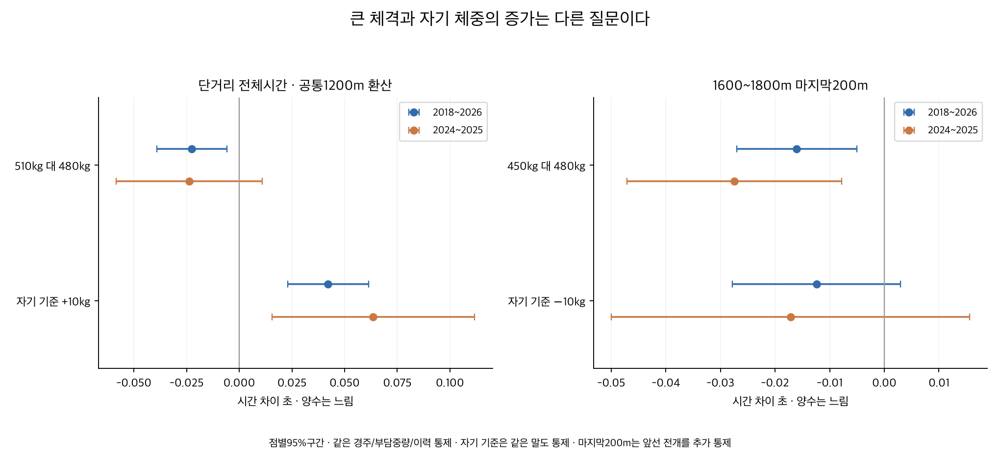
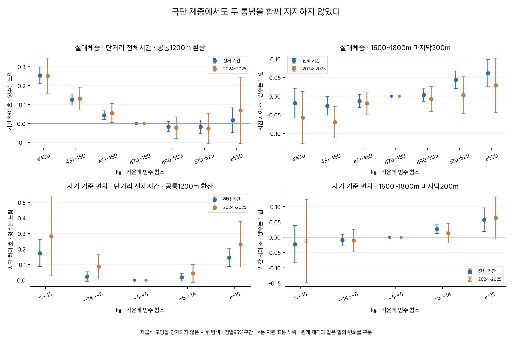

# 체중이 무거우면 단거리에, 가벼우면 긴 거리 막판에 불리한가

2026-10-08. **검증할 구간 자료는 있지만, 이번 서울·부산 자료는 두 주장을 일반적인 법칙으로 뒷받침하지 않았다.** 원래 체격이 큰 말이 단거리에서 느리다는 결과는 없었다. 같은 말이 최근 평소 체중보다 무거워졌을 때 전체기록이 조금 느린 경향은 남았지만, 긴 거리보다 단거리에 특별히 더 불리하다는 차이는 확인되지 않았다. 가벼운 말이 긴 거리에서 막판에 더 처진다는 결과도 확인되지 않았다.

## 체격이 큰 것과 자기 체중이 늘어난 것을 구분한다

500kg가 자연스러운 말과 평소470kg인데500kg가 된 말은 다른 비교다. 절대체중 모형은 같은 경주에 나온 서로 다른 말의 당일450/480/510kg를 비교하며, 순수하게 타고난 골격의 효과를 분리한 것은 아니다. 같은 말 모형은 현재를 제외한 직전5개 관측 체중 평균(최소3개)에서 벗어난 정도를 비교한다. 현재·미래 체중으로 이 기준을 계산하지 않았다. 절대450/510kg는 비교 예시이며 정상/비정상이나 생리적 ‘과체중’의 경계가 아니다. 체지방·근육량·건강 상태는 관측하지 않았다.

대상은2018년 이후 서울2026-09-20·부산2026-09-18까지 정상151,074출전·13,928경주·12,435두다. 충분한13개 지역×거리의1000~1800m148,126출전을 비교했다. 이 보고서에서 단거리는1000~1400m, 긴 거리는1600~1800m다. 특히1900m 이상은 희소하여2200m 같은 장거리까지 일반화하지 않는다. 제주·영천·주행심사·주로빠르기는 제외했다.

절대체중 비교는 같은 경주·부담중량·연령·rating·과거 성과를 맞췄다. 자기 기준 비교는 같은 말과 같은 경주를 함께 맞췄다. 같은 경주 효과가 지역·거리·날짜·등급·정확 함수율 등 공유 환경을 포함한다. 두 설계는 다른 질문에 답하며, 말 고정효과로 체격이 원래 큰 말과 작은 말 사이의 차이를 추정했다고 하지 않는다. 성별별 기준이나 성별 주모형은 만들지 않았고 절대체중의 성별 통제는 민감도로 보존했다.

## 두 가설의 주분석

아래 첫 두 행은 단거리 공통 기울기를1200m로 환산한 전체시간 예시다. 서울1200m 또는 부산1200m만의 계수는 아래 거리별 표에서 따로 확인한다. 마지막 두 행은1600~1800m의 실제 마지막200m 초다. **양수는 느림, 음수는 빠름**이며 대괄호는 점별95% 불확실성 구간이다.

| 질문과 체중 정의 | 전체 기간 차이 [95%구간] | 최근2024~2025 | 4세 이상 |
|---|---:|---:|---:|
| 단거리 · 절대510 대480kg | -0.022 [-0.039, -0.006] | -0.024 [-0.058, +0.011] | -0.000 [-0.021, +0.021] |
| 단거리 · 자기 기준+10kg | +0.042 [+0.023, +0.061] | +0.064 [+0.016, +0.112] | +0.047 [+0.022, +0.072] |
| 긴 거리 막판 · 절대450 대480kg | -0.016 [-0.027, -0.005] | -0.027 [-0.047, -0.008] | -0.021 [-0.035, -0.007] |
| 긴 거리 막판 · 자기 기준−10kg | -0.012 [-0.028, +0.003] | -0.017 [-0.050, +0.016] | -0.012 [-0.030, +0.005] |

절대510kg는480kg보다 단거리에서 느리지 않았다. 전기간 주모형에서는 약0.022초 빠른 방향이었지만, 성별을 추가하면-0.012 [-0.029, +0.005]초이고4세 이상에서도0을 포함한다. 따라서 ‘무거우면 느리다’를 지지하지 않으며, 반대로 무조건 큰 말이 유리하다는 처방도 하지 않는다.

자기 기준보다10kg 무거운 출전은 공통1200m 환산 약0.042초 느렸다. 최근 완결연도와4세 이상에서도 느린 방향이 남는다. 그러나 같은+10kg의 긴 거리 전체기록 차이는 초/1000m 기준+0.050 [+0.025, +0.076]로 나타났다. 이 경향을 단거리만의 약점으로 해석할 수 없다.

긴 거리에서 절대450kg는480kg보다 마지막200m가 약0.016초 빠른 방향이고, 자기 기준−10kg의 마지막200m 차이는0을 포함한다. 가벼움이 막판 시간 증가에 동반된다는 주가설은 지지되지 않았다. 차이가 작고 조정 조건에 의존하므로 가벼울수록 좋다는 주장으로 뒤집지 않는다.

## 단거리와 긴 거리의 차이를 직접 비교하면

‘한쪽만 유의하다’는 이유로 거리 차이를 주장하지 않고, 두 거리군의 차이를 같은 회귀에서 직접 비교했다. 첫 두 행의 단위는 초/1000m, 마지막 두 행은 마지막200m 초다. 가설 방향은 모두 양수이며 음수는 그 반대다. 주대비4개와 직접 차이4개를 합친8검정에 BH를 적용했다.

| 직접 검정 | 시간 차이 [95%구간] | BH q |
|---|---:|---:|
| 절대 무거움의 전체시간 효과 · 단거리−긴 거리 | -0.023 [-0.043, -0.003] | 0.0508 |
| 자기 기준 무거움의 전체시간 효과 · 단거리−긴 거리 | -0.015 [-0.045, +0.015] | 0.4205 |
| 절대 가벼움의 막판 효과 · 긴 거리−단거리 | -0.001 [-0.013, +0.010] | 0.9460 |
| 자기 기준 가벼움의 막판 효과 · 긴 거리−단거리 | +0.000 [-0.017, +0.018] | 0.9651 |

자기 기준+10kg의 단거리−긴 거리 차이는0을 포함한다. 절대 무거움의 차이는 오히려 반대 방향이며 BH q는0.0508이다. 가벼움의 긴 거리−단거리 마지막200m 차이는 두 체중 정의 모두0을 포함한다. 따라서 질문의 거리별 비대칭 패턴은 확인되지 않았다. 미확정을 효과가 정확히0이라는 뜻으로 바꾸지 않는다.

## ‘너무 무겁거나 가벼운’ 꼬리 구간도 확인했다

주분석을 본 뒤 극단 범주를 추가한 **사후 탐색**이다. 절대체중의 참조는470~489kg, 자기 기준의 참조는−5~+5kg다. 제곱식 곡선을 강제하지 않았다. 극단 범주도 양 지역을 모은 비교 지점에서100행·30두·20일 이상 지원 조건을 충족했다. 실제 분포의 끝377/609kg 같은 개별 체중까지 충분히 검증했다는 뜻은 아니다.

| 극단 범주와 참조 | 단거리 전체 · 공통1200m 환산 | 긴 거리 마지막200m | 단거리/긴 거리 범주 표본 |
|---|---:|---:|---:|
| 절대 ≤430kg · 참조 470–489kg | +0.254 [+0.210, +0.298] | -0.019 [-0.059, +0.021] | 5,213 / 801 |
| 절대 ≥530kg · 참조 470–489kg | +0.018 [-0.047, +0.083] | +0.062 [+0.025, +0.098] | 2,863 / 1,440 |
| 자기 기준 ≤−15kg · 참조 −5–+5kg | +0.173 [+0.087, +0.260] | -0.023 [-0.084, +0.038] | 1,431 / 428 |
| 자기 기준 ≥+15kg · 참조 −5–+5kg | +0.144 [+0.087, +0.202] | +0.058 [+0.019, +0.096] | 3,000 / 949 |

극단 무거움의 단거리 전체시간, 극단 가벼움의 긴 거리 마지막200m라는4개 주 탐색 대비의 별도 BH를 보존했다. 지원 표본과 최근/성별 통제 결과는 [범주형 표](outputs/categorical_contrasts.csv)에 모두 있다. 사후 범주 결과를 독립 검증으로 가산하지 않는다.

## 마지막이 느린 것과 실제로 속도가 떨어진 것을 구분했다

마지막200m만으로 체력 저하를 단정하지 않았다. 마지막200m 분석에는 출발200m·중간1·직전400m의 시간과 제곱을 통제했다. 마지막600m와 둔화 분석에는600m 이전 두 구간만 통제했다. 결과를 포함하는 전체시간·착순으로 막판을 통제하지 않았다. 전개는 체중과 함께 변할 수 있으므로 전개를 맞춘 관계는 전체 연관과 구분해야 한다. 전개를 빼면 긴 거리 가벼움의 마지막200m는 절대체중-0.012 [-0.028, +0.004], 자기 기준-0.007 [-0.032, +0.018]초로 모두0을 포함하며, 가벼움의 불리함을 보여주지 않는다.

둔화 지표는 ‘마지막200m − 바로 앞400m의200m당 평균시간’이다. 양수면 마지막200m가 느려졌다는 뜻이다. 마지막600m에서 마지막200m를 뺀 앞400m를 사용했으며, 서울에서 계측하지 않은 마지막400m를 만든 것이 아니다. 곡선/직선 등 구간 여건 차이도 남아 있어 생리적 피로나 지구력을 직접 측정하지 않는다.

| 긴 거리의 비교 | 마지막200m | 마지막600m | 마지막200m−직전400m/2 |
|---|---:|---:|---:|
| 450 대480kg | -0.016 [-0.027, -0.005] | -0.003 [-0.032, +0.027] | -0.013 [-0.025, -0.001] |
| 510 대480kg | +0.027 [+0.017, +0.037] | +0.025 [-0.000, +0.049] | +0.027 [+0.016, +0.038] |
| 자기 기준−10kg | -0.012 [-0.028, +0.003] | +0.018 [-0.027, +0.064] | -0.008 [-0.025, +0.009] |
| 자기 기준+10kg | +0.026 [+0.012, +0.039] | +0.067 [+0.029, +0.105] | +0.032 [+0.017, +0.046] |

위 표는 모두1600~1800m의 실제 초다. 가벼움에서 둔화가 커지는 관계는 확인되지 않았다. 자기 기준+10kg는 마지막200m와 둔화 지표 모두 느린 방향이지만, 단거리와의 차이는 각각+0.000 [-0.015, +0.015], -0.001 [-0.017, +0.016]초로0을 포함한다. 보조구간 결과는 탐색이며 마지막600m와 마지막200m가 겹쳐 독립 증거로 합산하지 않는다.

## 원시 평균과 거리별 결과

아래 평균은 출전 집단 그대로이며 편성·나이·부담중량·능력·전개가 다른 원시 관측이다. 같은 조건의 체중 효과와 구분한다. 전체 평균·중앙값·P20/P80과 구간 분포는 [원시 분포표](outputs/observed_mass_sections.csv)에 보존했다.

| 지역·거리 | 절대체중 범주 | 출전 | 전체 평균 초 | 마지막200m 평균 초 | 둔화 평균 초 |
|---|---|---:|---:|---:|
| 서울 1200m | ≤450kg | 4,447 | 76.638 | 13.895 | 1.204 |
| 서울 1200m | 470–489kg | 7,336 | 75.848 | 13.760 | 1.220 |
| 서울 1200m | ≥510kg | 2,454 | 75.522 | 13.744 | 1.270 |
| 서울 1800m | ≤450kg | 506 | 119.401 | 13.961 | 0.536 |
| 서울 1800m | 470–489kg | 2,324 | 119.027 | 13.975 | 0.607 |
| 서울 1800m | ≥510kg | 1,382 | 118.769 | 13.996 | 0.650 |
| 부산 1200m | ≤450kg | 2,936 | 76.749 | 13.916 | 1.293 |
| 부산 1200m | 470–489kg | 4,766 | 76.004 | 13.807 | 1.317 |
| 부산 1200m | ≥510kg | 1,969 | 75.577 | 13.738 | 1.334 |
| 부산 1800m | ≤450kg | 503 | 118.315 | 13.964 | 0.419 |
| 부산 1800m | 470–489kg | 2,471 | 117.931 | 14.002 | 0.532 |
| 부산 1800m | ≥510kg | 1,396 | 117.183 | 13.944 | 0.597 |

아래는 각 정확한 지역·거리의 별도 주모형이다. 전체시간은 해당 거리의 실제 초로 환산했다. 거리별 탐색값의 점별95%구간이며13개 거리 전체에 별도 유의성 보정을 완료했다는 뜻은 아니다. 서로 다른 표본에서 얻은 계수들의 차이를 이 표만으로 유의한 차이라고 판단하지 않는다.

| 지역·거리 | 절대510 대480 전체 초 | 자기 기준+10 전체 초 | 절대450 대480 마지막200m 초 | 자기 기준−10 마지막200m 초 |
|---|---:|---:|---:|---:|
| 부산 1000m | -0.096 [-0.154, -0.037] | +0.109 [-0.009, +0.226] | -0.003 [-0.021, +0.014] | -0.017 [-0.057, +0.024] |
| 부산 1200m | -0.063 [-0.099, -0.027] | +0.028 [-0.021, +0.077] | -0.014 [-0.027, -0.001] | -0.007 [-0.025, +0.012] |
| 부산 1300m | -0.020 [-0.070, +0.030] | +0.081 [+0.019, +0.142] | -0.033 [-0.047, -0.019] | -0.011 [-0.040, +0.019] |
| 부산 1400m | +0.004 [-0.041, +0.049] | +0.055 [-0.004, +0.115] | -0.019 [-0.034, -0.004] | -0.023 [-0.041, -0.006] |
| 부산 1600m | -0.059 [-0.114, -0.004] | +0.115 [+0.024, +0.206] | +0.000 [-0.017, +0.018] | +0.002 [-0.031, +0.035] |
| 부산 1800m | -0.012 [-0.068, +0.045] | +0.073 [-0.029, +0.175] | -0.012 [-0.037, +0.013] | -0.001 [-0.028, +0.025] |
| 서울 1000m | -0.055 [-0.119, +0.009] | -0.035 [-0.139, +0.069] | +0.012 [-0.002, +0.026] | -0.045 [-0.090, +0.000] |
| 서울 1200m | -0.001 [-0.034, +0.031] | +0.048 [+0.010, +0.085] | -0.017 [-0.028, -0.006] | -0.016 [-0.032, +0.000] |
| 서울 1300m | -0.033 [-0.072, +0.005] | +0.052 [+0.000, +0.103] | -0.010 [-0.021, +0.002] | +0.001 [-0.017, +0.020] |
| 서울 1400m | +0.015 [-0.028, +0.057] | +0.030 [-0.017, +0.077] | -0.026 [-0.041, -0.011] | -0.020 [-0.039, +0.000] |
| 서울 1600m | +0.032 [-0.060, +0.123] | +0.098 [-0.063, +0.259] | -0.060 [-0.097, -0.024] | -0.042 [-0.108, +0.025] |
| 서울 1700m | +0.075 [+0.024, +0.126] | +0.122 [+0.037, +0.207] | -0.013 [-0.030, +0.004] | -0.022 [-0.049, +0.005] |
| 서울 1800m | +0.046 [-0.006, +0.098] | +0.025 [-0.054, +0.105] | -0.045 [-0.073, -0.017] | -0.022 [-0.056, +0.012] |

## 표본과 독립 계산 검증

전기간 절대체중은 단거리111,036·긴 거리37,090출전이다. 과거 체중 기준을 만들 수 있고 말/경주 반복 비교가 가능한 자기 기준 표본은 단거리73,140·긴 거리31,612출전이다. 초기 체중 이력 결측과 말/경주 단독 관측을 제외한 표본이므로 전체 경주마의 생리 반응을 대표하는 실험은 아니다. 최근의 부산1000m는242행, 자기 기준 부산/서울1000m는 반복 제거 후0행으로 추정에서 제외했다. 미추정을 효과0으로 바꾸지 않았다. [표본 진단](outputs/diagnostics.csv)과 [제외표](outputs/skipped.csv)를 남겼다.

원문18파일151,074행의 말ID·날짜·체중·전체·마지막200/600m를 재대조하고,21개 입력 해시·구간 합·현재를 제외한 과거5개 기준·날짜를 검증했다. 희소 고정효과 LU 투영과 QR 회귀, 별도 pandas 군집 합산으로 **456거리 모형·216거리군 모형·108공동 비교·3,344수치검사**를 통과했다. 범주형도 별도 희소 투영/QR로248거리 계수 묶음과 군집 표준오차를 확인했다.

지역×정확한 거리별로 통제변수를 따로 제거한 뒤 거리군 공통계수를 추정했다. 같은 말·실제 달력 날짜의 거리/지역 간 공분산을 포함했다. 말 단일·날짜 단일·이원 군집 중 대비분산 최대값과 자유도/t 보정을 썼다. 주분석은450/510kg와자기 기준±10kg 지점 각각±5kg 근방100행·30두·20일 지원을 요구한다. 말/경주 고정효과와 나이 선형항이 겹치는 경우를 고려해 SVD/QR 상대 rank 기준1e-10을 통일했다.

연령·성장·컨디션·훈련·휴양과 거리 선택 등의 관측하지 못한 차이가 남는다. 조건부 기록 관계를 체중의 인과효과나 지구력 기전으로 입증하지 않았다. 최근2024~2025와4세 이상은 같은 자료의 민감도이며 미래 예측 검증이 아니다. 체중이 증가한 이유나 근육·지방·수분 구성은 알 수 없다. 특정 kg 처방·확정 기록 보정·DB·운영 모델·배포를 변경하지 않았다.

## 기록을 읽을 때 참고할 점

절대체중만 보고 ‘무거우니 단거리 감점, 가벼우니 긴 거리 막판 감점’으로 적용할 근거는 얻지 못했다. 자기 과거 범위에서 크게 벗어났는지와 실제 앞선 전개·막판 기록을 함께 보는 편이 이번 관측 결과에 맞다. 기존 [체중 변화/적정체중 연구](../20261008_body_weight_change_optimum/README.md)의 개인 최적 kg 미확정 결론은 유지한다. 이번 결과는 서로 다른 말의 체격과 같은 말의 변화를 구분하고 거리별 통념을 직접 검토한 후속이다.

[분석 계획](PLAN.md) · [출처/방법](SOURCES.md) · [게시 요약](PUBLICATION.md) · [게시 데이터](outputs/publication_summary.json) · [독립 검증](outputs/verification.json) · [범주 검증](outputs/categorical_verification.json) · [파일 용량](outputs/artifact_inventory.json) · [중앙11D](../conclusions/11D_BODY_MASS_DISTANCE_FINISH.md).

루트에서 `OPENBLAS_NUM_THREADS=1 PYTHONDONTWRITEBYTECODE=1 .venv/bin/python thoroughbred/research/20261008_body_mass_distance_finish/analyze.py`를 실행하고 같은 경로의 `verify.py`, `tails.py`, `render.py` 순서로 재현한다. `register.py`는 공유 목록을 수정하므로 분석 재현에는 생략한다.
