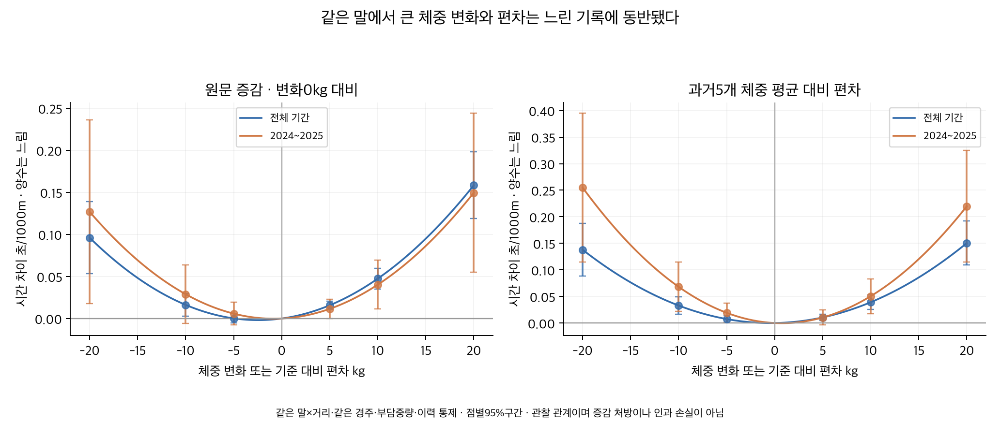
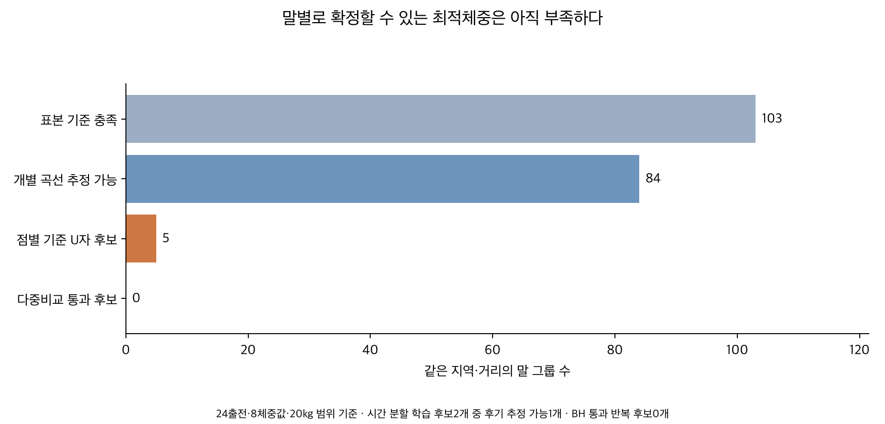
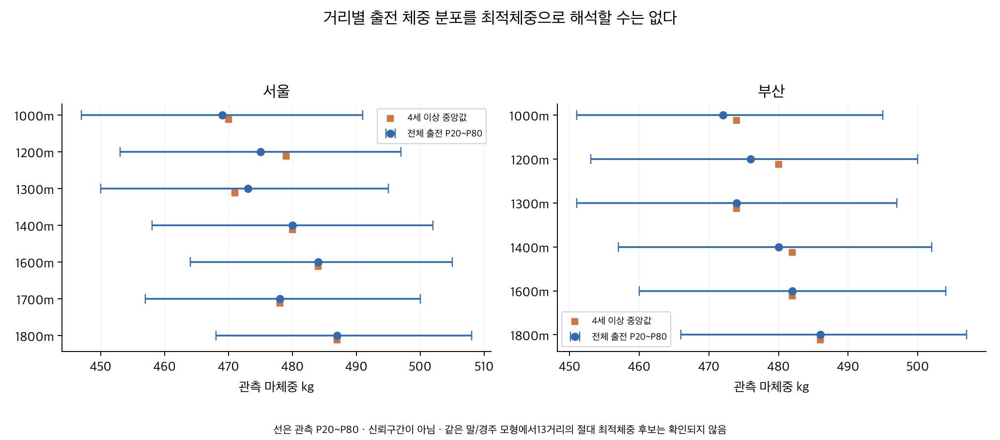

# 마체중 변화와 기록 및 적정체중

2026-10-08. **같은 말에서 체중의 큰 증감과 평소 체중에서 큰 편차가 느린 기록에 동반되는 관계가 관찰됐다. 반면 모든 말에 공통인 절대 최적체중이나 거리별로 정해진 최적 kg는 확인되지 않았다.** 말마다 체격이 다른 만큼 자기 체중 이력이 중요한 참조다. 다만 각 말의 최적점을 확정할 만큼 반복 표본과 검증이 충분하지는 않았다.

## 세 가지 체중 질문을 구분한다

‘지난번보다10kg 증가’는 현재 체중과 이전 체중의 변화다. ‘평소보다10kg 무거움’은 그 말의 기준 체중에서 벗어난 정도다. ‘현재500kg’은 절대체중이다.500kg 말이510kg가 됐어도 평소가510kg였다면 평소 체중으로 돌아온 것일 수 있어 세 질문을 섞을 수 없다.

자료는2018년 이후 서울2026-09-20·부산2026-09-18까지의 정상151,074출전·13,928경주·12,435두다.1000~1800m의13지역×정확 거리를 대상으로 같은 말과 같은 경주의 효과를 제거하고 부담중량·나이 제곱·rating·과거 성과·출전수·공백을 고려했다. 성별을 나누거나 성별 계수를 만들지 않았다. 제주·영천·주행심사·주로빠르기는 제외했다. 정상 완주 중 반복 비교가 가능한 말들이 대상이므로 모든 말의 신체 반응을 대표하는 시험은 아니다.

## 체중이 늘거나 줄면 기록은 어떻게 달라졌는가

원문 `wgHr`의 `496(+1)`처럼 체중과 함께 기록된 증감을 읽었다. 수치 증감은 140,926행이다. 빈 괄호 10,148행 중 직전 관측 날짜가 기존 과거 이력의 마지막 날짜와 일치하고 실제 두 체중도 같은 9,464행만 ‘확인된0kg 변화’로 별도 복원했다. 남은 684행은 결측이다. 원래 빈 증감값과 복원 출처는 그대로 보존했다. 단독 말/경주를 제거한 증감 주 분석은 **133,681출전**이다.

아래는 변화0kg 대비 조건부 시간 차이를 **공통 모형에서1200m로 환산한 예시**다. 양수는 느림이다. 여러 거리의 시간/1000m 기울기를 합친 값으로 서울1200m나 부산1200m만의 별도 계수는 아니다. 같은 말의 원기록 두 개를 조건 없이 뺀 차이도 아니다.

| 증감/편차 | 전체기간 차이 [95%구간] | 최근2024~2025 차이 [95%구간] |
|---|---:|---:|
| -20kg | +0.115 [+0.064, +0.167] | +0.152 [+0.021, +0.283] |
| -10kg | +0.019 [+0.003, +0.036] | +0.035 [-0.007, +0.076] |
| -5kg | +0.000 [-0.006, +0.007] | +0.007 [-0.009, +0.023] |
| +5kg | +0.019 [+0.013, +0.025] | +0.014 [-0.000, +0.028] |
| +10kg | +0.057 [+0.042, +0.072] | +0.048 [+0.014, +0.083] |
| +20kg | +0.190 [+0.142, +0.238] | +0.180 [+0.066, +0.293] |

전체기간의−5kg는0kg와 뚜렷한 차이가 없고,큰 증감에서 느린 방향이 커진다. 제곱곡선의 최소점은 변화약-2.5kg 부근이지만, 이를 모든 말에게 그만큼 감량하라는 처방으로 해석하지 않는다. 최근2024~2025년의 최소점과 선형항도 달라진다.

제곱식 모양을 강제하지 않은 증감 구간 모형에서도 큰 증감의 느린 방향이 남았다. 다만 작은 감량 구간은0kg와 확실히 구분되지 않아 모든1kg 변화를 벌점으로 처리할 근거는 없다.

| 원문 증감 구간 | 0kg 대비 초/1000m [95%구간] |
|---|---:|
| ≤−15kg | +0.109 [+0.051, +0.166] |
| −14~−6kg | -0.005 [-0.032, +0.022] |
| −5~−1kg | -0.019 [-0.044, +0.005] |
| +1~+5kg | -0.004 [-0.028, +0.021] |
| +6~+14kg | +0.038 [+0.011, +0.064] |
| ≥+15kg | +0.133 [+0.082, +0.185] |

## 같은 말의 평소 체중에서 벗어나면

각 말의 전체 관측 평균체중을 기준으로 하면 그 평균에서 양쪽으로 벗어날수록 느린 U자형 관계가 나타났다. 공통 최소점은 평균대비약-0.13kg로 평균에 가깝다.1200m 환산에서−10kg는+0.096초,+10kg는+0.101초다. 최근완결연도와4세이상에서도 이 관계가 남았다. 그러나 이 기준은 그 말의 나중 출전 체중까지 사용한 후향 참조이므로 그대로 실전 기준으로 쓸 수 없다.

그래서 **현재 출전을 제외한 직전5개 관측 체중 평균(최소3개)**으로 다시 계산했다. 이 기준을 만들 때 현재·미래 체중을 쓰지 않았다. 같은 말/경주와 이력을 맞춘 **104,752출전**에서 U자형 관계가 남았지만 차이는 더 작았다. 후향/과거 기준은 표본도 달라져 차이가 줄어든 원인을 참조방식 하나로 분해하지 않는다. 과거 관측 사이에 원자료에 없는 경주가 있을 수 있어 직전5개 ‘모든 공식 경주’를 완전히 복원했다는 뜻은 아니다.

다음 표는 과거5개 평균에서 벗어난 정도에 따른 **공통 모형의1200m 환산**이다.

| 증감/편차 | 전체기간 차이 [95%구간] | 최근2024~2025 차이 [95%구간] |
|---|---:|---:|
| -20kg | +0.165 [+0.106, +0.225] | +0.306 [+0.137, +0.474] |
| -10kg | +0.039 [+0.020, +0.059] | +0.082 [+0.026, +0.137] |
| -5kg | +0.009 [+0.001, +0.017] | +0.023 [+0.001, +0.045] |
| +5kg | +0.013 [+0.006, +0.020] | +0.013 [-0.004, +0.029] |
| +10kg | +0.047 [+0.031, +0.063] | +0.061 [+0.021, +0.100] |
| +20kg | +0.181 [+0.131, +0.230] | +0.264 [+0.138, +0.390] |

예를 들어 과거5개 평균이500kg인 말의 현재510kg 출전은 기준500kg 출전보다 공통 모형상 약0.047초 느린 방향이고,490kg는 약0.039초다. 이는 집단 평균의 예시이며 각 말에 같은 손실을 적용하는 처방은 아니다. ±5kg의 차이는 작고 ±20kg에서는 커진다. 최적 kg를 임의로 정하기보다 자기 이력의 안정된 범위와 큰 이탈을 함께 보는 근거다. 해당 차이를 확정된 기록 보정으로 채택하지 않았다.

## 말마다 적정체중이 있는가

반복 관측이8회 이상인 7,443두의 말별 평균체중 P10~P90은 약444~512kg이고, 말 안의 체중 표준편차 중앙값은 약7.0kg다. 체격이 서로 다르다는 사실과 평소 범위에서 크게 벗어날 때 느려지는 집단 관계는 확인할 수 있다. 그러나 각 말의 평균체중이 그 말의 최적체중이라는 증명은 아니다.

개별 곡선은 같은 지역·거리에서24출전 이상·8개 체중값 이상·체중 범위20kg 이상을 요구했다. 41,733개 말×지역×거리 중 **103그룹·100두**가 충족했고, rank와 자유도까지 통과해 추정 가능한 것은 84그룹이었다. 목표는 같은 경주의 다른 말 평균보다 몇초 빠르거나 느린지이며, 시간 추세·부담중량·rating·과거 기록을 고려한 별도 탐색이다. 이 개별 모형은 앞의 공동 말/경주 고정효과 모형과 동일하지 않다.

전체 개인 곡선에서 점별 기준을 통과한 U자형 최소 후보는 5그룹이었다. **여러 말의 검정을 BH로 조정하면 통과 후보는 0개**였다. 시간순60%/40%로 나눈 학습 후보는 2개, 이후 구간에서 곡선을 추정할 수 있는 것은 1개이고 그중 1개가10kg 이내로 반복됐다. 학습 후보의 다중비교까지 통과한 반복 후보는 0개다. 후기 미추정1개를 반복 실패나 효과0으로 바꾸지 않았다. 이 작은 수로 개인 최적점의 재현율을 일반화하지 않는다.

따라서 **말마다 평소 범위를 따로 참고할 이유는 있지만,현재 자료로 각각의 최적체중을 확정할 수는 없다.** 가장 빨랐던 한 번의 체중이나1승 당시 체중을 그대로 정답으로 삼지 않는다. 시간 분할은 결과자료의 경주 평균을 사용하는 조건부 반복성 진단이며 미래 기록의 사전예측 검증이 아니다.

## 거리별로 어울리는 절대체중이 있는가

같은 말과 경주를 맞춘 절대체중의 U자형 모형에서 **13개 거리 조합 모두 통계적으로 지원되는 절대 최소체중은 미확정**이었다. 제곱항이0을 포함하거나 음수이거나, 계산상 꼭짓점이 관측범위 밖이었다. 오목한 곡선의 최대점을 최적체중으로 바꾸지 않았다. ‘1200m는470kg,1800m는500kg’와 같은 공식은 얻지 못했다.

아래의 관측 중앙체중은 실제 출전 집단의 분포다. 최적체중과 구분한다. 상대 최소점은 공동 곡선상 평균 기준의 kg 편차다. †는 점별 기준은 충족하나13거리의 BH q가0.05 이상인 탐색값이다. 미확정은0kg로 채우지 않았다.

| 지역 | 거리 | 관측 중앙체중 kg | 절대 최소체중 | 평균 대비 최소점 kg | 과거5개 대비 최소점 kg |
|---|---:|---:|---|---:|---:|
| 부산 | 1000m | 472 | 미확정 | -1.2 | 미확정 |
| 부산 | 1200m | 476 | 미확정 | -0.3 | +2.5 |
| 부산 | 1300m | 474 | 미확정 | -1.7 | 미확정 |
| 부산 | 1400m | 480 | 미확정 | +0.2 | 미확정 |
| 부산 | 1600m | 482 | 미확정 | +0.2 | 미확정 |
| 부산 | 1800m | 486 | 미확정 | -0.8 | 미확정 |
| 서울 | 1000m | 469 | 미확정 | +0.7 | 미확정 |
| 서울 | 1200m | 475 | 미확정 | -0.6 | -2.2† |
| 서울 | 1300m | 473 | 미확정 | -0.3 | +1.7 |
| 서울 | 1400m | 480 | 미확정 | +0.8 | +1.5† |
| 서울 | 1600m | 484 | 미확정 | 미확정 | 미확정 |
| 서울 | 1700m | 478 | 미확정 | -1.3 | -4.6† |
| 서울 | 1800m | 487 | 미확정 | +3.5 | 미확정 |

전기간 자기평균 기준에서는13개 중 12개가 U자형 기준과 BH를 통과했다. 과거5개 기준으로 바꾸면 2개다. 참조와 표본에 따라 차이가 있으며, 개별 거리의 최소점 차이를 직접 검정하지 않았으므로 거리가 늘수록 최적 편차가 커진다고 확정하지 않는다. 출전 말의 나이·등급·체격·거리 선택이 함께 바뀔 수 있어 거리별 분포를 거리적성의 인과증거로 보지 않는다.

## 최근 기간과 성장 영향을 바꿔도 같은가

아래는 초/1000m이며, 실제 거리의 초가 필요하면 거리/1000을 곱한다.4세 이상도 나이·시간 변화가 완전히 제거된 집단은 아니다. FE만 모형은 말/경주 외의 이력·부담중량 통제를 제외한 민감도다.

| 기준/표본 | 분석 출전 | −10kg 차이 초/1000m | +10kg 차이 초/1000m | 통계적 최소점 |
|---|---:|---:|---:|---|
| 증감 · 전체 | 133,681 | +0.016 [+0.003, +0.030] | +0.047 [+0.035, +0.060] | -2.45kg 부근 |
| 증감 · 2024~2025 | 29,983 | +0.029 [-0.006, +0.064] | +0.040 [+0.011, +0.069] | -0.82kg 부근 |
| 증감 · 4세 이상 | 67,029 | +0.008 [-0.013, +0.029] | +0.048 [+0.031, +0.065] | -3.56kg 부근 |
| 증감 · 이력 통제 제외 | 133,681 | +0.037 [+0.024, +0.051] | +0.089 [+0.076, +0.101] | -2.04kg 부근 |
| 전기간 자기평균 편차 · 전체 | 134,233 | +0.080 [+0.065, +0.094] | +0.084 [+0.070, +0.099] | -0.13kg 부근 |
| 전기간 자기평균 편차 · 2024~2025 | 30,073 | +0.092 [+0.048, +0.136] | +0.093 [+0.059, +0.127] | -0.03kg 부근 |
| 전기간 자기평균 편차 · 4세 이상 | 67,118 | +0.099 [+0.077, +0.122] | +0.057 [+0.039, +0.076] | +1.33kg 부근 |
| 전기간 자기평균 편차 · 이력 통제 제외 | 134,233 | +0.084 [+0.070, +0.099] | +0.117 [+0.103, +0.132] | -0.82kg 부근 |
| 과거5개 자기평균 편차 · 전체 | 104,752 | +0.033 [+0.016, +0.050] | +0.039 [+0.026, +0.053] | -0.44kg 부근 |
| 과거5개 자기평균 편차 · 2024~2025 | 25,352 | +0.068 [+0.022, +0.114] | +0.051 [+0.018, +0.083] | +0.74kg 부근 |
| 과거5개 자기평균 편차 · 4세 이상 | 62,697 | +0.040 [+0.018, +0.063] | +0.042 [+0.024, +0.059] | -0.07kg 부근 |
| 과거5개 자기평균 편차 · 이력 통제 제외 | 104,752 | +0.048 [+0.031, +0.064] | +0.066 [+0.052, +0.080] | -0.81kg 부근 |

과거5개 기준의 최근 부산 곡률 구간은0을 포함한다. 집계 전체의 관계가 각 지역·거리·말에 모두 확정됐다는 뜻은 아니다. 작은 감량의 방향·개별 최소점보다 큰 편차와 느린 기록의 동반 관계를 더 안정적인 결론으로 본다.

## 원천과 계산을 어떻게 검증했는가

공식 원문18파일의151,074행에서 말ID·날짜·거리·체중과 괄호 증감을 대조했다. 사용 가능한 직전 관측 차이와 증감의 비교 139,236건 중 139,049건이 일치했다. 불일치187건 중186건은 자료의 직전 관측과 기존 이력의 마지막 날짜가 달라 관측 누락 가능성을 남겼다. 날짜까지 같은1건은 격리 원장에 남기고 그 행을 제외한 민감도를 추가했으며 주 결론이 거의 바뀌지 않았다. 원문 증감을 임의로 고치지 않았다. 구간 합·입력 해시·날짜·누락과 복원 출처를 확인했다.

고정효과 단독 말/경주는 재귀 제거했다. 고정효과 rank는 말+경주−연결요소이며, nuisance/체중 행렬의 rank를 SVD 상대 기준1e-10으로 맞췄다. 몸무게항은10kg 단위 선형+제곱이다. 시간은1000m 환산 후 거리별 통제를 따로 허용해 공통 모형으로 합쳤다. 같은 말/날짜의 거리 간·지역 간 공분산을 포함한 마필/실제 날짜 군집을 썼고, 각 단독과 이원 분산 중 최대·자유도·t 보정을 했다.

대비 지점±3kg에서100행/30두/20날짜, 전체100날짜를 지원 기준으로 삼았다. U최소 후보는 제곱항95%하한>0·꼭짓점P10~P90 안·근방 지원을 모두 요구한다. 분모가 불안정한 꼭짓점·관측범위 밖·오목 곡선은 최적 kg로 게시하지 않는다. 거리별 제곱항은 각 질문13개 family의 BH q를, 개인 곡선은 전체/학습별 BH q를 보존했다. 모든 대비표 전체의 다중비교를 완료했다는 뜻은 아니다.

독립적인 원문 문자열 분리·희소 고정효과 LU 투영·QR 회귀·pandas 군집 합·개인 HC3로 **182거리 모형·42공통 모형·24개인 모형·1324개 수치 검사**를 통과했다. 수치 검증은 체중 변화를 무작위 배정한 실험이나 인과성의 증명이 아니다. 몸무게 변화에 동반하는 성장·컨디션·훈련·휴양과 능력 변화가 남아 있다. 체중의 구성이나 왜 변했는지는 이 자료만으로 구분하지 못한다.

## 재현과 보존

[출처와 방법](SOURCES.md)·[게시 요약](PUBLICATION.md)·[게시 데이터](outputs/publication_summary.json)·[독립 검증](outputs/verification.json)·[파일 용량](outputs/artifact_inventory.json)·[중앙11C](../conclusions/11C_BODY_WEIGHT_CHANGE_OPTIMUM.md)를 남겼다. 기존 완료 연구·DB·운영·배포는 변경하지 않았다.

프로젝트루트에서 `OPENBLAS_NUM_THREADS=1 PYTHONDONTWRITEBYTECODE=1 .venv/bin/python thoroughbred/research/20261008_body_weight_change_optimum/analyze.py`,동일경로의 `individual.py`, `describe.py`, `verify.py`, `render.py` 순서로재현한다. `--change-and-past-only`는실행중자료정의보완시절대/후향편차결과를보존하고나머지만새로계산한옵션이다. 깨끗한재현은옵션없이실행한다. `register.py`는공유목록을수정하므로분석재현시생략한다.
