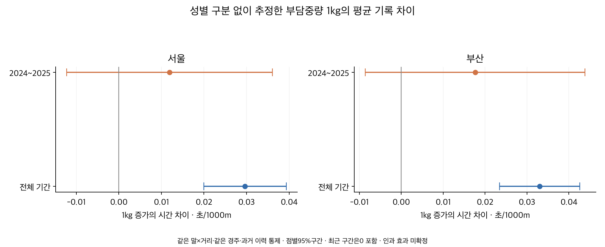
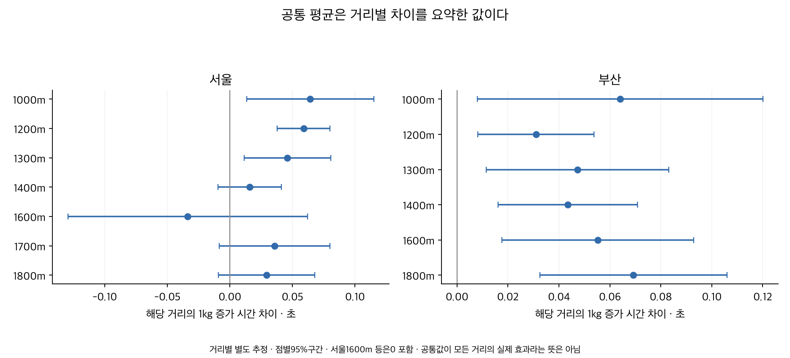

# 성별 구분 없는 부담중량 기록 보정계수

2026-10-08. **같은 말의 반복 출전과 같은 경주, 과거 성적을 맞추면 부담중량1kg 증가에 동반하는 평균 시간 차이는1000m당 전체 0.031초다.** 서울 0.030초·부산 0.033초로, 기록 비교를 위한 연구용 시작값은 **0.03초/(kg·1000m)**로 요약할 수 있다. 다만 최근 구간과 거리별 차이가 있어 고정 보정의 채택은 보류한다. 성별에 따른 기준이나 체중별 보정은 만들지 않았다.

## 무엇을 계산했는가

기존 정상151,074출전·13,928경주·12,435두를 읽기 전용 재사용했다. 원천은2018년 이후 서울2026-09-20·부산2026-09-18까지다.1000~1800m에서2000출전/100날짜 이상인13개 지역·정확 거리의 입력 148,126행을 사용하고, 단독 말/경주를 반복 제외한 **134,233출전·11,014두·13,575경주**가 주 모형에 남았다. 이는 정상 완주 중 반복 비교가 가능한 집단이다. 해당 경주 전체 출전원이 모두 남았다는 뜻은 아니다.1900m 이상·제주·영천·주행심사와 주로빠르기는 이번 범위에 없다.

잘 달리는 말이 더 무겁게 배정되는 문제를 줄이기 위해 지역×정확 거리별로 같은 말 효과와 같은 경주 효과를 제거했다. 경주 효과에는 등급·날짜·함수율·계절 등 같은 경주의 공통 조건이 포함된다. rating과 과거 착순 성과·초반 위치·출전수·공백·나이 제곱항도 통제했다. 성별 피처는 전혀 넣지 않았고 주 모형에는 체중 피처도 없다. 현재 착순·당일 전개는 통제하지 않는다. 선형 나이는 말과 경주 효과로 흡수되므로 별도 계수로 세지 않는다.

부담중량만 단순 비교하면 서울 +0.027·부산 +0.036초/(kg·1000m)다. 이 원시 비교는 지역·거리 절편만 맞춘 값으로, 말의 실력·편성 차이가 섞여 있다. 주 모형과 표본도 다르므로 두 값의 차이를 순수한 편향 크기로 분해하지 않는다. **어느 방향이든 원시 중량·시간 상관을 중량의 인과효과로 해석하지 않는다.**

## 전체 기간 평균과 최근 기간

양수는 부담중량 증가에 따라 느려지는 방향이다. 괄호는 마필/날짜 군집을 반영한 점별95%구간이다. 전체 계수는 지역×거리마다 별도로 제거한 통제 잔차를 합친 단일 기울기다. 단순 산술평균이 아니라 통제 후 남는 중량 변동이 큰 집단에 더 가중된 공통 계수다.

| 구분 | 전체 기간 초/(kg·1000m) | 2024~2025 초/(kg·1000m) |
|---|---:|---:|
| 서울 | +0.030 [+0.020, +0.039] | +0.012 [-0.012, +0.036] |
| 부산 | +0.033 [+0.023, +0.043] | +0.018 [-0.009, +0.044] |
| 전체 | +0.031 [+0.024, +0.038] | +0.014 [-0.003, +0.032] |

최근2024~2025년의 전체 계수는 0.014초로 작아지고95%구간에0이 들어간다. 최근 반복 비교 30,073행이며1000m는 반복 표본이 부족해 양 지역 모두 생략했다. 기간뿐 아니라 포함 거리·말 구성도 달라져 효과가 줄었다고 확정하지 않는다. 전체기간 평균의 양수 관계와 최근 고정값의 불확실성을 구분한다.

## 기록을 비교할 때의 초안

평균 관찰값을 반올림한 **0.03초/(kg·1000m)**를 실험적 비교값으로 사용한다면 다음과 같다. 이 반올림은 최적 예측값을 선택한 결과가 아니다.

| 거리 | 1kg당 | 3kg 차이 |
|---|---:|---:|
| 1000m | 0.030초 | 0.090초 |
| 1200m | 0.036초 | 0.108초 |
| 1400m | 0.042초 | 0.126초 |
| 1600m | 0.048초 | 0.144초 |
| 1800m | 0.054초 | 0.162초 |

`54kg 환산 기록 = 원기록 − 0.03 × (부담중량−54) × 거리(m)/1000`

예를 들어1200m에서52kg의75.000초는75.072초,57kg의75.000초는74.892초다. 같은 기록이라면 무거운 중량에서 뛴 출전을 약간 높게 평가한다.54kg는 계산의 기준점이며 공식 표준이나 최적 중량이라는 의미가 아니다. 기수 체중을 공식 부담중량에 다시 더하지 않는다.

이 공식은 거리 비례를 강제한 요약이다. 서울1200m의 별도 추정은0.059초/kg,부산은0.031초/kg로 공통값0.036초와 다르다.**모든 거리에서1kg 손실이 똑같다고 확인된 것은 아니다.**52~57kg 안의 작은 비교에 한정하며, 정상 완주 밖·다른 지역·큰 중량 변화에 외삽하지 않는다. 이 표는 공식 기록, 기존 함수율 보정, 채택된 거리별 기준에 자동 합산하지 않는다.

후보 선택용 보수적 기준은 전체와최근의95%구간 하한이 모두 양수일 때 두 점추정 중 작은 값의50%를0.005초 단위로0쪽 버림하는 것이다. 계획의양수조건을CI하한으로엄격히명시한실행보충을함께남겼다. 세 공통집계 모두최근 조건을 통과하지 못해 **추가 채택 후보는0(보류)**다. 이는 부담중량 효과가0이라고 추정한 값이 아니다. 관찰 평균0.03과0인채택상태를 구분하기 위해 [평균 설명표](outputs/illustrative_003_lookup.csv)와 [채택 보류표](outputs/correction_lookup.csv)를 따로 보존했다.50% 수축 정책 자체도 최적성 검증이 없는 초안이다.

## 거리별로 얼마나 다른가

| 지역 | 거리 | 반복 비교 출전 수 | 1kg당 초 [95%구간] |
|---|---:|---:|---:|
| 부산 | 1000m | 3,564 | +0.064 [+0.008, +0.120] |
| 부산 | 1200m | 15,509 | +0.031 [+0.008, +0.054] |
| 부산 | 1300m | 9,324 | +0.047 [+0.011, +0.083] |
| 부산 | 1400m | 11,275 | +0.044 [+0.016, +0.071] |
| 부산 | 1600m | 9,053 | +0.055 [+0.018, +0.093] |
| 부산 | 1800m | 7,280 | +0.069 [+0.033, +0.106] |
| 서울 | 1000m | 6,410 | +0.064 [+0.013, +0.115] |
| 서울 | 1200m | 23,524 | +0.059 [+0.038, +0.080] |
| 서울 | 1300m | 16,132 | +0.046 [+0.011, +0.081] |
| 서울 | 1400m | 14,982 | +0.016 [-0.010, +0.041] |
| 서울 | 1600m | 2,070 | -0.034 [-0.129, +0.062] |
| 서울 | 1700m | 8,113 | +0.036 [-0.009, +0.080] |
| 서울 | 1800m | 6,997 | +0.029 [-0.009, +0.068] |

서울1400·1600·1700·1800m 등은0을 포함한다.1000m 전체기간 계수는 양수지만 최근 표본 부족과 구형 편성의 영향을 유의해야 한다. 개별 거리의 점별 구간을 다중비교 후 확정된 효과로 표현하지 않는다. 지역 간 계수 차이의 직접 검정 없이 서울/부산 효과가 다르다고 확정하지 않는다.

## 통제 방법과 체중을 바꾸면

단위는 모두초/(kg·1000m)다. 체중 직접항은체중과제곱항을 추가하며중량×체중 상호작용은넣지 않는다. 성별은모든모형에서제외한다.

| 모형 | 서울 전체 | 부산 전체 | 서울 최근 | 부산 최근 |
|---|---:|---:|---:|---:|
| 말/경주+이력 | +0.030 [+0.020, +0.039] | +0.033 [+0.023, +0.043] | +0.012 [-0.012, +0.036] | +0.018 [-0.009, +0.044] |
| 말/경주만 | +0.016 [+0.009, +0.024] | +0.021 [+0.013, +0.029] | +0.025 [+0.009, +0.041] | +0.015 [-0.004, +0.033] |
| 말/경주+이력+체중 직접항 | +0.030 [+0.020, +0.039] | +0.033 [+0.023, +0.043] | +0.012 [-0.013, +0.036] | +0.017 [-0.009, +0.044] |

체중 직접항 추가는 전체계수를 거의 바꾸지 않았다. 반면 과거 이력·rating 통제 유무에 따라 값이 달라져, 전체기간에는 대략0.02~0.03초 범위로 읽는 것이 타당하다. 이것은 신뢰구간이나 최근에도 보장되는 범위가 아니다. 시간에 따라 바뀌는 실력·건강·훈련과 중량 배정의 관계는 남아 있으므로 **순수한 인과적 손실을 식별했다고 할 수 없다.**

## 연도를 넘겨 적용해 본 결과

2024/2025/2026년의1~8월을 보류하고 이전 연도들의1~8월로 추정한 계수를 고정 적용했다. 보류기간 내부에서 중량을 제외한 말/경주·이력을 다시 맞춘 뒤, 그 잔차에 과거 계수를 적용했다. 따라서 이것은 **조건부 보정량의 기간 안정성 진단이며 다음 경주의 사전예측 검증이 아니다.** 세 연도를 같은 월로 맞춰2026부분연도 차이를 줄였다.

| 지역 | 보류연도1~8월 | 날짜수/지원 | 이전 추정계수 | 보류기간 계수 [95%] | RMSE 변화 | MAE 변화 |
|---|---:|---|---:|---:|---:|---:|
| 부산 | 2024 | 65/부족 | 0.033 | 0.025 [-0.032, 0.081] | -0.000144 | +0.000068 |
| 서울 | 2024 | 65/부족 | 0.030 | 0.035 [-0.011, 0.081] | -0.000399 | -0.000079 |
| 전체 | 2024 | 99/부족 | 0.032 | 0.031 [-0.006, 0.068] | -0.000284 | -0.000018 |
| 부산 | 2025 | 66/부족 | 0.032 | 0.027 [-0.045, 0.098] | -0.000133 | -0.000138 |
| 서울 | 2025 | 66/부족 | 0.032 | 0.017 [-0.050, 0.084] | -0.000009 | -0.000174 |
| 전체 | 2025 | 100/충분 | 0.032 | 0.022 [-0.025, 0.069] | -0.000064 | -0.000159 |
| 부산 | 2026 | 66/부족 | 0.028 | 0.022 [-0.015, 0.059] | -0.000216 | -0.000591 |
| 서울 | 2026 | 68/부족 | 0.031 | 0.013 [-0.029, 0.055] | +0.000073 | +0.000227 |
| 전체 | 2026 | 101/충분 | 0.030 | 0.017 [-0.011, 0.046] | -0.000068 | -0.000180 |

계수와 오차는 1000m 환산 초다. 음의 오차 변화가 개선이며 변화는 매우 작다. 지역별 짧은 보류 구간은 65~68날짜로 100날짜 지원 조건을 못 채웠다. 전체 2024년도 99날짜다. 해당 구간과 점추정은 탐색 진단으로 보존하며 안정된 보정 근거로 채택하지 않는다. 서울 2026년에는 RMSE와 MAE가 모두 소폭 악화했다. 다른 지역/연도에서도 지표별 방향이 같지 않다. 강한 보정으로 성능이 좋아진다고 결론 내릴 수 없다. 보류기간 효과·통제를 사용했으므로 이 결과를 미래 새 말/경주 예측오차로 표시하지 않는다.

## 계산과 독립 검증

고정효과 단독 행은 재귀 제거했다. 부담중량−54의 단일 선형항을 사용하고, 거리별 전체시간을 1000m당 초로 바꾼 뒤 고정효과와 이력 통제를 제거하는 FWL 계산으로 추정했다. 공통 모형에서도 거리별 통제계수는 따로 허용한다. 중량 변화가 있는 말×거리 100쌍/날짜 100개·양의 잔차 중량 분산을 지원 기준으로 두고, 300행 미만 모형은 생략했다. [진단](outputs/diagnostics.csv)·[생략표](outputs/skipped.csv)·[전체 결과](outputs/coefficients.csv)에 표본과 기간·rank·변동량이 있다.

고정효과 rank는 말+경주−그래프 연결요소, nuisance rank는 SVD 상대 기준 1e-10이다. 분산은 마필·실제 날짜·교집합 군집을 계산해 마필 단독/날짜 단독/이원 중 최대값을 쓰고 자유도와 t 보정을 했다. 합친 모형은 동일 말·날짜의 거리 간 및 지역 간 공분산도 포함한다. 날짜는 같은 실제 날짜로 묶었다. 거리별 SE를 독립으로 합치지 않았다.

별도 희소 그래프 설계·LU 투영·QR 회귀·pandas 군집 합으로 **101개 거리 모형·24개 공통 모형·303개 수치 검사**를 통과했다. 입력 해시·중복·구간 합·군집 분산·기간 분할·고정계수 오차·보정 방향과 후보 선택식을 검증했다. 수치 검증은 무작위 중량 배정이나 인과성을 보증하지 않는다.

## 보존과 재현

원연구·DB·운영·배포는 변경하지 않았다. [출처와 방법](SOURCES.md), [게시 요약](PUBLICATION.md), [게시 데이터](outputs/publication_summary.json), [독립 검증](outputs/verification.json), [파일 용량 명세](outputs/artifact_inventory.json)를 남겼다. [중앙11B](../conclusions/11B_CARRIED_WEIGHT_CORRECTION.md)는 기존11번 중량 연구의 후속이다.

실행은 프로젝트 루트에서 `OPENBLAS_NUM_THREADS=1 PYTHONDONTWRITEBYTECODE=1 .venv/bin/python thoroughbred/research/20261008_carried_weight_correction/analyze.py` 후 동일 경로의 `verify.py`, `render.py` 순서다. `register.py`는 공유 목록을 수정하므로 분석 재현만 필요하면 실행하지 않는다.
