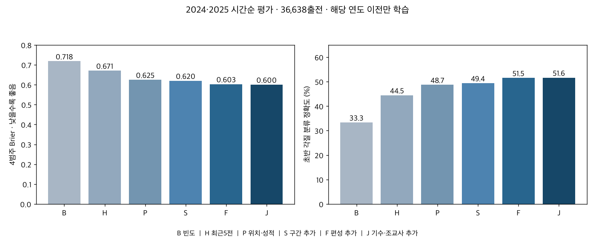
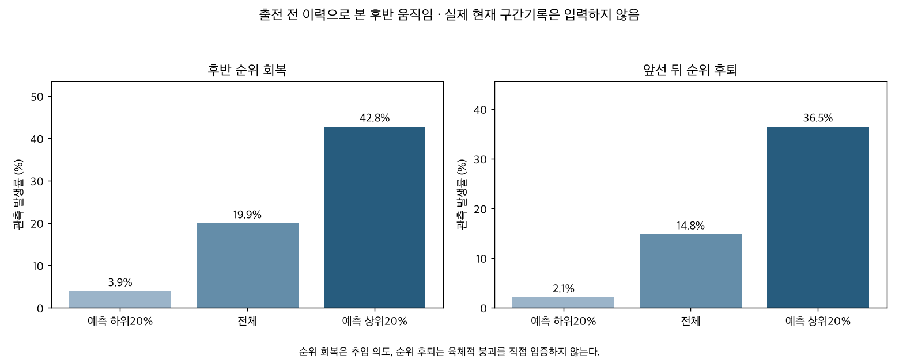
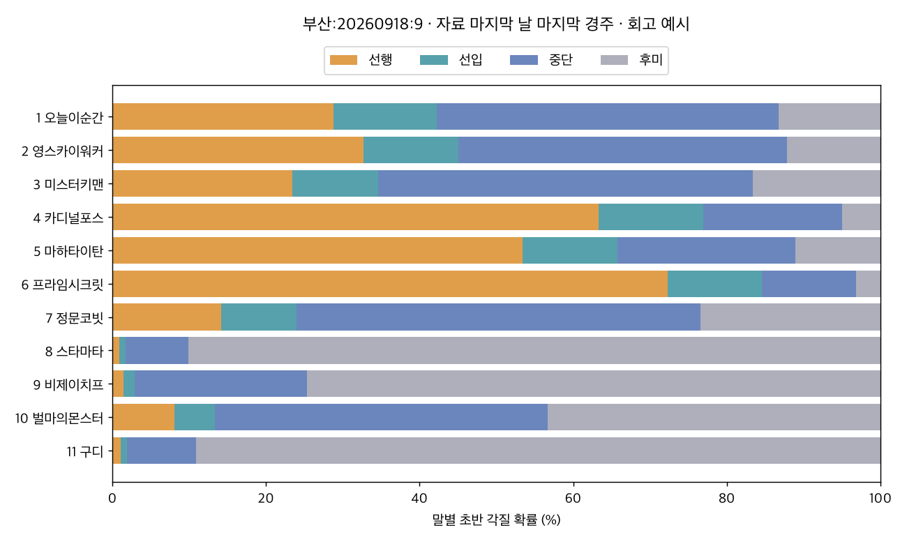

# 편성 안의 초반 위치와 후반 움직임 예측

2026-10-08 · 연구28 후속28C · 서울·부산 · 자료 종료 서울2026-09-20, 부산2026-09-18 · 연구 후보, 운영 반영 전.

**전개 예상에 쓸 추가 정보는 있었다.** 전체 평가 36,638출전에서 최근5전 빈도의 정확도는 44.5%, 위치·성적 이력 P는 48.7%, 자기 구간기록 S는 49.4%, 편성·기수·조교사까지 넣은 J는 51.6%였다. 주 비교 J−S Brier 차이는 -0.0193 [-0.0212, -0.0175]다. 구간기록과 상대 비교를 넣는 효과를 별도로 확인한 결과이며, 전개 의도를 맞혔다는 결과는 아니다.

실무에서는 각 말을 고정 각질 하나로 정하지 않고 **평소 위치 분포 → 이번 편성에서 위치 확보 확률 → 후반 회복/후퇴 확률**을 함께 읽는 편이 맞다. S1F가 상대보다 빠르고 과거 첫 마군 진입이 반복된 말은 앞선 후보로 보되, 바깥 게이트·빠른 내측 상대·앞선 후보 밀집도에 따라 이번 확률이 달라진다. 상대 후보 수는 관측된 실제 경합 강도가 아니다. S1F 시간은 반응·가속·기수 추진이 함께 들어간200m 기록이므로 독립적인 출발 반응시간으로 읽지 않는다.

막판 구간시간이 빠른 것과 뒤에서 순위를 회복한 것은 다르다. 앞에서 위치를 지키며 빠르게 끝낸 말도 있고, 느린 흐름에서 뒤쪽 말이 순위만 회복할 수도 있다. 과거 마지막600/200m 시간·조건부200m 잔차·실제 회복/후퇴 이력을 함께 보존했다. 후반 시간의 빠름/느림을 체력이나 최적 전술의 직접 증거로 단정하지 않는다.

## 시간순 성능

전체 명단 159,014출전·14,636경주·12,516두를 유지했다. 통과조 관측 155,387, 정상 구간기록 151,074출전이다. 2024·2025 평가 36,638출전·4,405두·3,465경주다. 결측 각질은 학습/정답 평가에서 제외하지만 상대 편성 입력에는 남긴다.

| 모형 | 평가 출전 | 정확도 | Brier | 로그손실 |
|---|---|---|---|---|
| 지역·거리·두수 빈도 | 36638 | 0.3334 | 0.7183 | 1.3132 |
| 최근5전 빈도 | 36638 | 0.4446 | 0.6707 | 1.2433 |
| 위치·성적·메타 이력 | 36638 | 0.4872 | 0.6248 | 1.1404 |
| + 과거 구간기록 | 36638 | 0.4941 | 0.6198 | 1.1317 |
| + 편성 비교 | 36638 | 0.5153 | 0.6029 | 1.0991 |
| + 기수·조교사 이력 | 36638 | 0.5162 | 0.6005 | 1.0944 |

Brier는 네 범주의 확률오차 합이며 낮을수록 좋다. 정확도는 가장 높은 확률의 범주가 실제 범주와 같은 비율이다. J의 개선이 네 범주를 완전히 구분한다는 뜻은 아니다. 연도별 수치와 전체/지원5전 비교는 [원표](outputs/early_metrics.csv)에 있다. 기존28A와 공통인 유효5전 지원24,613출전에서 H 정확도 45.8%, J 53.0%, Brier 0.6615→0.5875다.

| comparison | estimate | lower | upper | bh_q_four_comparisons |
|---|---|---|---|---|
| S-P | -0.0050 | -0.0058 | -0.0042 | 1.26e-27 |
| F-S | -0.0169 | -0.0186 | -0.0152 | 9.14e-55 |
| J-F | -0.0024 | -0.0031 | -0.0017 | 9.06e-12 |
| J-S | -0.0193 | -0.0212 | -0.0175 | 1.6e-58 |

차이는 추가 모형−이전 모형으로 음수가 개선이다.95% 군집구간과 네 대비 BH를 병기했다. 연도별 결과는 [대비 원표](outputs/early_comparisons.csv), 확률과 실제 빈도의 관계는 [교정표](outputs/early_calibration.csv)에 있다. 경주별 최고 선행확률마와 선행두수 평가는 전원 초반 관측 경주만 사용한다.

| model | races | top_first_group_hit | leader_count_mae |
|---|---|---|---|
| F | 3465 | 0.6898 | 0.9886 |
| H | 3465 | 0.5977 | 1.1265 |
| J | 3465 | 0.6909 | 0.9913 |
| P | 3465 | 0.6649 | 1.1049 |
| S | 3465 | 0.6860 | 1.1101 |

## 상위등급이면 각질이 더 뚜렷한가

| grade_bucket | n | horses | strong5_rate | mode_repeat | entropy5 | past_total |
|---|---|---|---|---|---|---|
| 1등급 | 906 | 217 | 0.3653 | 0.4857 | 0.7233 | 26.1004 |
| 2등급 | 1490 | 388 | 0.3107 | 0.4383 | 0.7543 | 21.8389 |
| 3등급 | 3958 | 810 | 0.2996 | 0.4505 | 0.7706 | 19.1781 |
| 4등급 | 7145 | 1368 | 0.3083 | 0.4528 | 0.7605 | 16.7804 |
| OPEN | 946 | 409 | 0.2791 | 0.4038 | 0.7819 | 17.3488 |
| 국5 | 7348 | 1425 | 0.2891 | 0.4303 | 0.7746 | 14.5822 |
| 국6 | 2820 | 770 | 0.3028 | 0.4525 | 0.7567 | 8.9344 |

strong5는 과거 실제5전 중 같은 범주4회 이상, mode_repeat는 다음 경주의 과거 최빈 범주 반복률이다. 원시 등급 비교에는 이력량·연령·거리 구성 차이가 섞인다. 상위1·2등급과 국5·국6을 지역×정확거리×연도×이력수×연령 공통셀에서 비교한 결과는 아래와 같다. 각 집단20출전 이상인 셀의 조화표본수로 가중했다. 셀 밖에는 일반화하지 않으며 승급의 인과효과가 아니다.

| target | cells | high_n | low_n | high_mean | low_mean | estimate | lower | upper |
|---|---|---|---|---|---|---|---|---|
| strong5 | 24 | 1337 | 2696 | 0.3272 | 0.3586 | -0.0315 | -0.0892 | 0.0263 |
| repeat | 24 | 1337 | 2696 | 0.4408 | 0.4726 | -0.0317 | -0.0814 | 0.0180 |

고등급일수록 무조건 뚜렷해진다고 일반화하기보다, [등급별 예측오차](outputs/early_metrics.csv)와 실제 반복성·지원수를 함께 판단한다.95% 구간 및 두 대비 BH는 [비교 원표](outputs/grade_matched_comparisons.csv)에 보존했다.

이 공통 범위24셀·4,033출전에서 강한 과거 성향 비율은 상위32.7%, 하위35.9%였고 차이는−3.15%p [−8.92,+2.63]다. 다음 각질 반복률도44.1% 대47.3%, 차이−3.17%p [−8.14,+1.80]였다. 두 비교 모두 BH q=0.2845로, **상위등급에서 더 뚜렷해진다는 근거는 이 비교에서 확인하지 못했다.** 같다는 증명이나 모든 거리의 결론도 아니다.

## 막판 회복과 앞선 후퇴

후반 회복은 결승 전600m에서 상대순위0.5 이상인 말이 결승까지0.25 이상 회복한 사건이다. 앞선 후퇴는 S1F 선행/선입이면서 결승 상대위치가 초반 마군평균보다0.30 이상 뒤인 사건이다. 현재 경주의 실제 앞선 여부로 예측 표본을 먼저 고르지 않고, 모든 유효 목표를 대상으로 사전 변수만 학습했다. 미완주·미관측 정답은0으로 바꾸지 않았다. 이런 사건은 추입 의도나 육체적 붕괴의 정답이 아니다.

| task | model | n | prevalence | brier | auc | low20_rate | high20_rate |
|---|---|---|---|---|---|---|---|
| fade | P | 36609 | 0.1480 | 0.1119 | 0.7501 | 0.0266 | 0.3462 |
| fade | J | 36609 | 0.1480 | 0.1095 | 0.7682 | 0.0213 | 0.3648 |
| recovery | P | 36531 | 0.1994 | 0.1430 | 0.7239 | 0.0510 | 0.4047 |
| recovery | J | 36531 | 0.1994 | 0.1391 | 0.7476 | 0.0394 | 0.4275 |

AUC는 사건 구분 순서 성능이다. 하위/상위20%는 예측 확률 기준이며, 발생률이 예측 확률 자체와 같지는 않다. [후반 군집 비교](outputs/late_comparisons.csv)와 [교정표](outputs/late_calibration.csv)를 함께 보존했다. 전체 사전 모형 J와 P의 통합 Brier 차이는 회복 -0.0039 [-0.0045, -0.0033], 후퇴 -0.0024 [-0.0028, -0.0019]다.

평소 선행 이력3/5 이상이며 초반 기록3전 이상 있는 말의 편성 내 과거 초반잔차 순위별 실제 첫 마군 비율도 보았다. 아래 표는 선택된 역사 표본의 기술통계이며, 강한 상대가 선행 실패를 일으킨 인과효과가 아니다.

| speed_group | n | horses | actual_first_group | estimated_first_group |
|---|---|---|---|---|
| 편성 내 과거 초반 빠른쪽 | 4630 | 1164 | 0.5637 | 0.5788 |
| 중간 | 893 | 573 | 0.3057 | 0.3234 |
| 느린쪽 | 139 | 123 | 0.1295 | 0.2197 |

## 같은 편성의 회고 사례

서울·부산의 자료 마지막 날짜에서 마지막 경주 번호를 고정 선택했다. 잘 맞는 경주를 골라낸 것이 아니다.2026 모형은2025년 말까지 학습했고 해당 경주 이전 이력만 입력했다. 최종 출전 명단 메타정보의 실제 사전 공표시각은 감사하지 않았으므로 당시 사전 발행 실적이 아니다. 실제 결과는 아래 비교 열에만 썼다.

| 경주 | 게이트 | 말 | 선행 | 선입 | 중단 | 후미 | 후반 회복 | 앞선 후퇴 | 실제 초반 |
|---|---|---|---|---|---|---|---|---|---|
| 부산:20260918:9 | 1 | 오늘이순간 | 0.2883 | 0.1339 | 0.4454 | 0.1325 | 0.0660 | 0.2408 | 후미 |
| 부산:20260918:9 | 2 | 영스카이워커 | 0.3268 | 0.1237 | 0.4275 | 0.1220 | 0.0976 | 0.1946 | 후미 |
| 부산:20260918:9 | 3 | 미스터키맨 | 0.2343 | 0.1114 | 0.4877 | 0.1666 | 0.1025 | 0.1681 | 중단 |
| 부산:20260918:9 | 4 | 카디널포스 | 0.6334 | 0.1361 | 0.1806 | 0.0499 | 0.0505 | 0.1493 | 선행 |
| 부산:20260918:9 | 5 | 마하타이탄 | 0.5341 | 0.1235 | 0.2319 | 0.1105 | 0.0460 | 0.4801 | 중단 |
| 부산:20260918:9 | 6 | 프라임시크릿 | 0.7227 | 0.1225 | 0.1227 | 0.0322 | 0.0391 | 0.1195 | 선행 |
| 부산:20260918:9 | 7 | 정문코빗 | 0.1418 | 0.0976 | 0.5261 | 0.2345 | 0.2013 | 0.0811 | 후미 |
| 부산:20260918:9 | 8 | 스타마타 | 0.0093 | 0.0077 | 0.0818 | 0.9013 | 0.3742 | 0.0127 | 선행 |
| 부산:20260918:9 | 9 | 비제이치프 | 0.0145 | 0.0143 | 0.2242 | 0.7470 | 0.4958 | 0.0161 | 후미 |
| 부산:20260918:9 | 10 | 벌마의몬스터 | 0.0809 | 0.0526 | 0.4329 | 0.4336 | 0.3648 | 0.0298 | 중단 |
| 부산:20260918:9 | 11 | 구디 | 0.0104 | 0.0091 | 0.0899 | 0.8906 | 0.5217 | 0.0116 | 후미 |
| 서울:20260920:11 | 1 | 글로벌하트 | 0.3547 | 0.2703 | 0.2819 | 0.0932 | 0.0396 | 0.3264 | 후미 |
| 서울:20260920:11 | 2 | 드림리메인 | 0.1904 | 0.3268 | 0.3356 | 0.1471 | 0.1796 | 0.0879 | 선행 |
| 서울:20260920:11 | 3 | 팬텀프린스 | 0.4756 | 0.2625 | 0.2089 | 0.0531 | 0.0608 | 0.1811 | 중단 |
| 서울:20260920:11 | 4 | 문학루퍼 | 0.0725 | 0.0708 | 0.3028 | 0.5539 | 0.1025 | 0.0663 | 중단 |
| 서울:20260920:11 | 5 | 마이티세이버 | 0.1756 | 0.2735 | 0.3826 | 0.1683 | 0.1724 | 0.0974 | 중단 |
| 서울:20260920:11 | 6 | 원평크라운 | 0.0567 | 0.0439 | 0.1662 | 0.7332 | 0.0905 | 0.0628 | 후미 |
| 서울:20260920:11 | 7 | 무초마초라피도 | 0.2511 | 0.3208 | 0.3378 | 0.0903 | 0.1019 | 0.1250 | 선입 |
| 서울:20260920:11 | 8 | 이스트라코타 | 0.0476 | 0.0736 | 0.3016 | 0.5771 | 0.4020 | 0.0224 | 후미 |
| 서울:20260920:11 | 10 | 이끌림 | 0.8131 | 0.1138 | 0.0532 | 0.0199 | 0.0258 | 0.1946 | 선행 |
| 서울:20260920:11 | 11 | 위너선 | 0.0751 | 0.0873 | 0.3918 | 0.4457 | 0.1935 | 0.0824 | 중단 |

각 말의 네 초반 확률과 후반 사건 확률을 함께 보되, 회복·후퇴가 어느 각질을 시도하려는 의지를 뜻하지는 않는다. 이름·기수/조교사·구간 지원수·자기 S와 편성 J의 확률 차이는 [사례 원표](outputs/example_cards.csv)에 있다.

부산 사례의 프라임시크릿은 자기 구간 이력 S의 선행확률51.7%에서 편성·기수/조교사를 더한 J의72.3%로 올라갔고 실제 첫 마군에 들어갔다. 마하타이탄은53.4%였지만 실제 중단이었다. 스타마타는 후미90.1%였는데 실제 첫 마군에 들어가 큰 예측 실패가 났다. 이를 전술 변경이나 적극 추진의 증거로 확정할 수는 없다. 이 예시들은 확률을 고정 작전으로 읽으면 안 되는 이유를 보여준다.

현재 말별 이력은 [12,516두 프로필](outputs/latest_horse_pace_profiles.csv)에 저장했다. 기준일2026-09-22(T−2)이며 최근 실제5/10슬롯의 위치 분포, 구간 평균/유효수, 마지막200m 조건부 잔차, 회복/후퇴 이력을 담았다. 과거 자료의 말도 포함하므로 active_365·days_since_last·supported5를 함께 봐야 한다. 이번 편성을 지정하지 않은 말에는 위치확률을 발행하지 않았다. [프로필 독립 SQL 검증](outputs/profile_verification.json)을 병기했다.

## 방법과 적용 범위

초반 각질은 S1F 통과조를 기준으로 선행·선입·중단·후미 네 범주다. **선행은 첫 마군 전체**다. 그 밖은 마군 평균 상대위치1/3·2/3 경계로 구분한다. 한 경주 여러 말이 선행일 수 있으므로 각 말의 네 확률만 합이1이며, 말 전체의 선행확률 합은1이 아니다. 후미를 자동으로 추입형이라 부르지 않는다.

최근5/10전은 실제 출전 슬롯이며 T−2까지·730일 이내 기록만 쓴다. 미관측을 건너뛰지 않고 유효수와 함께 부분 평균을 썼다. 기수·조교사 이력은 T−2까지 직전365일이며 같은 날·전날 결과를 배제했다. 선행빈도와 말의 사전 선행빈도 대비 편차를20회 강도로 축소했다. 이 편차는 완전한 능력 보정이나 직접 작전 의도가 아니다.

과거 구간기록은 원초, 같은 경주 상대시간, 전년까지 학습한 지역×정확거리·월·함수율 기준 잔차로 구분했다. 등급 간 능력차를 지우지 않도록 기본 환경모형에는 등급을 넣지 않았다. 마지막200m 조건부 잔차는 과거 경주의 실제 초반·중간과 등급·rating·연령·부담중량을 더해 설명한 값이다. 이 과거 잔차만 다음 경주 입력으로 사용한다. 2018년 환경 잔차는 미관측이다. G3F와 G1F의 겹치는 기록을 별도 능력으로 가산하지 않는다.

P는 현재 지역·거리·등급·게이트·두수·연령과 과거 위치·착순·rating·회복/후퇴 이력, S는 자기 구간 이력, F는 상대마와의 초반 속도 차이·순위·선행 후보 수·내측 상대 성향, J는 기수·조교사 이력을 차례로 추가한다. 신마·기록 결측 상대도 명단에서 제거하지 않는다. 현재 경주의 S1F/G3F/G1F·착순·시간·함수율·체중·rating·배당은 입력하지 않는다.

LightGBM 학습률0.04·15잎·최소잎150·L2=10·180회·seed42를 고정했다. 2024년은2023년까지, 2025년은2024년까지 학습했으며 평가로 튜닝하지 않았다. 2026년 사례는2025년까지 학습한 별도 동결모형이다. 말·실제 날짜·교집합 군집의 보수적인 최대 분산으로95% 구간을 계산했다. 주 비교 J−S와 보조 S−P/F−S/J−F 네 대비에 BH를 표시했다. 전체기간은 과거 이력과 환경 기준의 학습 자료이고, 주 성능평가는2024·2025년이다.

게이트·상대의 힘 때문에 원래 원하는 자리를 못 잡았는지는 통과 결과만으로 확정할 수 없다. 같은 말의 기수·게이트·편성별 반복 변화와 말의 과거빈도를 넘는 기수/조교사 성향은 간접 단서다. 직접 의지를 검증하려면 출발 후 추진, 고삐 제어, 진로막힘, 실제 작전 지시/사전 발언 같은 별도 정답과 시점 자료가 필요하다. 본 연구에는 그 자료가 없다.

## 검증과 산출물

독립 SQL 실제5/10슬롯, 원문 식별자, 연간 ridge 정상방정식, 자기 제외 상대 입력, 같은 날/미래 결과 변조, 별도 트리 경로 해석기, 확률·군집구간·BH·등급 셀을 검증했다. [검증 결과](outputs/verification.json) 63,939,496개 비교가 통과했으며 기존 160개 참조 파일을 보존했다. [계산 전 계획](PLAN.md) · [출처21개와 해시](SOURCES.md) · [입력 감사](outputs/source_audit.json) · [게시요약](PUBLICATION.md) · [게시JSON](PUBLICATION.json) · [용량](outputs/SIZE_REPORT.md) · [중앙28C](../conclusions/28C_FIELD_PACE_PREDICTION.md).

연구용 모형·확률·각 말 입력은 본 폴더에 보존했다. 기존 독립 연구 수·DB·운영 예측모델·웹 배포는 변경하지 않았다. 자료 뒤의 새 편성·다른 지역/시즌·직접 전술 의도·선행 실패의 인과손실·승률 개선은 아직 검증하지 않았다.
