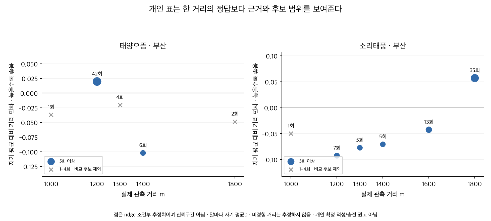
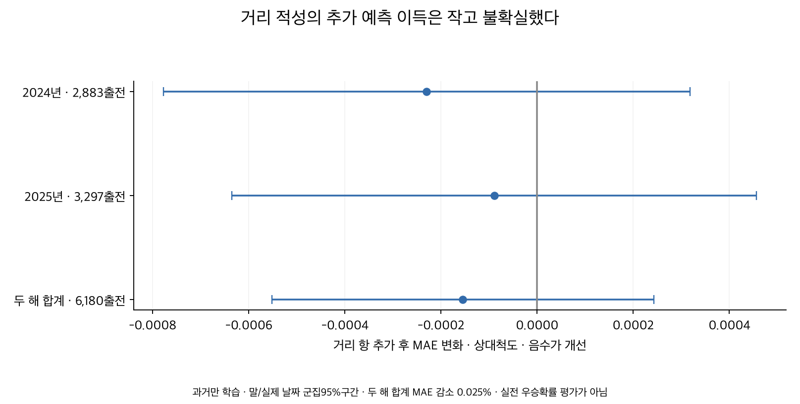

# 말별 적정거리 후보를 구하는 방식과 검증

2026-10-08. **말별로 비교 가능한 거리 후보는 구할 수 있다. 그러나 이번 자료로 각 말의 단일 적정거리를 확정할 근거는 부족했다.** 같은 말이 실제로 여러 거리에서 뛴 이력을 조건에 맞춰 비교하고, 표본이 적은 거리의 우연한 좋은 기록을 낮게 반영하는 방식이 적절하다. 현재 계산한 표는 ‘관측한 거리 중 잘 맞는 후보’이며 미경험 거리까지 알아낸 생리적 최적값은 아니다.

## 적정거리 후보를 구하는 네 단계

1. **거리별 기록을 비교 가능한 척도로 바꾼다.** 1200m의 1분 15초와 1800m의 1분 58초, 또는 둘의 1000m 환산 속도를 그대로 비교하지 않는다. 같은 경주의 상대 기록을 구하고, 학습기간의 지역×거리별 기록 차이 표준편차로 나눈다. 코스와 거리의 기록 구조가 다른 점을 반영하는 상대척도다.
2. **말의 기본 수준과 당시 상태를 분리한다.** 같은 경주 효과와 당시 부담중량·연령·rating·과거 전체/초반/입상 성과·출전수·공백을 고려하고, 말의 기본 수준에 더해 특정 거리에서 얼마나 더 좋았는지 추정한다. 모든 통제변수는 과거 학습 자료에서만 정규화한다. 성별별 기준이나 주로빠르기는 쓰지 않는다.
3. **반복 출전이 적으면 거리 차이를 줄여 잡는다.** 한 번 우승한 거리나 최고기록 한 개가 정답이 되지 않도록 ridge 축소를 쓴다. 말별 거리 편차는 학습 출전수로 가중한 자기 평균이 0이 되도록 한다. 0은 자기 평균이고, 다른 말의 0과 능력이 같다는 뜻은 아니다.
4. **과거로 고른 후보를 이후 자료에서 확인한다.** 2023년으로 축소 강도를 고른 뒤,2024년과 2025년의 결과를 각각 이전 연도까지의 자료로 평가한다. 이후 기록을 보며 후보를 다시 골라 과거 예측처럼 표현하지 않는다.

전체시간을 주대상으로 삼았다. 막판 200m만 좋다고 적정거리를 고르지는 않았다. 막판은 앞선 전개에 의존하고 전체시간과 겹치는 정보이므로, 향후 후보거리 설명의 보조 항목으로 다뤄야 한다. 혈통·체중 하나만으로 거리를 정하는 공식도 만들지 않았다.

## 어느 말까지 비교할 수 있었나

자료는 서울·부산 2018년 이후 서울 2026-09-20·부산 2026-09-18까지다. 검증된 정상 151,074출전 중 1000~1800m13지역×거리 148,126출전을 사용했다.1900m 이상·제주·영천·주행심사는 제외했다. 서로 다른 경마장은 별도 프로필로 계산했다.2026년은 부분연도이므로 최종 후보표에만 포함하고,이후 성과 검증은 완결된 2024·2025년으로 구분했다.

| 구분 | 규모 |
|---|---:|
| 전체 고유 마필 | 12,428두 |
| 경마장을 구분한 말 그룹 | 12,874개 |
| 전체 15출전 이상, 두 거리 이상 각각 5회 이상 | 2,634그룹 · 고유 2,634두 |
| 위 조건을 충족하고 최근 365일 내 관측 | 760그룹 |
| 비교 근거 부족 | 10,240그룹 |

한 거리만 뛴 말은 그 거리의 성과를 알 수 있어도 다른 거리보다 적합하다고 판단할 수 없다. 거리별 1~4회는 근거 표에는 보존하되 최종 비교 후보에서 제외했다. 총 15회는 5회 이상인 두 거리뿐 아니라 같은 지역의 모든 해당 거리 출전을 합친 수다. 초기의 ‘두 거리 각각 5회’ 점검 2,827개는 총 15회 조건을 붙이기 전의 경마장별 말 그룹 수다.5회/15회는 이번 연구의 최소 표시 기준이며 정확성을 보장하는 횟수가 아니다. 최근 관측을 현역 등록 확인과 동일시하지 않는다.

개인 후보의 1·2순위 차이는 2,634그룹 중 2,625개에서 0.10 상대척도 미만이었다. 나머지 9개가 통계적으로 확정된 적성을 갖는다는 뜻은 아니다.0.10은 가까운 후보를 함께 보여주기 위한 표시 기준이고 개인 신뢰구간을 계산한 결과가 아니다. 작은 표본과 강한 축소로 후보 차이가 작아질 수 있어 ‘거리 적성이 없다’고 해석하지 않는다.

## 실제 개인 표는 이렇게 읽는다

아래 사례는 관측기간 전체로 만든 최신 연구 스냅샷의 설명용 예시다. 당시 출전 전에 제공한 추천이나 앞으로의 승률이 아니다.

| 말과 지역 | 실제 근거 | 임시 후보 | 읽는 방법 |
|---|---|---|---|
| 태양으뜸 · 부산 | 1200m 42회 · 1400m 6회 | 1200m | 표시 기준상 1순위 · 통계적 확정 아님 |
| 소리태풍 · 부산 | 1200m 7회 · 1300m 5회 · 1400m 5회 · 1600m 13회 · 1800m 35회 | 1800,1600m | 후보 차이가 작아 함께 표시 |
| 발키리 · 서울 | 1300m 5회 · 1400m 8회 | 1400m | 표시 기준상 1순위 · 통계적 확정 아님 |
| 리치트리 · 부산 | 1400m 8회 · 1600m 11회 | 1400m | 표시 기준상 1순위 · 통계적 확정 아님 |

태양으뜸은 1200m42회와 1400m6회 근거에서 1200m의 조건부 점추정이 높았다.1800m는 2회라 비교 후보에서 빠진다. 소리태풍은 1800m가 1순위지만 1600m와의 차이가 표시 기준보다 작아 1600~1800m를 함께 남긴다. 연속 범위의 모든 중간 거리를 실제 검증했다는 뜻은 아니다. 리치트리의 1200m는 3회라 전체 후보 표의 1·2순위 비교에는 포함하지 않았다.

[말별 전체 후보 CSV](outputs/horse_candidates.csv),[최근 관측·비교 가능 후보 CSV](outputs/recent_horse_candidates.csv),[거리별 횟수와 추정치 parquet](outputs/horse_distance_profiles.parquet)에 마명·마필ID·지역·거리·관측수·가까운 후보·마지막 관측일을 보존했다. 우승확률·공식rating·확정 적성 점수가 아니다.

## 이후 기록에서 실제 도움이 됐나

2018~2022년을 학습하고 2023년 3,119개 비교 출전에서 거리 편차 축소 강도 3/10/30/100을 비교했다. 선택값은 100으로, 개인 거리 차이를 상당히 보수적으로 반영하는 방식이었다.2024·2025년 평가 후 이 값을 다시 선택하지 않았다.

2024년은 2018~2023년,2025년은 2018~2024년까지만 학습했다. 주 평가집단은 학습 12출전 이상·검증거리 3회 이상·다른 거리 3회 이상인 말이다. 신마나 미경험 거리까지 포함한 전체 결과와 지역별 결과는 [평가표](outputs/evaluation_metrics.csv)에 따로 남겼다. 이 표의 MAE는 낮을수록 좋은 상대척도 오차이고 ‘차이’는 거리 항 추가−제외다.

| 검증 기간 | 비교 출전 | 거리 항 제외 MAE | 거리 항 추가 MAE | 차이 [95%구간] |
|---|---:|---:|---:|---:|
| 2024 | 2,883 | 0.597984 | 0.597754 | -0.000230 [-0.000778, +0.000318] |
| 2025 | 3,297 | 0.638277 | 0.638188 | -0.000089 [-0.000635, +0.000456] |
| 2024_2025 | 6,180 | 0.619480 | 0.619325 | -0.000155 [-0.000552, +0.000243] |

합계 6,180출전·1,022두의 주 평가에서 MAE는 0.619480→0.619325로 약 0.025% 줄었지만,차이 95%구간은 0을 포함했다. 실제 초로 바꾼 평균 절대오차는 0.851671→0.851450초로 약 0.000221초 감소했다. 이는 **예측오차 감소량**이며 적정거리로 옮겼을 때 빨라지는 시간이 아니다. 거리 적성 항의 추가 예측 가치를 확정하지 못했다.2024년 부산 한 하위집단의 감소만 골라 전체 개선이라고 주장하지 않는다.

실제 검증 경주의 평균은 결과 평가에서 공통 경주 효과를 없애는 데만 사용했다. 예측값은 이전 학습 계수와 해당 출전의 알려진 조건으로 계산했고,현재 경주의 실제 기록·착순을 입력으로 넣지 않았다. 정상 완주자 선택 모집단에서의 상대 기록 검증이므로 실전 출전표 전원의 절대시간·우승확률을 검증한 것은 아니다. 원천 정보의 공개시각을 복원한 실시간 검증과도 구분한다.

## 과거 후보거리가 이후에도 가장 좋았나

과거 두 거리 이상에서 각각 3회·전체 12회 이상 근거가 있고,이후 후보거리와 다른 지원거리에서 각각 2회 이상 실제 뛴 말만 비교했다. 각 비교 거리도 이후 2회 이상인 경우로 제한했다. 이후 성과는 과거에 추정한 통제/말 기본 수준을 제외하고,같은 경주의 다른 정상 완주자 평균을 결과 평가 참조로 삼았다. 미래 경쟁마의 결과는 평가용이며 예측 입력이 아니다.

| 이후 연도 | 두 거리 이상 반복 비교한 말 | 과거 후보와 이후 최고거리 일치 | 후보거리−다른거리 성과 [95%구간] |
|---|---:|---:|---:|
| 2024 | 120두 | 55.0% | +0.056 [-0.074, +0.187] |
| 2025 | 131두 | 49.6% | +0.085 [-0.041, +0.212] |

성과 차이는 상대척도이고 높을수록 후보거리에서 좋았다는 뜻이다. 두 해 모두 평균 방향은 후보거리 쪽이지만 불확실성 구간이 0을 포함했다.55.0%와 49.6%를 높은 정확도라고 해석하지 않는다. 말마다 후보 수와 거리 선택이 달라 단순한 50%와의 우열도 검정하지 않았다. 다음 출전거리 자체가 훈련·성장·상태·편성에 따라 선택되므로 거리 변경의 인과 개선이나 최적 출전 전략을 입증하지 않는다.

## 적용 범위와 다음 판단

현재 결과는 ‘말별 비교표를 만들 수 있다’는 근거이고 ‘모든 말의 적정거리를 맞혔다’는 근거는 아니다. 개인 편차는 관측기간 평균적 선호를 고정한 모형으로,성장·훈련·부상·주법 변화에 따라 달라지는 적성을 완전히 추적하지 못한다. 당시 rating·과거 성적을 맞춘 조건부 적성이며,그 조정에 포함되는 능력 변화까지 모두 독립적인 거리 적성으로 분해한 것이 아니다.

기록을 읽을 때는 **후보거리·가까운 대안·거리별 출전수·최근 관측일·판단 보류**를 함께 표시하는 것이 맞다. 최소 표본을 충족해도 개인 확정 신뢰구간과 이후 개선 근거가 없으면 단일 거리로 단정하지 않는다. 아직 뛰지 않은 거리나 1900m 이상 장거리로 외삽하지 않는다. 현재 연구는 후보표를 보존한 상태이며 운영 평가표·DB·모델·웹사이트 배포에 반영하지 않았다.

## 검증과 재현

원문 18파일에서 148,126행의 말ID·날짜·거리·전체기록과 최신 관측 마명을 대조하고 19개 입력 해시를 확인했다. 별도 희소 설계행렬·경주 평균 투영·LSMR 회귀로 10개모형을 재계산해 CG 결과와 비교했다. 독립 검증 4,882개 검사를 통과했으며 계수 최대오차는 [독립 계산표](outputs/independent_fit_checks.csv)에 있다. 학습기간의 결측 중앙값/평균/표준편차·거리 척도·과거 지원수·개인 후보·미래 현재결과 변조에 대한 예측 불변을 확인했다.

말 군집은 경마장을 옮긴 같은 말도 함께 묶고,실제 날짜 군집은 두 지역의 같은 달력일을 함께 묶었다. 말 단일·날짜 단일·이원 군집 중 대비분산 최대값과 t 구간을 썼다. 주검정은 두 완결연도를 합친 사전 지정 MAE 차이 1개이며 다른 표는 민감도/탐색이다. 수치 일치가 거리 적성의 인과성이나 생리적 기전을 입증하지 않는다.

[계획](PLAN.md) · [출처와 모형](SOURCES.md) · [게시 요약](PUBLICATION.md) · [게시 데이터](outputs/publication_summary.json) · [검증](outputs/verification.json) · [용량](outputs/artifact_inventory.json) · [중앙 결론](../conclusions/27_HORSE_DISTANCE_APTITUDE.md).

루트에서 `OPENBLAS_NUM_THREADS=1 PYTHONDONTWRITEBYTECODE=1 .venv/bin/python thoroughbred/research/20261008_horse_distance_aptitude/run.py`,같은 경로의 `verify.py`, `render.py` 순서로 재현한다. `--resume`은 같은 연구의 저장된 학습 모형을 읽어 파생표만 다시 계산하는 옵션이다. 공유 목록의 `register.py`는 재현 분석에서 생략한다.
