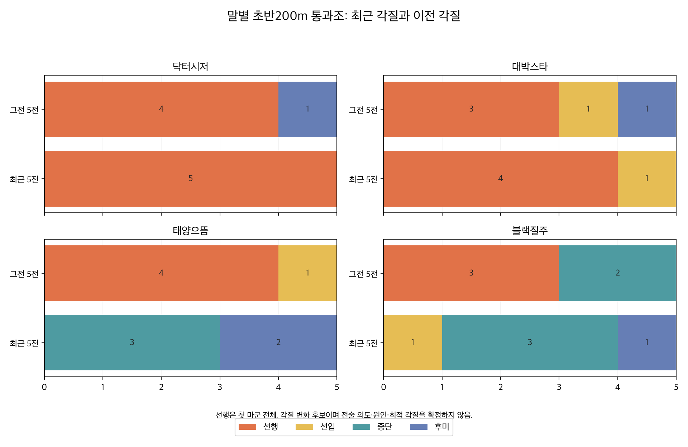
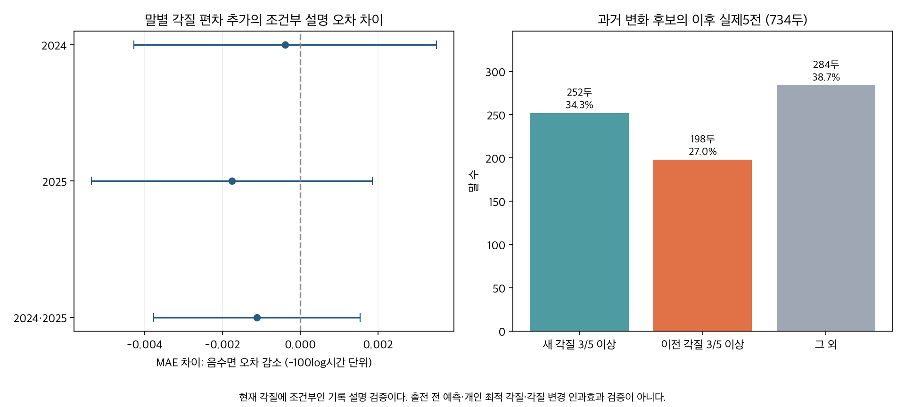

# 말별 각질: 평소 성향·좋은 경기력·최근 변화

**말별 연구표를 만들었다. 평소 초반 위치, 좋은 성적을 낸 초반 위치, 최근 위치 성향의 변화를 구분할 수 있다. 다만 개인의 확정 ‘최적 각질’과 전술 변경의 원인은 아직 입증되지 않았다.**

연구28·28A를 이어받은 후속28B다. 분류는 **출발 후 200m인 S1F 통과조** 기준이며 표시 이름은 선행·선입·중단·후미다. 기존 role4 정의는 유지했다. 선행은 첫 마군 전체, 선입은 첫 마군 밖에서 마군 평균 상대위치≤1/3, 중단은 1/3 초과~2/3, 후미는 2/3 초과다. 선두1두/여러 두 표식도 보존했다. 선행이 단독 선두라는 뜻은 아니며 후미만으로 추입 적성을 정하지 않는다.

## 범위와 지원 표본

서울 2018-01-06~2026-09-20·부산 2018-01-05~2026-09-18 실전 검증 명단 **159,014출전·14,636경주·12,516두**를 사용했다. 통과조가 관측된 155,387출전으로 평소 각질을 정리하고, 기존 정상 기록151,074출전 중 통과조가 있는 **151,065출전·13,927경주·12,435두**로 경기력을 비교했다. 제주·영천·주행심사·주로빠르기는 제외했다.

말 프로필의 기준일은 2026-09-22, 자료 마감은 T−2인 09-20이다. 지역을 옮겨도 식별자가 같으면 같은 말의 이력으로 연결했다. 2018년 이전 자료가 없으므로 ‘전체 분포’는 생애 전체가 아닌 이 관측기간의 분포다. 최근365일 관측3,213두는 현역 등록 확인을 뜻하지 않는다.

| 질문 | 분석 가능한 말 | 현재 판단 |
|---|---:|---|
| 최근5전의 평소 각질 | 2,601두 | 분포와 3/5 이상 우세 성향 표시 |
| 최근5전과 그전5전 비교 | 1,349두 | 두 창의 분포와 위치 변화 비교 |
| 같은 거리의 각질별 기록 비교 | 1,753두·2,001 말×거리 | 기록 우세 각질 잠정후보, 최근365일 관측553두 |
| 최근5전의 우세 각질 변화 | 302두/1,349두(22.4%) | 변화 후보, 다중검정 통과0두 |
| 최근10전과 그전10전 비교 | 217두 중11두 | 창이 길어 표본과 표적도 달라지는 보조 분석 |

평소 각질을 단순 숫자 평균으로 정하지 않는다. 선행3·후미2인 말을 ‘중단형’으로 만들지 않는다. 최근5전에서 3회 이상이면 해당 성향, 그 미만이면 혼합으로 표시했다. 지원2,601두 중 선행488·선입47·중단567·후미806·혼합693두다. 최근10전은 6회 이상을 우세 기준으로 썼다. 결측을 후미로 넣거나, 결측 경주를 건너뛰어 유효5전을 채우지 않았다. 창 전체가 유효하고 가장 오래된 출전이730일 이내여야 지원한다.

## 잘 달린 경기의 두 기준

첫째는 실제5위 이내이며 **69,634출전**이다. 같은5위라도 출주두수와 상대가 다르므로 순수 능력 점수로 사용하지 않는다. 둘째는 각질을 넣지 않고 조건을 맞춘 기록 잔차다. 같은 말의 정상 관측이10회 이상일 때 잔차80분위 이상인 **27,134출전**을 ‘조건 대비 좋은 경기’로 별도 표시했다. 동률을 포함했다.

두 집단의 각질별 횟수와 해당 각질로 뛴 전체 횟수, 5위 이내율을 함께 저장했다. 좋은 경기에서 선행이 많더라도 그 말이 평소 거의 항상 선행했다면 각질 간 우열의 증거가 부족하다.

기록 목표는 y=−100log(전체초)다. 경주 평균을 정확히 제거하고 말 기본 수준, 말×정확거리, 연령·연령²·부담중량·마체중·rating·과거착순/입상·출전수·휴양간격·상대게이트를 고려했다. 경주 안 비교는 지역·정확거리·당일 함수율·월·등급·편성의 공통 차이를 제거한다. 각 상대의 모든 능력, 건강, 출발 실수까지 관측하거나 통제한 것은 아니다.

말 기본 수준과 말×거리에는 ridge1/20, 지역×거리대의 공통 각질효과에는 ridge1, 개인 각질편차에는 빈도 가중 평균0·ridge30을 사용했다. 연속 설명변수와 결측 지시자는 지역×거리대별로 표준화했다. 거리대는 ≤1400m/1600~1800m/≥1900m다. 이는 부분 풀링 모형이며 완전한 말 고정효과라고 부르지 않는다. 현재 초반 시간·막판 기록·착순·기존 전체기간 점수를 설명변수로 사용하지 않았다.

잔차가 양수면 조건 대비 빠르다. 단위1은 대략1%의 기록 차이이며 정확한 단위는100로그시간 차이다. 전체기간 모형을 쓴 회고적 평가이므로 이 잔차나 좋은 경기 표식을 같은 경주의 사전 예측 입력으로 사용하면 안 된다.

## 실제 말을 읽는 사례

| 말 | 그전5전 → 최근5전 | 조건 대비 좋은 경기의 각질 | 같은 거리 비교 |
|---|---|---|---|
@EXAMPLES@

닥터시저는 최근5전 모두 선행이고 조건 대비 좋은8경기도 모두 선행이었다. 하지만 같은 거리에서 다른 각질로 충분히 반복한 비교가 없어 ‘선행이 최적’이라는 개인 판정은 보류했다.

대박스타는 최근5전 선행4·선입1이며, 1400m에서는 선행이 조건부 기록 우세 후보였다. 선입 대비 차이는0.450로그시간 단위(근사0.45%)다. 개인 신뢰구간이나 작전 변경의 인과 개선량이 아니며 작전 추천으로 채택하지 않는다.

태양으뜸은 그전5전 선행4·선입1에서 최근5전 중단3·후미2로 이동했다. 같은 창의5위 이내율은100%→0%, 조건 대비 기록 잔차 평균은+0.551→−0.970이었다. 평균거리도1200→1220m로 달라졌다. 위치 변화와 경기력 저하가 동반된 사례이며 ‘선행하지 못해서 느려졌다’는 증거는 아니다. 컨디션 저하로 초반 위치부터 밀렸을 가능성도 있다.

블랙질주는10전 모두1200m에서 선행3·중단2→선입1·중단3·후미1로 바뀌었지만, 5위 이내율은20%→60%, 보정 잔차 평균은−0.285→+0.074였다. 뒤쪽으로 이동했다고 모든 말의 성적이 나빠지는 것은 아니다. 두 사례 모두 짧은 창의 관찰이며 개별 변화의 다중검정은 통과하지 않았다.

## 개인에게 맞는 각질을 확정할 수 있는가

같은 정확거리에서10회 이상, 각질2개 이상 각각3회, 말 전체15회 이상일 때만 비교 후보를 만들었다. 지원되지 않는 각질이나 거리를 추천하지 않는다. 말별 대표거리는 지원 거리 중 최근10전에서 가장 많이 뛴 거리다. 동률은 전체 관측수, 짧은 거리 순으로 정한다.

1,753두 중241두는 상위 두 후보 차이가0.10 미만이라 차이 작음으로 표시했다. 추정 강도10/30/100을 바꿔도 대표거리 후보가 같은 말은1,551두였다. 이는 같은 자료의 민감도이며 독립적인 재현 검증이 아니다. 여러 거리에서 지원되는 말 중112두는 거리별 후보가 달라 단일 고정각질로 합치지 않았다. 개인 신뢰구간은 산출하지 않았다.

2024와2025년에 각각 전년 말까지만 학습해 공통 각질효과 모형과 개인 각질편차를 추가한 모형을 비교했다. 해당 경주의 실제 각질을 쓰므로 **실제 각질에 조건부인 기록 설명 검증**이며 출전 전 예측 검증은 아니다. 과거15회 이상·해당거리 각질2개 이상 각각3회인 지원 표본의 결과는 다음과 같다.

| 평가연도 | 출전 | 공통 각질 MAE | 개인 편차 추가 MAE | 차이·95% 구간 |
|---|---:|---:|---:|---|
@METRICS@

말/실제날짜/교집합 군집을 고려한 보수적95% 구간이다. 합산1,995출전·427두에서 오차 감소는0.001116으로 작고 구간이0을 포함했다. 전체35,849출전에서도 차이−0.000375[−0.000846,+0.000096]로0을 포함했다. **개인 각질 적성의 추가 반복 가치가 충분히 확인됐다고 할 수 없다.**

과거에 고른 후보 각질과 다른 각질을 이후 같은 말·정확거리에서 각각2회 이상 관측한 더 작은 표본도 확인했다. 공통 각질효과를 제거한 이후 잔차의 후보−다른 각질 차이이며 양수면 후보 쪽이 좋다. 첫 표에는 과거 해당 각질 관측이3회 미만인 미래출전37행도 포함된다.

| 평가연도 | 말 | 출전 | 후보−다른 각질·95% 구간 |
|---|---:|---:|---|
@REPLICATION@

과거에 해당 거리·각질을3회 이상 관측한 출전만 남긴 민감도는 다음과 같다.

| 평가연도 | 말 | 출전 | 후보−다른 각질·95% 구간 |
|---|---:|---:|---|
@STRICT_REPLICATION@

첫 비교의2024년에는 오히려 후보 쪽이 낮았고2025년에는 불확실했다. 더 엄격한 표본에서도 안정적인 개인 우세를 입증하지 못했다. 표본이 작고, 실제 관측 각질로 조건을 나눈 비교이므로 무작위 전술 실험과 다르다.

## 변화는 어느 정도 지속되는가

최근5전과 그전5전이 모두 유효하고 각 창에서3/5 이상인 우세 각질이 다르면 변화 후보로 정했다. 두 분포의 총변동거리(TV), 연속 상대위치 차이, 거리·지역 변화도 저장했다. 최신 말별10전의252가지 자리배치에 대한 정확 순열검정과1,349두의 BH 다중검정을 수행했다.

현재302두 중10전 모두 동일거리인 말은4두뿐이다. 많은 말의 거리 구성도 변하므로302두를 순수 전술변경으로 읽으면 안 된다. 다중검정 통과는0두였다. ‘변화가 없다’는 증명이 아니라 짧은 이력과 다중비교로 개별 변화를 확정하기 어렵다는 뜻이다. 최근365일 관측 변화 후보는287두다. 순열검정은 창 안의 교환가능성을 가정하며 거리 구성이나 시계열 의존이 달라지면 보장하기 어려워 p/q는 탐색 진단으로 읽는다.

2024~2025년 각 말의 첫 탐지시점만 선택한1,094사건 중 이후 실제5전이 모두 유효·365일 이내인 **734두**를 따라갔다. 선택에 미래 결과를 쓰지 않았고, 첫 사건의 후속 결측을 이유로 다른 사건으로 대체하지 않았다. 새 각질 출현율39.7%, 이전 각질33.3%, 차이+6.43%p[+2.85,+10.01]였다.

새 각질이3/5 이상 유지된 말은 **252두·34.3%**, 이전 각질이3/5 이상 나온 말은198두·27.0%, 그 외는284두·38.7%였다. 탐지 전10전이 같은 거리였던 보조 표본은15두뿐이며 새 각질3/5 유지60.0%였다. 표본이 작고 이후 거리까지 고정한 비교도 아니므로 일반화하지 않는다. 후속 관측 미지원360두의 선택 편향도 남는다. 변화 후보는 다음 경주들로 계속 확인해야 하는 표식이다.

## 한계와 검증

통과조가 없는3,627명단행은 각질 미관측으로 두었다. 관측155,387행 중 기존 정상기록 기준 밖4,322행(2.8%)은 시간 비교에서 제외했지만 평소/변화 이력에는 남겼다. 기존 정상151,074행 중 통과조 미지원9행도 기록 비교에서 빠졌다. [각질별 선택표](outputs/selection_by_style.csv)에 원수와 유지수를 남겼다. 기존 등급·함수율·구간 품질 모집단을 물려받았으므로 모든 실전 출전의 완주성과 모형은 아니다.

초반 위치는 출발능력·컨디션·기수 결정·게이트·상대와 함께 결정된다. 조건을 맞춰도 강제로 각질을 바꿨을 때의 인과성과를 식별하지 못한다. 미관측 컨디션, 장기 능력 변화, 원자료에 없는 사유, 희소 장거리, 부분 풀링 모형의 가정이 남는다. 현재 자료에서 좋은 경기를 골라 같은 자료로 개인 적성을 확증하지 않았다. 생리적 각질, 게이트/상대 때문에 밀린 원인, 확정 시간손실은 제공하지 않는다.

독립 SQL로 명단·최근 실제 슬롯·좋은 경기 분위수를 대조하고 별도 초기하 계산으로 순열p·BH를 확인했다. 별도 계수 복원으로5개 최종모형과4개 시간순모형의 정상방정식, 미래 기록 설명값과 과거 고정후보, 개인 효과, 군집구간, 변화 후속 슬롯을 검증했다. [검증 결과](outputs/verification.json)에 전체 검사 수를 기록했다. 관련 기존136파일은 해시 그대로 보존했다.

전후 성적 비교와 과거 해당 각질3회 이상 민감도는1차 계산 후 추가한 진단이며 [계획](PLAN.md)에 변경을 명시했다. 전후 성적은 각 창의 정상기록3회 이상일 때만 차이를 표시한다. 전술 변경의 인과효과로 해석하지 않는다.

## 보관 파일

- [말별 종합프로필](outputs/horse_profiles.csv) · [최근365일 관측말](outputs/recent_horse_profiles.csv): 평소·좋은 경기 분포·대표거리 잠정후보·변화와 지원상태.
- [말×정확거리×각질](outputs/horse_distance_style.csv) · [말×각질 원시성과](outputs/horse_performance_style.csv): 각질별 표본·5위 이내율·개인/공통 효과·민감도.
- [최근 변화후보](outputs/current_change_candidates.csv) · [전후 성적](outputs/change_performance.csv): 원인 확정이 아닌 관측 변화와 동반 성적.
- [사례 원문10전](outputs/example_actual_starts.csv) · [시간순 설명 검증](outputs/conditional_evaluation_metrics.csv) · [변화 지속성](outputs/change_followup_metrics.csv).
- [계산 전 계획과 추가 범위](PLAN.md) · [출처](SOURCES.md) · [계산](run.py) · [독립 검증](verify.py) · [게시 요약](PUBLICATION.md) · [용량 명세](outputs/artifact_inventory.json).

연구 상태는 회고적 프로필·조건부 기록 우세 후보·관측 변화 후보다. 개인 최적 각질·인과손실·사전 예측 개선·운영 보정 채택은 미확정이다. 이전 연구와 독립 연구 수를 유지했고 DB·운영 모델·웹사이트 배포를 변경하지 않았다.
