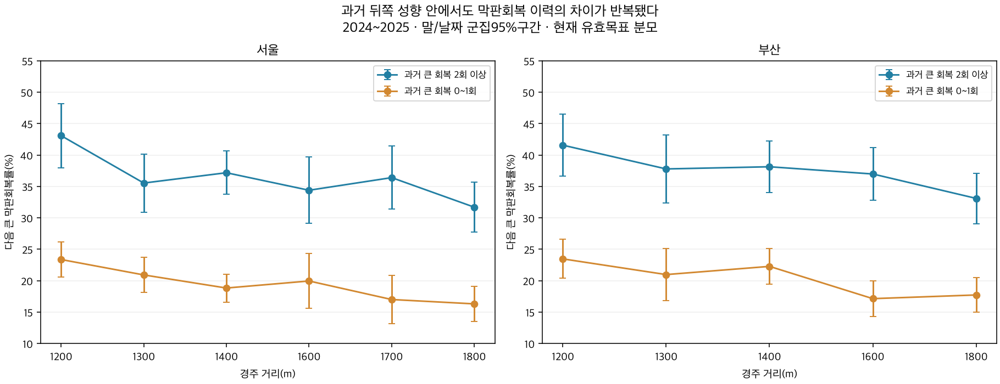
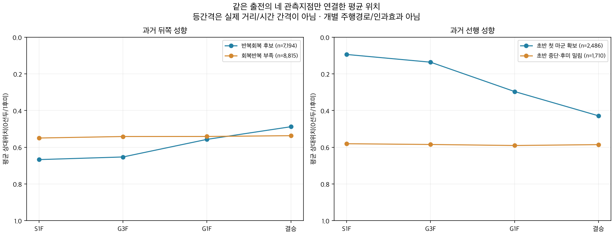
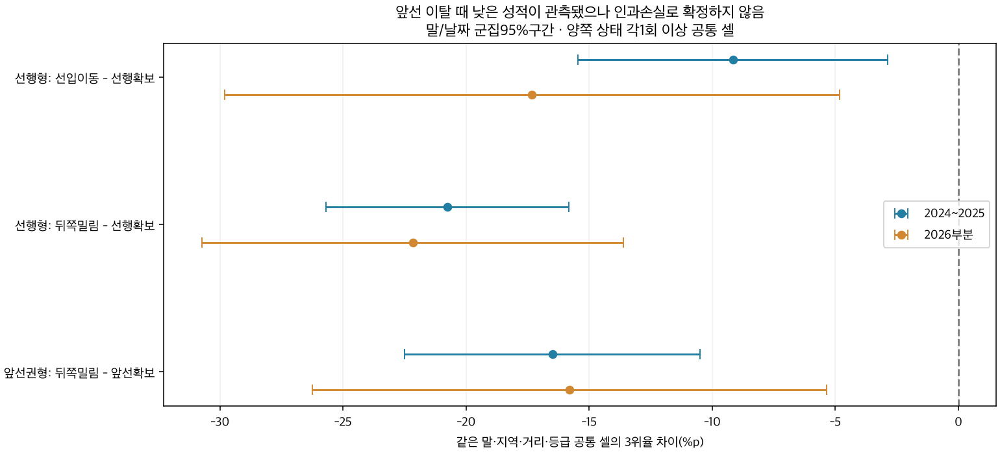

# 중반·종반의 실제 추입과 선행·선입 확보 실패

2026-10-08 · 연구28 후속28F · 서울·부산 · 주 평가2024~2025 · 연구 후보.

**초반에 뒤에서 뛰는 성향과 실제 막판 순위를 회복하는 성향은 구분할 수 있었다. 과거 뒤쪽 성향 중 최근5전에서 큰 막판회복이2회 이상인 후보는 다음 경주의 회복률36.2%,0~1회 집단은19.9%였다. 뒤쪽 출발만 보고 추입형으로 확정하면 안 된다.**

평소 선행형은 이번 초반에도 첫 마군을 확보했을 때3위 이내40.7%,선입으로 이동했을 때29.4%,중단·후미까지 밀렸을 때18.7%였다. 같은 말·지역·정확거리·등급 안에서도 선입 이동−9.16%p,뒤쪽 밀림−20.76%p의3위율 차이가 관측됐다. 앞선 실패가 부진을 일으킨 인과 손실이나 기수의 작전 의도를 확정한 값은 아니다.

## 자료와 관측 구간

전체2018~2026 명단159,014출전·14,636경주·12,516두를 유지했다. 주 분석2024~2025는 **37,345출전·3,532경주·4,425두**,정상 결승착순37,242출전,후반 회복 정답36,531출전이다. 이전28D/28E 초반 예측36,638출전보다 큰 이유는 이번에 현재 S1F 정답이 없는 출전도 중·후반 관측에 남겼기 때문이다. 정답마다 유효 분모를 표시하고 결측을0/후미로 메우지 않는다.

| 이동 구간 | 실제 관측 위치 | 이동 거리 |
|---|---|---|
| 초반→후반 진입 전 | 출발200m S1F→결승600m 전 G3F | 경주거리 D−800m |
| 후반400m | G3F→결승200m 전 G1F | 400m |
| 마지막200m | G1F→결승 | 200m |

G3F는1200m에서 출발600m 지점,1800m에서 출발1200m 지점이다. 모든 거리의 정중앙을 동일하게 계측한 것이 아니다. 첫 구간을 편의상 ‘중간 이동’으로 부르되 실제 길이를 유지한다. 서울 미계측 마지막400m를 만들지 않았고 후반400m는600→200m 사이의 직접 차이다. 이번 위치는 공식 통과순위이며 실제 내외측 주행경로가 아니다.

S1F 각질은 이전 통과조 정의를 유지한다. 선행은 첫 마군 전체,선입은 그 밖의 마군 평균 상대위치1/3 이내,중단은2/3 이내,후미는 그 밖이다. G3F/G1F는 검증된 공식 통과순위를 사용하며 새 마군을 만들어 같은 네 이름을 붙이지 않았다. 이동량은 공식 순위의 p=(순위−1)/(출주두수−1) 차이이고 양수가 전진이다. 같은 마군의 가로 배열을 순위 이동으로 해석하지 않는다. 순위는 API4_3 공식 통과순위다.

## 뒤쪽형과 반복회복 후보를 사전에 나누기

현재 경주의 결과를 제외하고T−2까지 최근5개 실제 명단 슬롯을 사용했다.5개 모두 유효 각질·730일내여야 성향을 부여한다. 결측 경주를 건너뛰어 유효5전을 채우지 않는다.

- 뒤쪽 성향: 최근5전 중 중단+후미3회 이상.
- 엄격 후미형: 최근5전 중 후미3회 이상. 뒤쪽 성향 안의 부분집단이다.
- 큰 막판회복 사건: 결승600m 전 p≥0.5이고 결승까지p를0.25 이상 회복.12두면 통상3순위 이상 회복에 해당한다.
- 반복회복 후보: 뒤쪽 성향이면서 과거5회 모두 회복 정답이 있고 큰 막판회복2회 이상.0~1회는 반복 부족,과거 회복 정답이 모자라면 미분류다.

이는 출전별 과거 프로필이다. 한 말이 시기에 따라 다른 집단에 들어갈 수 있고 확정된 타고난 각질·최적 작전이 아니다. ‘추입형’은 현재 후미에 있다는 이름 대신 뒤쪽 성향+반복 회복 근거가 있는 후보로 읽는다.

| 사전 성향 | 전체 출전 | 회복 유효 출전 | 큰 막판회복률 | 막판 조금이라도 전진 | 3위 이내율 |
|---|---|---|---|---|---|
| 과거 후미형(엄격) | 6,846 | 6,709 | 34.1% | 61.0% | 21.6% |
| 뒤쪽 반복회복 후보 | 7,376 | 7,221 | 36.2% | 64.9% | 27.1% |
| 뒤쪽 회복반복 부족 | 9,039 | 8,854 | 19.9% | 44.9% | 23.4% |

반복회복 후보36.16%와 부족집단19.89%의 차이는 **+16.27%p,95%군집구간[14.54,17.99]**였다. 서울35.74% 대19.58%,부산36.69% 대20.31%로 같은 방향이었다. 지역×정확거리×연도×등급×두수군×과거평균착순 구간을 맞춘 공통169셀에서도 **+16.41%p [14.36,18.45]**,10,137출전·2,005두,원 비교 표본63.06%에서 차이가 남았다. 다른 능력·과거 전개·상대 구성까지 모두 제거한 고유 추입능력 효과는 아니다.

2026년 부분 후속관측에서는34.56%(2,549유효출전) 대20.40%(3,333),차이+14.16%p [11.35,16.97]였다. 같은 조건 공통 셀 차이도+15.11%p [11.43,18.79]였다. 이미 수집된 후향 자료의 재현이며 봉인된 실전 사전 발행 검증은 아니다.1/5기준이면30.8% 대16.2%,3/5기준이면41.1% 대23.5%로,기준에 따라 범위는 바뀌어도 반복 근거의 방향은 유지됐다. 좋은 수치를 골라 주 기준2/5를 바꾸지 않았다.

## 회복할 여지와 빠른 막판을 구분

반복회복 후보는G3F 평균p0.653,부족집단은0.542로 후보가 더 뒤에 있었다. 뒤에서 출발하면 회복할 여지도 크다. 추가 사후 진단으로 **현재G3F에서도 뒤쪽 절반에 있던 경우만** 보면 후보49.24%(5,303출전),부족집단34.08%(5,167)가 큰 회복을 했다. 두 집단의G3F 세부 순위까지 완전히 맞춘 비교는 아니며 사전 예측 성능이 아니다.

후보 중 막판에 한 순위라도 전진한 비율은64.91%,큰 회복36.16%,3위 이내27.13%였다. 회복했다고 반드시 입상하는 것은 아니다. 후보에서 실제 큰 회복이 있었고 조건부 마지막200m 기록도 있는 사건의79.91%는 연도 이전에 학습한 조건부 기준보다 마지막200m가 빨랐다. 부족집단의 실제 회복 사건도78.48%였다. 단순 순위만이 아닌 시간 기록도 보조 근거지만,상대의 감속이나 진로·작전 원인을 분해하지는 못한다.

조건부 막판 잔차는28C의 환경·등급·rating·연령·부담중량·실제 초반/중간 기록 대비값이다. 현재 실제 전개를 쓰는 사후 해석이며 이 잔차 자체를 사전 입력이나 확정 능력 점수로 바꾸지 않는다. 막판600m와200m는 겹치므로 더하지 않는다.

## 어느 구간에서 전진하는가

아래는 네 지점 모두 관측된 같은 출전만 사용한 평균 경로다. 위치는0=선두,1=후미이므로 작아질수록 앞이다. 평균 경로는 개별 말이 그 경로로 움직인다는 뜻이 아니다.

| 사전 성향 | 네 지점 공통n | S1F 위치 | G3F 위치 | G1F 위치 | 결승 위치 | 중간 이동 | 600→200m 이동 | 마지막200m 이동 |
|---|---|---|---|---|---|---|---|---|
| 과거 후미형(엄격) | 6,687 | 0.703 | 0.676 | 0.602 | 0.540 | 0.027 | 0.074 | 0.061 |
| 뒤쪽 반복회복 후보 | 7,194 | 0.667 | 0.653 | 0.557 | 0.488 | 0.014 | 0.096 | 0.069 |
| 뒤쪽 회복반복 부족 | 8,815 | 0.550 | 0.541 | 0.541 | 0.537 | 0.008 | 0.000 | 0.004 |

반복회복 후보의 평균 이동은 중간+0.014,600→200m+0.096,마지막200m+0.069였다. 전진이 주로 후반에 모였다. 부족집단은 중간+0.008,600→200m+0.0003,마지막200m+0.004로 평균 막판 이동이 작았다. 중간의 큰 진출률은 후보10.56%/부족9.63%였고,후반 큰 진출률은39.97%/22.81%,마지막200m 큰 진출률은14.39%/7.86%였다. 여기서 후반 큰 진출은G3F의 뒤쪽 절반 조건을 붙이지 않아 주 회복사건36.16/19.89%와 다르다.

뒤에서 달리다가 중간에 전진해 좋은 착순을 유지하면 성공한 경기여도 주 막판회복 사건은 아닐 수 있다. 이동 시점·상대 위치·막판 기록·최종 착순을 각각 보존해야 한다.

지역·거리별 반복회복 후보의 실제 평균 순위상승은 다음과 같다. 양수는 앞선 순위로 이동했다는 뜻이다. 각 행은 네 지점이 모두 유효한 같은 출전만 비교하며, 평균 상대위치에 평균 두수를 곱해 만든 값이 아니라 각 출전의 공식 순위 차이를 직접 평균했다.

| 지역 | 거리(m) | 네 지점 공통n | S1F→G3F 순위상승 | G3F→G1F 순위상승 | G1F→결승 순위상승 |
|---|---|---|---|---|---|
| 부산 | 1,200 | 413 | +0.09 | +1.04 | +1.06 |
| 부산 | 1,300 | 307 | +0.10 | +1.00 | +0.91 |
| 부산 | 1,400 | 762 | +0.12 | +1.08 | +0.80 |
| 부산 | 1,600 | 714 | +0.19 | +1.06 | +0.72 |
| 부산 | 1,800 | 841 | +0.26 | +0.99 | +0.51 |
| 서울 | 1,200 | 557 | +0.16 | +1.10 | +1.01 |
| 서울 | 1,300 | 529 | +0.02 | +0.91 | +0.73 |
| 서울 | 1,400 | 1,135 | +0.10 | +0.86 | +0.64 |
| 서울 | 1,600 | 378 | +0.10 | +0.80 | +0.56 |
| 서울 | 1,700 | 478 | +0.07 | +0.75 | +0.57 |
| 서울 | 1,800 | 814 | +0.18 | +0.78 | +0.47 |

서울1200m 후보는 중간+0.16순위,600→200m+1.10순위,마지막200m+1.01순위였다. 부산1800m는 각각+0.26,+0.99,+0.51순위였다. 주요 거리에서도 평균 전진이 후반에 모였다. 이 표는 반복회복 후보의 관측 평균이고, 다른 거리로 바꾸면 그만큼 더 회복한다는 효과가 아니다. 다른 사전 성향과2000m 이상도 [지역·거리별 구간 요약](outputs/regional_distance_phase_summary.csv)에 보존했다.

## 지역·정확거리별 다음 큰 막판회복

| 지역 | 거리(m) | 반복회복 후보 유효n | 후보 회복률 | 반복 부족 유효n | 부족 집단 회복률 |
|---|---|---|---|---|---|
| 부산 | 1,200 | 421 | 41.6% | 814 | 23.5% |
| 부산 | 1,300 | 307 | 37.8% | 434 | 21.0% |
| 부산 | 1,400 | 771 | 38.1% | 889 | 22.3% |
| 부산 | 1,600 | 722 | 37.0% | 782 | 17.1% |
| 부산 | 1,800 | 843 | 33.1% | 790 | 17.7% |
| 부산 | 2,000 | 89 | 30.3% | 60 | 18.3% |
| 부산 | 2,200 | 3 | 0.0% | 2 | 50.0% |
| 서울 | 1,200 | 557 | 43.1% | 1,040 | 23.4% |
| 서울 | 1,300 | 529 | 35.5% | 899 | 20.9% |
| 서울 | 1,400 | 1,135 | 37.2% | 1,328 | 18.8% |
| 서울 | 1,600 | 378 | 34.4% | 371 | 19.9% |
| 서울 | 1,700 | 478 | 36.4% | 506 | 17.0% |
| 서울 | 1,800 | 814 | 31.7% | 779 | 16.3% |
| 서울 | 2,000 | 158 | 24.7% | 140 | 17.9% |
| 서울 | 2,300 | 16 | 12.5% | 20 | 10.0% |

표는2024~2025이고 각 행은 현재 회복 정답이 유효한 출전 수다.1200~1800m 주요 거리에서 후보가 부족집단보다 높았다. 이는 동일 거리 안에서 과거 회복 이력의 반복 근거이며,거리 간 효과 검정이나 단거리 적성 판정이 아니다.1200m의 후보율이1800m보다 높아도 능력·등급·두수·전개·거리 변경이 다르므로 짧은 거리가 유리하다고 결론내리지 않는다.

1000m는 이번 주 기간에5전 지원된 과거 각질 후보가0개여서 이 비교를 만들 수 없었다. 현재 순위의 이동 관측은 [전체 성능표](outputs/cohort_metrics.csv)에 남겼다.1900m는 주 기간 관측이 없어 과거 관측만 별도 기간에 보존했다.2000m 후보 분모는서울158/부산89이고,부산2200m3/2출전·서울2300m16/20출전은 소표본이어서 성향이나 개선을 확정하지 않는다.

## 평소 선행·선입 성향을 확보하지 못했을 때

선행형은 과거5전 선행3회 이상이다. 앞선권형은 과거5전 선행+선입3회 이상이면서 선행3회 미만으로, 선입과 선행이 섞인 말도 포함한다. 엄격 선입형은 선입만3회 이상인 부분집단이다. 현재 S1F에서 선행형이 첫 마군에 있으면 표의 ‘선행유지’, 선입으로 내려오면 ‘선입이동’, 중단·후미면 ‘중단후미밀림’이다. ‘선행유지’는 초반 확보만 뜻하며 결승까지 선두 유지가 아니다.

| 사전 성향 | 실제 초반 | 출전 | 착순 유효n | 3위 이내율 | 5위 이내율 | 큰 막판회복률 | 앞선 후퇴율 |
|---|---|---|---|---|---|---|---|
| 과거 선행형 | 선입이동 | 787 | 786 | 29.4% | 48.1% | 1.9% | 45.7% |
| 과거 선행형 | 선행유지 | 2,509 | 2,503 | 40.7% | 57.6% | 0.8% | 48.7% |
| 과거 선행형 | 중단후미밀림 | 1,722 | 1,722 | 18.7% | 35.1% | 17.9% | 0.0% |
| 과거 앞선권형 | 앞선확보 | 1,598 | 1,598 | 40.4% | 58.6% | 1.4% | 43.2% |
| 과거 앞선권형 | 중단후미밀림 | 1,703 | 1,703 | 23.1% | 41.0% | 23.3% | 0.0% |
| 과거 선입형(엄격) | 앞선확보 | 285 | 285 | 41.8% | 61.8% | 1.8% | 39.6% |
| 과거 선입형(엄격) | 중단후미밀림 | 293 | 293 | 25.3% | 44.0% | 23.9% | 0.0% |

평소 선행형5,100출전 중 현재 초반 관측은5,018출전이었다. 첫 마군2,509(50.0%), 선입787(15.7%), 뒤쪽1,722(34.3%)이었다. 앞선권형은 현재 초반 관측3,301출전 중1,703(51.6%)이 중단·후미였다. 엄격 선입형도 앞선 확보3위율41.75%, 뒤쪽 밀림25.26%로 관찰 차이가 있었다. 엄격 선입은 전체596출전으로, 앞선권형3,371출전보다 작다.

**초반 확보 실패와 확보 후 후퇴는 다른 사건이다.** 선행형이 초반 선행을 확보한 경우에도48.70%, 앞선권형이 앞선을 확보한 경우43.24%가 기존 ‘앞선 후퇴’ 사건이었다. 이 사건은 결승 상대위치가 초반 마군평균보다0.30 이상 뒤로 간 경우이며 신체적 붕괴·체력 소진으로 확정하지 않는다. 처음부터 뒤쪽으로 밀린 경우의fade=0은 정의상 해당되지 않는다는 뜻이며 후반 후퇴가 없었다는 의미가 아니다.

뒤쪽으로 밀린 선행형의17.94%, 앞선권형의23.29%는 이후 큰 막판회복을 했다. 그래도 각 집단의3위율은18.70/23.08%였다. 초반 이탈이 항상 끝까지 부진은 아니고, 추입으로 일부 만회해도 입상하지 못할 수 있다.

## 같은 말·같은 거리·같은 등급에서도 차이가 있는가

| 같은 말·지역·거리·등급의 대비 | 공통 셀 | 말 수 | 변화 출전 | 확보 출전 | 3위율 차이(%p) | 95% 하한 | 95% 상한 | BH q |
|---|---|---|---|---|---|---|---|---|
| 선행형: 선입이동 - 선행유지 | 273 | 245 | 343 | 522 | -9.16 | -15.46 | -2.86 | 0.00454 |
| 선행형: 중단후미밀림 - 선행유지 | 422 | 370 | 575 | 736 | -20.76 | -25.70 | -15.82 | 1.46e-14 |
| 앞선권형: 중단후미밀림 - 앞선확보 | 307 | 272 | 455 | 482 | -16.50 | -22.49 | -10.50 | 2.03e-07 |

같은 말×지역×정확거리×등급에서 양쪽 상태가 각1회 이상 있는 공통 셀만 사용했다. nA*nB/(nA+nB) 가중치로 각 셀의 차이를 평균했고, 말/날짜의 군집을 고려했다. 공통표본 포함률은 선입 이동26.30%, 선행형 뒤쪽 밀림31.03%, 앞선권형 뒤쪽 밀림28.39%다. 전체 말의 평균손실을 뜻하지 않으며 반복적으로 다른 전개를 보인 말만 비교한다.

같은 대비의 결승 상대위치 차이도 각각+0.077,+0.167,+0.133으로 뒤로 가는 방향이었다.2026부분의3위율 차이는−17.32/−22.17/−15.79%p로 같은 방향이지만 공통 말 수가81/114/108두로 구간이 넓다. [모든 대비와 구간](outputs/matched_comparisons.csv).

이 차이는 컨디션 저하가 초반 위치와 최종 성적에 함께 영향을 준 결과일 수도 있다. 현재 상대 강도·게이트·기수·진로·출발 반응·의도 등을 동일하게 배정한 실험이 아니다. 따라서 선행을 강제로 못해서 정확히20.76%p 손해를 봤다고 말하거나 그만큼 확률을 가산/감산하지 않는다.

## 선행형의 지역·거리별 관측3위율

| 지역 | 거리(m) | 초반 선행 착순유효n | 선행 확보 3위율 | 뒤쪽 밀림 착순유효n | 뒤쪽 밀림 3위율 |
|---|---|---|---|---|---|
| 부산 | 1,200 | 332 | 47.0% | 277 | 19.9% |
| 부산 | 1,400 | 277 | 36.5% | 216 | 22.2% |
| 부산 | 1,600 | 225 | 36.9% | 124 | 10.5% |
| 부산 | 1,800 | 256 | 35.9% | 130 | 13.1% |
| 서울 | 1,200 | 442 | 43.7% | 370 | 16.8% |
| 서울 | 1,400 | 313 | 45.0% | 208 | 18.3% |
| 서울 | 1,600 | 107 | 43.0% | 51 | 25.5% |
| 서울 | 1,700 | 68 | 48.5% | 33 | 27.3% |
| 서울 | 1,800 | 139 | 38.8% | 71 | 19.7% |

이 표의 지역·거리별 차이는 단순 관측이고, 위 같은 말 공통 셀의 차이와 구분한다. 선입으로 이동한 경우·앞선권형·엄격 선입형의 모든 거리표는 [앞선 실현 원표](outputs/front_realization_metrics.csv), [지역·거리 요약](outputs/regional_distance_front_summary.csv)에 있다.

## 고정된 편성의 설명 사례

이전28C/28D와 같은2026-09-18 부산9경주와2026-09-20 서울11경주의21두 전원을 [사례표](outputs/fixed_example_trajectories.csv)에 보존했다. 아래는 이해를 위한 일부 사례이며 성공률 추정 표본이 아니다.

| 말·경주 | 과거5전 근거 | S1F→G3F→G1F→결승 공식순위 | 해석 |
|---|---|---|---|
| 구디·부산1800m | 후미5회, 큰 막판회복3회 | 11→8→8→5 | 마지막200m에3순위를 회복, 주 회복사건 해당; 3위 입상은 아님 |
| 스타마타·같은 편성 | 후미5회, 큰 막판회복3회 | 3→5→7→9 | 이번엔 첫 마군에 들어갔으나 후퇴; 과거 추입후보라도 같은 전개가 보장되지 않음 |
| 마하타이탄·같은 편성 | 선행3회, 큰 막판회복0회 | 5→10→11→11 | 초반 중단 이후 계속 밀림; 실패 원인/작전 의도 미확정 |
| 미스터키맨·같은 편성 | 중단+후미4회, 큰 막판회복2회 | 4→2→2→2 | 중간에 전진해2위 유지; 막판 큰 회복 정의에는 해당하지 않아도 좋은 경기 |

## 검증·한계·활용범위

원문 공식순위159,014행, 독립SQL 완전순열·상대순위·실제5슬롯/T−2·회복사건, 각 지점 합, 지역·거리별 분모/평균·군집구간, 공통셀/가중/군집/BH, 전이표·개별 말 요약·21두 사례, 기존 파일 보존을 검증했다. 검사 **9,784,542개**, 기존 공유 파일 제외 **200파일 보존**. 단순 평균 경로는 네 지점 공통 관측만 사용했다.

비율별 정답 유효 분모는 서로 다르다.3/5위율은 정상착순 출전 분모이고, 정상착순이 없는 경우를 자동0으로 넣지 않았다. nonfinish열은 정상 결승착순 미관측/비정상 표식으로, 모두 실제 주행 중단이 확정됐다는 뜻은 아니다. 완전 통과순위 경주만의 유효성 조건에 따른 선택편향도 남는다. 이력 부족 신마나730일 밖의 기록을 확정 각질로 분류하지 않는다.

말/실제 날짜/말-날짜 점수합의 이중군집과 단일군집 중 최대분산, 최소군집수−1 t구간을 사용했다. 공통 셀 대비는 양쪽의 조화가중 평균을 빼고 각 행을 해당 쪽의 전체 가중평균으로 중심화하여 말별 대비의 변동을 보존했다. 단일출전 셀의 분산을0으로 만드는 방식을 피했다. 주 회복후보 차이, 지역·거리 탐색, 같은 말 성적6대비 BH를 기간별로 구분했다. 회복기준 민감도와 추가 현재G3F 조건 진단은 보조결과다. [계획](PLAN.md)과 [검증](outputs/verification.json)을 따른다.

과거 전개에 반복되는 근거는 있으나, 최적 각질·의도·강제 선행실패 원인·개인별 확정손실·마체 지구력 기전을 확정하지 않는다. 연구용 프로필은 뒤쪽 빈도/회복 반복/진출 시점/앞선 이탈 반응을 함께 표시하는 데 활용할 수 있다. 새 예측모델 학습0개, 운영/DB/웹 배포 유지. 기수·조교사의 새 연구는 하지 않았고 과거 말 기록 속 영향도 분리하지 않았다.

[출처](SOURCES.md) · [전체성향별표](outputs/cohort_metrics.csv) · [공통관측경로](outputs/common_path_metrics.csv) · [위치전이](outputs/position_transition_counts.csv) · [말별관측요약](outputs/horse_observed_summary.csv) · [게시요약](PUBLICATION.md) · [게시JSON](PUBLICATION.json) · [용량](outputs/SIZE_REPORT.md).

