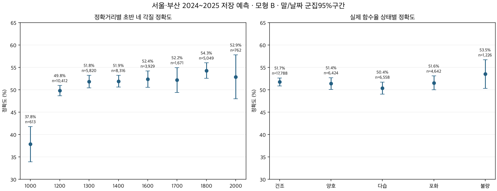
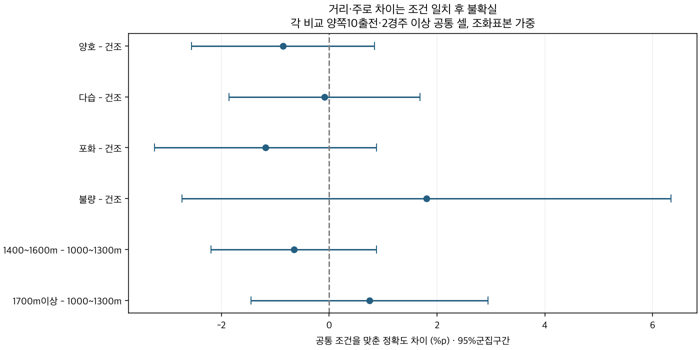

# 거리·함수율별 각질 예측 성능과 모델 활용

2026-10-08 · 연구28 후속28E · 서울·부산 · 평가2024~2025 · 연구 후보.

**각질·구간 기록·편성을 이용한 초반 위치 예측에는 도움이 됐다. 최근5전 각질 빈도 H의44.46%에서 기수·조교사·교체 입력을 뺀 N은51.51%, 안팎 전원 확장 B는51.47%였다. B−H 정확도 차이는+7.00%p [6.48,7.53]이고 확률오차도 줄었다. 이 비교는 입력 묶음과 학습 방식 전체의 차이이며 개별 특징 하나의 효과가 아니다.**

거리별 관측 정확도는1000~1300m50.07%,1400~1600m52.05%,1700m이상53.63%였다. 공통 조건을 맞추면 중거리−단거리−0.66%p [-2.19,0.88],1700m이상−단거리+0.75%p [-1.45,2.95]로 차이가 불확실했다. 함수율별 관측 정확도는50.37~53.51%였으며 건조와의 네 상태 비교 모두 조건 일치 후95%구간이0을 포함했다. 거리·주로별 별도 모형이나 추가 보정의 개선이 입증된 결과는 아니다.

## 모델로 만들거나 기존 모델에 넣을 가치

이미28C/28D에서 초반200m 통과조 네 위치의 연구 모형을 만들었다. 선행은 첫 마군 전체, 선입은 그 밖의 마군 평균 상대위치1/3 이내, 중단은2/3 이내, 나머지는 후미다. 작전 의도·전체 주행경로·막판 추입 성공은 별도 목표다.

| 모형 | 출전 | 정확도 | Brier |
|---|---|---|---|
| H | 36,638 | 44.5% | 0.670743 |
| N | 36,638 | 51.5% | 0.602899 |
| A | 36,638 | 51.5% | 0.602397 |
| B | 36,638 | 51.5% | 0.602440 |

H는 이전28C에 저장된 최근5실제슬롯의 각질 빈도와 사전값을 이용한 기준 예측이고, N/A/B는28D의 고정 연도별 LightGBM이다. N157입력, A202입력, B297입력. N/A/B는 기수·조교사 식별자·성향·기수 교체 입력도 제외했다. 과거 말 기록 속 기수 영향까지 인과적으로 제거했다는 뜻은 아니다. B와 이전28C의 기준 B는 이름만 같고 다른 모형이므로 이번 문서의 B는28D 확장만 가리킨다.

N−H 정확도+7.04%p [6.52,7.57], Brier−0.067844 [-0.070674,-0.065014]. B−H는 정확도+7.00%p [6.48,7.53], Brier−0.068303 [-0.071155,-0.065451]. 거리3군·함수율5상태 모두 B−H 정확도와 Brier가 탐색 BH 후 개선 방향으로 남았다. 같은 기간에 측정한 동일 출전 쌍 비교다.

기존 전체 상대를 이미 반영한 N을 A/B로 더 확장한 효과는 훨씬 작다.28D의 A−N Brier−0.000502 개선과 B−A+0.000043 불확실 결론을 유지한다. 이번 B−A 정확도−0.02%p [-0.19,0.15], Brier95%구간[-0.000229,0.000315]. 전체정보가 유용하다는 결과를297입력이157입력보다 우수하다는 주장으로 바꾸지 않는다.

입상 모델에 연결하는 질문은 구분한다. [기존 연결 실험](../20261004_pace_finish_stack_v1/README.md)에서 직접 전개·게이트·기수·심사 이력 묶음 추가는 부산 삼복 상위6조합25.91→27.74%로 개선됐지만, 그 위에 당시 S1F/G3F 예측값을 추가하면 서울29.81→29.81%, 부산27.74→27.49%로 추가 개선이 확인되지 않았다. 그 모형은 이번 통과조 모형과 목표·기간·입력 범위가 다르다. 이번 새 네 확률을 현재 입상/운영 모델에 넣은 비교 학습은 하지 않았고, 그 개선은 미검증이다.

활용 후보는 출전마의 네 위치 확률과 과거 초반/막판·편성 정보를 함께 제공하는 것이다. 하나의 각질 이름으로 고정하기 전에 선입 문제를 보완하고, 입상 연결은 직접 입력 기준과 시간순 외부 예측 추가 후보를 같은 경주에서 비교해야 한다. 직접 정보와 예측값을 중복 가산하지 않는다. 별도 거리 모형·현재 함수율 추가·가중치 변경·운영 채택은 이번 결과로 확정하지 않았다.

## 거리별 결과

| 거리(m) | 출전 | 경주 | 정확도 | 95% 하한 | 95% 상한 |
|---|---|---|---|---|---|
| 1000 | 613 | 59 | 37.8% | 33.9% | 41.8% |
| 1200 | 10,412 | 971 | 49.8% | 48.7% | 51.0% |
| 1300 | 5,820 | 553 | 51.8% | 50.4% | 53.2% |
| 1400 | 8,316 | 786 | 51.9% | 50.6% | 53.2% |
| 1600 | 3,929 | 376 | 52.4% | 50.6% | 54.2% |
| 1700 | 1,671 | 167 | 52.2% | 49.4% | 54.9% |
| 1800 | 5,049 | 476 | 54.3% | 52.5% | 56.0% |
| 2000 | 762 | 71 | 52.9% | 48.0% | 57.8% |
| 2200 | 8 | 1 | 50.0% | 미산출 | 미산출 |
| 2300 | 58 | 5 | 50.0% | 15.3% | 84.7% |

2200m8출전1경주,2300m58출전5경주는 안정적인 정확도로 읽을 수 없다.2200m은 경주일이1개여서 군집구간을 산출하지 않았다.2000m도762출전71경주로 구간이 넓다. 정확거리 전체와 지역별 결과는 [성능 원표](outputs/condition_metrics.csv)를 따른다.

1200m49.81%,1800m54.27%로 차이가 관측됐다. 서울은1200m48.92%/1800m53.00%, 부산은51.07%/55.52%였다. 연도별 거리군도2024년49.82/51.31/52.94%,2025년50.35/52.76/54.24%로 같은 순서였다. 그러나 같은 말·같은 등급/두수/지원의 거리 효과로 확정할 수 없다.

1000m613출전은 최근5슬롯 모두 유효 각질인 지원 표본이0%였고, 과거 유효 위치 평균은0.18전이었다. 반면1800m의 지원율90.69%,유효 위치 평균4.88전이다.1000m의37.85%를 거리 자체의 어려움이나 모든 신마의 정확도로 일반화하지 않는다. 이력 부족이 크게 섞인 관측이다. [이력 지원표](outputs/history_support_by_distance.csv).

## 주로 상태별 결과

실제 함수율을 사후 평가 조건으로 연결했다. 건조2~5%,양호6~9%,다습10~14%,포화15~19%,불량20%다. 기존 context의 함수율789결측도 API4_3 원문 track로 복구하여 전체36,638출전을 유지했다. 기존에 있던35,849개 함수율과 원문이 일치했다. 주로빠르기는 사용하지 않았다.

| 함수율 상태 | 출전 | 경주 | 정확도 | 95% 하한 | 95% 상한 |
|---|---|---|---|---|---|
| 건조 | 17,788 | 1,674 | 51.7% | 50.8% | 52.6% |
| 양호 | 6,424 | 603 | 51.4% | 50.1% | 52.7% |
| 다습 | 6,558 | 622 | 50.4% | 49.0% | 51.7% |
| 포화 | 4,642 | 447 | 51.6% | 50.0% | 53.1% |
| 불량 | 1,226 | 119 | 53.5% | 50.3% | 56.7% |

불량이53.51%로 가장 높다고 비가 오면 더 잘 맞힌다고 말할 수 없다. 불량은2024년51.16%,2025년55.47%이고 표본도1,226출전119경주다. 다습은 서울49.59%/부산53.67%로 지역별 양상도 다르다. 원표에는 지역·연도·거리군×함수율 교차표를 모두 보존했다.

28D의 실제 경주 함수율은 원래 예측 입력에 없었다. 이번 층화 결과는 이미 만들어진 모형이 어떤 실제 상태에서 맞았는지를 확인한 것이며 현재 주로를 알고 예측한 성능이 아니다. T−2 예측시점에 실제 당일 함수율을 알 수 있다고 가정하지 않는다. [이전 함수율 실험](../20261003_pace_gate_moisture_v2/README.md)도 과거 전체기록의 함수율 환산 추가가 전개 순위를 더 개선했다는 근거는 얻지 못했다. 기록 비교의 환경 보정 가치와 현재 위치 예측 추가 가치는 구분한다.

## 공통 조건을 맞춘 차이

| 비교 조건 | 기준 | 공통 셀 | 표본 포함률 | 보정 차이(%p) | 95% 하한 | 95% 상한 | BH q |
|---|---|---|---|---|---|---|---|
| 양호 | 건조 | 149 | 69.7% | -0.86 | -2.56 | +0.84 | 0.605 |
| 다습 | 건조 | 121 | 57.9% | -0.09 | -1.86 | +1.69 | 0.924 |
| 포화 | 건조 | 116 | 55.5% | -1.18 | -3.24 | +0.88 | 0.605 |
| 불량 | 건조 | 29 | 21.5% | +1.81 | -2.73 | +6.34 | 0.605 |
| 1400~1600m | 1000~1300m | 179 | 80.3% | -0.66 | -2.19 | +0.88 | 0.605 |
| 1700m이상 | 1000~1300m | 100 | 57.4% | +0.75 | -1.45 | +2.95 | 0.605 |

함수율 비교: 지역×정확거리×연도×등급×두수군(9이하/10~11/12이상)×최근5지원이 같은 셀. 거리군 비교: 지역×연도×등급×두수군×함수율 상태×지원이 같은 셀. 각 비교의 양쪽10출전·2경주 이상 셀만 포함하고 nA*nB/(nA+nB) 가중치로 셀 차이를 평균했다. 공통 표본에 한정한 기술적 표준화이며 전체 모집단 평균이나 인과효과가 아니다. 불량−건조 포함률21.51%로 특히 제한적이다. 두수군 안 잔여 차이·세부 능력·연령·현재 각질 구성·기수·작전 등은 남는다.

단순 거리군 차이+1.98/+3.56%p가 조건 일치 후−0.66/+0.75%p로 줄었다. 이력과 등급 등 표본 구성이 관측 차이에 기여한다는 해석과 맞지만 어느 변수 하나의 원인 비중을 분해한 결과는 아니다. 거리와 함수율 효과가 없다고 입증한 것도 아니다.6대비 BH q는 모두0.60이상이다.

## 선입 약점은 조건별로도 반복

| 조건 | 실제 선입 | 선입 예측 | 선입 적중 | 선입 재현율 |
|---|---|---|---|---|
| 1000~1300m | 1,794 | 49 | 18 | 1.0% |
| 1400~1600m | 1,285 | 32 | 8 | 0.6% |
| 1700m이상 | 962 | 50 | 19 | 2.0% |
| 건조 | 1,948 | 60 | 29 | 1.5% |
| 다습 | 726 | 29 | 3 | 0.4% |
| 불량 | 123 | 4 | 1 | 0.8% |
| 양호 | 733 | 17 | 8 | 1.1% |
| 포화 | 511 | 21 | 4 | 0.8% |

실제 선입4,041건 중 최댓값 분류가 선입인 적중45건,재현율1.11%다. 전체 정확도51.47%와 네 클래스 재현율 평균43.50%를 함께 읽는다. 중단/후미 대 선행/선입의 두 범주 분류 정확도는75.13%지만 더 쉬운 다른 목표이므로 네 각질 정확도 개선처럼 표현하지 않는다. 선입 평균 확률10.56%와 실제 비율11.03%가 가까워도 각 말의 선입 확률이 교정됐거나 선입을 잘 식별한다는 증거는 아니다.

따라서 현재 후보는 큰 앞뒤 방향 설명에 활용 여지가 있고, 선행/선입을 세밀하게 고정하는 의사결정에는 약점이 있다. 순서형 위치 예측·앞뒤 단계 분류·확률 교정 등은 이후 비교할 후보이지 이번에 성능을 확인한 해결책은 아니다.

## 검증과 시점

평가2024년 모형은2023년까지,2025년은2024년까지 학습했다. 최근5/10실제슬롯·T−2·최대730일·전년까지의 환경 기준을 재사용한다. 이번에는 모형 재학습0개이며 실제 위치나 현재 함수율을 입력으로 다시 예측하지 않았다. 이미 이전 후속연구에서 사용한 평가기간이므로 미관측 미래의 새 검증 결과가 아니다. 역사적 명단 공표/정정시각은 미감사다. 유효 실제 각질이 있는 출전의 정확도이며 결측 정답을 후미로 메우지 않는다.

말·날짜·말날짜 점수합으로 이중 군집분산을 계산하며 단일 군집과 이중 군집 중 최대분산,t(최소군집수−1)의95%구간을 사용한다. 정확도 구간의0~1 밖 값은 자르지 않은 근사 구간이다. 작은 경주/날짜 표본은 별도 표시한다. 주 비교 전체3대비×2지표와 거리3군/상태5군×3대비×2지표는 별도 BH군이다. 공통 조건6대비도 별도 BH다. 자세한 계산 전 규칙은 [계획](PLAN.md)을 따른다.

독립 원문 경주/말 키 연결·SQL 평균/인원·원래 저장 확률 일치·다른 군집 집계·혼동표·공통셀/가중치·BH·이전 파일 보존 검증을 통과했다. 검사 1,516,217개,이전 공유 파일을 제외한 168파일 보존. [검증 JSON](outputs/verification.json). 운영/DB/웹 배포는 변경하지 않았다.

[출처](SOURCES.md) · [조건별 성능](outputs/condition_metrics.csv) · [각질별 성능](outputs/class_metrics.csv) · [혼동표](outputs/confusion_tables.csv) · [동일출전 차이](outputs/paired_comparisons.csv) · [공통조건 차이](outputs/standardized_contrasts.csv) · [공통 셀](outputs/standardized_cells.csv) · [게시요약](PUBLICATION.md) · [게시JSON](PUBLICATION.json) · [용량](outputs/SIZE_REPORT.md).

