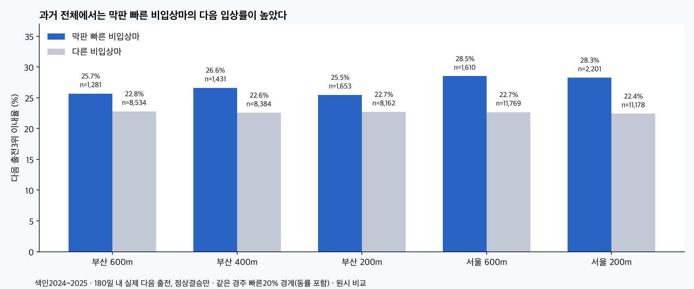
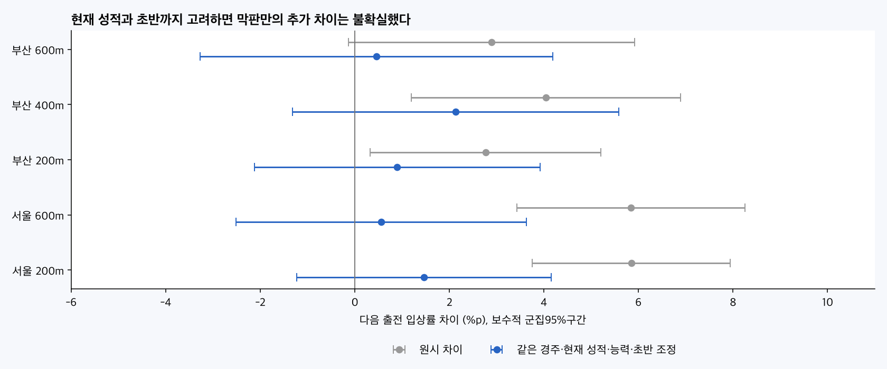
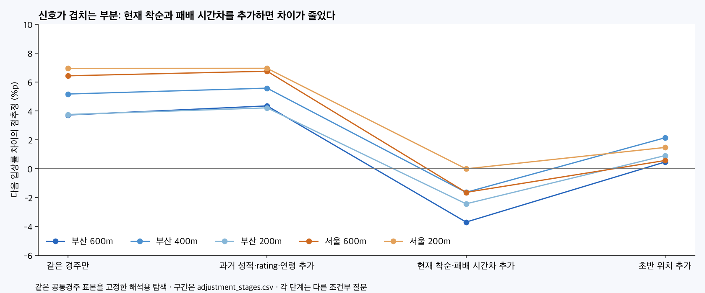

# 막판 우수·비입상 이후의 입상 관측

2026-10-09 · 연구28 후속28H · 연구 후보 · 예측모델/운영/DB/배포 변경 없음.

막판이 빠르면서 비입상한 말은 과거 전체에서 다른 비입상마보다 다음 입상률이 대체로 높았다. 그러나 현재 착순·패배 시간차·기존 능력·초반 위치까지 고려한 추가 효과는 불확실했고,2026초반 후속관측에서도 안정적으로 재현되지 않았다.

## 질문과 표본

현재 경주에서4위 이하였더라도 막판600/400/200m가 빠른 말은 이후 입상 가능성이 높은가? 원문 전체159,014실전·14,636경주를 시간순으로 연결했다. 다음출전 연결에는 정상구간 모집단 밖의 실제출전도 포함해 나쁜기록이나이상결승을 건너뛰지 않았다.

색인2024~2025 전체37,345출전·3,532경주 중 기존정상구간 품질을 만족한4위이하 기록은부산10,881·서울14,787출전이다. 같은경주 구간기준까지지원되는주표본은부산10,874·서울14,787출전이다. 자료종료일서울2026-09-20·부산2026-09-18,공통미래관측종료일2026-09-18.180일성숙조건의2026색인마감은2026-03-22다. 이후색인출전을실패로채우지않았다. 과거2018~2023은기술표에분리했다. 제주·영천·주행심사·주로빠르기는제외한다.

## 구간과 ‘좋은 기록’ 정의

부산 마지막600/400/200m는원문bu_3fGTime/bu_2fGTime/bu_1fGTime이며전체시간−G3F/G2F/G1F누적시간과대조했다. 서울 마지막600/200m는전체시간−seG3fAccTime/seG1fAccTime. 서울400m를추정하지않았다. 부산600→400,400→200,마지막200의독립200m세조각 합이600m와같음을검증했으나,주지표는중첩하는마지막600/400/200초다. 이점수들을합산하지않는다.

기존151,074정상구간품질모집단을재사용했다. 부산400m만별도로원문양수/누적합/600≥400≥200을확인해1행을제외했다(2020-11-22R1,누적G2F0·마지막400이전체시간으로들어간기록). 부산400정상62,830행,600/200은62,831행,서울600/200은88,243행이다. 정상적으로빠르거나느린기록을효과방향에맞춰절삭하지않았다.

주정의는현재경주전체 유효구간시간의P20이하,최소6두·전체명단80%이상구간지원. 현재입상마도기준계산에포함하며4위이하말들끼리만상위20%를뽑지않았다.0.1초동률을모두포함하므로실제빠른그룹비중은20%를넘는다.

| 지역구간 | 전체유효 | 빠른경계포함 | 실제선택비율 |
|---|---|---|---|
| 부산 600m | 15005 | 3997 | 26.64% |
| 부산 400m | 15005 | 4053 | 27.01% |
| 부산 200m | 15005 | 4233 | 28.21% |
| 서울 600m | 20835 | 5488 | 26.34% |
| 서울 200m | 20835 | 5793 | 27.80% |

보조정의는평가연도이전3개연도의동일지역×정확거리×등급×함수율상태P20,최소100출전·10경주다. 함수율1~5/6~9/10~14/15~19/20이상. 연초고정이라평가연도/미래기록을문턱에넣지않았다. 표본부족은다른거리/등급으로채우지않았다. 이보조기준은상태내정확함수율·월까지완전히맞춘보정값이아니며,같은현재경주비교는이환경차이를경주절편으로제거한다.

현재경주의기록과착순은경주후선별용으로알려진정보다. 경주전현재성적을알고예측했다는뜻이아니다. 과거평균착순/유효이력수는기존T−2·730일·직전5실제슬롯을사용했다.

## 다음 출전 입상률: 원시와 조건조정을 나눠 읽는다

다음출전은말별전체실제명단의바로다음1슬롯이며180일안의서울/부산출전만유효다. 정상순위1..N 중1~3위면1,4위이하면0,이상순위는NaN이다. ‘다음정상출전’을찾아뒤기록으로넘어가지않았다. 미래편성의등급·거리·게이트를조정입력에사용하지않았다.

| 구간 | 빠른비입상마 다음입상률(n) | 다른비입상마(n) | 원시차이%p[95%] | 조건조정 차이%p[95%] |
|---|---|---|---|---|
| 부산 마지막600m | 25.68% (1,281) | 22.79% (8,534) | +2.89 [-0.13, +5.92] | +0.45 [-3.28, +4.18] |
| 부산 마지막400m | 26.62% (1,431) | 22.58% (8,384) | +4.05 [+1.20, +6.89] | +2.13 [-1.32, +5.59] |
| 부산 마지막200m | 25.47% (1,653) | 22.70% (8,162) | +2.77 [+0.32, +5.21] | +0.90 [-2.12, +3.92] |
| 서울 마지막600m | 28.51% (1,610) | 22.67% (11,769) | +5.84 [+3.43, +8.25] | +0.56 [-2.52, +3.63] |
| 서울 마지막200m | 28.26% (2,201) | 22.41% (11,178) | +5.85 [+3.76, +7.94] | +1.46 [-1.23, +4.15] |

원시비교에서부산400/200,서울600/200은다중비교BH후차이가남았지만부산600은q=.087로불확실했다. 부산400점추정이가장크다고다른구간보다우월한신호임을검증한것은아니다. 구간과말/경주는겹친다.

조건조정은현재경주절편(양상태모두있는공통경주),현재착순범주,우승마와전체시간차,과거5슬롯평균상대착순/유효수,현재rating·연령,초반상대위치의일차/제곱·결측표시다. 같은경주로거리·등급·주로·편성환경을맞췄다. 연속변수결측은계산을위해0또는0.5와결측표시를사용했으며관측값으로확정하지않았다. 현재착순/전체기록을통제하면‘그성적까지이미알고도막판기록에추가정보가있는가’라는다른질문이된다.

현재경주평균을제거한뒤노출/결과를통제변수에잔차화한선형연관성계수다. 다섯구간모두증가의95%구간이0을포함했다. 조정후확률그자체를만들거나개별마에게그%p를더하지않는다. 다음출전공통경주피복은63.2~79.2%,과거문턱보조는28.5~52.0%로표본이달라진다.

## 어느 정보를 맞추면 차이가 줄어드는가

주결과를본뒤해석용단계분해를추가했다. 각구간의같은공통경주표본을고정한탐색이며주검정을대체하지않는다. 단위%p[95%].

| 구간 | 경주만 | 과거능력추가 | 현재착순·패배시간차추가 | 초반추가=주조정 |
|---|---|---|---|---|
| 부산 600m | +3.71 [+0.45, +6.97] | +4.34 [+1.20, +7.48] | -3.71 [-7.17, -0.24] | +0.45 [-3.28, +4.18] |
| 부산 400m | +5.17 [+2.01, +8.32] | +5.57 [+2.53, +8.61] | -1.65 [-4.93, +1.64] | +2.13 [-1.32, +5.59] |
| 부산 200m | +3.75 [+1.06, +6.44] | +4.21 [+1.54, +6.87] | -2.44 [-5.31, +0.42] | +0.90 [-2.12, +3.92] |
| 서울 600m | +6.43 [+3.88, +8.97] | +6.74 [+4.21, +9.28] | -1.65 [-4.42, +1.12] | +0.56 [-2.52, +3.63] |
| 서울 200m | +6.94 [+4.70, +9.18] | +6.94 [+4.70, +9.19] | -0.02 [-2.53, +2.50] | +1.46 [-1.23, +4.15] |

같은경주와과거성적/rating/연령만맞춰도빠른비입상마의다음입상신호는남았다. 현재착순과패배시간차를추가하면대체로0근처로줄었고,초반위치추가시다소바뀌지만주조정은모두불확실했다. ‘과거능력만으로설명된다’고단정하지않는다. 부산600의현재성적단계음수만골라역효과라고채택하지않았다. 미래예측성능추가가치는별도의시간순학습/평가가필요하다.

## 재출전과3전 조건

| 구간 | 빠른그룹 재출전율(색인n) | 다른그룹 재출전율(n) | 당시평균착순 빠름/다른 | 다음출전중앙간격 빠름/다른 |
|---|---|---|---|---|
| 부산 600m | 95.75% (1,341) | 89.74% (9,533) | 5.64/7.82 | 28/29일 |
| 부산 400m | 95.03% (1,510) | 89.75% (9,364) | 5.75/7.85 | 28/29일 |
| 부산 200m | 94.69% (1,750) | 89.68% (9,124) | 5.89/7.88 | 28/30일 |
| 서울 600m | 94.78% (1,704) | 90.21% (13,083) | 5.48/7.50 | 34/35일 |
| 서울 200m | 94.35% (2,338) | 90.06% (12,449) | 5.76/7.55 | 34/35일 |

빠른그룹이재출전할비율도약94~96%대90%로높았다. 재출전하지않은말을다음출전입상실패0으로채우지않았다. 군집을고려해도이차이가컨디션/휴양/퇴역/전적누락의인과효과임을알수는없다. 재출전표본의예측대상과전체색인의향후관측사건을구분한다.

‘3전내입상’은180일안에실제3번모두출전하고세성적정상관측이있는말의그3전중1회이상3위사건이다. 중간이상결승을건너뛰지않으며,한번성공했어도3출전지원이없으면주3전지표에는넣지않았다. 따라서재출전지속에따른선택편향이있다.

| 구간 | 빠른그룹3전내 입상률(n) | 다른그룹(n) | 원시차이%p[95%] | 조건조정%p[95%] |
|---|---|---|---|---|
| 부산 600m | 53.85% (1,066) | 52.95% (6,523) | +0.90 [-4.89, +6.68] | -2.42 [-9.50, +4.65] |
| 부산 400m | 55.30% (1,188) | 52.66% (6,401) | +2.64 [-2.97, +8.24] | -0.56 [-7.56, +6.44] |
| 부산 200m | 53.70% (1,378) | 52.94% (6,211) | +0.76 [-4.40, +5.92] | -2.13 [-8.19, +3.94] |
| 서울 600m | 59.63% (1,246) | 53.30% (8,857) | +6.33 [+1.14, +11.52] | +1.50 [-4.79, +7.80] |
| 서울 200m | 59.99% (1,722) | 52.87% (8,381) | +7.12 [+2.44, +11.80] | +3.72 [-2.02, +9.47] |

서울600/200은원시3전입상차이가있었지만조건조정후불확실했다. 부산은원시도불확실했다. any180_top3는180일전체색인에서최대첫3전중입상이관측됐는지의별도사건으로,미출전=관측입상없음0이다. 이것을재출전마의경기입상확률과혼동하지않았다. 이상결승을0으로놓는next_abnormal_zero민감도도저장했다.

## 과거조건 기준과 같은말 민감도

| 구간 | 과거문턱빠름 다음입상률(n) | 다른비입상마(n) | 원시차이%p[95%] | 같은경주조건조정%p[95%] | 문턱피복 |
|---|---|---|---|---|---|
| 부산 600m | 27.30% (575) | 22.39% (7,319) | +4.91 [+0.67, +9.15] | -1.45 [-7.75, +4.84] | 80.1% |
| 부산 400m | 27.92% (942) | 22.05% (6,952) | +5.87 [+2.46, +9.28] | +5.05 [-0.02, +10.13] | 80.1% |
| 부산 200m | 26.46% (1,164) | 22.11% (6,730) | +4.35 [+1.35, +7.35] | +2.66 [-1.61, +6.93] | 80.1% |
| 서울 600m | 33.49% (1,039) | 22.56% (9,778) | +10.93 [+7.82, +14.05] | +3.17 [-2.10, +8.43] | 80.7% |
| 서울 200m | 31.79% (1,038) | 22.74% (9,779) | +9.05 [+5.94, +12.16] | +2.01 [-2.54, +6.55] | 80.7% |

과거절대조건문턱에서는서울600/200의원시신호가더컸지만조건조정구간은0포함이다. 기준이없는최근등급조합을제외하므로같은경주P20과같은모집단은아니다.

같은말×지역×정확거리×등급에서빠른비입상/다른비입상상태를각1회이상보인공통셀조화표본가중 민감도(현재착순/컨디션은별도로맞추지않음)는다음과같다.

| 구간 | 같은말 다음입상 차이%p[95%] | 빠름/다른n | 피복 | BH q |
|---|---|---|---|---|
| 부산 600m | +3.23 [-0.69, +7.15] | 851/1642 | 25.4% | 0.211 |
| 부산 400m | +3.11 [-0.64, +6.86] | 937/1722 | 27.1% | 0.211 |
| 부산 200m | +2.43 [-0.84, +5.70] | 1070/1899 | 30.2% | 0.264 |
| 서울 600m | +5.23 [+2.03, +8.42] | 1048/2059 | 23.2% | 0.00733 |
| 서울 200m | +5.22 [+2.35, +8.09] | 1368/2412 | 28.3% | 0.00424 |

서울같은말의신호는남았으나같은말도당시착순·패배시간차가다르므로완전조정의대체가아니다. P10/P30 문턱 민감도·4~5/6~8/9+착순대·거리별기술표를따로보존했다. 결과가좋은문턱으로주정의를바꾸지않았다.

## 2026 성숙자료에서 재현됐는가

2026-01-01~03-22색인만180일을완전히볼수있다. 주정의의다음입상은다음과같다.

| 구간 | 빠른그룹(n) | 다른그룹(n) | 원시차이%p[95%] | BH q |
|---|---|---|---|---|
| 부산 600m | 22.70% (185) | 19.71% (1116) | +2.99 [-4.00, +9.98] | 0.954 |
| 부산 400m | 25.71% (210) | 19.07% (1091) | +6.65 [-1.06, +14.36] | 0.615 |
| 부산 200m | 23.98% (246) | 19.24% (1055) | +4.74 [-2.99, +12.47] | 0.911 |
| 서울 600m | 22.17% (203) | 23.78% (1371) | -1.61 [-7.92, +4.69] | 0.954 |
| 서울 200m | 24.90% (257) | 23.31% (1317) | +1.59 [-5.33, +8.51] | 0.954 |

다섯구간모두원시구간0포함으로안정적증가를확인하지못했다. 서울600원시점추정은반대방향,같은경주조정은−10.62%p[−20.41,−0.83]였으나BH q=.348이어서역효과를확정하지않았다. 기간이짧고색인날짜군집이적어불확실성이크다.

부분연도와전체연도를그대로비교하지않도록각연도1월1일~3월22일만맞춘원시율도보존했다. 아래각칸은빠름/다른그룹의다음입상률이며연도차이의인과검정이아니다.

| 구간 | 2024~2025 같은달범위 | 2026 같은달범위 |
|---|---|---|
| 부산 600m | 18.77% / 22.03% | 22.70% / 19.71% |
| 부산 400m | 20.50% / 21.79% | 25.71% / 19.07% |
| 부산 200m | 17.93% / 22.30% | 23.98% / 19.24% |
| 서울 600m | 27.45% / 22.98% | 22.17% / 23.78% |
| 서울 200m | 27.60% / 22.75% | 24.90% / 23.31% |

2024~2025초반부산은오히려빠른그룹입상률이낮았다. 시기별로일률적인법칙이아니다.2026자료는과거연구와말/이력이공유되는후속관측이고별도의미래예측정확도검증이아니다.

## 사례

2025색인에서600m좋음·비입상·다음출전정상인표본중,지역별다음입상성공/실패를각하나씩날짜·경주·게이트순첫사례로선택했다. 성공/실패를보여주는사후설명사례이며검정/사전추천이아니다.

| 지역 | 마명 | 색인날짜 | 당시착순 | 600초 / 경주P20 | 다음날짜 | 다음착순 | 간격일 |
|---|---|---|---|---|---|---|---|
| 부산 | 오버더앨리 | 2025-01-03 | 4 | 39.6 / 40.2 | 2025-02-07 | 3 | 35 |
| 부산 | 골드마스크 | 2025-01-03 | 5 | 41.7 / 41.8 | 2025-02-28 | 6 | 56 |
| 서울 | 레이디폭스 | 2025-01-04 | 9 | 38.7 / 38.7 | 2025-05-24 | 1 | 140 |
| 서울 | 리버태양 | 2025-01-04 | 7 | 38.0 / 38.0 | 2025-02-16 | 7 | 43 |

## 불확실성·검증·적용

말·색인날짜·교차점수합최대분산에공유미래경주날짜의점수합분산을추가해최댓값을썼다.3전지표는세미래날짜에점수를중복배치한보수적민감도라구간이넓다. t 자유도는말/색인날짜/유효미래날짜군집수최솟값−1,회귀잔차자유도수정n/(n−경주절편수−통제행렬rank−1). 동일말의출전과동일미래성적이여러색인에겹치는것을독립표본으로보지않았다. 지역5구간×두정의×다음/3전입상20비교를기간·방법별BH. 재출전/180일사건/이상결승0/문턱/단계분해는보조탐색이다.

막판우수·비입상은다시볼후보를추리는정보다. 이미보이는착순·패배시간차와정보가겹치며단독확률가산점이나개별마예측확률은만들지않았다. 미래출전에서는편성·거리·등급·주로·게이트·휴양·컨디션이달라질수있다. 기수/조교사효과나실제외측경로/전술의도를추가추정하지않았다. 입상실패의이유/다음경주작전변경/능력향상의인과효과를입증한연구가아니다.

원문159,014행의600/400/200와누적합,독립SQL LEAD 전체미래슬롯/180일/결측,현재/과거문턱연결,요약·회귀·같은말공통셀·군집구간/BH와원래1,208파일보존을검증했다. 보조단계80회귀와착순/거리/동일달범위221요약행도독립계산했다. 수치검증결과는JSON을따른다.

[설계](PLAN.md) · [출처/입력해시](SOURCES.md) · [출전자료](outputs/analysis_rows.parquet) · [주요표](outputs/primary_summary.csv) · [전체비교](outputs/comparisons.csv) · [과거문턱](outputs/prior_thresholds.csv) · [3전/재출전](outputs/cohort_metrics.csv) · [단계분해](outputs/adjustment_stages.csv) · [거리별](outputs/distance_metrics.csv) · [같은달확인](outputs/same_calendar_confirmation.csv) · [검증](outputs/verification.json) · [민감도검증](outputs/sensitivity_verification.json) · [게시MD](PUBLICATION.md) · [게시JSON](PUBLICATION.json) · [용량](outputs/artifact_inventory.json).
