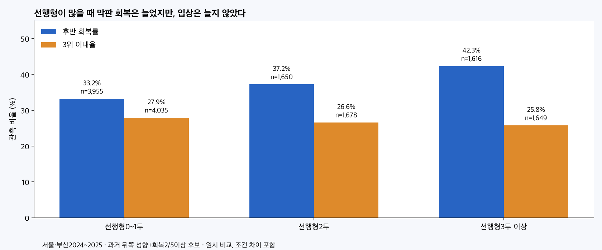
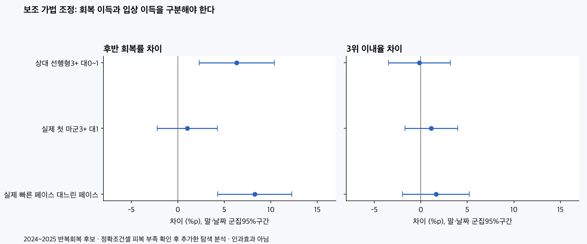
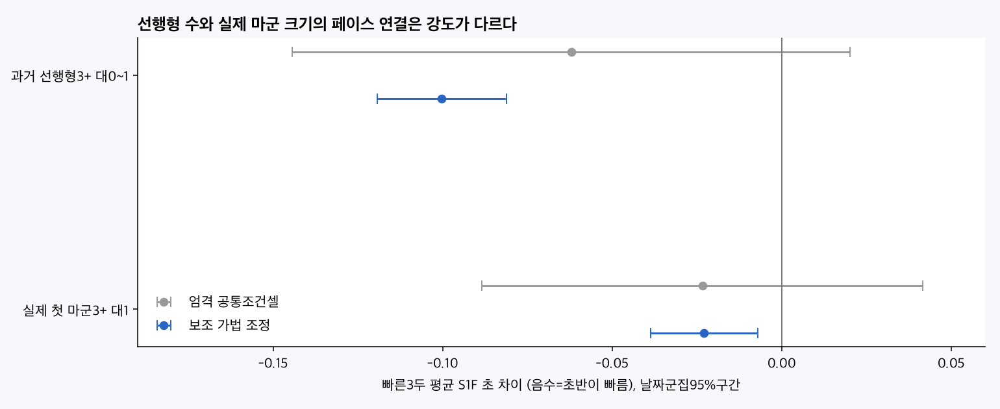

# 선행 밀집과 뒤쪽형 이득의 관측 검증

2026-10-09 · 연구28 후속28G · 연구 후보 · 새 예측모델/운영/DB/배포 변경 없음.

선행형이 많은 편성과 빠른 초반 페이스에서 뒤쪽형의 막판 순위 회복이 늘어나는 근거는 있다. 그러나 추입형이나 선입형의3위 이내 확률이 일률적으로 오른다는 근거는 확인되지 않았다. 실제 첫 마군의 말 수만으로 뒤쪽형 유리를 판정하는 근거도 약하다.

## 표본과 분류

| 기간 | 전체 출전 | 경주 | S1F페이스 유효경주 | 과거페이스 기준 지원 | 반복회복후보 출전 |
|---|---|---|---|---|---|
| 2024~2025 | 37,345 | 3532 | 3465 | 3104 | 7376 |
| 2026부분 | 13,714 | 1295 | 1264 | 1147 | 2613 |
| 2018~2023 | 107,955 | 9809 | 9577 | 6232 | 17250 |

전체159,014출전·14,636경주. 종료일 서울2026-09-20·부산2026-09-18. 첫연도2018은 과거 조정/이력이 제한적이며 주검정에 포함하지 않는다.2026은 부분연도 후속관측으로 독립 외부검증이나 완결연도 비교가 아니다.2018~2023 기술표도 저장했다. 제주·영천·심사·주로빠르기를 제외한다.

과거 선행형은T−2 기준730일 안의 직전5실제슬롯 모두 통과조 유효이며 선행3회이상이다. 뒤쪽형은중단+후미3/5,반복회복후보는뒤쪽형 중 직전5회복 사건 모두 유효이며2/5이상. 분류는 출전 시점마다 달라진다. 이력이 부족한 말은 비선행형으로 확정한 것이 아니라 미분류다. 전체명단의지원비율과80%이상 민감도를 별도 보존했다.

통과조 첫 마군은 모두 선행으로 분류한다. 첫마군3두는3두가 앞선 조에 있다는 뜻으로,나란히 경합·소모·선행의도·실제 내외측경로의 직접 측정이 아니다. 상대선행형수는 자기 과거선행형을 뺐다. 실제첫마군수는 경주 공통 노출이며 자기 현재첫마군을 뺀 분석도 별도로 했다.

후반회복은 공식G3F(결승600m전)의상대순위 p=(순위−1)/(두수−1)가0.5이상이고 결승까지0.25이상 좋아진 사건이다. 두수11일 때 최소3등 정도 회복이며,3위 입상과 별개다. 정상결승1..N이 아닌 기록/불완전통과순위는 지표별NaN,실패0으로 대체하지 않았다. 정상성적 기준3/5위율과비정상결승표시를 함께 저장했다.

## 원시 관측: 회복과 입상을 나누면 답이 달라진다

| 편성 선행형 | 후보 출전 | 회복 유효 | 회복률 | 3위 유효 | 3위율 |
|---|---|---|---|---|---|
| 0~1 | 4,040 | 3,955 | 33.20% | 4,035 | 27.91% |
| 2 | 1,681 | 1,650 | 37.21% | 1,678 | 26.58% |
| 3+ | 1,655 | 1,616 | 42.33% | 1,649 | 25.77% |

선행형3+ 대0~1의 반복후보 회복 차이는+9.13 [+6.05, +12.21]%p,하지만3위율 차이는−2.13%p[−4.91,+0.65]로 이득을 확인하지 못했다. 전체 뒤쪽형에서도 선행형수에 따른 회복 증가가 관측됐다. 반복회복이 부족했던 뒤쪽형의 회복도 증가하므로 반복후보만의 특수 이득이라고 단정할 수 없다.

## 조건을 맞춘 비교와 보조 조정

아래는 반복회복 후보. 단위%p,대괄호95%구간. 엄격조건은지역×정확거리×등급×연도×정확두수×함수율상태×과거평균착순3구간의 공통셀(각상태5출전·2경주이상),같은말은말×지역×정확거리×등급(각1출전이상)이다. 조화표본가중 w=nA*nB/(nA+nB),각side의 전역가중평균 중심 영향함수. 피복은 두 상태의 해당 유효 출전 중 남은 비중이다.

| 노출 대비 | 지표 | 엄격조건 차이[구간] | 피복 | 같은말 차이[구간] | 보조조정 차이[구간] | 보조BH q |
|---|---|---|---|---|---|---|
| 상대 선행형3+ 대0~1 | 회복 | +4.12 [-6.24, +14.49] | 6.4% | +8.71 [+3.32, +14.10] | +6.34 [+2.29, +10.38] | 0.00766 |
| 상대 선행형3+ 대0~1 | 3위 | -0.29 [-9.37, +8.79] | 6.3% | -4.83 [-9.34, -0.31] | -0.15 [-3.47, +3.18] | 0.99 |
| 실제 첫 마군3+ 대1 | 회복 | -3.20 [-14.19, +7.79] | 7.4% | +1.47 [-3.58, +6.52] | +1.03 [-2.20, +4.27] | 0.67 |
| 실제 첫 마군3+ 대1 | 3위 | +4.93 [-4.23, +14.08] | 7.4% | +1.51 [-2.68, +5.69] | +1.13 [-1.72, +3.98] | 0.615 |
| 실제 빠른 페이스 대느린 페이스 | 회복 | +11.97 [-0.96, +24.91] | 7.4% | +9.49 [+3.68, +15.30] | +8.26 [+4.28, +12.24] | 0.000337 |
| 실제 빠른 페이스 대느린 페이스 | 3위 | -1.51 [-13.85, +10.84] | 7.4% | +0.66 [-4.29, +5.61] | +1.64 [-1.95, +5.22] | 0.615 |

엄격조건셀은 반복후보에서6~8% 정도만 남으므로 전체모집단의 정밀한 결론으로 일반화하지 않는다.2026반복후보의 선행형3+ 대0~1 엄격공통셀은 아예 없으며 결과0이 아니다. 같은말 비교에도 매 출전 컨디션·상대능력·주행경로 차이가 남는다.80%이력지원과현재자기첫마군제외 민감도도 comparisons.csv에 있다.

엄격셀 피복 부족을 확인한 뒤 **탐색 가법조정**을 추가했다. 지역×정확거리×등급×연도 절편+정확두수·정확함수율 범주+과거평균착순·편성평균과거착순·지원비율·게이트상대위치 일차/제곱과결측표시를 썼다. 회복/3위는 선형확률 연관성 회귀이며 예측확률 산출용이 아니다. 연속변수 결측은0.5와결측표시로 계산만 가능하게 했고 미관측마를 같은능력으로 확정하지 않았다. 주대비에 사후 승격하지 않았으며 미포함 상호작용/공통효과 가정이 있다.

과거 뒤쪽형 전체의 엄격셀에서 선행형3+의 회복 차이는+9.46%p[+4.42,+14.49],BH q=.0068,피복11.2%였다. 보조조정에서는+8.31%p[+5.93,+10.69]. 반복후보는같은말+8.71%p[+3.32,+14.10],보조조정+6.34%p[+2.29,+10.38]로 방향이같았다. 단,엄격셀 반복후보 구간은0을 포함한다. 실제첫마군 크기의 회복 이득은 보조조정+1.03%p[−2.20,+4.27]로 불확실했다.

입상은다르다. 반복후보의 보조조정3위 차이는 선행형수−0.15%p[−3.47,+3.18],마군크기+1.13%p[−1.72,+3.98],실제빠름+1.64%p[−1.95,+5.22]. 선입/앞선권형도별도 탐색으로 확인했으나3위 이득은모두불확실했다(엄격선입 표본 특히작음). ‘뒤에 있으면 무조건 유리’ 또는 ‘선입이 대신입상’까지 확인된 것은아니다.

말·날짜·말날짜 점수합의 최대군집분산 max(V말,V날짜,V말+V날짜−V교차,0),t 자유도최소군집−1을 사용한다. 경주단위는horse_id대신경주ID여서 사실상날짜군집이다. 보조회귀는잔차자유도수정 n/(n−rankX). 주3노출×4집단×2결과를기간·방법별BH,선입보조는별도BH. 유의한값만골라전체결론으로표현하지않았다.

## 선행형 수가 실제 빠른 페이스와 연결되는가

S1F빠른3두 평균초. 전체명단 모두양수S1F·공식S1F완전순열일 때만유효이며,결승비정상마도초반관측이유효하면포함한다. 임의이상치절삭없음. 빠름/느림은평가연도이전3개연도 동일지역×정확거리×등급의경주30개이상 Q25/Q75(연초고정)로판정했다. 같은평가연도분위수를정답과함께만들지않았다. 기준부족은다른등급으로대체하지않았다.

| 노출 | 엄격조건 초 차이[95%] | 경주수A/B·피복 | 보조조정 초 차이[95%] |
|---|---|---|---|
| 과거선행형3+ 대0~1 | -0.06 [-0.14, +0.02] | 95/98 · 6.9% | -0.10 [-0.12, -0.08] |
| 실제첫마군3+ 대1 | -0.02 [-0.09, +0.04] | 167/103 · 11.6% | -0.02 [-0.04, -0.01] |

표는소수2자리지만 보조추정정확값은선행형−0.100209초,마군−0.022851초다. 첫마군크기와초반속도는다른측정이다. 엄격공통셀은둘다0포함,보조가법에서는둘다빠른방향이나강도가다르다. 경주단위로집계해두수가많은경주를중복가중하지않았다. S1F는반응/가속/기수행동을포함하며순수반응시간이나경합소모가아니다. 빠른3두의시간은경주전체페이스의보조측정이며선두단독누적시간과같지않다.

반복후보의실제빠름/느림 원시회복률40.73%/34.44%,3위율26.78%/26.56%. 같은말회복차이+9.49%p[+3.68,+15.30],보조+8.26%p[+4.28,+12.24]지만엄격조건+11.97%p[−0.96,+24.91]는불확실하다. ‘선행형수→빠른전개→회복’의관측연결은있으나매개인과효과를분해한것이아니다.

## 회복할 기회와 지역·거리 차이

선행형0~1/2/3+에서반복후보의평균G3F상대위치는0.632/0.660/0.696(클수록뒤)였다. 중간까지더뒤에있어회복기회가커지는부분이섞인다. 현재G3F뒤쪽절반에있었던경우만보면회복률47.04%(n2791)/50.00%(1228)/53.27%(1284)였다. 이는현재위치에조건을건사후기술치로사전예측/완전보정이아니다. 앞선의절대적인체력붕괴나막판절대속도향상으로동일시하지않는다.

지역전체 원시회복은서울33.07→43.54%,부산33.43→41.46%(0~1→3+)였다. 정확거리별은다음과같고,모든거리에서동일하지않았다. 부산1300과서울1800은점추정방향이반대다.2000이상과서울1700의고밀도등희소조건주의;거리별표는탐색기술이며통합효과를복제하지않는다.

| 지역·정확거리 | 선행형0~1 회복률(n) | 선행형3+ 회복률(n) | 원시차이%p | 범위 |
|---|---|---|---|---|
| 부산 1200 | 31.00% (100) | 45.77% (201) | +14.77 | 관측 비교 |
| 부산 1300 | 39.76% (166) | 37.93% (58) | -1.83 | 표본주의 |
| 부산 1400 | 34.26% (359) | 43.72% (215) | +9.46 | 관측 비교 |
| 부산 1600 | 35.53% (380) | 39.53% (172) | +4.01 | 관측 비교 |
| 부산 1800 | 29.74% (343) | 38.49% (278) | +8.75 | 관측 비교 |
| 부산 2000 | 22.45% (49) | 42.11% (19) | +19.66 | 표본주의 |
| 부산 2200 | 0.00% (3) | — | — | 표본주의 |
| 서울 1200 | 40.59% (170) | 46.67% (270) | +6.08 | 관측 비교 |
| 서울 1300 | 33.99% (356) | 44.00% (50) | +10.01 | 표본주의 |
| 서울 1400 | 35.39% (698) | 46.33% (177) | +10.94 | 관측 비교 |
| 서울 1600 | 28.57% (238) | 45.31% (64) | +16.74 | 표본주의 |
| 서울 1700 | 35.37% (376) | 40.91% (22) | +5.54 | 표본주의 |
| 서울 1800 | 30.25% (605) | 25.35% (71) | -4.90 | 표본주의 |
| 서울 2000 | 22.55% (102) | 36.84% (19) | +14.29 | 표본주의 |
| 서울 2300 | 10.00% (10) | — | — | 표본주의 |

## 2026부분 후속관측과 고정사례

보조조정에서뒤쪽형전체 선행형수의회복차이+8.64%p[+4.15,+13.12],실제빠름+9.45%p[+5.20,+13.71]였다. 반복후보는+7.79%p[+0.58,+15.01]이나BH q=.118로불확실성증가,실제빠름+10.44%p[+3.21,+17.67],q=.020였다. 반복후보의3위이득은여전히불확실. 같은말회복도2026에는구간0을포함했다. 부분연도·일자범위가다르고경쟁마이력도공유하므로독립검증으로부르지않는다.

이전연구와같은2경주21두전원을 fixed_example_cards.csv에보존했다. 부산2026-09-18R9 1800m11두:선행형3두·첫마군3두·S1F빠른3두14.2667초. 동등급과거페이스참조미달이라속도등급미판정. 구디11→8→8→5(회복,비입상),스타마타3→5→7→9(회복실패),미스터키맨4→2→2→2(중간진출후입상,후반대회복사건아님). 서울2026-09-20R11 1200m10두:선행형1두·첫마군2두·S1F13.9333초·과거기준느림·이력지원50%. 이스트라코타9→10→10→6으로느린편성에서도회복했지만입상하지않았다. 사례는효과검정이나사전예측성공사례가아니다.

## 적용과 한계

편성의선행형수는빠른전개/뒤쪽순위회복의후보변수로쓸근거가있다. ‘선행형3두이상→추입형입상확률+몇%’의가산점은도출하지않았다. 실제빠름은경주후관측이므로사전에는전개모델로예측해야하며,그예측확률과후반회복/성적을연결한시간순추가가치검증이필요하다. 기수·조교사정보는추가하지않았다. 과거성향수·현재마군크기·실제속도·순위회복·입상을서로다른정보로보존한다. 이번실제페이스는초반200m의대리측정이며중반까지이어지는압박·지속경합을직접측정하지못했다.

관측연관성이며컨디션·상대편성의세부능력·작전·휴양·장비·실제경로·경합압력의인과효과가아니다. 미래과거구분을지켰어도선택편향이자동제거되지는않는다. 현재초반/G3F위치로수혜집단을먼저선택하지않았으나순위회복정의의기회차이는남는다. 전체포디엄자리수제한을고려해정확두수도맞췄다.2026의숫자를2024~2025의독립적인미래예측정확도로표현하지않는다.

## 검증·산출물

[사전설계와추가민감도](PLAN.md) · [출처/해시](SOURCES.md) · [출전자료](outputs/analysis_rows.parquet) · [경주자료](outputs/race_context.parquet) · [원시표](outputs/cohort_metrics.csv) · [조건/같은말/지원/자기제외](outputs/comparisons.csv) · [보조회귀](outputs/additive_adjusted_comparisons.csv) · [선입보조](outputs/following_adjusted_comparisons.csv) · [페이스참조](outputs/pace_thresholds.csv) · [지역거리](outputs/regional_distance_summary.csv) · [검증](outputs/verification.json) · [보조검증](outputs/adjusted_verification.json) · [게시MD](PUBLICATION.md) · [게시JSON](PUBLICATION.json) · [자기포함용량](outputs/artifact_inventory.json).

원문159,014행S1F시간·마필ID,경주전체명단과후보수·자기제외·첫마군수,過去年SQL분위수,1,508요약행,20,365공통셀과전역영향함수군집구간/BH,원래연구1,214파일해시를검증했다. 보조분석76개는독립적인전체설계행렬회귀/의사역행렬로잔차화계산과대조했다. 검증세부와게시후최종검토는각JSON을따른다. 예측모델0개,회귀는관측연관성의민감도분석이다.
