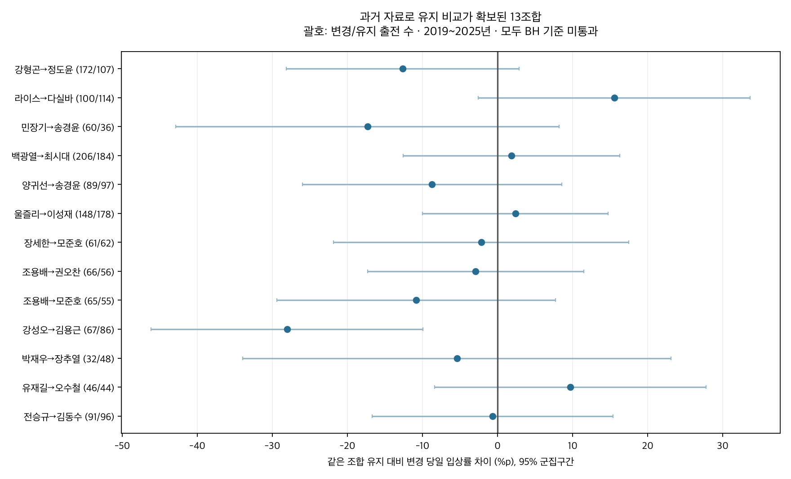
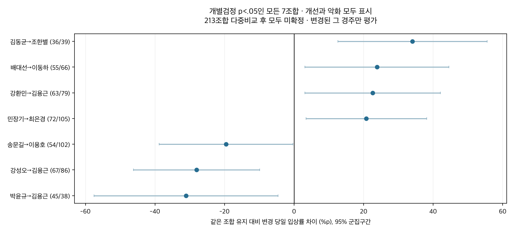
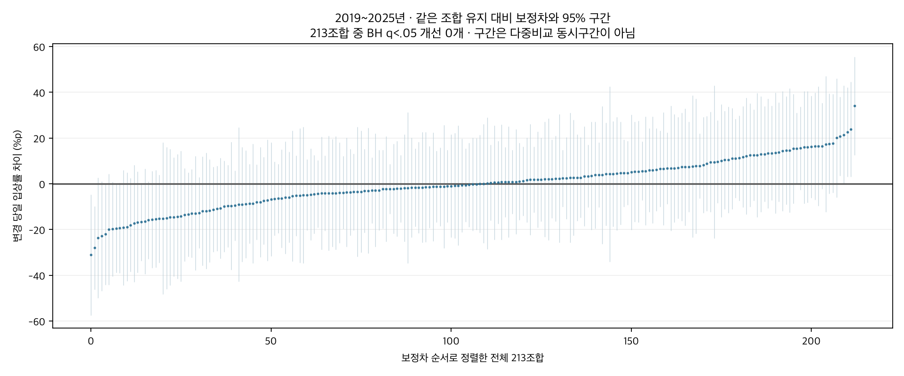

# 과거 기간을 확대한 마방별 기수변경 당일 성적 분석

2026-10-12 · 연구50C · 기존50B 후속 · 관찰 연구

서울·부산의 완결 연도 2019~2025년으로 늘려 계획된 기수변경 40,272출전을 분석했다. 기수가 변경된 바로 그 경주만 결과로 삼았다. 교체와 유지 비교가 충분한 조합은 기존20개에서213개로 늘었고, 기존 비교표본 부족17개 중13개를 다시 추정할 수 있었다. 말의 능력·직전 성적·현재 편성·기수의 일반 수준·평소 조합 성적을 고려한 입상률 개선은 개별검정에서4개 조합이 신호를 보였으나,213개 다중비교 기준을 통과한 개선 조합은0개였다.

## 변경된 한 경주만 평가

각 이벤트는 실제 직전 기수와 다른 기수가 출전표에 예정되고 그대로 기승한 **현재 한 출전**이다. 이후 다음 경주·여러 경주 평균·최고 성적은 결과에 포함하지 않았다. 직전 성적은 비교와 통제에만 사용했다. 같은 기수 유지 출전은 별개의 비교 관측치이며 교체 이벤트에 이후 성적으로 붙이지 않았다. 변경40272출전의 원본 현재행·직전행 키와 결과를 [이벤트 명세](outputs/switch_race_events.parquet)에 남겼다. 결과의 시간 범위는 `target_horizon_races=0`이다. 앞선50B도 현재행 결과였고, 이번에는 혼동을 줄이도록 모두 “변경 당일”로 표시했다.

2018년은 이력과 전년도 기수지원의 참고기간이다. 주분석은2019~2025년의 완결7개 연도이며2026년 부분기간은 섞지 않았다. 계획대로 기승한 분류만 사용하고 카드 발표 후 대타·미확정은 제외했다. 양 기수 전년도≥100회 기승 지원 조건을 유지한 주표본은79,551출전이다. 상위기수 여부로 조합을 선정하거나 상위기수 더미를 보정계수에 쓰지 않았다. 해당 기승지원 조건을 없앤106,332출전도 민감도로 분석했다.

| 기간 | 표본 | 전체출전 | 변경출전 | 말 | 경주 |
|---|---|---|---|---|---|
| 2019_2025 | primary | 79551 | 40272 | 9322 | 11296 |
| 2019_2025 | expanded_no_annual_minimum | 106332 | 60373 | 9828 | 11325 |
| 2019_2023 | primary | 54016 | 27682 | 7251 | 7800 |
| 2019_2023 | expanded_no_annual_minimum | 74080 | 42569 | 7756 | 7818 |
| 2024_2025 | primary | 25535 | 12590 | 3845 | 3496 |
| 2024_2025 | expanded_no_annual_minimum | 32252 | 17804 | 4021 | 3507 |

## 말의 능력과 직전 성적을 고려한 비교

**보정차는 같은 마방–기수 조합에서 해당 기수를 유지한 출전 대비, 해당 기수로 계획변경된 당일 출전의 조건부 차이**다. 원시 직전율→당일율은 같은 변경출전 집단의 단순 전후 집계이며 이 보정차와 비교 기준이 다르다. 직전 비정상 결과는 직전율에서 빠질 수 있어 직전유효분모/짝지은현재율도 저장했다.

말 고정효과와 현재 경주 고정효과를 사용하고, 현재 기수의 지역×연도별 수준,마방 주효과,213지원 조합의 평소 주효과를 고려했다. 추가로 직전 상대착순/입상,최근5회 상대착순 평균과 수,공백,거리·등급 변화,rating,나이,부담중량,마체중,상대게이트,직전기수의 전년도 점수와 결측/제곱항을 포함했다. 현재 경주 고정효과는 같은 경주의 거리·등급·주로·상대편성이 공유하는 차이를 흡수한다. 당일 개별 마필의 미관측 상태와 기수 선택 판단까지 완전히 제거하지 못한다.

모형은 일반변경항과 조합별변경 추가항을 함께 추정한다. 표의 **총차**는 일반항+조합 추가항이다. 별도 **추가차**는 개별 상호작용을 두지 않은 기타 조합의 일반변경 차이에 비해 얼마나 다른지를 뜻한다. 지원 밖 조합에는 기수/마방 주효과가 가산되는 가정이 있다. 표의 계수는 선택된 조합의 현재경주 결과에 대한 관찰 연관성이며 인과적 교체효과나 승부의지가 아니다.

말 고정효과는2019~2025년 분석기간 전체 관측으로 추정한 사후 평균능력 통제다. 이후 출전의 결과를 이번 변경 이벤트의 목표로 쓰지는 않지만, 능력통제 추정 자체가 경주 이전 정보만 사용하는 예측모형은 아니다. 과거 자료로 미래를 맞힌 검증으로 해석하지 않는다.

입상(3위 이내)이 주결과다. 상대착순 `(순위-1)/(출전수-1)`과 공식 우승마 대비 시간차(초)는 보조결과이며 음수가 개선이다. 기록을 전 거리 공통초 가산점으로 채택하지 않았다. 말·날짜 두 방향 군집의 보수적 표준오차와95%구간을 사용했다. 주기간 BH 다중비교는 각 결과/대조의213조합에 적용하고3결과를 함께 묶은 BH도 별도로 저장했다. 최근기간은 식별 가능한173조합이 검정분모다.95%구간은 동시구간이 아니다.

## 표본이 부족했던 조합을 다시 확인한 결과

변경≥30출전·≥15말·≥20경주를 충족한 조합은335개다. 같은 조합 유지에도 같은 기준을 요구하면213개를 공동 추정할 수 있다. 기존37변경지원 조합을 모두 다시 확인했고,기존 유지비교 부족17개 중13개가 새로 분석 가능해졌다. 아래4개는 여전히 지원 부족이며 무효과로 분류하지 않는다. 모든 작은 조합도 [전체 분모표](outputs/pair_support.csv)에 남겼다.

| 지역 | 조합 | 기존 변경/유지 | 확장 변경/유지 | 보정차%p | 95% 구간 | BH q |
|---|---|---|---|---|---|---|
| 부산 | 백광열→최시대 | 52/26 | 206/184 | +1.86 | -12.56~+16.28 | 0.9864 |
| 부산 | 강형곤→정도윤 | 41/24 | 172/107 | -12.64 | -28.17~+2.90 | 0.9572 |
| 부산 | 울즐리→이성재 | 30/27 | 148/178 | +2.37 | -10.00~+14.73 | 0.9864 |
| 부산 | 라이스→다실바 | 31/21 | 100/114 | +15.54 | -2.60~+33.67 | 0.9572 |
| 서울 | 전승규→김동수 | 35/24 | 91/96 | -0.67 | -16.70~+15.35 | 0.9864 |
| 부산 | 양귀선→송경윤 | 42/29 | 89/97 | -8.72 | -26.02~+8.58 | 0.9572 |
| 서울 | 강성오→김용근 | 31/36 | 67/86 | -28.04 | -46.15~-9.93 | 0.2601 |
| 부산 | 조용배→권오찬 | 47/40 | 66/56 | -2.93 | -17.34~+11.49 | 0.9864 |
| 부산 | 조용배→모준호 | 33/20 | 65/55 | -10.83 | -29.39~+7.73 | 0.9572 |
| 부산 | 장세한→모준호 | 42/35 | 61/62 | -2.18 | -21.86~+17.49 | 0.9864 |
| 부산 | 민장기→송경윤 | 30/17 | 60/36 | -17.33 | -42.86~+8.20 | 0.9572 |
| 서울 | 유재길→오수철 | 30/32 | 46/44 | +9.71 | -8.38~+27.79 | 0.9572 |
| 서울 | 박재우→장추열 | 30/43 | 32/48 | -5.42 | -33.98~+23.13 | 0.9864 |
| 부산 | 백광열→이성재 | 30/12 | 86/27 | 지원 부족 | — | — |
| 부산 | 백광열→김혜선 | 31/12 | 63/24 | 지원 부족 | — | — |
| 부산 | 조용배→김동영 | 35/22 | 37/23 | 지원 부족 | — | — |
| 서울 | 최용건→김철호 | 34/26 | 34/26 | 지원 부족 | — | — |

새로 분석 가능한13조합에서 입상률 개선의 BH통과 조합은0개다. 강성오→김용근은 개별검정에서 입상률 감소 신호가 있었으나 다중비교 후 확정되지 않았다. 표본의 확대가 반드시 개선조합 발견으로 이어지지는 않는다.

## 개별검정의 신호와 다중비교 결과

아래는213개 중 입상률 총차의 개별검정 p<.05인 모든 조합이다. 양의 효과만 골라 표시하지 않았다. 보정차가 양수이면 같은 조합 유지보다 변경 당일 입상률이 높다는 추정이다. 그 구간이0을 피하더라도213조합을 찾아본 점을 고려한 BH q<.05를 통과해야 확정 후보로 구분한다.

| 지역 | 조합 | 변경수 | 유지수 | 직전율 | 변경 당일율 | 유지율 | 보정차%p | 95% 구간 | BH q |
|---|---|---|---|---|---|---|---|---|---|
| 서울 | 김동균→조한별 | 36 | 39 | 8.57% | 36.11% | 23.08% | +34.04 | +12.57~+55.52 | 0.2601 |
| 서울 | 배대선→이동하 | 55 | 66 | 23.64% | 30.91% | 31.82% | +23.82 | +3.13~+44.51 | 0.8547 |
| 서울 | 강환민→김용근 | 63 | 79 | 30.16% | 42.86% | 35.44% | +22.60 | +3.08~+42.12 | 0.8547 |
| 부산 | 민장기→최은경 | 72 | 105 | 14.08% | 40.28% | 25.71% | +20.79 | +3.47~+38.10 | 0.8547 |
| 서울 | 송문길→이용호 | 54 | 102 | 16.67% | 12.96% | 29.41% | -19.54 | -38.79~-0.29 | 0.9192 |
| 서울 | 강성오→김용근 | 67 | 86 | 29.85% | 22.39% | 47.67% | -28.04 | -46.15~-9.93 | 0.2601 |
| 서울 | 박윤규→김용근 | 45 | 38 | 35.56% | 35.56% | 55.26% | -31.06 | -57.48~-4.64 | 0.8547 |

213조합 입상률 총차와 추가차 모두 BH통과0개다. 상대착순과 시간차의 총차/추가차도 주모형에서 BH통과0개다. 개별검정의 신호는 후속 추적 후보이며 고정 가산점으로 채택하지 않는다. 기간이 늘면서 조사한 조합 수도20→213개로 늘었으므로 단순히 과거분석보다 p값이 작아졌는지만 비교하지 않는다.

[모든213조합 입상률 표](outputs/all_213_top3_pairs.md) · [주 비교표 CSV](outputs/primary_pair_comparison.csv) · [모든 결과와 두 대조](outputs/adjusted_associations.csv)

## 조건 변경과 최근 기간

직전 출전도 카드대로 기승한 표본,동일마주,연간100회 지원 제한 해제에서213명단을 고정하고 다시 추정했다.2024~2025년 역시 역사적으로 고정한213명단으로 해당기간 계수를 다시 추정했으며,해당기간에서 변동/식별성이 없는 조합은 추정불가로 남겼다. 이 최근기간 점검은 주기간과 중복되므로 독립 재현 또는 사전예측 검증이 아니다.

| 기간 | 조건 | 전체출전 | 추정조합 | 개별신호 수 | BH 개선수 | 최소q |
|---|---|---|---|---|---|---|
| 2019_2025 | expanded_no_annual_minimum | 106332 | 213 | 7 | 0 | 0.7094 |
| 2019_2025 | previous_also_as_card | 77334 | 213 | 11 | 0 | 0.3150 |
| 2019_2025 | primary | 79551 | 213 | 7 | 0 | 0.2601 |
| 2019_2025 | same_owner | 78876 | 213 | 7 | 0 | 0.2249 |
| 2024_2025 | frozen_historical_pairs | 25535 | 173 | 8 | 0 | 0.0000 |

최근기간에서 식별된173조합만 대상으로 한 결과별 BH에서는 박재우→정정희의 입상/상대착순 악화와 김동균→조한별의 상대착순 개선이 검출됐다. 그러나 각각 최근 변경/유지가6/1출전과7/15출전으로 사전 지원기준을 충족하지 못한다. 선형확률모형의 박재우→정정희 입상계수는-1보다 작아 실제 확률 차이로 해석할 수 없으며 희소 표본의 불안정성으로 기록한다. 김동균→조한별 순위 개선도3결과 공동 BH에서는 q=.0776으로 미통과다. 이 결과를 최근의 확정 개선조합으로 승격하지 않았다.

| 조합 | 결과 | 대조 | 최근 변경/유지 | 계수 | 95% 구간 | 결과별q | 3결과q | 최근지원 |
|---|---|---|---|---|---|---|---|---|
| 박재우→정정희 | top3 | pair_extra | 6/1 | -1.176 | -1.54~-0.81 | 1.761e-07 | 5.284e-07 | 부족 |
| 박재우→정정희 | finish_p | pair_extra | 6/1 | +0.574 | +0.32~+0.83 | 0.002384 | 0.003575 | 부족 |
| 박재우→정정희 | top3 | pair_total | 6/1 | -1.189 | -1.56~-0.82 | 1.16e-07 | 3.48e-07 | 부족 |
| 박재우→정정희 | finish_p | pair_total | 6/1 | +0.588 | +0.33~+0.84 | 0.001362 | 0.002043 | 부족 |
| 김동균→조한별 | finish_p | pair_extra | 7/15 | -0.507 | -0.78~-0.23 | 0.02657 | 0.05313 | 부족 |
| 김동균→조한별 | finish_p | pair_total | 7/15 | -0.492 | -0.77~-0.22 | 0.03882 | 0.07765 | 부족 |

모든3결과·2대조의 민감도는 [민감도표](outputs/sensitivity_summary.csv)에 표시했다. 연도별 원시율도 [연도별표](outputs/annual_pair_metrics.csv)에 보존했다. 긴 기간의 평균 차이가 현재 마방·기수의 성과를 그대로 보장하지 않는다.

## 검증과 해석 범위

독립 SQL로 원시집계와 실제 직전 슬롯을 검산했다. 변경된40,272이벤트의 모든 저장필드가 현재 원본행과 같고,목표가 현재 한 경주뿐임을 확인했다. 지원기준·기존37조합/17부족조합·두 BH계산과 입력해시도 확인했다. 주기간/최근기간 전체 희소LSQR로3결과의 모든 식별 가능한 대조를 재계산했고,사전 지정한 입상 개별신호·변경수 상위5·복구13조합의 군집구간과 보조결과의 BH통과 구간을 독립 확인했다. 검증 3,199,432항목 통과. [검증 결과](outputs/verification.json) · [모형 진단](outputs/model_diagnostics.csv).

기수 선택은 무작위가 아니며 장기간의 관리방침·기수의 이적/변화와 보이지 않는 말 상태가 남는다. 카드 원문은 과거에 수집된 자료여서 최초 게시본 불변성을 인증하지 못했다. 결과가 차이를 검출하지 못했다는 것은 모든 조합의 효과가 정확히0이라는 입증이 아니다. 기존50/50A/50B는 보존하고 후속50C로 추가했다. 연구 후보이며 운영 모델·DB·배포 변경 없음.

[출처와 재실행](SOURCES.md) · [게시용 요약](PUBLICATION.md) · [게시 JSON](outputs/publication.json) · [정확 용량](outputs/artifact_inventory.json)
