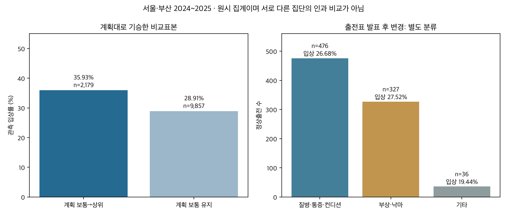
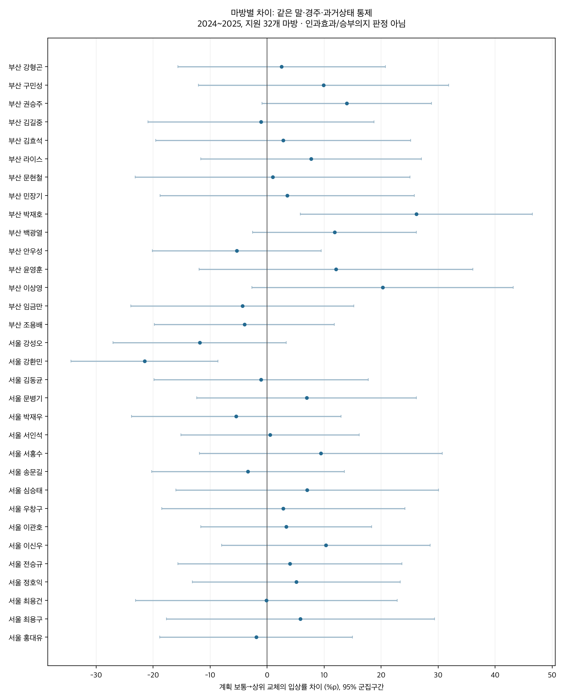

# 마방별 계획 기수교체와 출전표 발표 후 변경

2026-10-12 · 연구50의 후속50A · 연구 후보/관찰 연관성 · 운영 반영 없음

출전표 기준 계획교체만 남겨도 보통→상위 교체의 입상률 개선 연관성은 남았다. 2,179출전 입상률 35.93%, 보통유지 9,857출전 28.91%. 같은말·경주와 과거상태 등을 통제한 차이 +4.40%p(95% +1.35~+7.46, q=0.0169). 마방별 지원 32곳의 양의 차이 중 BH q<.05는 0곳. 발표후 변경은 839정상출전으로 따로 보았다.

## 대상과 분리 기준

서울·부산 2018~2026 기존 159,014출전의 신원·직전 출전·전년도 기수분류를 그대로 보존했다. 주기간 2024~2025 37,345출전 중 출전표대로 36,483, 발표후 변경 842, 미확정 20이다. 발표후 변경 842건 가운데 비정상착순 3건은 원시 성적률에서 제외해 839건이다. 실제 교체행 전체 목록에는 비정상도 보존했다.

공식 API10_1은 경주 전 출전표에 제공된 기수가 변경된 자료라고 설명한다. [공식 정의](https://www.data.go.kr/data/15057181/openapi.do). 경주 전 명목 날짜의 dacom01 카드에서 예정 기수를 읽고, dacom13 변경 공지 및 별도 API10_1의 전후 기수·말·번호를 대조했다. 예정기수=실제기수, 말·조교사 일치, 변경자료 지원, 후발변경 없음일 때에만 출전표 기준 계획대로 기승으로 분류했다. 그 안에서 직전 실제기수와 다르면 계획교체다. 공지 없음 하나로 계획교체를 추정하지 않았다. 명시 공지는 예정→변경→실제의 연결을 확인하고 분리했다.

**보관 출전표는 경주 뒤 수집한 공식 과거파일이다. 명목 파일일자가 경주 전이라는 것은 확인했으나 최초 게시 시각·최초 버전 불변성까지 인증하지 못했다. 따라서 “당초의 승부의지”나 계획을 직접 관측했다고 해석하지 않는다.** 공지와 카드가 충돌한 2024-01-20 서울 5출전 등은 미확정으로 남겼다. 이름 약칭·지역 접두사만 정규화하고 유일한 역사적 ID에 연결했다. 동명이인·국제교류 별칭·조교사 불일치는 강제로 연결하지 않았다.

카드 161,567행, 변경 원문 5,332행을 보존했다. API215 심판보고서 14,867경주의 jkChange는 전부 “-” 또는 “null”이므로 변경 없음의 근거로 사용하지 않았다. 카드 파싱 예외 5행은 2018~2021의 긴 교류마명/산지 결합행이며 해당 행은 미지원으로 남겼다. 변경공지 파싱 예외는 0이다. 2026 카드 본문은 양 지역 9월13일까지, 실제 성적은 서울9월20일·부산9월18일까지이므로 그 이후 카드 없는 출전은 계획집단에서 제외했다.

[분류/제외 사유 전수표](outputs/classification_coverage.csv) · [카드 원문행](outputs/card_rows.parquet) · [변경 원문행](outputs/notice_rows.parquet) · [API/텍스트 대조](outputs/api_text_crosscheck.csv) · [미지원 이름](outputs/unsupported_card_names.csv) · [파싱 예외](outputs/parse_exceptions.csv)

## 계획교체의 전체 결과

주 비교표본은 정상착순, 같은 조교사·지역, 직전 출전 간격2~180일, 양 기수의 전년도 순위가 지원되는 계획대로 기승 25,535출전·3,845말·3,496경주다. 입상은 **3위 이내**다. 상위기수는 지역별 전년도 정상 기승≥100회인 기수의 완화 입상률 `(입상수+50×지역입상률)/(기승수+50)` 상위 ceil(20%)다. 현재 성적을 상위기수 분류에 사용하지 않았다.

| 기수 범주 | 출전 | 입상률 | 직전 입상률 | 짝지은 전후 변화 |
|---|---|---|---|---|
| ordinary_to_ordinary | 6949 | 20.38% | 13.27% | +7.12%p |
| ordinary_to_top | 2179 | 35.93% | 27.82% | +8.13%p |
| retained_ordinary | 9857 | 28.91% | 37.40% | -8.47%p |
| retained_top | 3088 | 45.85% | 55.93% | -10.07%p |
| top_to_ordinary | 2298 | 28.07% | 26.75% | +1.31%p |
| top_to_top | 1164 | 42.70% | 42.35% | +0.34%p |

보통→상위의 단순 전후 변화 +8.13%p에는 평균회귀·말의 회복·선택 편향이 섞인다. 같은 현재 경주+말 고정효과, 직전/최근5회 착순·직전입상·공백·거리/등급 변화·현재 rating/나이/부담중량/마체중/게이트·직전기수 점수(결측 표시/비선형항 포함)를 통제하면 입상률 +4.40%p, 상대착순 -0.0339, 우승마와 시간차 -0.132초다. 상대착순/시간차는 낮을수록 좋다. 시간차95% [-0.224,-0.040]초이며 모든 거리의 보정 상수로 쓸 수 없다. 표본이 다른 원시율을 직접 빼서 통제효과로 부르지 않는다. 직전 비정상착순은 직전율·전후차의 분모에서 제외하므로 현재율과 분모가 다를 수 있다. 짝지은 전후차는 양쪽 착순이 모두 지원되는 출전만 계산했으며 각 분모는 CSV의 previous_top3_n에 있다.

| 민감도 | 출전 | 입상률 차이%p | 95% 구간 | BH q |
|---|---|---|---|---|
| primary | 25535 | +4.40 | +1.35~+7.46 | 0.0169 |
| previous_also_as_card | 24980 | +4.77 | +1.57~+7.97 | 0.0126 |
| same_owner | 25326 | +4.57 | +1.48~+7.65 | 0.0134 |
| venue_부산 | 9743 | +5.56 | +0.61~+10.51 | 0.0651 |
| venue_서울 | 15792 | +3.03 | -0.96~+7.02 | 0.3174 |

직전 출전도 카드대로 기승한 민감도는 직전 갑작스러운 대타 이후 본래 기수로 돌아오는 사례를 제거한다. 동일마주 민감도도 방향은 유지됐다. 서울/부산 효과차 자체를 검정한 것이 아니므로 한 지역에만 유효하다고 단정하지 않는다. 2026 부분연도 계획표본8,674의 차이는 +9.06%p(95%+2.32~+15.79,q=.0312)이나 별도 부분기간 관찰이며 확대·재현 확정이 아니다.

## 마방별 원시 결과와 통제 결과

마방은 출전 당시 조교사ID로 구분했다. 아래는 보통→상위 계획교체 수가 많은 순서의 10개이며 긍정 결과만 골라 나열하지 않았다. 모든 마방·모든 기수 범주·발표후 변경의 분모와 성적은 [전체 마방표](outputs/stable_metrics.csv)에 있다. 직전 대비는 원시 비교다.

| 지역 | 조교사 | 교체수 | 직전 입상률 | 교체 후 입상률 | 짝지은 전후차 |
|---|---|---|---|---|---|
| 부산 | 백광열 | 78 | 26.92% | 38.46% | +11.54%p |
| 서울 | 이관호 | 59 | 23.73% | 35.59% | +11.86%p |
| 서울 | 박재우 | 56 | 30.36% | 32.14% | +1.79%p |
| 부산 | 토마스 | 52 | 28.85% | 50.00% | +21.15%p |
| 서울 | 홍대유 | 52 | 23.08% | 34.62% | +11.54%p |
| 서울 | 서인석 | 52 | 40.38% | 36.54% | -3.85%p |
| 부산 | 권승주 | 51 | 25.49% | 33.33% | +7.84%p |
| 부산 | 라이스 | 50 | 42.00% | 46.00% | +4.00%p |
| 서울 | 강성오 | 50 | 18.00% | 18.00% | +0.00%p |
| 서울 | 정호익 | 49 | 30.61% | 42.86% | +12.24%p |

개별 통제추정은 계획출전≥200, 말≥30, 경주≥30, 보통→상위≥30, 보통유지≥50인32개 마방이다. 한 마방만 추려 경주당 한 마리로 비교하지 않고 전체 계획편성을 배경으로 말/경주 고정효과·마방 주효과·마방별 상위교체항을 함께 추정했다. 다른 교체범주 및 통제변수의 계수는 공통이라는 모형 가정이 있다. 말 고정효과와 겹치는 마방 주효과의 개별 계수는 식별되지 않아 해석하지 않았다. 표의 상위교체항은 식별성 검사를 통과했다. 95%는 말·날짜 군집 중 보수적인 분산, BH는32개 마방을 각 결과변수별로 보정했다. 구간 자체는 동시구간이 아니다.

| 지역 | 조교사 | 상위교체수 | 관측입상률 | 보통유지수 | 관측입상률 | 통제차%p | 95% 구간 | BH q |
|---|---|---|---|---|---|---|---|---|
| 부산 | 강형곤 | 42 | 26.19% | 156 | 23.72% | +2.52 | -15.69~+20.73 | 0.9755 |
| 부산 | 구민성 | 39 | 33.33% | 97 | 20.62% | +9.88 | -12.08~+31.84 | 0.9755 |
| 부산 | 권승주 | 51 | 33.33% | 174 | 24.71% | +13.97 | -0.92~+28.86 | 0.6653 |
| 부산 | 김길중 | 38 | 34.21% | 132 | 31.06% | -1.09 | -20.91~+18.74 | 0.9800 |
| 부산 | 김효석 | 35 | 42.86% | 89 | 31.46% | +2.81 | -19.53~+25.15 | 0.9755 |
| 부산 | 라이스 | 50 | 46.00% | 53 | 43.40% | +7.71 | -11.64~+27.06 | 0.9755 |
| 부산 | 문현철 | 30 | 46.67% | 59 | 40.68% | +0.96 | -23.15~+25.07 | 0.9800 |
| 부산 | 민장기 | 33 | 30.30% | 156 | 28.85% | +3.51 | -18.80~+25.81 | 0.9755 |
| 부산 | 박재호 | 37 | 45.95% | 109 | 30.28% | +26.17 | +5.82~+46.52 | 0.1905 |
| 부산 | 백광열 | 78 | 38.46% | 87 | 41.38% | +11.81 | -2.54~+26.17 | 0.6685 |
| 부산 | 안우성 | 45 | 24.44% | 86 | 37.21% | -5.35 | -20.17~+9.47 | 0.9755 |
| 부산 | 윤영훈 | 37 | 37.84% | 83 | 20.48% | +12.06 | -11.96~+36.07 | 0.9755 |
| 부산 | 이상영 | 33 | 48.48% | 126 | 26.98% | +20.25 | -2.67~+43.17 | 0.6653 |
| 부산 | 임금만 | 38 | 36.84% | 98 | 40.82% | -4.36 | -23.94~+15.22 | 0.9755 |
| 부산 | 조용배 | 42 | 16.67% | 182 | 13.74% | -4.00 | -19.79~+11.80 | 0.9755 |
| 서울 | 강성오 | 50 | 18.00% | 141 | 26.95% | -11.85 | -27.02~+3.32 | 0.6685 |
| 서울 | 강환민 | 36 | 11.11% | 172 | 25.00% | -21.53 | -34.45~-8.61 | 0.0372 |
| 서울 | 김동균 | 47 | 29.79% | 255 | 31.76% | -1.07 | -19.86~+17.73 | 0.9800 |
| 서울 | 문병기 | 42 | 54.76% | 223 | 42.15% | +6.91 | -12.36~+26.18 | 0.9755 |
| 서울 | 박재우 | 56 | 32.14% | 149 | 27.52% | -5.44 | -23.83~+12.94 | 0.9755 |
| 서울 | 서인석 | 52 | 36.54% | 330 | 29.09% | +0.51 | -15.13~+16.14 | 0.9800 |
| 서울 | 서홍수 | 42 | 52.38% | 188 | 36.17% | +9.43 | -11.88~+30.74 | 0.9755 |
| 서울 | 송문길 | 43 | 30.23% | 263 | 39.54% | -3.37 | -20.29~+13.56 | 0.9755 |
| 서울 | 심승태 | 30 | 26.67% | 148 | 22.97% | +7.02 | -16.02~+30.07 | 0.9755 |
| 서울 | 우창구 | 47 | 31.91% | 75 | 32.00% | +2.83 | -18.51~+24.17 | 0.9755 |
| 서울 | 이관호 | 59 | 35.59% | 349 | 26.36% | +3.32 | -11.68~+18.33 | 0.9755 |
| 서울 | 이신우 | 39 | 30.77% | 163 | 27.61% | +10.31 | -7.98~+28.60 | 0.9755 |
| 서울 | 전승규 | 33 | 39.39% | 168 | 40.48% | +3.98 | -15.68~+23.65 | 0.9755 |
| 서울 | 정호익 | 49 | 42.86% | 221 | 32.58% | +5.11 | -13.13~+23.36 | 0.9755 |
| 서울 | 최용건 | 31 | 41.94% | 156 | 38.46% | -0.14 | -23.08~+22.80 | 0.9907 |
| 서울 | 최용구 | 31 | 35.48% | 101 | 29.70% | +5.83 | -17.69~+29.36 | 0.9755 |
| 서울 | 홍대유 | 52 | 34.62% | 271 | 23.25% | -1.92 | -18.83~+14.98 | 0.9755 |

양의 통제차 중 BH q<.05는 0곳이다. 음의 차이는 1곳(강환민 -21.53%p,95%-34.45~-8.61,q=0.0372)이었다. 강환민의 상위교체는36출전·입상4건(11.11%)으로 작고 선택 조건을 모두 관측하지 못했다. 실패 원인이나 조교사의 능력·의지로 단정할 근거가 아니며 독립 기간 재현이 필요하다. 어느 마방에나 동일 가산점을 주거나 일부 큰 양의 추정치를 승부의지 지표로 채택하지 않는다.

## 특정 마방에서 특정 기수로 계획교체

같은 조교사 내에서 이전 실제기수와 다른 기수로 계획교체한 모든 조합을 집계했다. ≥30교체·≥15말·≥20경주인 조합은 37개다. 아래는 교체수가 많은 순서10개이며 [전수 조합표](outputs/stable_destination_jockey_metrics.csv)에 지원 미달도 남겼다. **상위기수 교체에만 한정한 표가 아니며 아래 전후차는 통제효과가 아니다.**

| 지역 | 조교사 | 변경 후 기수 | 교체수 | 직전 입상률 | 현재 입상률 |
|---|---|---|---|---|---|
| 서울 | 서인석 | 조재로 | 90 | 26.97% | 36.67% |
| 부산 | 권승주 | 최시대 | 67 | 32.84% | 35.82% |
| 부산 | 백광열 | 정도윤 | 64 | 26.56% | 35.94% |
| 서울 | 정호익 | 임다빈 | 63 | 17.46% | 42.86% |
| 서울 | 송문길 | 김정준 | 53 | 18.87% | 33.96% |
| 부산 | 백광열 | 최시대 | 52 | 40.38% | 42.31% |
| 부산 | 조용배 | 권오찬 | 47 | 6.52% | 4.26% |
| 서울 | 리카디 | 정정희 | 45 | 33.33% | 33.33% |
| 부산 | 백광열 | 진겸 | 44 | 40.91% | 40.91% |
| 부산 | 양귀선 | 송경윤 | 42 | 21.95% | 23.81% |

## 갑작스러운 발표후 변경은 따로 보면

| 공식 변경 사유 | 정상출전 | 입상률 | 예정부터 직전과 다른 기수였음 |
|---|---|---|---|
| 전체 | 839 | 26.70% | 521 |
| 질병·통증·컨디션 | 476 | 26.68% | 309 |
| 부상·낙마 | 327 | 27.52% | 187 |
| 기타 | 36 | 19.44% | 25 |

부상·낙마327건, 질병·통증·컨디션476건, 기타36건이다. 기타에는 가사/개인사정, 기수선정 착오, 음주측정 기준 초과, 도착·전검량 지연 등이 있으며 부상으로 바꾸어 분류하지 않았다. 중량 사유로 확인된 해당기간 정상출전은0건이다. 원문에 “조교 중 부상”이라고만 적힌 경우 당일 발생·공지시각을 새로 추정하지 않았다. 발표후 변경은 당일뿐 아니라 카드 발표 이후의 변경을 뜻한다.

839건 중521건은 카드 때부터 직전과 다른 기수로 예정됐다가 다시 대타로 바뀐 사례다. 나머지318건은 예정기수가 직전과 같았거나 예정 비교가 미지원인 사례다. 이전처럼 “직전 실제기수와 현재 실제기수가 다름”만 쓰면 계획과 대타가 섞인다. [발표후 변경 사건 전수](outputs/late_change_events.csv)와 [마방별 사후 변경 집계](outputs/stable_metrics.csv)의 post_card_all_normal 범주를 함께 보아야 한다.

같은 마방·양 기수 전년도지원 등 조건을 맞춘 사후변경569출전은 입상28.30%다. 계획과 사후변경을 합친26,104출전에서 실제 기수범주와 예정기수의 전년도 점수, 같은말/경주와 과거상태를 함께 통제한 사후변경의 추가차는 +0.59%p(95% -4.44~+5.61), 시간차 -0.052초(95% -0.217~+0.114)였다. 유불리가 확인되지 않았다. 0효과 입증은 아니며 변경이 특정 기수·날짜에 몰려 구간이 넓다. 예정기수 점수 결측은 별도 표시했고 대타의 수준 저하를 자동 가정하지 않았다.

사유가 명시된 실제 사례:

| 일자 | 지역 | 말 | 조교사 | 예정→실제 | 원문사유 | 실제착순 |
|---|---|---|---|---|---|---|
| 2025-01-25 | 서울 | 빅블레드 | 서인석 | 이용호→유승완 | 4R 입장 중 낙마부상 | 8 |
| 2025-01-25 | 서울 | 스플렌디드 | 서인석 | 이용호→송재철 | 4R 입장 중 낙마부상 | 3 |

## 검증과 적용 한계

독립 토큰 파서로 카드/공지 원문을 다시 읽고, SQL 직전 분류·전수 계획판정·명시 변경 연결·모든 결과표 집계·BH를 재확인했다. 분석의 정확한 고정효과 투영과 다른 전체 희소 LSQR로 주 모형3결과와 마방 모형3결과를 재추정하고 주요 군집구간을 비교했다. 14,727,492항목 검증 통과. [검증 상세](outputs/verification.json) · [모형 진단](outputs/model_diagnostics.csv) · [모든 통제계수](outputs/adjusted_associations.csv). 기존 연구50의 원시 신원/성적/전년도 분류는 그대로 보존하고 새 입력 해시를 확인했다.

관찰자료는 기수의 가용성·계약·훈련·말 컨디션·마주의 실제 지시를 완전히 관측하지 못한다. 계획된 상위기수 교체는 연구 후보 특성이며 승부의지를 입증하지 않는다. 마방별 미래 예측·교체시점 의도 추론은 시간순 별도 검증이 필요하다. 주로빠르기 보정이나 확률모델/DB/운영·배포 변경은 하지 않았다. 기존 연구 결론을 덮어쓰지 않고 후속50A로 등록했다.

[출처·재실행](SOURCES.md) · [게시 요약](PUBLICATION.md) · [게시 JSON](outputs/publication.json) · [정확 용량](outputs/artifact_inventory.json)
