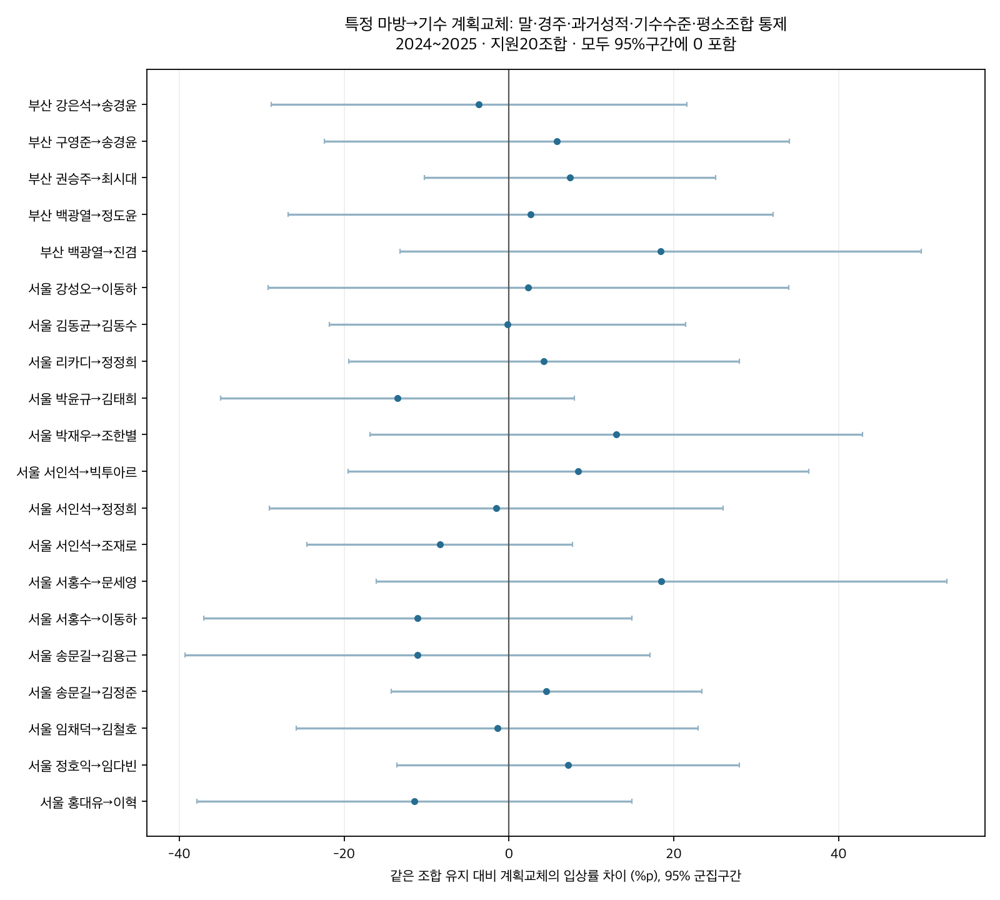
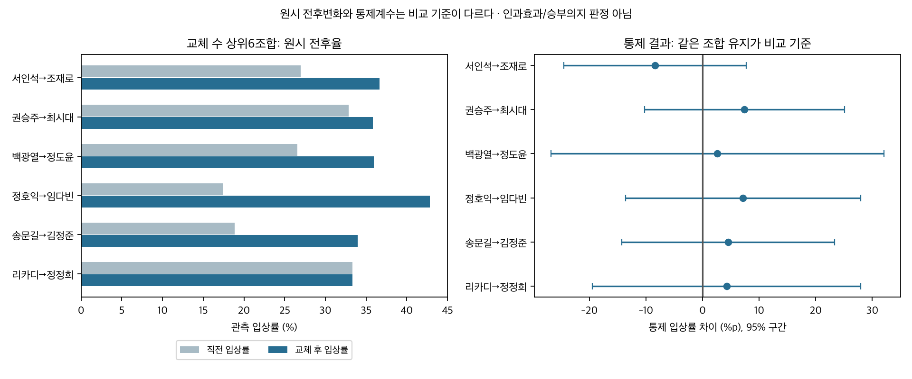

# 특정 마방→기수 계획교체: 능력·직전 성적 보정 후 차이

2026-10-12 · 연구50B · 50/50A 후속 · 연구 후보/관찰 연관성 · 운영 반영 없음

상위기수 구분 없이 계획교체 조합을 분석했다. 교체지원37조합 중 같은 조합의 유지 비교도 충분한20조합을 공동 추정한 결과, 말·경주·과거성적·기수의 연도별 수준·평소 조합 성적을 고려한 입상률 개선이 확인된 조합은0개다. 20조합의 입상률 차이는 모두95%구간에0을 포함했다. 이는 효과가 없다는 입증이 아니라 현 표본에서 구분하기 어렵다는 뜻이다.

## 대상과 질문

주기간은 서울·부산2024~2025다. 이전50A에서 원문 카드·변경 공지를 대조한159,014출전 중 계획대로 기승 확인 표본만 참조했다. 사후 대타와 미확정은 제외했다. 상위기수 더미/상위20% 분류는 이번 조합선정과 효과모형에 사용하지 않았다. 주표본25,535출전은 이전 연구와 비교를 위해 양 기수 전년도≥100회 기승 지원 조건을 유지했으며, 이 제한을 해제한32,252출전 민감도도 함께 분석했다. 따라서 “상위 여부 무관”을 모든 신규기수의 주표본 편입과 혼동하지 않는다. 주표본의 정상 현재착순·같은 조교사/지역·직전2~180일·기수ID 확인 조건은 동일하다.

| 기간 | 표본 | 출전 | 교체 | 말 | 경주 |
|---|---|---|---|---|---|
| 2024_2025 | primary | 25535 | 12590 | 3845 | 3496 |
| 2024_2025 | expanded_no_annual_minimum | 32252 | 17804 | 4021 | 3507 |
| 2026_partial | primary | 8674 | 4069 | 2347 | 1255 |
| 2026_partial | expanded_no_annual_minimum | 11504 | 6244 | 2576 | 1257 |

교체는 직전 실제기수와 다른 기수가 출전표에 예정되고 그대로 기승한 경우다. 국제교류 이름/기수ID 모호함과 과거카드 충돌은 이전50A의 미확정 처리 그대로다. 과거 카드가 최초 게시본 그대로인지 인증하지 못했으므로 최초의 계획/승부의지를 직접 관측한 것으로 표현하지 않는다. 입력 성적/카드분류를 재작성하거나 새로 가져오지 않았다.

## 조합의 비교 기준과 통제

**같은 마방–기수 조합에서 해당기수 유지와 해당기수로 새로 계획교체된 출전을 비교**한다. 더 좋은 말을 계속 타는 평소 조합과 교체마의 차이를 고려하도록 모든 배경 출전을 함께 사용했다. 한 조합만 추려 경주당 한마리가 되는 회귀는 하지 않았다. 모형은 `현재성적 = 말FE + 현재경주FE + 기수의지역×연도FE + 마방주효과 + 지원조합의평소주효과 + 일반교체항 + 조합별교체추가항 + 과거상태통제`다.

말 고정효과는 관측기간의 말별 평균 차이, 같은 경주 고정효과는 현재 거리/등급/주로/상대편성의 공통 차이를 흡수한다. 변하는 능력·상태는 직전 상대착순/입상,최근5회평균/관측수,공백,거리·등급 변화,rating,나이,부담중량,마체중,상대게이트,직전기수 전년도 점수와 결측/제곱항으로 추가 고려했다. 현재기수 연도별 주효과로 일반 기승수준을, 지원조합의 주효과로 평소 조합 성적을 구분한다. 마방 주효과의 독립 계수는 말FE 등과 겹칠 수 있어 해석하지 않고, 보고하는 교체 대조의 식별성을 검사했다. 상위기수 여부를 효과에 섞지 않았다.

두 대조를 구분한다. **총차이**는 일반교체항+해당조합 추가항으로, 같은 조합 유지 대비 계획교체의 조건부 차이다. **추가차이**는 조합교체 추가항으로, 개별 상호작용을 두지 않은 기타 조합의 일반교체 차이보다 얼마나 더 다른지를 뜻한다. 기타 조합은 기수/마방 주효과가 더해지는 모형을 가정한다. 이 둘 모두 동일 말의 직전 대비 변화와는 다른 대조다. 관측 선택을 모두 통제하지 못하므로 인과효과가 아니다.

입상(3위 이내)이 주결과이며 상대착순 `(순위-1)/(출전수-1)`와 우승마 대비 시간차가 보조결과다. 상대착순과 시간차는 음수가 개선이다. 기록은 같은 현재 경주에서 비교되며 전 거리 공통 초 보정으로 채택하지 않는다. 95% 구간은 말/날짜/말×날짜 점수의 군집분산 중 보수적인 값을 쓰며, BH는20조합을 결과변수·대조별로 보정했다. 구간 자체는 다중비교 동시구간이 아니다.

## 지원조합 선정과 제외

사전에 정한 교체≥30출전·≥15말·≥20경주인 조합은 기존 연구와 같은37개다. 이 중 같은 조합 유지≥30출전·≥15말·≥20경주가 지원되는20개를 주 개별추정으로 고정했다. 유지35출전이어도 말15두 미달이면 제외하는 등 모든 기준을 적용했다. 나머지17개를0효과로 분류하지 않는다. 아래와 [전체 지원표](outputs/pair_support.csv)에 분모/사유를 남겼고, 그 밖의 작은 조합도 [전체 원시표](outputs/pair_metrics.csv)에 포함했다.

| 지역 | 조합 | 계획교체 | 같은 조합 유지 | 개별추정 |
|---|---|---|---|---|
| 서울 | 서인석→조재로 | 90 | 125출전/46말/125경주 | 추정 |
| 부산 | 권승주→최시대 | 67 | 106출전/37말/106경주 | 추정 |
| 부산 | 백광열→정도윤 | 64 | 40출전/18말/40경주 | 추정 |
| 서울 | 정호익→임다빈 | 63 | 128출전/42말/128경주 | 추정 |
| 서울 | 송문길→김정준 | 53 | 76출전/27말/76경주 | 추정 |
| 부산 | 백광열→최시대 | 52 | 26출전/14말/26경주 | 유지 비교지원 부족 |
| 부산 | 조용배→권오찬 | 47 | 40출전/14말/40경주 | 유지 비교지원 부족 |
| 서울 | 리카디→정정희 | 45 | 104출전/34말/104경주 | 추정 |
| 부산 | 백광열→진겸 | 44 | 35출전/19말/35경주 | 추정 |
| 부산 | 양귀선→송경윤 | 42 | 29출전/15말/29경주 | 유지 비교지원 부족 |
| 부산 | 장세한→모준호 | 42 | 35출전/13말/35경주 | 유지 비교지원 부족 |
| 부산 | 강형곤→정도윤 | 41 | 24출전/15말/24경주 | 유지 비교지원 부족 |
| 서울 | 서인석→정정희 | 40 | 41출전/15말/41경주 | 추정 |
| 서울 | 김동균→김동수 | 40 | 58출전/20말/58경주 | 추정 |
| 부산 | 강은석→송경윤 | 38 | 49출전/20말/49경주 | 추정 |
| 부산 | 구영준→송경윤 | 36 | 34출전/20말/34경주 | 추정 |
| 서울 | 서홍수→이동하 | 36 | 42출전/17말/42경주 | 추정 |
| 서울 | 임채덕→김철호 | 36 | 63출전/22말/63경주 | 추정 |
| 부산 | 조용배→김동영 | 35 | 22출전/11말/22경주 | 유지 비교지원 부족 |
| 서울 | 강성오→이동하 | 35 | 36출전/15말/36경주 | 추정 |
| 서울 | 전승규→김동수 | 35 | 24출전/12말/24경주 | 유지 비교지원 부족 |
| 서울 | 박재우→조한별 | 34 | 42출전/23말/42경주 | 추정 |
| 서울 | 최용건→김철호 | 34 | 26출전/13말/26경주 | 유지 비교지원 부족 |
| 부산 | 조용배→모준호 | 33 | 20출전/6말/20경주 | 유지 비교지원 부족 |
| 서울 | 박윤규→김태희 | 33 | 42출전/15말/42경주 | 추정 |
| 서울 | 홍대유→이혁 | 33 | 87출전/26말/87경주 | 추정 |
| 서울 | 서인석→빅투아르 | 33 | 41출전/18말/41경주 | 추정 |
| 서울 | 송문길→김용근 | 33 | 37출전/17말/37경주 | 추정 |
| 부산 | 백광열→김혜선 | 31 | 12출전/7말/12경주 | 유지 비교지원 부족 |
| 부산 | 라이스→다실바 | 31 | 21출전/11말/21경주 | 유지 비교지원 부족 |
| 서울 | 서홍수→문세영 | 31 | 39출전/16말/39경주 | 추정 |
| 서울 | 강성오→김용근 | 31 | 36출전/14말/36경주 | 유지 비교지원 부족 |
| 부산 | 백광열→이성재 | 30 | 12출전/7말/12경주 | 유지 비교지원 부족 |
| 부산 | 민장기→송경윤 | 30 | 17출전/10말/17경주 | 유지 비교지원 부족 |
| 부산 | 울즐리→이성재 | 30 | 27출전/18말/27경주 | 유지 비교지원 부족 |
| 서울 | 유재길→오수철 | 30 | 32출전/12말/32경주 | 유지 비교지원 부족 |
| 서울 | 박재우→장추열 | 30 | 43출전/14말/43경주 | 유지 비교지원 부족 |

## 입상률: 모든 지원20조합

아래는 교체 수 순서다. 직전율과 현재율은 원시 집계이며 통제효과가 아니다. 직전 비정상착순은 직전율/짝지은 전후차에서 제외하므로 분모가 다를 수 있다. paired_current_top3_rate/previous_top3_n을 [원시표](outputs/pair_metrics.csv)에 별도로 남겼다. 유지율은 해당기수를 계속 탄 출전의 현재 입상률이다. 단순 교체율−유지율도 통제효과와 다르다.

| 지역 | 조합 | 교체수 | 유지수 | 직전율 | 교체 후율 | 유지율 | 통제 총차%p | 95% 구간 | BH q |
|---|---|---|---|---|---|---|---|---|---|
| 서울 | 서인석→조재로 | 90 | 125 | 26.97% | 36.67% | 37.60% | -8.40 | -24.51~+7.71 | 0.9597 |
| 부산 | 권승주→최시대 | 67 | 106 | 32.84% | 35.82% | 39.62% | +7.41 | -10.29~+25.10 | 0.9597 |
| 부산 | 백광열→정도윤 | 64 | 40 | 26.56% | 35.94% | 40.00% | +2.63 | -26.81~+32.06 | 0.9597 |
| 서울 | 정호익→임다빈 | 63 | 128 | 17.46% | 42.86% | 39.06% | +7.14 | -13.64~+27.91 | 0.9597 |
| 서울 | 송문길→김정준 | 53 | 76 | 18.87% | 33.96% | 48.68% | +4.55 | -14.27~+23.36 | 0.9597 |
| 서울 | 리카디→정정희 | 45 | 104 | 33.33% | 33.33% | 50.00% | +4.24 | -19.47~+27.95 | 0.9597 |
| 부산 | 백광열→진겸 | 44 | 35 | 40.91% | 40.91% | 31.43% | +18.39 | -13.23~+50.02 | 0.9597 |
| 서울 | 서인석→정정희 | 40 | 41 | 7.50% | 15.00% | 19.51% | -1.55 | -29.06~+25.96 | 0.9597 |
| 서울 | 김동균→김동수 | 40 | 58 | 12.50% | 30.00% | 32.76% | -0.19 | -21.81~+21.42 | 0.9859 |
| 부산 | 강은석→송경윤 | 38 | 49 | 18.42% | 21.05% | 48.98% | -3.66 | -28.86~+21.54 | 0.9597 |
| 부산 | 구영준→송경윤 | 36 | 34 | 16.67% | 25.00% | 17.65% | +5.80 | -22.39~+33.99 | 0.9597 |
| 서울 | 서홍수→이동하 | 36 | 42 | 36.11% | 38.89% | 52.38% | -11.07 | -37.02~+14.87 | 0.9597 |
| 서울 | 임채덕→김철호 | 36 | 63 | 11.11% | 27.78% | 25.40% | -1.41 | -25.79~+22.97 | 0.9597 |
| 서울 | 강성오→이동하 | 35 | 36 | 22.86% | 25.71% | 41.67% | +2.34 | -29.27~+33.95 | 0.9597 |
| 서울 | 박재우→조한별 | 34 | 42 | 11.76% | 38.24% | 21.43% | +13.00 | -16.86~+42.86 | 0.9597 |
| 서울 | 박윤규→김태희 | 33 | 42 | 0.00% | 6.06% | 21.43% | -13.52 | -34.96~+7.93 | 0.9597 |
| 서울 | 홍대유→이혁 | 33 | 87 | 27.27% | 45.45% | 43.68% | -11.47 | -37.87~+14.93 | 0.9597 |
| 서울 | 서인석→빅투아르 | 33 | 41 | 45.45% | 33.33% | 26.83% | +8.42 | -19.56~+36.40 | 0.9597 |
| 서울 | 송문길→김용근 | 33 | 37 | 33.33% | 33.33% | 43.24% | -11.13 | -39.34~+17.08 | 0.9597 |
| 서울 | 서홍수→문세영 | 31 | 39 | 54.84% | 67.74% | 58.97% | +18.49 | -16.14~+53.12 | 0.9597 |

입상률 총차20개 모두95%구간에0을 포함했고 BH q<.05도0개다. 양의 추정치는11개지만 불확실성이 커 확정 개선 조합으로 선정하지 않는다. 예를 들어 정호익→임다빈63교체의 원시 입상률은17.46%→42.86%였지만, 같은 조합 유지 대비 통제 총차는+7.14%p(95%-13.64~+27.91)다. 서인석→조재로90교체는26.97%→36.67%이나 통제 총차-8.40%p(95%-24.51~+7.71)였다. 원시 반등과 추가 교체효과가 다름을 보여준다.

기타 조합의 일반교체 대비 추가차:

| 조합 | 추가차%p | 95% 구간 | BH q |
|---|---|---|---|
| 서인석→조재로 | -7.12 | -23.52~+9.28 | 0.9051 |
| 권승주→최시대 | +8.69 | -9.06~+26.43 | 0.9051 |
| 백광열→정도윤 | +3.91 | -25.44~+33.25 | 0.9916 |
| 정호익→임다빈 | +8.42 | -12.33~+29.16 | 0.9051 |
| 송문길→김정준 | +5.83 | -13.05~+24.71 | 0.9068 |
| 리카디→정정희 | +5.52 | -18.23~+29.27 | 0.9252 |
| 백광열→진겸 | +19.68 | -11.95~+51.30 | 0.9051 |
| 서인석→정정희 | -0.27 | -27.79~+27.25 | 0.9916 |
| 김동균→김동수 | +1.09 | -20.49~+22.66 | 0.9916 |
| 강은석→송경윤 | -2.38 | -27.42~+22.67 | 0.9916 |
| 구영준→송경윤 | +7.08 | -21.22~+35.38 | 0.9252 |
| 서홍수→이동하 | -9.79 | -35.92~+16.33 | 0.9051 |
| 임채덕→김철호 | -0.13 | -24.84~+24.58 | 0.9916 |
| 강성오→이동하 | +3.62 | -28.25~+35.50 | 0.9916 |
| 박재우→조한별 | +14.28 | -15.62~+44.18 | 0.9051 |
| 박윤규→김태희 | -12.23 | -33.67~+9.20 | 0.9051 |
| 홍대유→이혁 | -10.19 | -36.76~+16.37 | 0.9051 |
| 서인석→빅투아르 | +9.70 | -18.42~+37.82 | 0.9051 |
| 송문길→김용근 | -9.85 | -37.93~+18.23 | 0.9051 |
| 서홍수→문세영 | +19.77 | -15.10~+54.64 | 0.9051 |

추가차20개도 모두95%구간에0을 포함했다. 기수의 일반 수준이나 평소 조합을 고려한 후 특정 조합의 추가적인 입상 이점이 남는다고 확정할 근거가 없다.

## 순위·기록의 보조 결과

상대착순 총차(음수가 개선):

| 조합 | 차이 | 95% 구간 | BH q |
|---|---|---|---|
| 서인석→조재로 | +0.026 | -0.09~+0.14 | 0.8300 |
| 권승주→최시대 | -0.049 | -0.16~+0.06 | 0.8016 |
| 백광열→정도윤 | -0.047 | -0.22~+0.13 | 0.8016 |
| 정호익→임다빈 | -0.048 | -0.16~+0.07 | 0.8016 |
| 송문길→김정준 | -0.008 | -0.14~+0.12 | 0.9530 |
| 리카디→정정희 | -0.044 | -0.21~+0.12 | 0.8016 |
| 백광열→진겸 | -0.105 | -0.29~+0.08 | 0.8016 |
| 서인석→정정희 | +0.050 | -0.13~+0.23 | 0.8016 |
| 김동균→김동수 | +0.024 | -0.14~+0.19 | 0.9170 |
| 강은석→송경윤 | +0.001 | -0.15~+0.16 | 0.9879 |
| 구영준→송경윤 | +0.115 | -0.09~+0.32 | 0.8016 |
| 서홍수→이동하 | +0.103 | -0.08~+0.29 | 0.8016 |
| 임채덕→김철호 | -0.014 | -0.19~+0.16 | 0.9530 |
| 강성오→이동하 | -0.084 | -0.27~+0.10 | 0.8016 |
| 박재우→조한별 | -0.098 | -0.25~+0.06 | 0.8016 |
| 박윤규→김태희 | +0.082 | -0.07~+0.24 | 0.8016 |
| 홍대유→이혁 | +0.054 | -0.11~+0.22 | 0.8016 |
| 서인석→빅투아르 | -0.132 | -0.26~-0.01 | 0.7574 |
| 송문길→김용근 | +0.135 | -0.04~+0.31 | 0.8016 |
| 서홍수→문세영 | -0.089 | -0.33~+0.15 | 0.8016 |

우승마와 시간차 총차, 초(음수가 개선):

| 조합 | 차이 | 95% 구간 | BH q |
|---|---|---|---|
| 서인석→조재로 | +0.104 | -0.32~+0.52 | 0.9472 |
| 권승주→최시대 | -0.195 | -0.69~+0.30 | 0.9472 |
| 백광열→정도윤 | -0.160 | -0.90~+0.57 | 0.9472 |
| 정호익→임다빈 | -0.122 | -0.53~+0.28 | 0.9472 |
| 송문길→김정준 | -0.058 | -0.48~+0.36 | 0.9472 |
| 리카디→정정희 | -0.048 | -0.80~+0.71 | 0.9472 |
| 백광열→진겸 | -0.453 | -1.31~+0.40 | 0.9472 |
| 서인석→정정희 | +0.285 | -0.30~+0.87 | 0.9472 |
| 김동균→김동수 | -0.039 | -0.57~+0.49 | 0.9472 |
| 강은석→송경윤 | +0.014 | -0.67~+0.70 | 0.9672 |
| 구영준→송경윤 | +0.122 | -0.90~+1.15 | 0.9472 |
| 서홍수→이동하 | +0.307 | -0.44~+1.05 | 0.9472 |
| 임채덕→김철호 | +0.282 | -0.63~+1.20 | 0.9472 |
| 강성오→이동하 | -0.170 | -0.81~+0.47 | 0.9472 |
| 박재우→조한별 | -0.287 | -0.87~+0.30 | 0.9472 |
| 박윤규→김태희 | +0.099 | -0.72~+0.92 | 0.9472 |
| 홍대유→이혁 | +0.118 | -0.45~+0.69 | 0.9472 |
| 서인석→빅투아르 | -0.241 | -0.73~+0.25 | 0.9472 |
| 송문길→김용근 | +0.378 | -0.44~+1.20 | 0.9472 |
| 서홍수→문세영 | -0.270 | -1.52~+0.98 | 0.9472 |

서인석→빅투아르는 상대착순 총차-0.132(95%-0.256~-0.007,p=.0379)로 개별검정 신호가 있었지만20조합 BH q=.7574다. 입상률과 시간차에서 같은 수준의 근거가 없으므로 확정 개선으로 취급하지 않는다. 연간100회 제한을 없앤 상대착순 총차-0.152,q=.1435도 다중비교 기준을 통과하지 않았다. 보조 결과까지 유리한 숫자만 골라 승부조합으로 선언하지 않았다.

## 민감도와2026 부분기간

직전 출전도 카드대로 기승한 표본, 동일마주, 연간100회 제한 해제에서도20조합을 새로 선정하지 않고 고정했다. 주기간 입상률 총차/추가차에서 BH통과 개선0개였다. 2026은 카드가9월13일까지 지원되는 부분기간이며, 고정20조합 중15개에서 총차 대조가 식별됐다. 나머지5개는 변동/식별성 부족으로 추정불가를 남겼다.2026 입상률·상대착순·시간차의 BH통과 조합도0개다.조합 명단만 동결하고2026계수는 해당기간에서 재추정했으므로2024~2025모형의 사전예측 검증은 아니다.2026만 보고 새 조합을 발굴하거나 미래 예측 개선을 검증한 분석은 아니다.

| 기간 | 모형 | 결과 | 출전 | 추정조합 | BH 양/음 통과 | 최소q |
|---|---|---|---|---|---|---|
| 2024_2025 | expanded_no_annual_minimum | finish_p | 32252 | 20 | 0/0 | 0.1435 |
| 2024_2025 | expanded_no_annual_minimum | time_gap | 31049 | 20 | 0/0 | 0.7725 |
| 2024_2025 | expanded_no_annual_minimum | top3 | 32252 | 20 | 0/0 | 0.8905 |
| 2024_2025 | previous_also_as_card | finish_p | 24980 | 20 | 0/0 | 0.6554 |
| 2024_2025 | previous_also_as_card | time_gap | 24080 | 20 | 0/0 | 0.9787 |
| 2024_2025 | previous_also_as_card | top3 | 24980 | 20 | 0/0 | 0.9760 |
| 2024_2025 | primary | finish_p | 25535 | 20 | 0/0 | 0.7574 |
| 2024_2025 | primary | time_gap | 24620 | 20 | 0/0 | 0.9472 |
| 2024_2025 | primary | top3 | 25535 | 20 | 0/0 | 0.9597 |
| 2024_2025 | same_owner | finish_p | 25326 | 20 | 0/0 | 0.6237 |
| 2024_2025 | same_owner | time_gap | 24418 | 20 | 0/0 | 0.9623 |
| 2024_2025 | same_owner | top3 | 25326 | 20 | 0/0 | 0.9363 |
| 2026_partial | frozen_pairs | finish_p | 8674 | 15 | 0/0 | 0.7004 |
| 2026_partial | frozen_pairs | time_gap | 8355 | 15 | 0/0 | 0.6506 |
| 2026_partial | frozen_pairs | top3 | 8674 | 15 | 0/0 | 0.9150 |

[모든 계수·상태·군집구간](outputs/adjusted_associations.csv) · [연도별 원시 조합 성적](outputs/annual_pair_metrics.csv) · [민감도 집계](outputs/sensitivity_summary.csv) · [주 입상 비교표](outputs/primary_pair_comparison.csv)

## 검증·해석·보존

독립 SQL로 직전 슬롯과 모든 원시 조합 집계를 다시 계산하고, 지원조합 전수/제외기준·BH·입력 해시를 확인했다. 분석의 정확한 고정효과 투영과 다른 전체 희소LSQR로 주기간·2026의3결과를 재추정하고 주기간20조합×2대조 입상률의 군집구간을 독립 계산했다. 1,427,226항목 검증 통과. [검증](outputs/verification.json) · [모형진단](outputs/model_diagnostics.csv). 이전159,014출전 분류를 바꾸지 않았다.

표본이 작은 데다 기수 선택은 무작위가 아니다. 말FE/과거상태는 말의 매번 바뀌는 능력이나 조교사·마주의 관측하지 못한 판단을 완전히 제거하지 못한다. 현20조합/기간에서 통계적 차이를 구분하지 못했다는 결과를 모든 마방·모든 기수의 무효과로 일반화하지 않는다. 원시 반등이 있는 조합은 추적 후보로 남기되 고정 가산점/승부의지 확정/운영 반영은 하지 않았다. 주로빠르기 보정·새 확률모델·DB·배포 변경 없음. 기존50/50A 결론은 보존하고 후속50B로 등록했다.

[출처·재실행](SOURCES.md) · [게시용 요약](PUBLICATION.md) · [게시 JSON](outputs/publication.json) · [정확 용량](outputs/artifact_inventory.json)
