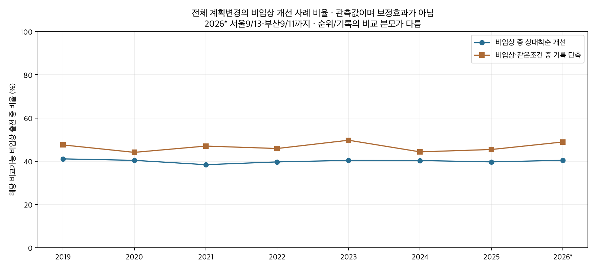
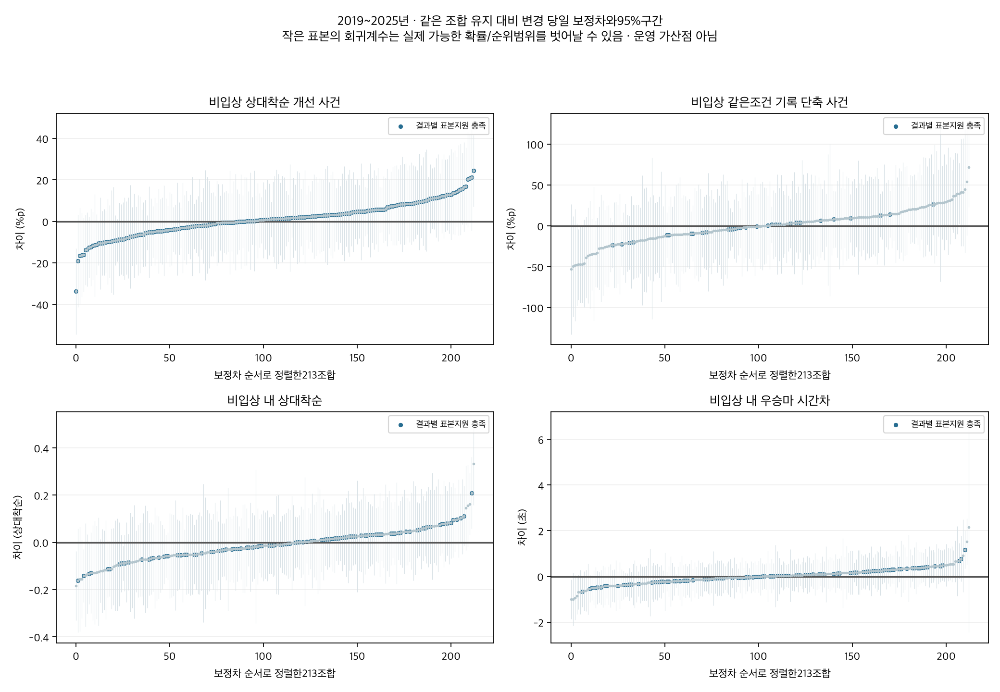
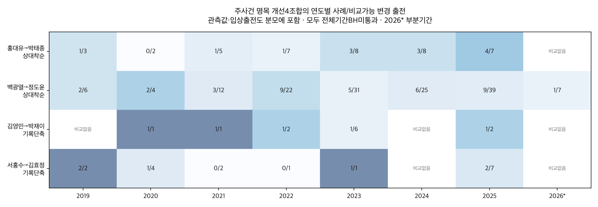

# 전체 마방 기수 조합의 비입상 개선과 변경 당일 성적

2026-10-13 · 연구50E · 전체 조합 후속 · 관찰 연구

2019~2025년 전체3,386개 관측 조합을 집계했다. 계획된 기수변경40,272출전 중 비입상은29,568건이며,상대착순 개선11,807건과 같은 지역·거리·등급의 기록 단축5,108건을 확인했다. 중복은3,166건이다. 비교표본이 충분한213개 조합을 말의 능력·직전 성적·편성·기수 수준·평소 조합 성적·직전 기록과 환경을 고려해 추정했다. 전체기간에서 다중비교를 통과한 유리한 조합은 없었다. 연도별·최근의 유리한 통계 신호도 해당기간 표본지원이 부족해 확정 개선으로 채택하지 않았다.

## 변경한 한 경주의 모든 개선 사례

입상은3위이내,비입상은4위이하다. 계획대로 기승했고 직전 실제 기수와 다른 현재기수인 출전만 변경으로 분류했다. 사후대타/미확정은 제외했다. 이후 출전·여러경주의 평균·최고성적을 교체 목표로 붙이지 않았다. 직전/최근 이력은 비교와 통제에만 쓴다. [44,341개 현재변경 이벤트](outputs/current_switch_event_cases.parquet)에는2019~2025년40,272건과2026부분4,069건의 현재결과·직전키·개선플래그·출처가 있다. [모든 관측 개선사례](outputs/all_observed_nonpodium_improvement_cases.parquet)는상대착순/단순착순/기록 중 하나라도 개선한 비입상 사건이다.

주표본은 기존 정상현재착순·같은조교사/지역·직전2~180일·기수ID지원·양기수전년도100회이상 지원 조건이다.2019~2025완결7년과2026부분(서울9/13·부산9/11)을 분리한다.2026은10월 현재까지의 전체자료가 아니다.3386개 과거 관측조합 모두를 [원시표](outputs/raw_period_pair_metrics.csv)에 남겼다. 개별보정은 변경/유지 각30출전·15말·20경주를 충족한 동결213개이며 나머지는 원시집계만 제공한다. 작은 조합의 효과가0이라는 뜻은 아니다.

| 기간 | 전체변경 | 비입상 | 상대착순 비교가능 비입상 | 상대착순 개선 | 단순착순 개선 | 기록 비교가능 비입상 | 기록단축 | 상대착순·기록 중복 | 상대착순 또는 기록 |
|---|---|---|---|---|---|---|---|---|---|
| 2019_2025 | 40272 | 29568 | 29515 | 11807 | 11141 | 11006 | 5108 | 3166 | 13749 |
| 2024_2025 | 12590 | 9249 | 9234 | 3688 | 3488 | 3448 | 1550 | 933 | 4305 |
| 2026_partial | 4069 | 2996 | 2984 | 1206 | 1178 | 1119 | 547 | 334 | 1419 |

주기간 비교가능 비입상29,515건 중 상대착순 개선11,807건은40.00%다. 같은조건의 기록 비교가능 비입상11,006건 중 기록단축5,108건은46.41%다. 두 사건의 중복3,166건을 제외하면13,749건이다. 단순착순 숫자 개선11,141건도 별도 확인했으며,상대착순/단순착순/기록 중 어느 하나의 관측개선은14,524건이다. 이는 사례수이며 보정된 기수변경의 효과가 아니다.

상대착순은 `(순위-1)/(출전수-1)`로 출전두수 변화까지 고려한다. 숫자 순위가 좋아져도 상대착순이 나빠질 수 있고 반대도 가능하므로 두 플래그를 따로 남겼다. 직전 비정상착순은 순위 비교에서 제외한다. 기록은 지역·거리·등급이 같고 양쪽 품질검증 기록이 유효할 때만 직전보다 단축됐는지 본다. 비교불가는 실패0이 아니다. 원시초에는 함수율 등 환경 차이가 포함돼 순수 능력 향상으로 부르지 않는다.

## 서로 다른 두 비교를 구분

첫째 주사건은 비교가능한 **전체 출전** 중 비입상하면서 직전보다 상대착순/기록이 개선되는 빈도다. 같은 조합 유지 대비 변경 당일에 이 사건이 얼마나 더 자주 발생하는지 보정했다. 입상하면 이 비입상 사건에는 포함되지 않으므로 사건 빈도가 높다고 전체 경기력이나 입상능력이 반드시 좋다는 뜻은 아니다. 원시표의 입상수/비입상 개선수/비입상 미개선/비교불가 분모를 함께 읽어야 한다.

둘째 보조결과는 **현재 비입상 출전만** 놓고 상대착순과 우승마 대비 시간차의 수준을 비교했다. 낮을수록 좋다. 이는 “비입상 집단 안에서 더 좋은 성적”이라는 별도 관찰 대조다. 비입상 여부도 교체와 능력의 영향을 받으므로 이 조건부 집단의 계수를 전체 교체의 인과효과로 일반화하지 않는다. 직접 직전 대비 개선사례 플래그와도 다른 질문이다.

두 비교 모두 말/현재경주FE,기수의지역×연도수준,마방주효과,213조합 평소주효과,일반변경항+조합별추가항을 사용한다. 직전 상대착순/입상·최근5회평균/관측수·공백·거리/등급변화·rating·나이·부담/마체중·상대게이트·직전기수전년도점수와 결측/제곱항을 고려했다. 실제직전행의 우승마시간차·품질기록·함수율·출전두수도 추가했다. 기록 평균회귀와 직전환경을 일부 고려하지만 새 일별주로빠르기 보정을 만들지는 않았다. 말능력FE는 각 분석기간 전체 관측으로 추정한 사후 통제이며 경주전 예측검증이 아니다.

## 전체기간에서 나온 모든 명목 개선 신호

아래는4개 목표 각각의 유리한 방향·개별p<.05인 모든 행이다. 주사건은 양수(단위%p),비입상 내 상대착순/시간차는 음수(0~1척도/초)가 유리하다. 효과의 크기를 서로 더하지 않는다. 결과별 표본지원 미달은 진단용이다.

| 조합 | 결과 | 기간 | 비교가능 변경/유지 | 보정차 | 95% 구간 | BH q | 지원 |
|---|---|---|---|---|---|---|---|
| 홍대유→박태종 | 비입상 상대착순 개선 사건 | 2019_2025 | 40/57 | +24.468 | +7.187~+41.748 | 0.593 | 충족 |
| 백광열→정도윤 | 비입상 상대착순 개선 사건 | 2019_2025 | 139/78 | +11.827 | +0.558~+23.096 | 0.9976 | 충족 |
| 김영민→박재이 | 비입상 같은조건 기록 단축 사건 | 2019_2025 | 12/7 | +71.855 | +22.966~+120.744 | 0.8546 | 부족 |
| 서홍수→김효정 | 비입상 같은조건 기록 단축 사건 | 2019_2025 | 17/26 | +39.574 | +2.113~+77.035 | 0.995 | 부족 |
| 김길중→이성재 | 비입상 내 상대착순 | 2019_2025 | 64/62 | -0.141 | -0.253~-0.030 | 0.611 | 충족 |
| 서홍수→빅투아르 | 비입상 내 상대착순 | 2019_2025 | 32/24 | -0.184 | -0.330~-0.037 | 0.611 | 부족 |
| 정호익→임다빈 | 비입상 내 상대착순 | 2019_2025 | 91/176 | -0.088 | -0.161~-0.015 | 0.645 | 충족 |
| 곽영효→박태종 | 비입상 내 상대착순 | 2019_2025 | 52/69 | -0.132 | -0.261~-0.003 | 0.982 | 충족 |
| 지용철→조한별 | 비입상 내 우승마 시간차 | 2019_2025 | 26/28 | -0.999 | -1.860~-0.138 | 0.9925 | 부족 |
| 권승주→박재이 | 비입상 내 우승마 시간차 | 2019_2025 | 31/21 | -0.850 | -1.659~-0.040 | 0.9925 | 부족 |

전체기간 유리한BH통과는0개다. 주사건의 홍대유→박태종/백광열→정도윤과 기록단축 사건의 김영민→박재이/서홍수→김효정은 개별신호일 뿐이다. 특히 기록비교가 가능한 변경/유지 수는 김영민→박재이12/7,서홍수→김효정17/26으로 부족하다. 비입상 내 상대착순에서는 김길중→이성재,곽영효→박태종,정호익→임다빈 등도 명목 개선 방향이지만 다중비교를 통과하지 못했다. 이전 입상률4개를 선정기준으로 사용하지 않았다.

## 연도별 최근에도 같은 방향인가

네 주사건 명목 후보의 연도별 원시 사건수와 비교가능 변경출전 수다. [모든 명목 후보의 연도별 보정구간](outputs/candidate_annual_tables.md)에는비입상 내 성적 후보도 포함했고,후보 밖213개 전체 연도계수는 [전체 계수표](outputs/all_adjusted_associations.csv)에 보존했다. 모든 연도·과거2019~2023·최근2024~2025·2026부분에서 명단을 고정했다. 연도별 말/경주FE는 해당연도 내에서 재추정되므로7년 공동모형의 동일능력 추정과 같지 않다.

홍대유→박태종은 최근완결2년 비입상 순위개선7건/비교가능 변경15건이며 사건 보정차+23.27%p(95%+0.91~+45.62,q=.7347)다. 최근에도 방향은 양수지만 변경15/유지24로 표본지원이 부족하고2026부분은 대상이 없다. 백광열→정도윤은최근15건/64건,보정차+7.71%p(95%-11.14~+26.56,q=1)다.2026부분은 변경7건 중 상대착순개선1건이나 유지0건으로 대조를 추정할 수 없다.

김영민→박재이의최근 기록단축 사건은 비교가능 변경2건 중1건이며 유지2건이다. 서홍수→김효정은최근 비교가능 변경7건 중2건,유지11건이다. 해당 기록 사건의 최근 보정구간은 모두0을 포함한다. 비입상 내 상대착순의 김길중→이성재는최근-0.285(95%-0.497~-0.073) 신호가 있지만213조합q=.9191이며 변경14/유지13으로 부족하다. 정호익→임다빈은최근-0.074구간에0이 포함되고2026부분은+0.016구간에도0이 포함한다. 유리한 과거 점추정이 현재까지 이어졌다고 확정할 근거는 없다.

## 작은 연도 표본에서 나온 통계적 신호

각 기간/목표213개,같은모형의 두목표426개 BH와7개연도를 함께 묶은1491/2982개 BH를 제공한다. 추정불가p는1,계수는NA다. 아래는유리한 값과 불리한 값을 포함한 **모든 결과별BH통과 행**이다. 기간별 지원 미달과 매우 큰 계수를 숨기지 않았다.

| 조합 | 결과 | 기간 | 비교가능 변경/유지 | 보정차 | 95% 구간 | BH q | 지원 |
|---|---|---|---|---|---|---|---|
| 박재우→장추열 | 비입상 내 상대착순 | 2019_2025 | 20/23 | +0.333 | +0.157~+0.509 | 0.04519 | 부족 |
| 홍대유→박을운 | 비입상 상대착순 개선 사건 | 2020 | 3/1 | -175.948 | -252.031~-99.865 | 0.00358 | 부족 |
| 심승태→김정준 | 비입상 상대착순 개선 사건 | 2022 | 3/2 | +84.401 | +42.174~+126.627 | 0.0259 | 부족 |
| 권승주→정우주 | 비입상 상대착순 개선 사건 | 2023 | 7/1 | -144.653 | -215.990~-73.316 | 0.02063 | 부족 |
| 서홍수→다비드 | 비입상 상대착순 개선 사건 | 2024 | 1/4 | +79.040 | +37.843~+120.237 | 0.04643 | 부족 |
| 울즐리→채상현 | 비입상 같은조건 기록 단축 사건 | 2024 | 5/2 | -108.771 | -138.933~-78.608 | 9.121e-09 | 부족 |
| 안병기→임기원 | 비입상 상대착순 개선 사건 | 2025 | 1/2 | +86.418 | +42.349~+130.487 | 0.03407 | 부족 |
| 방동석→유현명 | 비입상 같은조건 기록 단축 사건 | 2025 | 1/1 | -391.135 | -544.007~-238.264 | 0.0002671 | 부족 |
| 임금만→정동철 | 비입상 상대착순 개선 사건 | 2024_2025 | 1/2 | -116.941 | -183.608~-50.275 | 0.04525 | 부족 |
| 안병기→임기원 | 비입상 상대착순 개선 사건 | 2024_2025 | 2/2 | +95.724 | +58.026~+133.423 | 0.0002127 | 부족 |
| 서홍수→다비드 | 비입상 상대착순 개선 사건 | 2024_2025 | 1/4 | +80.073 | +42.309~+117.836 | 0.004217 | 부족 |
| 방동석→유현명 | 비입상 같은조건 기록 단축 사건 | 2024_2025 | 1/1 | -318.678 | -440.639~-196.716 | 0.0001055 | 부족 |
| 안우성→정도윤 | 비입상 같은조건 기록 단축 사건 | 2024_2025 | 2/5 | -107.271 | -159.295~-55.248 | 0.006755 | 부족 |
| 서홍수→이동하 | 비입상 내 우승마 시간차 | 2026_partial | 3/1 | -5.899 | -8.440~-3.359 | 0.002466 | 부족 |
| 김영관→유현명 | 비입상 내 상대착순 | 2019 | 4/5 | -1.314 | -1.950~-0.679 | 0.01541 | 부족 |
| 민장기→유현명 | 비입상 내 우승마 시간차 | 2019 | 6/1 | +4.219 | +2.231~+6.206 | 0.01012 | 부족 |
| 전승규→유승완 | 비입상 내 상대착순 | 2020 | 4/3 | -1.373 | -2.021~-0.724 | 0.01473 | 부족 |
| 곽영효→이혁 | 비입상 내 상대착순 | 2022 | 1/1 | +1.383 | +0.765~+2.000 | 0.004044 | 부족 |
| 곽영효→이혁 | 비입상 내 우승마 시간차 | 2022 | 1/1 | +4.501 | +2.405~+6.597 | 0.008332 | 부족 |

연도별·최근BH신호 중표본지원을충족한 유리한행은없다. 최근 안병기→임기원/서홍수→다비드의사건신호나2026서홍수→이동하의시간차신호도 변경/유지 수가2/2,1/4,3/1처럼 극히작다. 확률계수±1초과나 상대착순 차이±1초과가 나오는 작은 셀은 회귀 외삽의 불안정성이며 실제확률/순위 차이로 적용하지 않는다.95%구간 자체는 다중비교 동시구간이 아니다. 과거/최근 점추정의 차이만으로 시기변화의 유의성을 주장하지 않는다.

## 검증과 보존

독립SQL로실제직전슬롯·정의·30,708원시그룹·44,341현재변경행을 확인했다. 정확FE/SVD와 다른 전체희소LSQR로기본28+연도조건부추가16=44모형의 모든 식별 가능한213조합대조를 재현했다. 사전규칙의 전체기간구간과 모든기간BH구간도 독립검증했다. 기본4,623,787항목과추가332,427항목 통과. [기본검증](outputs/verification.json) · [연도조건부검증](outputs/conditional_annual_verification.json).

분모가부족한조합·비교불가기록·식별불가를0효과로처리하지않았다.기수선택의미관측판단과최초카드불변성미인증한계가남는다. 연구용관찰결과이며승부의지·인과적개선·미래예측개선은입증하지않았다.기존50/50A/50B/50C/50D보존,후속50E등록. 운영모델·DB·배포변경없음.

[모든 원시 조합](outputs/raw_period_pair_metrics.csv) · [결과별분모](outputs/target_pair_support.csv) · [모든모형 계수](outputs/all_adjusted_associations.csv) · [결과가족 요약](outputs/family_summary.csv) · [출처와 재실행](SOURCES.md) · [게시용 요약](PUBLICATION.md) · [게시 JSON](outputs/publication.json) · [용량명세](outputs/artifact_inventory.json)
