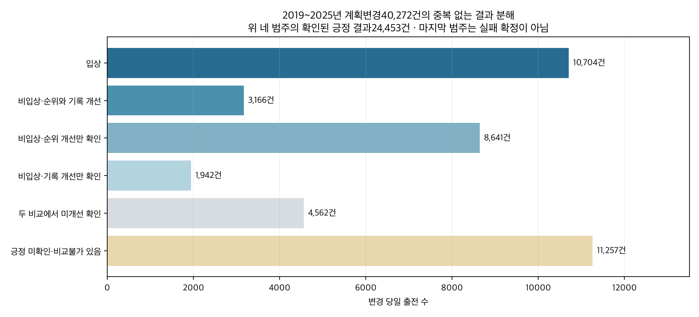
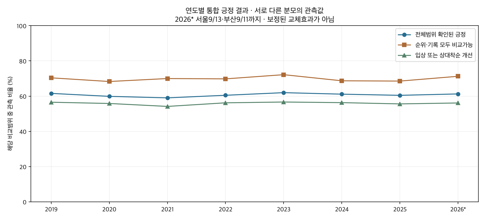
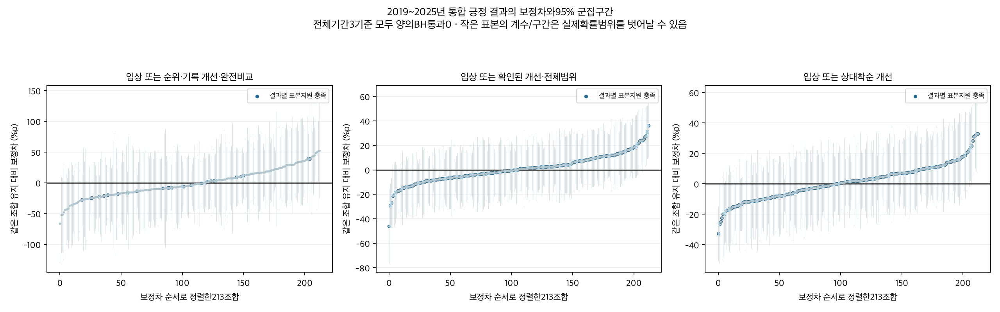

# 입상 또는 비입상 개선을 합친 기수변경 당일 성적

2026-10-13 · 연구50F · 50E 후속 · 관찰 연구

입상과 비입상 개선을 합치면2019~2025년 계획변경40,272건 중 확인된 긍정 결과는24,453건(60.72%)이다. 순위·기록을 모두 비교할 수 있는15,094건에서는10,532건(69.78%)이다. 전체3,386개 관측 조합을 집계하고213개 비교지원 조합을 능력·직전 성적 등을 보정했다. 통합해도 전체기간에서 다중비교를 통과한 양의 조합은 없었다. 연도별·최근의 통계 신호도 해당기간 표본지원이 부족해 최근까지 좋아지는 조합으로 확정하지 않았다.

## 변경한 한 경주의 결과를 중복 없이 합산

긍정 결과는 현재3위이내 입상하거나,비입상했어도 직전보다 상대착순 또는 같은조건 기록이 좋아진 경우다. 입상과 개선이 겹치거나 순위와 기록이 동시에 좋아져도1건으로만 센다. 직전/최근 성적은 비교·통제에 사용하며 이후 출전이나 이후 평균·최고성적을 교체 사건의 목표로 붙이지 않았다. [44,341개 현재변경 이벤트](outputs/current_switch_combined_events.parquet)와 [확인된 긍정 이벤트](outputs/all_confirmed_positive_current_events.parquet)에 행키·현재결과·직전키·분해플래그·출처를 보존했다.

2019~2025년 전체3,386개 관측 조합을 집계하고 변경/유지 각30출전·15말·20경주를 충족한213개를 결과와 무관하게 동결했다. 작은 조합도 [원시표](outputs/raw_period_pair_metrics.csv)에 남겼으며 효과0으로 처리하지 않았다.2026부분까지 관측 조합은3,604개다. 주표본은 정상현재착순·같은조교사/지역·직전2~180일·기수ID·양기수전년도100회이상 지원·계획대로 기승 조건이다. 사후대타/미확정은 제외한다.2026은 서울9/13·부산9/11까지이며10월 현재의 전체자료가 아니다.

주기간 입상10,704건에 비입상 상대착순/기록 개선13,749건을 더해24,453건이다. 비입상 중 둘다 개선3,166건은 중복해서 더하지 않았다. 비입상 순위개선만 확인8,641건,기록개선만 확인1,942건이다. 이 “만 확인”에는 다른 비교가 불가능한 경우도 있어 다른 측면이 미개선이라고 확정한 뜻은 아니다.

## 기록 비교불가를 실패로 바꾸지 않는 세 기준

**주분석 완전비교 통합:** 직전 상대착순과 같은지역·거리·등급의 양쪽 품질기록이 모두 비교가능한 집단에서 입상 또는 비입상 순위/기록개선을 본다. 이 비교조건은 입상한 말에도 동일하게 요구한다. 주기간 변경15,094건 중10,532건(69.78%)이 긍정이다.

**전체범위 확인된 긍정:** 전체 변경40,272건에서 입상 또는 확인된 순위/기록개선이 하나라도 있으면 긍정으로 센다. 나머지 중4,562건은 두비교에서 미개선이 확인됐지만11,257건은 하나이상 비교불가여서 긍정을 확인하지 못한 상태다. 회귀에서0은 “확인된 긍정 없음”이지 모두 실제실패라는 뜻이 아니다. 자료기회에 민감한 보조기준으로만 읽는다. 순위/기록 비교가능 표시도 통제에 추가했다.

**입상 또는 상대착순 개선:** 직전 상대착순을 비교할 수 있는 변경40,200건에서22,492건(55.95%)이 긍정이다. 기록 기회에 의존하지 않는 비교범위 진단이다. 상대착순은 `(순위-1)/(출전수-1)`로 낮을수록 좋다. 기록단축은 지역·거리·등급이 같고 품질기록이 유효할 때만 정의하며 원시초에는 함수율 등 환경 차이가 포함된다.

세기준은 분모가 달라 비율만으로 우열을 비교하지 않는다. 알려진 양성만 살리고 비교불가 음성을 제외하는 선택적 표본으로 회귀하지 않았다. 입상과 작은 순위개선을 모두1로 세는 혼합사건이므로 종합능력·우승확률·개선정도 점수도 아니다.

| 기간 | 전체변경 | 확인된긍정 | 전체확인율 | 두비교가능 | 그중긍정 | 완전비교율 | 긍정미확인·비교불가 |
|---|---|---|---|---|---|---|---|
| 2019_2025 | 40272 | 24453 | 60.72% | 15094 | 10532 | 69.78% | 11257 |
| 2019_2023 | 27682 | 16807 | 60.71% | 10386 | 7302 | 70.31% | 7791 |
| 2024_2025 | 12590 | 7646 | 60.73% | 4708 | 3230 | 68.61% | 3466 |
| 2026_partial | 4069 | 2492 | 61.24% | 1576 | 1123 | 71.26% | 1124 |

## 말의 능력과 직전 성적을 고려한 차이

보정차의 기준은 같은 마방–현재기수 조합의 기수 유지 대비 계획변경 당일이다. 말/현재경주FE,현재기수지역×연도 수준,마방주효과,213조합 평소주효과,일반변경항+조합별추가항을 사용했다. 직전 상대착순/입상·최근5회평균/관측수·공백·거리/등급변화·rating·나이·부담/마체중·상대게이트·직전기수전년도점수와 결측/제곱항을 고려했다. 실제직전행의 우승마시간차·품질기록·함수율·출전두수와 두비교가능 표시도 추가했다. 새로운 일별주로빠르기 보정은 만들지 않았다.

말능력FE는 각기간 전체 관측으로 추정한 사후 통제다. 목표가 변경한 한 경주라는 것과 통제추정이 경주전 정보만 쓴다는 것은 다르다. 경주전 예측검증이나 기수 선택의 미관측 판단까지 제거한 인과효과가 아니다. 연도별FE는 그연도 내에서 재추정해7년 공동FE와 같은 능력 추정이 아니다.

## 전체기간의 모든 명목 긍정 신호

아래는 각기준의 양수·개별p<.05인 모든17행(13조합)이다. 유리한 값만 확정효과로 승격하지 않았다. 결과별 출전/말/경주 지원도 표시한다.

| 조합 | 통합 기준 | 기간 | 변경/유지 비교수 | 보정차%p | 95% 구간 | BH q | 지원 |
|---|---|---|---|---|---|---|---|
| 하무선→권오찬 | 입상 또는 순위·기록 개선·완전비교 | 2019_2025 | 11/24 | +49.06 | +11.70~+86.42 | 0.9604 | 부족 |
| 장세한→김어수 | 입상 또는 순위·기록 개선·완전비교 | 2019_2025 | 12/29 | +51.87 | +2.77~+100.98 | 0.9604 | 부족 |
| 송문길→김정준 | 입상 또는 순위·기록 개선·완전비교 | 2019_2025 | 22/57 | +42.81 | +1.86~+83.77 | 0.9604 | 부족 |
| 홍대유→박태종 | 입상 또는 확인된 개선·전체범위 | 2019_2025 | 40/57 | +30.97 | +9.05~+52.90 | 0.3191 | 충족 |
| 지용철→조한별 | 입상 또는 확인된 개선·전체범위 | 2019_2025 | 30/34 | +36.21 | +10.41~+62.01 | 0.3191 | 충족 |
| 최봉주→박태종 | 입상 또는 확인된 개선·전체범위 | 2019_2025 | 69/105 | +24.12 | +3.99~+44.24 | 0.67 | 충족 |
| 이희영→신형철 | 입상 또는 확인된 개선·전체범위 | 2019_2025 | 32/49 | +27.76 | +3.56~+51.96 | 0.6909 | 충족 |
| 강환민→김용근 | 입상 또는 확인된 개선·전체범위 | 2019_2025 | 63/79 | +23.76 | +2.12~+45.39 | 0.6909 | 충족 |
| 김동균→조한별 | 입상 또는 확인된 개선·전체범위 | 2019_2025 | 36/39 | +26.87 | +2.25~+51.50 | 0.6909 | 충족 |
| 홍대유→조상범 | 입상 또는 확인된 개선·전체범위 | 2019_2025 | 40/45 | +25.15 | +1.68~+48.62 | 0.6925 | 충족 |
| 홍대유→박태종 | 입상 또는 상대착순 개선 | 2019_2025 | 40/57 | +31.77 | +10.04~+53.51 | 0.4488 | 충족 |
| 김동균→조한별 | 입상 또는 상대착순 개선 | 2019_2025 | 35/39 | +31.20 | +8.04~+54.36 | 0.4733 | 충족 |
| 지용철→조한별 | 입상 또는 상대착순 개선 | 2019_2025 | 30/34 | +32.90 | +8.27~+57.53 | 0.4733 | 충족 |
| 홍대유→조상범 | 입상 또는 상대착순 개선 | 2019_2025 | 40/45 | +33.02 | +7.01~+59.03 | 0.55 | 충족 |
| 권승주→신윤섭 | 입상 또는 상대착순 개선 | 2019_2025 | 47/39 | +28.42 | +4.53~+52.30 | 0.7018 | 충족 |
| 민장기→최은경 | 입상 또는 상대착순 개선 | 2019_2025 | 71/105 | +21.14 | +2.80~+39.47 | 0.7271 | 충족 |
| 토니→안토니오 | 입상 또는 상대착순 개선 | 2019_2025 | 42/55 | +24.04 | +2.10~+45.98 | 0.8454 | 충족 |

주분석의 장세한→김어수,하무선→권오찬,송문길→김정준은 기록까지 비교할 수 있는 변경/유지가12/29,11/24,22/57로 부족하며 BH q=.9604다. 전체범위에서는 지용철→조한별,홍대유→박태종,홍대유→조상범,최봉주→박태종 등7개 명목신호가 있지만 모두BH를 통과하지 못했다. 입상+상대착순 기준의7개 신호도 미통과다. 전체기간에서3기준 모두 양의BH통과0개다.

## 최근에도 좋아지는 조합인가

[후보의 모든 연도와 최근 표](outputs/candidate_annual_tables.md)는17대조를 모두 보여준다. [전체 계수표](outputs/all_pair_period_comparison.csv)에는 후보 밖을 포함해213조합×3기준×11기간=7,029행이 있다. 연도별·과거2019~2023·최근2024~2025·2026부분 모두 명단을 고정해 재추정했다. 같은 자료를 나눈 사후분석이며 독립 사전예측 검증은 아니다.

전체범위 확인된 긍정의 홍대유→박태종은 전체+30.97%p에서 최근+29.57%p(95%-7.07~+66.21,q=1)로 양수 방향이다. 홍대유→조상범은 최근+44.27%p(95%+12.52~+76.02,q=.2285),김동균→조한별은최근+69.83%p(95%+20.99~+118.68,q=.2227),강환민→김용근은최근+47.71%p(95%+2.67~+92.75,q=.6873) 신호다. 하지만 변경/유지가 각각18/25,7/15,16/12로 작고 다중비교를 통과하지 못했다. 김동균→조한별은2026부분 대상 출전도 없다.

2026부분에서 강환민→김용근은2변경으로 보정구간에0을 포함한다. 홍대유→조상범은5/3으로 구간이 넓다. 주분석 후보들도 현재기간 비교부족/미식별이 남는다. 최근 양의 방향이 있다는 것과 최근까지 확인된 개선 규칙은 구분한다. 과거/최근 점추정 차이만으로 시기변화의 유의성을 선언하지 않는다.

| 조합 | 통합 기준 | 기간 | 변경/유지 비교수 | 보정차%p | 95% 구간 | BH q | 지원 |
|---|---|---|---|---|---|---|---|
| 지용철→조한별 | 입상 또는 확인된 개선·전체범위 | 2019_2025 | 30/34 | +36.21 | +10.41~+62.01 | 0.3191 | 충족 |
| 이희영→신형철 | 입상 또는 확인된 개선·전체범위 | 2019_2025 | 32/49 | +27.76 | +3.56~+51.96 | 0.6909 | 충족 |
| 홍대유→박태종 | 입상 또는 확인된 개선·전체범위 | 2019_2025 | 40/57 | +30.97 | +9.05~+52.90 | 0.3191 | 충족 |
| 홍대유→조상범 | 입상 또는 확인된 개선·전체범위 | 2019_2025 | 40/45 | +25.15 | +1.68~+48.62 | 0.6925 | 충족 |
| 최봉주→박태종 | 입상 또는 확인된 개선·전체범위 | 2019_2025 | 69/105 | +24.12 | +3.99~+44.24 | 0.67 | 충족 |
| 김동균→조한별 | 입상 또는 확인된 개선·전체범위 | 2019_2025 | 36/39 | +26.87 | +2.25~+51.50 | 0.6909 | 충족 |
| 강환민→김용근 | 입상 또는 확인된 개선·전체범위 | 2019_2025 | 63/79 | +23.76 | +2.12~+45.39 | 0.6909 | 충족 |
| 지용철→조한별 | 입상 또는 확인된 개선·전체범위 | 2024_2025 | 0/0 | — | 추정불가 | 1 | 부족 |
| 이희영→신형철 | 입상 또는 확인된 개선·전체범위 | 2024_2025 | 8/13 | +28.25 | -19.42~+75.92 | 1 | 부족 |
| 홍대유→박태종 | 입상 또는 확인된 개선·전체범위 | 2024_2025 | 15/24 | +29.57 | -7.07~+66.21 | 1 | 부족 |
| 홍대유→조상범 | 입상 또는 확인된 개선·전체범위 | 2024_2025 | 18/25 | +44.27 | +12.52~+76.02 | 0.2285 | 부족 |
| 최봉주→박태종 | 입상 또는 확인된 개선·전체범위 | 2024_2025 | 21/61 | +15.25 | -20.82~+51.32 | 1 | 부족 |
| 김동균→조한별 | 입상 또는 확인된 개선·전체범위 | 2024_2025 | 7/15 | +69.83 | +20.99~+118.68 | 0.2227 | 부족 |
| 강환민→김용근 | 입상 또는 확인된 개선·전체범위 | 2024_2025 | 16/12 | +47.71 | +2.67~+92.75 | 0.6873 | 부족 |
| 지용철→조한별 | 입상 또는 확인된 개선·전체범위 | 2026_partial | 0/0 | — | 추정불가 | 1 | 부족 |
| 이희영→신형철 | 입상 또는 확인된 개선·전체범위 | 2026_partial | 0/0 | — | 추정불가 | 1 | 부족 |
| 홍대유→박태종 | 입상 또는 확인된 개선·전체범위 | 2026_partial | 0/0 | — | 추정불가 | 1 | 부족 |
| 홍대유→조상범 | 입상 또는 확인된 개선·전체범위 | 2026_partial | 5/3 | -17.51 | -144.68~+109.65 | 1 | 부족 |
| 최봉주→박태종 | 입상 또는 확인된 개선·전체범위 | 2026_partial | 0/0 | — | 추정불가 | 1 | 부족 |
| 김동균→조한별 | 입상 또는 확인된 개선·전체범위 | 2026_partial | 0/0 | — | 추정불가 | 1 | 부족 |
| 강환민→김용근 | 입상 또는 확인된 개선·전체범위 | 2026_partial | 2/14 | +7.92 | -46.27~+62.10 | 1 | 부족 |

## 모든 연도별 통계 신호와 지원

목표별/기간별213개,3목표 공동639개 BH와7개연도를 묶은1491/4473개 BH를 제공했다. 추정불가p는1,계수는NA다. 아래는 유리한 값과 불리한 값을 모두 포함한 모든 결과별BH통과 행이다.

| 조합 | 통합 기준 | 기간 | 변경/유지 비교수 | 보정차%p | 95% 구간 | BH q | 지원 |
|---|---|---|---|---|---|---|---|
| 곽영효→유승완 | 입상 또는 확인된 개선·전체범위 | 2020 | 8/2 | +107.49 | +53.21~+161.77 | 0.03844 | 부족 |
| 정호익→김동수 | 입상 또는 확인된 개선·전체범위 | 2022 | 23/2 | -81.68 | -126.07~-37.30 | 0.04072 | 부족 |
| 박재우→장추열 | 입상 또는 확인된 개선·전체범위 | 2022 | 1/1 | -90.20 | -134.78~-45.62 | 0.02156 | 부족 |
| 임금만→박재이 | 입상 또는 확인된 개선·전체범위 | 2023 | 8/2 | +98.19 | +65.12~+131.26 | 5.893e-06 | 부족 |
| 민장기→최시대 | 입상 또는 확인된 개선·전체범위 | 2024 | 4/1 | +180.12 | +113.38~+246.87 | 7.599e-05 | 부족 |
| 박재우→정정희 | 입상 또는 상대착순 개선 | 2024_2025 | 6/1 | -109.54 | -160.92~-58.16 | 0.007681 | 부족 |
| 전승규→김용근 | 입상 또는 확인된 개선·전체범위 | 2026_partial | 6/15 | -107.51 | -155.51~-59.51 | 0.004702 | 부족 |
| 안우성→정도윤 | 입상 또는 상대착순 개선 | 2026_partial | 8/3 | +121.71 | +58.53~+184.90 | 0.04809 | 부족 |

유리한 통계신호 중 해당기간 표본지원을 충족한 행은 없다. 예를 들어2026안우성→정도윤의 입상+상대착순 신호는변경8/유지3이고3목표공동q=.0721로 미통과다. 매우작은 연도 셀의 회귀계수±1초과는 실제확률 차이로 적용할 수 없는 외삽 불안정성이다.95%구간은 다중비교 동시구간이 아니다.

## 검증과 보존

독립SQL로 OR/결측/중복 분해,실제직전슬롯,30,708원시그룹,44,341현재변경행을 확인했다. 정확FE/SVD와 다른 전체희소LSQR로33모형의 모든 식별가능 대조를 재현하고 사전규칙의 전체기간 구간 및 모든기간BH구간을 독립검증했다. 7,560,122항목 통과. [검증](outputs/verification.json) · [모형진단](outputs/model_diagnostics.csv).

기록/이력이 부족한 출전을 실제실패로 단정하지 않고 비교불가와 미식별을 표시했다. 기수 선택의 미관측 상태·최초카드 불변성 미인증 한계가 남는다. 승부의지·인과적개선·미래예측개선은 입증하지 않았다. 기존50~50E를 보존하고50F후속으로 등록하며 운영모델·DB·배포는 변경하지 않았다.

[모든 원시 조합](outputs/raw_period_pair_metrics.csv) · [결과별분모](outputs/target_pair_support.csv) · [검정가족 요약](outputs/family_summary.csv) · [출처와 재실행](SOURCES.md) · [게시용 요약](PUBLICATION.md) · [게시 JSON](outputs/publication.json) · [용량명세](outputs/artifact_inventory.json)
