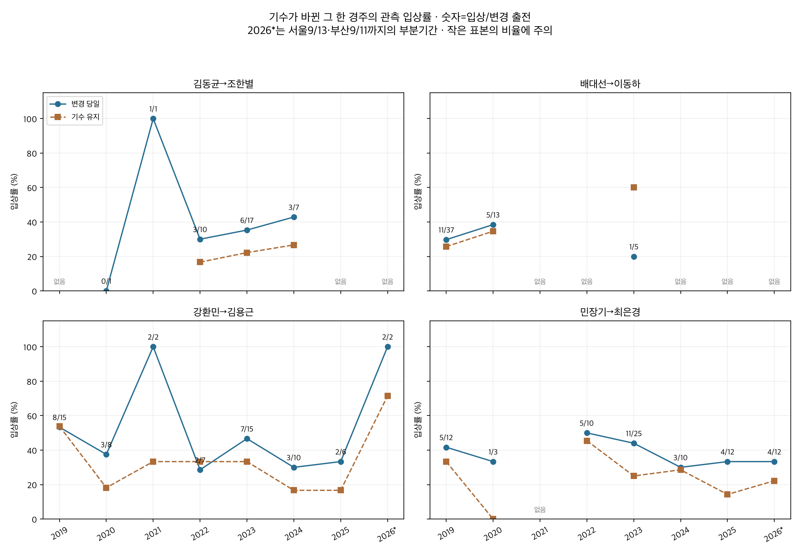
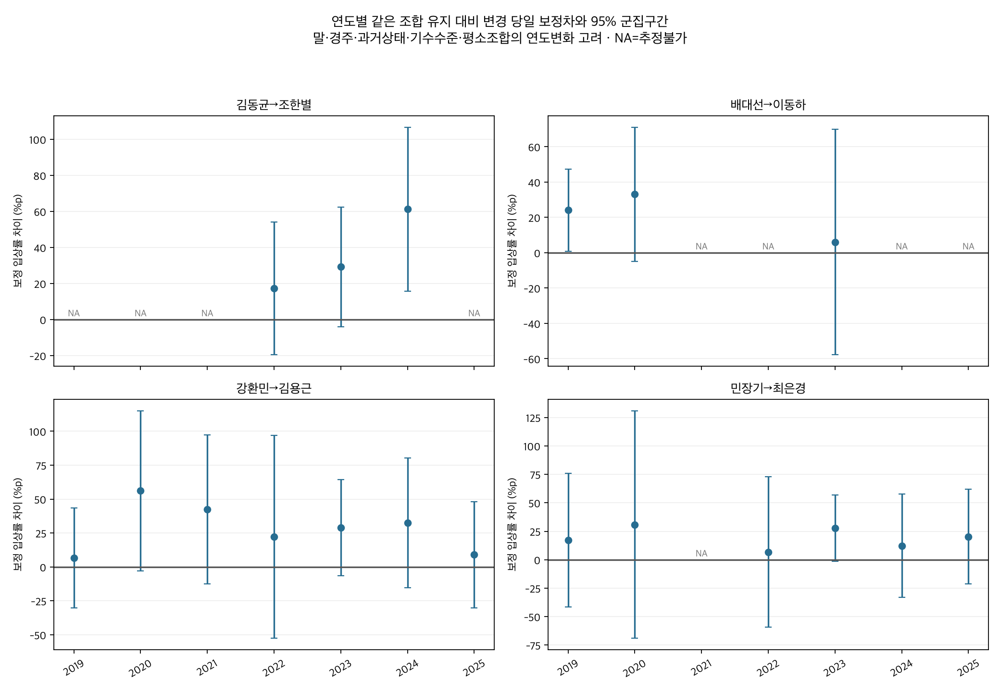

# 네 마방 기수 조합의 연도별 변경 당일 성적

2026-10-13 · 연구50D · 50C 후속 · 사후 선택된 후보의 탐색 분석

네 개 후보를 연도별로 나누면 최근까지 개선이 확정적으로 이어졌다고 판단할 조합은 없다. 배대선→이동하의 자료는2019~2020년에 집중되고2024~2026년에는 대상 출전이 없다. 김동균→조한별은2024년까지 신호가 있으나 그 해 변경7회뿐이며2025~2026년 대상 출전이 없다. 강환민→김용근과 민장기→최은경은 최근 완결2년에도 보정 입상률 차이의 추정 방향은 양수이나 불확실성이 크다.2026부분기간에서도 각각 변경2회와12회여서 현재의 개선조합으로 확정할 수 없다.

## 변경된 한 경주만 비교

대상은50C에서7년 전체 입상률 보정차 양수·개별p<.05였던 네 조합이다. 이들은 원래213개 조합의 다중비교를 통과하지 못했다. 이번 결과도 그 사실을 바꾸는 독립 확인으로 취급하지 않는다. 출전표에 예정된 기수가 실제 그대로 기승하고 직전 실제 기수와 달라진 경우만 변경으로 본다. 카드 발표 후 대타와 미확정은 제외했다. **변경한 바로 그 현재 한 경주**의 결과만 분석했다. 이후 출전·이후 평균·최고성적을 이벤트 성과로 연결하지 않았다. 직전·최근5회는 비교/통제 변수다. 네 조합의 변경240건(2019~2025년226건,2026부분14건) 전필드가 원본의 현재행과 같은지 검증했다.

서울·부산2019~2025 완결7년을 주기간으로 유지한다. 최근은2024~2025완결2년과2026부분을 각각 표시한다.2026은 서울9월13일·부산9월11일까지 계획대로 기승 지원이 있는 표본이며 올해 전체나10월 현재까지의 결과가 아니다. 주표본은 정상현재착순·같은조교사/지역·직전2~180일·기수ID지원·양기수전년도100회이상 기승지원 조건이다. 무출전은 이 연구 조건의 대상 부재이며 현역 여부를 뜻하지 않는다. 결과 확인 뒤 원본 전체의 조합 출전도 별도 점검해 배대선→이동하2024~2026과 김동균→조한별2025~2026의 부재가100회 조건 때문은 아님을 확인했다. [조건별 분모 점검](outputs/population_coverage_diagnostic.csv)은 보정모형과 구분한다.

| 모형 | 배경출전 | 전체변경 | 말 | 경주 | 네 조합 변경 | 시작 | 종료 |
|---|---|---|---|---|---|---|---|
| annual | 79551 | 40272 | 9322 | 11296 | 226 | 2019-01-04 | 2025-12-28 |
| eras | 79551 | 40272 | 9322 | 11296 | 226 | 2019-01-04 | 2025-12-28 |
| recent_partial | 8674 | 4069 | 2347 | 1255 | 14 | 2026-01-02 | 2026-09-13 |

## 연도별 관측 성적

관측 당일율은 변경출전 집단의 현재3위이내 비율이다. 직전율은 동일 집단 직전 결과의 원시율이며 직전 유효분모가 다를 수 있다. 원시표에 직전 유효수와 그에 짝지은 당일율을 별도로 보관했다. 유지율은 같은 마방–기수 조합으로 계속 기승한 별도 출전의 현재 입상률이다. 원시 직전→당일 또는 변경−유지 차이가 보정효과는 아니다.2020/2021년의1~3회 표본에서 나온0%/100%를 재현 가능한 규칙으로 취급하지 않는다.

### 김동균와 조한별

| 연도 | 변경/유지 | 직전율 | 당일 입상/출전 | 당일율 | 유지율 | 보정차%p | 95% 구간 | 탐색q | 지원 |
|---|---|---|---|---|---|---|---|---|---|
| 2019 | 0/0 | — | 없음 | — | — | — | 추정불가 | 1.0000 | 무출전 |
| 2020 | 1/0 | 0.0% | 0/1 | 0.0% | — | — | 추정불가 | 1.0000 | 유지 비교/식별 부족 |
| 2021 | 1/0 | 0.0% | 1/1 | 100.0% | — | — | 추정불가 | 1.0000 | 유지 비교/식별 부족 |
| 2022 | 10/6 | 22.2% | 3/10 | 30.0% | 16.7% | +17.32 | -19.56~+54.20 | 0.9085 | 표본 부족·진단용 |
| 2023 | 17/18 | 5.9% | 6/17 | 35.3% | 22.2% | +29.20 | -3.99~+62.40 | 0.4110 | 표본 부족·진단용 |
| 2024 | 7/15 | 0.0% | 3/7 | 42.9% | 26.7% | +61.24 | +15.77~+106.71 | 0.2339 | 표본 부족·진단용 |
| 2025 | 0/0 | — | 없음 | — | — | — | 추정불가 | 1.0000 | 무출전 |

### 배대선와 이동하

| 연도 | 변경/유지 | 직전율 | 당일 입상/출전 | 당일율 | 유지율 | 보정차%p | 95% 구간 | 탐색q | 지원 |
|---|---|---|---|---|---|---|---|---|---|
| 2019 | 37/35 | 27.0% | 11/37 | 29.7% | 25.7% | +24.14 | +0.87~+47.42 | 0.4110 | 기준 충족 |
| 2020 | 13/26 | 23.1% | 5/13 | 38.5% | 34.6% | +33.05 | -4.94~+71.04 | 0.4110 | 표본 부족·진단용 |
| 2021 | 0/0 | — | 없음 | — | — | — | 추정불가 | 1.0000 | 무출전 |
| 2022 | 0/0 | — | 없음 | — | — | — | 추정불가 | 1.0000 | 무출전 |
| 2023 | 5/5 | 0.0% | 1/5 | 20.0% | 60.0% | +6.07 | -57.78~+69.93 | 1.0000 | 표본 부족·진단용 |
| 2024 | 0/0 | — | 없음 | — | — | — | 추정불가 | 1.0000 | 무출전 |
| 2025 | 0/0 | — | 없음 | — | — | — | 추정불가 | 1.0000 | 무출전 |

### 강환민와 김용근

| 연도 | 변경/유지 | 직전율 | 당일 입상/출전 | 당일율 | 유지율 | 보정차%p | 95% 구간 | 탐색q | 지원 |
|---|---|---|---|---|---|---|---|---|---|
| 2019 | 15/26 | 33.3% | 8/15 | 53.3% | 53.8% | +6.56 | -30.29~+43.41 | 1.0000 | 표본 부족·진단용 |
| 2020 | 8/11 | 25.0% | 3/8 | 37.5% | 18.2% | +56.15 | -2.81~+115.10 | 0.4110 | 표본 부족·진단용 |
| 2021 | 2/3 | 0.0% | 2/2 | 100.0% | 33.3% | +42.39 | -12.63~+97.42 | 0.4580 | 표본 부족·진단용 |
| 2022 | 7/9 | 14.3% | 2/7 | 28.6% | 33.3% | +22.20 | -52.62~+97.01 | 1.0000 | 표본 부족·진단용 |
| 2023 | 15/18 | 26.7% | 7/15 | 46.7% | 33.3% | +28.95 | -6.54~+64.44 | 0.4388 | 표본 부족·진단용 |
| 2024 | 10/6 | 20.0% | 3/10 | 30.0% | 16.7% | +32.51 | -15.43~+80.45 | 0.5712 | 표본 부족·진단용 |
| 2025 | 6/6 | 83.3% | 2/6 | 33.3% | 16.7% | +9.07 | -30.04~+48.19 | 1.0000 | 표본 부족·진단용 |

### 민장기와 최은경

| 연도 | 변경/유지 | 직전율 | 당일 입상/출전 | 당일율 | 유지율 | 보정차%p | 95% 구간 | 탐색q | 지원 |
|---|---|---|---|---|---|---|---|---|---|
| 2019 | 12/6 | 8.3% | 5/12 | 41.7% | 33.3% | +17.17 | -41.49~+75.83 | 1.0000 | 표본 부족·진단용 |
| 2020 | 3/5 | 0.0% | 1/3 | 33.3% | 0.0% | +30.91 | -69.07~+130.88 | 1.0000 | 표본 부족·진단용 |
| 2021 | 0/0 | — | 없음 | — | — | — | 추정불가 | 1.0000 | 무출전 |
| 2022 | 10/11 | 10.0% | 5/10 | 50.0% | 45.5% | +6.71 | -59.36~+72.79 | 1.0000 | 표본 부족·진단용 |
| 2023 | 25/20 | 16.7% | 11/25 | 44.0% | 25.0% | +27.82 | -1.23~+56.86 | 0.4110 | 표본 부족·진단용 |
| 2024 | 10/42 | 30.0% | 3/10 | 30.0% | 28.6% | +12.32 | -33.05~+57.68 | 1.0000 | 표본 부족·진단용 |
| 2025 | 12/21 | 8.3% | 4/12 | 33.3% | 14.3% | +20.29 | -21.20~+61.78 | 0.9085 | 표본 부족·진단용 |

## 능력과 직전 성적을 고려한 연도별 차이

50C와 같은 말/현재경주 고정효과,현재기수의 지역×연도 수준,마방 주효과,213개 지원조합 평소 주효과,일반변경항+조합별변경 추가항과 직전/최근 상태 통제를 사용했다. 네 후보의 평소조합 주효과와 변경 추가항만 연도별로 달라지도록 허용했다. 따라서 보정차는 **그 연도의 같은 조합 유지 대비 변경 당일 입상률 차이**다. 네 조합 밖209개에는 기간 공통 조합 계수를 유지한다.

직전 상대착순/입상,최근5회 평균과 관측수,공백,거리/등급 변화,rating,나이,부담중량,마체중,상대게이트,직전기수 전년도 수준과 결측/제곱항을 고려했다. 말능력 고정효과는 전체 분석기간의 관측에서 추정한 사후 통제이며 경주전 예측모형이 아니다. 이후 출전을 교체의 목표성과로 쓰는 것과 능력통제 추정에 분석기간 전체를 사용하는 것은 구분한다. 기수 선택의 보이지 않는 판단까지 제거한 인과효과도 아니다.

95%구간은 말/날짜 두 방향 군집분산의 보수적인 값이다. 주결과 연도별28개·3결과 공동84개에 BH를 제공하며 추정불가 p는1로 두고 고정분모를 유지했다. 별도의기간8개/기간차4개/2026부분4개 가족도 사전에 정했다. 모두 원래의 후보선정 뒤에 한 탐색검정으로 원래213조합의 선택 편향을 없애지 않는다. 선형확률모형의 소표본 계수나 구간은±100%p를 벗어날 수 있으며 실제 확률·가산점으로 사용하지 않는다.

## 과거와 최근의 비교

연도별로 분모가 작으므로 사전에 정한2019~2023대2024~2025 두 기간 모형에서도 네 후보의 평소조합/변경항을 기간별로 허용했다. 그 외 말·경주·과거상태 통제는 유지한다.2026은 별도 해당기간 모형을 재추정했으며 사전예측 검증이 아니다.

| 조합 | 기간 | 변경/유지 | 변경 입상/출전 | 변경 당일율 | 유지율 | 보정차%p | 95% 구간 | 탐색q | 지원 |
|---|---|---|---|---|---|---|---|---|---|
| 김동균→조한별 | 2019_2023 | 29/24 | 10/29 | 34.5% | 20.8% | +26.48 | -0.39~+53.35 | 0.1068 | 표본 부족·진단용 |
| 김동균→조한별 | 2024_2025 | 7/15 | 3/7 | 42.9% | 26.7% | +61.29 | +15.83~+106.75 | 0.0642 | 표본 부족·진단용 |
| 김동균→조한별 | 2026_partial | 0/0 | 없음 | — | — | — | 추정불가 | 1.0000 | 무출전 |
| 배대선→이동하 | 2019_2023 | 55/66 | 17/55 | 30.9% | 31.8% | +23.82 | +3.13~+44.51 | 0.0642 | 기준 충족 |
| 배대선→이동하 | 2024_2025 | 0/0 | 없음 | — | — | — | 추정불가 | 1.0000 | 무출전 |
| 배대선→이동하 | 2026_partial | 0/0 | 없음 | — | — | — | 추정불가 | 1.0000 | 무출전 |
| 강환민→김용근 | 2019_2023 | 47/67 | 22/47 | 46.8% | 38.8% | +26.13 | +3.90~+48.36 | 0.0642 | 기준 충족 |
| 강환민→김용근 | 2024_2025 | 16/12 | 5/16 | 31.3% | 16.7% | +23.30 | -9.92~+56.51 | 0.2253 | 표본 부족·진단용 |
| 강환민→김용근 | 2026_partial | 2/14 | 2/2 | 100.0% | 71.4% | +36.27 | -27.41~+99.95 | 1.0000 | 표본 부족·진단용 |
| 민장기→최은경 | 2019_2023 | 50/42 | 22/50 | 44.0% | 28.6% | +23.15 | -2.52~+48.82 | 0.1233 | 기준 충족 |
| 민장기→최은경 | 2024_2025 | 22/63 | 7/22 | 31.8% | 23.8% | +15.54 | -11.76~+42.85 | 0.3020 | 표본 부족·진단용 |
| 민장기→최은경 | 2026_partial | 12/18 | 4/12 | 33.3% | 22.2% | -3.05 | -55.33~+49.24 | 1.0000 | 표본 부족·진단용 |

최근−과거는 두 기간 공동모형에서2024~2025변경차−2019~2023변경차다. 양수면 보정차가 최근에 더 크다는 추정이다. 단순히 두 점추정의 부호나 크기가 다르다는 이유로 시기 변화가 확인됐다고 선언하지 않는다.

| 조합 | 최근−과거 보정차%p | 95% 구간 | 탐색q |
|---|---|---|---|
| 김동균→조한별 | +34.81 | -18.10~+87.72 | 0.7877 |
| 배대선→이동하 | — | 추정불가 | 1.0000 |
| 강환민→김용근 | -2.84 | -41.21~+35.54 | 1.0000 |
| 민장기→최은경 | -7.60 | -46.20~+30.99 | 1.0000 |

## 조합별 해석

**김동균→조한별:**2019년 대상이 없고2020/2021년은 변경1회씩,유지0회여서 연도 대조가 식별되지 않는다.2022년3/10입상,2023년6/17,2024년3/7로 변경 당일 관측률은 올라가는 방향이다. 보정치 역시2024년에 양수 신호가 있지만7회에 불과하다.2024년 상대착순 차이-0.505(95%-0.728~-0.283),우승마와 시간차-1.376초(95%-2.143~-0.609)로 순위와 기록에서도 개선 신호가 있다. 연도별4×7 탐색BH q는각각.000263/.012638,3결과 공동q는.000790/.018957다. 최근−과거 상대착순 차이도-0.434(95%-0.709~-0.159,탐색q=.0081)다. 다만 변경7/유지15출전으로 지원기준 미달이며 후보를 고른 뒤의 탐색 결과다.2025~2026년은 대상 출전이 없어 현재까지 유지된다는 결론을 낼 수 없다.

**배대선→이동하:**55변경 중50회(90.9%)가2019~2020년에 몰렸다.2019년11/37,2020년5/13,2023년1/5다.2023년에는 변경20%·유지60%여도5회씩이라 단정할 수 없다.2024~2026년 표본이 없어 과거의 신호를 현재에도 유효하다고 적용할 근거가 없다.

**강환민→김용근:**변경 당일 관측 입상률은2019~2023년46.8%(22/47)에서2024~2025년31.3%(5/16)로 낮아졌다. 그러나 유지율도38.8%→16.7%로 달라졌고 말/경주/직전상태를 고려한 보정차는 최근에도 양수다. 최근−과거 구간에0이 포함돼 보정효과가 약해졌거나 강해졌다고 확정할 수 없다.2026부분은2변경 모두 입상했지만 유지도14회 중10회 입상했다. 보정차+36.27%p의95%구간은-27.41~+99.95로 넓고 변경2회뿐이어서 재현 가능한 확정 이점으로 취급하지 않는다.

**민장기→최은경:**변경 당일율은 과거44.0%(22/50)→최근31.8%(7/22)로 낮아졌지만 보정차의 추정 방향은 두 기간 모두 양수다. 최근−과거 구간에0이 포함돼 원시율 하락을 조합효과 약화로 단정하지 않는다.2026부분은 변경4/12입상(33.3%)·유지4/18입상(22.2%)이나 보정차-3.05%p(95%-55.33~+49.24)다. 원시율은 높아도 능력과 편성 등을 고려한 방향은 약한 음수로 바뀌며 구간이 넓다. 변경12회에 그치므로 악화나 개선 모두 확정하지 않는다.

## 순위 기록과 검증

연간100회 지원 제한만 해제한2026부분 범위점검에서는 강환민→김용근2/3입상,민장기→최은경4/13입상이다. 주표본의2/2와4/12보다 분모가 조금 늘지만 여전히 작다. 이 부록은 보정 없는 범위점검이며 새로운 개선효과 추정으로 사용하지 않는다. 상대착순 `(순위-1)/(출전수-1)`과 공식우승마 대비 시간차(초)는 음수가 개선이다. 보조결과까지 포함한 모든 연도/기간/기간차/2026계수와 고정분모 BH를 [전체 계수표](outputs/adjusted_period_effects.csv)에 남겼다. 시간차를 전 거리 공통 초 가산점으로 채택하지 않는다.

| 모형 | 결과 | 대조 | 고정검정수 | 식별수 | 개별신호 | 유리한BH | 3결과유리BH | 지원충족 |
|---|---|---|---|---|---|---|---|---|
| annual | finish_p | pair_total | 28 | 19 | 2 | 1 | 1 | 1 |
| annual | time_gap | pair_total | 28 | 19 | 2 | 1 | 1 | 1 |
| annual | top3 | pair_total | 28 | 19 | 2 | 0 | 0 | 1 |
| eras | finish_p | pair_total | 8 | 7 | 1 | 1 | 1 | 3 |
| eras | finish_p | recent_minus_earlier | 4 | 3 | 1 | 1 | 1 | 0 |
| eras | time_gap | pair_total | 8 | 7 | 1 | 1 | 1 | 3 |
| eras | time_gap | recent_minus_earlier | 4 | 3 | 1 | 0 | 0 | 0 |
| eras | top3 | pair_total | 8 | 7 | 3 | 0 | 0 | 3 |
| eras | top3 | recent_minus_earlier | 4 | 3 | 0 | 0 | 0 | 0 |
| recent_partial | finish_p | pair_total | 4 | 2 | 0 | 0 | 0 | 0 |
| recent_partial | time_gap | pair_total | 4 | 2 | 0 | 0 | 0 | 0 |
| recent_partial | top3 | pair_total | 4 | 2 | 0 | 0 | 0 | 0 |

독립 SQL로 실제 직전 슬롯과80개 원시표 격자를 재계산하고240변경행의 현재 결과·출처를 전수 확인했다. 정확한 고정효과 투영/SVD와 다른 전체 희소LSQR로3모형×3결과의 모든 식별 가능한 대조를 재현하고 입상률 전구간 및 보조결과BH신호의 군집구간을 재계산했다. 330,965항목 검증 통과. [검증](outputs/verification.json) · [모형진단](outputs/model_diagnostics.csv).

기존지원기준은 변경과 유지 각각≥30출전·≥15말·≥20경주다. 연도로 나누면 많은 셀이 미달한다. 식별 가능성과 충분한 표본지원은 다르며 작은 셀의 계수를0효과나 확정효과로 바꾸지 않았다. 처음 게시된 카드의 불변성 미인증,선택 편향과 미관측 마필 상태 한계도 유지한다. 기존50C는 보존하고50D후속으로 등록하며 운영모델/DB/배포는 변경하지 않는다.

[출처와 재실행](SOURCES.md) · [게시용 요약](PUBLICATION.md) · [게시 JSON](outputs/publication.json) · [모든연도표](outputs/all_annual_top3.md) · [용량명세](outputs/artifact_inventory.json)
