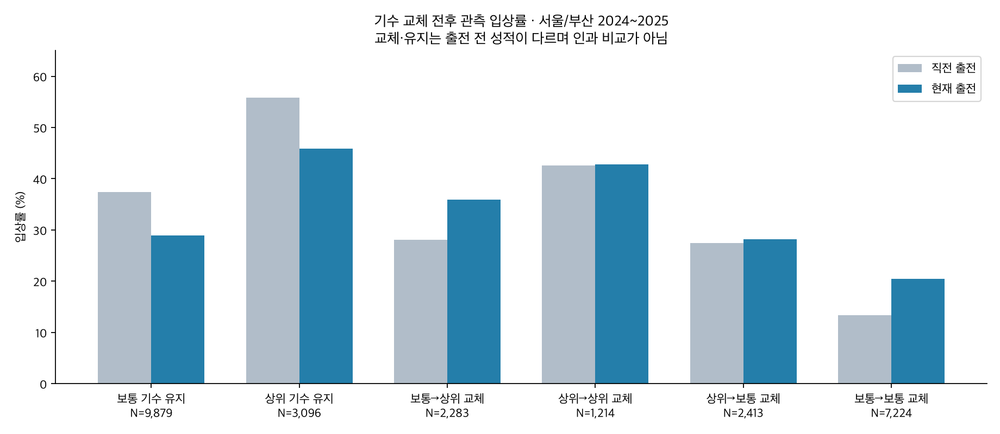
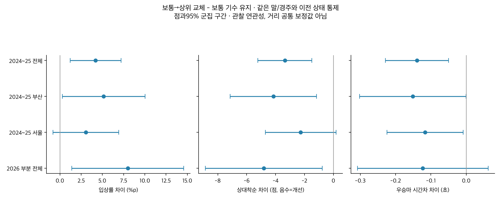
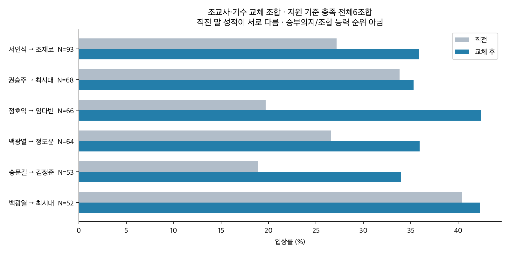

# 기수 교체·상위 기수와 조교사 기용 관계

2026-10-12 · 서울·부산 · 관찰 연구 후보 · 운영 미반영

**상위 기수로 교체되는 출전에는 성적 개선 연관성이 있다. 그러나 ‘기수 교체는 조교사·마주의 승부의지다’라는 명제는 직접 입증되지 않는다.**

2024~2025 서울·부산 주표본26,109출전 중 보통→상위 교체2,283출전의 입상률은35.87%, 보통 기수 유지9,879출전은28.90%였다. 같은 말·현재 편성·이전 성적·휴양·거리/등급 변화·중량 등을 고려하면 차이는 **+4.21%p(95% +1.21~+7.21%p, q=0.022)**다. 기존에 좋은 말이 상위 기수에게 배정되는 부분을 고려해도 이 표본에서 양의 연관성이 남았다.

반면 모든 교체를 합치면 입상률은26.62%, 유지는32.66%다. 교체 전 성적도20.75%와41.82%로 크게 다르다. 부진 뒤 기수 교체, 좋은 성적 뒤 기수 유지라는 선택과 평균으로의 회귀가 섞여 있어, 교체 전후 반등을 전부 기수나 의지의 효과로 볼 수 없다.

| 구분 | 출전 | 현재 입상률 | 동일 출전쌍의 직전→현재 입상률 | 상대착순 개선 |
|---|---|---|---|---|
| 보통 기수 유지 | 9,879 | 28.90% | 37.37% → 28.92% | -7.43점 |
| 상위 기수 유지 | 3,096 | 45.90% | 55.81% → 45.90% | -7.62점 |
| 보통→상위 교체 | 2,283 | 35.87% | 28.09% → 35.89% | +3.91점 |
| 상위→상위 교체 | 1,214 | 42.83% | 42.59% → 42.83% | -1.05점 |
| 상위→보통 교체 | 2,413 | 28.18% | 27.43% → 28.17% | +0.56점 |
| 보통→보통 교체 | 7,224 | 20.42% | 13.34% → 20.43% | +5.51점 |

입상은3위 이내. 전후 입상률은 직전 정상 결과가 있는 동일 출전쌍의 분모다. 전체 현재율과 미세하게 다를 수 있다. 상대착순 개선은 직전 상대착순−현재 상대착순×100이며 양수일수록 개선이다.

보통→상위 교체의 상대착순은 통제 후 **3.36점 개선**되는 연관성(0=1위·100=최후위)이 남았다. 현재 경주 우승마와의 전체시간 차이는 **0.140초 작았다**(시간차 차이95% -0.229~-0.050초). 이 수치는 관측 거리들을 섞은 회귀 평균이다. 거리별10개 지원 조합에서는 모두 신뢰구간에0이 포함되어 **말 기록에서 일괄0.14초를 빼는 보정표로 쓸 근거는 부족하다**. 같은 지역·정확 거리·등급을 연속 출전한 경우의 원시 시간 변화도 별도 표에 남겼으며, 날짜·주로·편성이 바뀌는 기술량이다.

상위 기수 교체와 상위 기수 유지의 조정 차이는 **+0.19%p(95% -4.28~+4.66%p)**로 구분되지 않았다. 이는 결과를 본 뒤 추가한 탐색 대비다. 기수 수준의 연관성과 ‘이번에 바꿨으니 특별한 의지가 추가됐다’는 설명은 분리해야 한다.

| 기간 | 지역 | 조정 입상률 차이 | 95% 구간 | BH q |
|---|---|---|---|---|
| 2024_2025 | 전체 | +4.21%p | +1.21~+7.21%p | 0.022 |
| 2024_2025 | 부산 | +5.16%p | +0.28~+10.03%p | 0.089 |
| 2024_2025 | 서울 | +3.06%p | -0.81~+6.93%p | 0.298 |
| 2026_partial | 전체 | +8.00%p | +1.41~+14.58%p | 0.062 |
| 2026_partial | 부산 | +5.95%p | -3.47~+15.37%p | 0.881 |
| 2026_partial | 서울 | +10.47%p | +2.11~+18.83%p | 0.052 |

특정 기수로 바뀐 경우에도 관측 차이가 있었다. 다음4명은 원자료에서 높은 기수 등급을 가진 대표 사례이며, 최소100교체·30말·30경주를 충족한 전체54명 표를 별도로 공개한다.

| 교체 후 기수 | 지역 | 교체 출전 | 직전→현재 입상률 | 상대착순 개선 |
|---|---|---|---|---|
| 김혜선 | 부산 | 289 | 22.15% → 38.75% | +12.51점 |
| 다실바 | 부산 | 341 | 37.83% → 47.21% | +3.06점 |
| 서승운 | 부산 | 290 | 44.83% → 56.90% | +3.61점 |
| 문세영 | 서울 | 284 | 42.25% → 52.11% | +4.45점 |

이 수치는 그 기수의 전체 기승 입상률이 아니라 **연구 조건을 충족한 교체 출전**의 입상률이다. 같은 기수가 계속 타던 출전과 비교한 기수별 통제 모형에서는54명과 기타집단을 포함한 모든 비교에서 다중비교 후 입상률의 추가 교체 효과가 확정되지 않았다. 특정 기수 기용 자체와 ‘교체했으므로 특별히 달라지는 효과’를 혼동하지 않는다.

전년도 조교사의 최다 기용 기수를 선호 후보로 정했다(조교사50회·그 기수20회 이상, 점유율15% 이상). 이미 교체한 출전 중 선호기수 기용은1,054출전·입상30.17%, 기타는7,195출전·27.28%다. 같은 말·경주·기수 수준·기존 상태를 고려한 차이는 **-2.53%p(95% -9.91~+4.84%p)**로 추가 이점을 확인하지 못했다.

아래는 최소50교체·20말·20경주를 충족한 **모든6조합**이다. 해당 기수로 바꾸기 전 말 성적이 서로 다르므로 조합 능력이나 승부의지 순위가 아니다. 표본이 작은 기술표이며 쌍별 인과효과는 추정하지 않았다.

| 조교사→기수 | 지역 | 교체 출전 | 직전→현재 입상률 |
|---|---|---|---|
| 서인석→조재로 | 서울 | 93 | 27.17% → 35.87% |
| 권승주→최시대 | 부산 | 68 | 33.82% → 35.29% |
| 정호익→임다빈 | 서울 | 66 | 19.70% → 42.42% |
| 백광열→정도윤 | 부산 | 64 | 26.56% → 35.94% |
| 송문길→김정준 | 서울 | 53 | 18.87% → 33.96% |
| 백광열→최시대 | 부산 | 52 | 40.38% → 42.31% |

동일 마주 출전만 남긴 민감도에서도 상위 교체 차이는+4.30%p(95% +1.28~+7.33%p)였다. 마주별 지시·사전 승부 계획·기수의 당일 가용성·부상/기승정지 정보는 없어 조교사와 마주의 의지를 각각 분리할 수 없다.

관측 사례는 표본이 가장 큰4조합에서 입상·비입상 각각 첫 날짜를 고른 것이다. 좋은 사례만 고르지 않았다.

- 2024-01-07 서울 1800m 티즈에너지: 서인석 조교사·조재로 기수로 교체, 직전 9위 → 현재 4위. 예시일 뿐 성공률 추정은 위 전체 표본으로 한다.
- 2024-01-07 서울 1400m 신한특송: 서인석 조교사·조재로 기수로 교체, 직전 1위 → 현재 2위. 예시일 뿐 성공률 추정은 위 전체 표본으로 한다.
- 2024-01-05 부산 1300m 홀리윙즈: 권승주 조교사·최시대 기수로 교체, 직전 7위 → 현재 10위. 예시일 뿐 성공률 추정은 위 전체 표본으로 한다.
- 2024-02-16 부산 1300m 차이밍런: 권승주 조교사·최시대 기수로 교체, 직전 2위 → 현재 1위. 예시일 뿐 성공률 추정은 위 전체 표본으로 한다.
- 2024-01-07 서울 1300m 마루스타: 정호익 조교사·임다빈 기수로 교체, 직전 9위 → 현재 9위. 예시일 뿐 성공률 추정은 위 전체 표본으로 한다.
- 2024-01-27 서울 1300m 토종글로리: 정호익 조교사·임다빈 기수로 교체, 직전 7위 → 현재 3위. 예시일 뿐 성공률 추정은 위 전체 표본으로 한다.
- 2024-03-01 부산 1800m 아델호랑이: 백광열 조교사·정도윤 기수로 교체, 직전 5위 → 현재 7위. 예시일 뿐 성공률 추정은 위 전체 표본으로 한다.
- 2024-02-16 부산 1200m 사바하: 백광열 조교사·정도윤 기수로 교체, 직전 1위 → 현재 1위. 예시일 뿐 성공률 추정은 위 전체 표본으로 한다.

2026은 서울9월20일·부산9월18일까지의 부분연도다. 합산 조정 입상률은양의 방향이지만, 다중비교 q가0.05를 넘고 시간차 구간은0을 포함한다. 같은9월18일까지의 연도별 추가 분석도 표로 보존했으며, 기간별 효과 크기 변화나 독립 재현을 확정하지 않았다. 상위30%로 완화하면 입상 차이 구간이0을 포함한다. 같은 마주·직전 정상 결과·730일·최소50회 기준은 대체로 양의 방향이다.

같은 말 고정효과도 당일 컨디션·조교 상태·출전 계획·기수 가용성에 의한 배정 선택을 제거하지 못한다. 실제 조교사/마주의 의사결정 원문이 없어 승부의지의 정답 라벨이 없다. 기용 변화와 성과의 관계를 확인한 연구이며, 승부의지 감지나 미래 예측 개선을 검증한 연구가 아니다.

기록을 읽을 때는 ‘승부의지 확정’ 대신 **기수 수준 변화·해당 말과의 재기승·조교사 기용 점유율·교체 전 부진/휴양/승급**을 함께 보는 근거로 쓸 수 있다. 다음 모델 시험에는 이 과거 입력들의 추가 예측 가치를 따로 검증해야 한다.

[전체 방법](../20261012_jockey_switch_trainer_intent/README.md) · [출처](../20261012_jockey_switch_trainer_intent/SOURCES.md) · [기수 전체표](../20261012_jockey_switch_trainer_intent/outputs/destination_jockey_metrics.csv) · [조교사 조합](../20261012_jockey_switch_trainer_intent/outputs/trainer_jockey_pair_metrics.csv) · [검증](../20261012_jockey_switch_trainer_intent/outputs/verification.json).

[연구 원본](../20261012_jockey_switch_trainer_intent/README.md) · [용량](../20261012_jockey_switch_trainer_intent/outputs/artifact_inventory.json). 새 독립 연구, 기존 결론 보존.
